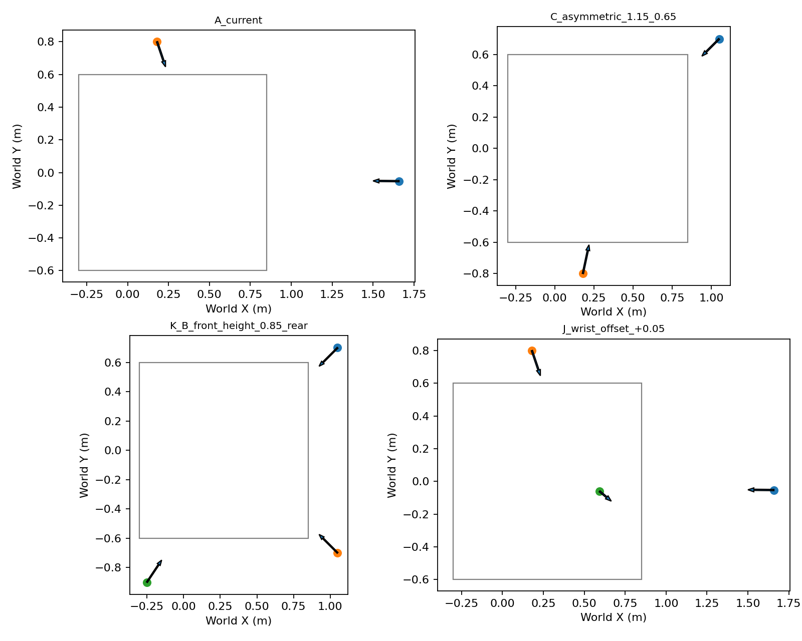
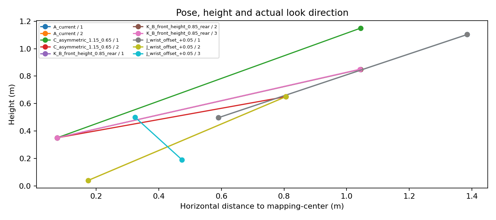
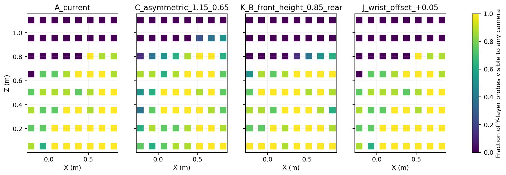
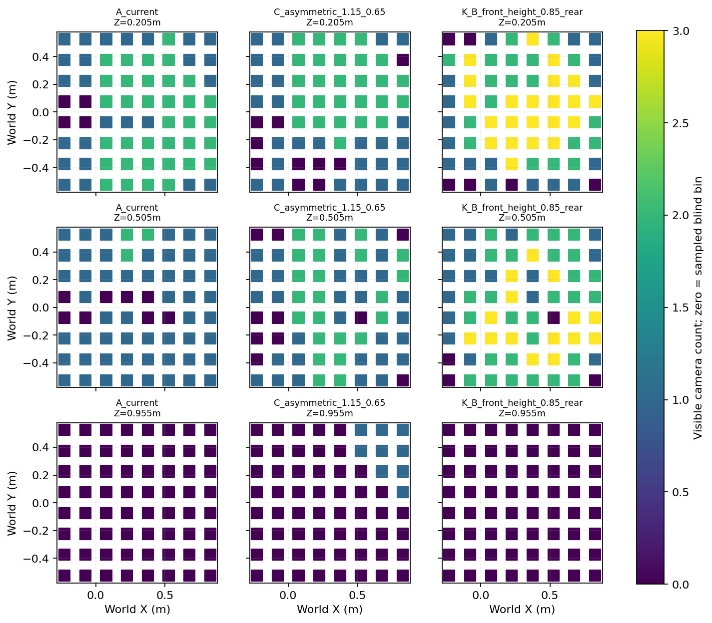
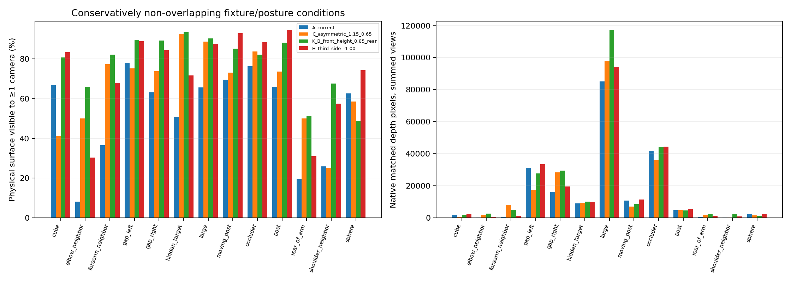
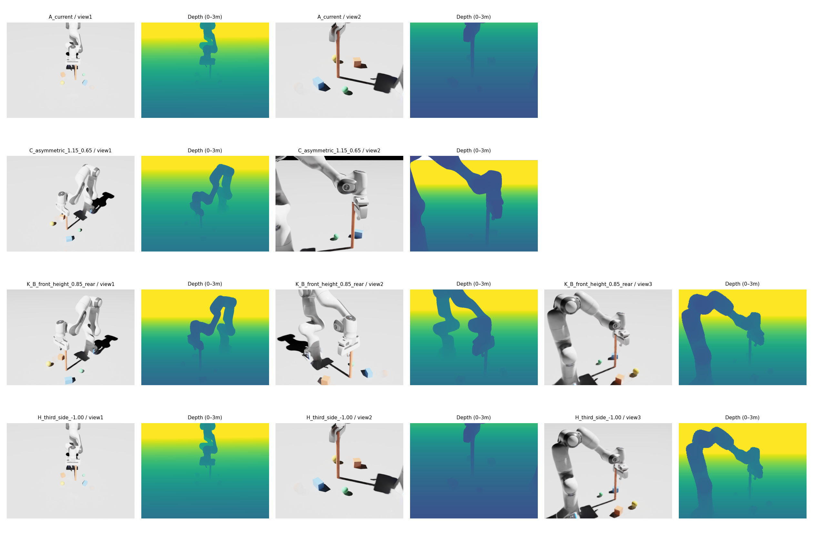
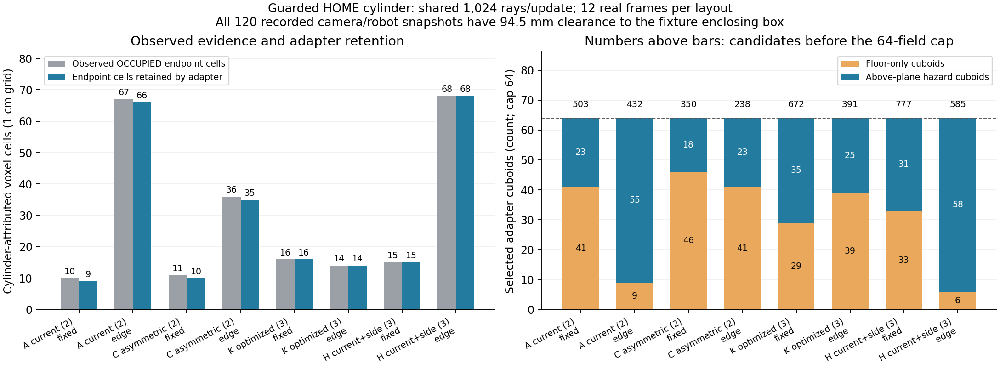
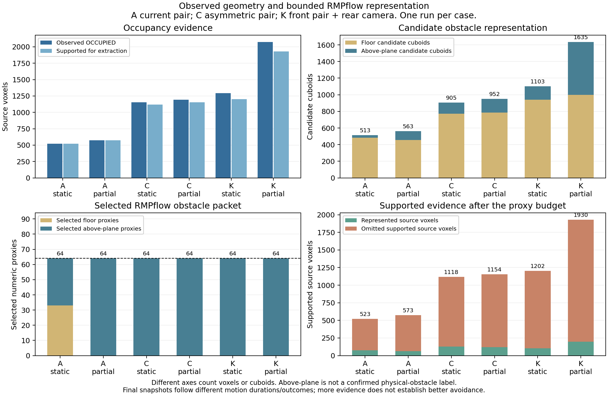
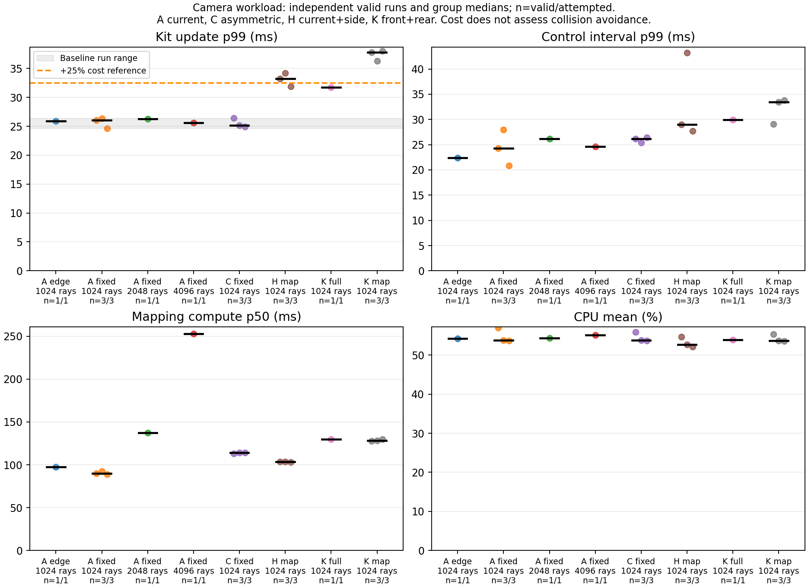
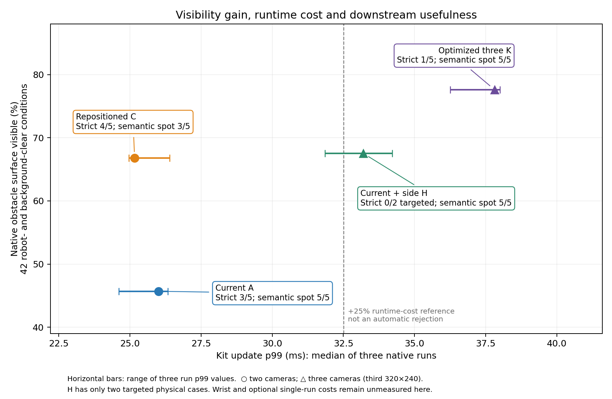

# Camera observability, positioning and performance feasibility

Research branch: `research/camera-observability-feasibility`. Production baseline:
`8e56b163650b66e940eb39a2ab8f5684bbd08c10`; local research parent:
`39780c2a9725be5fbaa7fd0e937ced3922b52d79`, which adds only the reusable camera
smoke benchmark. No production camera layout, sampler, occupancy model,
controller, motion strategy, grasp planner or scene has been adopted or changed.

**Recommendation:** retain the validated production arrangement while refining
the repositioned two-camera candidate under semantic-FOV and narrow-passage
constraints. More visible geometry improved neither every motion nor every
representation. The study completed 450 native RGB-D views, 38 physical
motion trials and 16 valid runtime windows; no production change is proposed.

## 1. Baseline and evidence

The current scene has two fixed 640×480 RGB-D cameras, semantic observations at
5 Hz, mapping at 2 Hz, stride 8 and **1,024 total selected mapping rays**. Semantic
and mapping computation remain independent subprocesses. The 64-proxy limit,
one-second freshness limits and V2b exact self-filter/temporal support remain
unchanged. UNKNOWN is traversable uncertainty, not an invented obstacle.

Historical [selection](assets/multiview_final/selection.json),
[selected layout](assets/multiview_final/selected-layout.json) and
[checkpoint](assets/multiview_final/checkpoint.json) optimized semantic object
perception. V2b's [physical evaluation](assets/motion_planning_v2b/evaluation.json),
[sampling probe](assets/motion_planning_v2b/sampling_phase_probe.json),
[source timings](assets/motion_planning_v2b/source_timing.json) and
[obstacle composition](assets/motion_planning_v2b/obstacle_composition.json)
established improved source availability but mixed RGB-D avoidance. The public
Lula probe showed representation-dependent collision policy influence; its
natural force/metric values are not physical Newtons.

There are two historical camera baselines. The validated scene's exact authored
optical transforms define **A_current** here. V2b's diagnostic `EYES` are a
different pair; replay of those inputs is explicitly labeled V2b reference.
The earlier smoke test used authored A: Kit p99 25.61 ms, third rendering-only
35.38 ms, third mapping 31.61 ms, repeated A 23.32 ms, all near 5/2 Hz. Those
single-run values are context, not pooled with the new repetitions.

## 2. Positioning methodology

We screened **42 candidate entries** in families A–J, plus optimized pair/triple
combinations: 41 unique nominal pose configurations, with one shared height/aim
sweep anchor. Historical front-corner and asymmetric configurations were reused
as seeds. Height, horizontal range, lateral spacing and aim-height sweeps retain
other coordinates where practical. A look-at camera's pitch and azimuth change
when its position changes; these curves are not a complete independent factorial
experiment. The separate aim-height sweep holds XYZ fixed to study pitch.

The screen uses actual calibrated intrinsics and robot triangle meshes, analytic
fixture intersections, line of sight and area-weighted surface quadrature. It
includes the full mapping bounds, probes near fingertips, hand, wrist, forearm,
elbow, shoulder and an ordinary motion-path neighborhood. The 15 cm workspace
probe bins are visualization samples, not occupancy cells or a continuous swept
volume proof. Surface visibility, multi-view overlap, weak link regions,
per-object coverage and worst posture remain separate components. The shortlist
uses a componentwise Pareto comparison rather than an opaque combined score.
The weak-arm statistic is the mean across postures of the minimum visibility
among shoulder, elbow, forearm and wrist probe groups. Link/grid heatmaps test
robot and original scene-background occlusion; scenario fixture occlusion is
measured separately in the physical-surface comparisons. AABB-face probes may
lie inside an adjacent link, so they are diagnostic context rather than verified
physical obstacle placements. The primary native object conditions are checked
for conservative non-overlap.

Five legitimate direct postures—Home, hover, extended, raised and low—were
captured with actual exposure-matched mesh poses. Their actual TCP and joint
positions matched **bitwise across all four native layouts**. Nine scenes cover
empty space, cube/sphere, thin cylinder, large obstruction, narrow gap, object
occlusion, robot occlusion, an entering-path snapshot and upper-arm hazards.
The entering-path visibility snapshot is not a dynamic planner experiment.

Visibility fixtures are render-only: their surfaces appear in genuine GPU depth,
but cannot disturb the arm. Separate planner fixtures retain physical colliders.
An initial collider-equipped capture disturbed later posture moves; it is kept
as a failed setup and excluded. Of 65 object/posture conditions, 54 passed the
same conservative robot/fixture overlap check. Those **54 common conditions**
exclude robot/fixture intersections. A later independent background-intersection
audit found four fixture/background pairs overlapping in the synthetic scene.
A stricter **42-condition target subset** excludes those targets as well and is
the primary recommendation comparison. All 54 and all 65 remain available as
sensitivity/stress evidence. Occluders can be static rendered volume unions;
this is distinct from the separately validated physical planner scenes.

Native pixel returns match analytic depth within 5 mm; sampled surface checks
use 8 mm and front-facing normals. Predictions are compared with rendered
depth, including occlusion and invalid returns. Exact per-object raw projected,
valid, visible and occluded pixel counts are in
[native visibility](assets/camera_observability_feasibility/native_visibility.json).
No evaluation labels, analytic shape completion or truth occupancy enter RGB-D
mapping or the controller.

## 3. Exact poses, optics and mounting scope

The following are world coordinates in meters. Orientations are **ROS optical
scalar-first quaternions** `(w,x,y,z)` for `camera_axes='ros'`. The table is rounded from actual simulator calibration, not nominal poses. Full
SDK precision for the measured matrices, quaternions, intrinsics and distances is
in [native calibration](assets/camera_observability_feasibility/native_visibility.json);
[camera layouts](assets/camera_observability_feasibility/camera_layouts.json)
separately records all prescribed aim points and 42 candidate entries. Native
calibration confirms the requested transforms to approximately 1e-7.

| Layout / camera | Actual XYZ m | Actual ROS optical quaternion wxyz | Downward pitch / azimuth |
|---|---|---|---|
| A primary | (1.658959985, -0.052813482, 1.103580832) | (0.313687737, -0.639999990, -0.627375497, 0.313687737) | 37.33° / 179.43° |
| A side | (0.179999992, 0.800000072, 0.650000036) | (0.073753332, -0.144271642, 0.878632499, -0.449167086) | 35.85° / -71.35° |
| C high oblique | (1.049999952, 0.700000048, 1.149999976) | (0.164922940, -0.345321631, -0.833680171, 0.398159221) | 38.94° / -135.00° |
| C low side | (0.180000022, -0.799999952, 0.649999976) | (0.569415179, -0.815380744, 0.085677665, -0.059832376) | 20.14° / 78.00° |
| K front-left | (1.049999952, 0.699999928, 0.850000024) | (0.200528511, -0.325936979, -0.786881501, 0.484118692) | 26.80° / -135.00° |
| K front-right | (1.049999952, -0.699999928, 0.850000024) | (0.484118683, -0.786881516, -0.325936973, 0.200528520) | 26.80° / 135.00° |
| K rear third | (-0.250000030, -0.900000036, 0.850000083) | (0.515591643, -0.806343860, 0.244141239, -0.156108599) | 24.81° / 56.31° |
| H added side | (-0.250000000, -1.000000000, 0.850000024) | (0.530456880, -0.804588080, 0.222857973, -0.146928043) | 23.21° / 59.04° |

C and K aim at `(0.35,0,0.35)`; H preserves both authored A cameras and adds a
view aimed there. A's original aim points remain in the linked JSON. Mapping
center distances are A 1.492/0.812 m; C 1.204/0.812 m; K 1.087/1.087/1.084 m;
H's additional side is 1.169 m. Camera 1 has approximately 60.00°×46.83° FOV,
camera 2 and the copied third optics 47.17°×36.26°. The original pair stays at
640×480; fixed third cameras use 320×240. Equal-looking symmetric mounts
therefore do not have equal FOV.

Optical prims have no physical camera housings. A world-aligned 5 cm assumed
housing envelope had minimum visible-robot-mesh clearances A 0.636 m, C 0.612 m,
K 0.752 m and H 0.636 m across the five postures. This does not validate real
mounts, cables, scene furniture or all intermediate motions. Both tested
hand-fixed wrist hypotheses intersected the robot under this assumed housing
check in every posture. See [housing checks](assets/camera_observability_feasibility/camera_housing_clearance.json).
No native wrist attachment was attempted.




## 4. Measured observability

These are rendered-depth measurements on the **42 common target/posture
conditions** clear of both the robot and original background objects. They are
not estimates of occupancy completeness or a certificate of scene-wide dynamics.

| Layout | Visible target surface ≥1 camera | ≥2 cameras | Unobserved | Per-object macro visibility |
|---|---:|---:|---:|---:|
| A current | 45.70% | 5.62% | 54.30% | 44.69% |
| C repositioned two | 66.81% | 2.98% | 33.19% | 59.80% |
| K optimized three | 77.59% | 28.90% | 22.41% | 73.56% |
| H current plus side | 67.54% | 18.44% | 32.46% | 66.63% |

C adds **21.11 percentage points** at the same sensor count and reaches 86.1%
of K's visible-area fraction. H adds 21.84 pp over A but only 0.73 pp over C on
this stricter subset; its multi-view overlap and per-object coverage are higher.
K adds 10.78 pp over C. Area ratios do not imply equivalent link/object coverage.

On the broader **54 robot/fixture-clear conditions**, the corresponding visible
fractions are A 63.18%, C 76.16%, K 83.91%, H 80.95%; ≥2-view fractions are
4.77%, 4.79%, 37.97%, 25.19%. Background-intersecting large surfaces materially
affect area weighting. Ranking remains K > H > C > A, while magnitudes change.
See the explicit [scene/denominator audit](assets/camera_observability_feasibility/geometry_scene_qualifications.json).
The native per-object figure below uses the broader 54-condition denominator;
raw all-65 stress rows are retained. These are sampled surface measurements,
not an opaque universal camera score.

The requested symmetric front-corner arrangement is useful only with a suitable
aim: the historical tabletop aim `(0.45,0,0.04)` gave 1.7% weak-arm probe
visibility; changing the same mounts to aim `(0.35,0,0.35)` raised it to 61.7%.
That historical comparison changes both aim X and Z. The separate pure pitch
curve holds aim X=0.35 m and both camera XYZ positions fixed. A z=0.60 m aim
raised weak-arm coverage further but cropped much tabletop hazard surface.
Higher cameras expanded broad workspace coverage without necessarily improving
obstacle-surface visibility. Closer views magnified objects but lost FOV coverage.
These component curves and blind-bin locations/sizes are retained in
[the full screen](assets/camera_observability_feasibility/geometry_screen.json).

Current-plus-overhead candidates contributed only about 3 pp in the geometric
screen, compared with much larger side/rear gains. Tested wrist hypotheses added
roughly 1–2 pp, no arm-probe gain, and failed the assumed housing clearance. These
are limited kinematic hypotheses, not evidence against every possible wrist mount.






## 5. Sampling and semantic tradeoffs

The isolated sampling prototype compares fixed selection, midpoint phase cycling,
stride-offset cycling, half-uniform/half-depth-edge selection, and separate
2,048/4,096 budgets. Depth-edge priorities use depth discontinuities only; no
semantic labels or evaluation truth. Canonical mapping, probabilities, TTL,
mask geometry and exact occupied-cell proxies remain unchanged. The explicit
off-grid prototype needs filter validation stride 1 for its supplied selected
pixels; it still casts only the selected budget. Its first incompatible stride
attempt is retained as a negative interface result.

All replays keep actual inputs/timestamps. Offline logical clocks and CPU compute
measurements are not native publication ages, transport measurements or effective
runtime rates. [Historical reference](assets/camera_observability_feasibility/sampling_v2b_reference.json)
and [negative trials](assets/camera_observability_feasibility/sampling_negative_trials.json)
show why more unique samples are not automatically better: phase variation
reduces revisits/confidence, higher density can exhaust the unchanged voxel-visit
cap, and stronger occupied evidence can still disappear at the 64-proxy budget.

The first near-gripper cylinder bursts are explicitly
[render-only hover stress](assets/camera_observability_feasibility/sampling_layouts.json).
Their conservative enclosing-box overlap check is zero, so those results do not
serve as primary physically separated obstacle evidence. The guarded **Home**
comparison checks all 48 recorded input batches / 120 camera-matched robot
snapshots. They share one bitwise-identical static robot geometry, checked with
cached exact mesh distance; every sample has **94.517 mm** positive clearance
to the cylinder's conservative enclosing box. No sweep-clearance claim follows.

Primary twelve-update results at the same 1,024-ray budget:

Endpoint attribution uses the inherited V2b **15 mm optical-depth matching
tolerance**, separately from the 5 mm native visibility criterion above. It is
an evaluation label and does not expand runtime obstacle geometry.

| Layout | Raw matching cylinder pixels, last frame | Fixed represented endpoint cells | Depth-edge represented endpoint cells |
|---|---:|---:|---:|
| A current | 4,931 | 9 | 66 |
| C repositioned two | 5,084 | 10 | 35 |
| K optimized three | 4,589 | 16 | 14 |
| H current plus side | 5,428 | 15 | 68 |

A has 4,931 usable raw returns but fixed selection samples only ten matching
rays in the last input, versus 67 with depth-edge priority. Of ten occupied
physical-matching endpoint cells, nine survive in the reduced packet; edge
retains 66 of 67. The sampler is therefore an important loss point for this
cylinder. H plus edge adds only two represented cells over A plus edge. K's edge
result worsens relative to its fixed sampler, so the prototype is not universal.
These are endpoint-cell evidence counts under the recorded depth-match scoring,
not reconstructed solid volume or certified obstacle coverage.

For A, midpoint cycling represents 35 cells and stride cycling 30; both select
4,096 unique pixels over time but median revisits fall 12→3 and occupied-cell
confidence 0.982→0.928. Edge preserves the fixed 1,024 unique pixels / twelve
revisits, selects 55 above-plane fields and nine floor fields versus 23/41,
and reduces unique FREE evidence **9.4%**. Fixed 2,048 represents 18 endpoint
cells; 4,096 represents 40. Offline worker p50 is approximately 78/74/111/203 ms
for fixed1,024/edge1,024/fixed2,048/fixed4,096 respectively. CPU-cache/order and
logical replay limitations prevent treating these as a causal native speedup.

All 144 primary replay updates were accepted and every adapter audit found zero
invented FREE/UNKNOWN/expired geometry. Existing fair remainder rotation also
changes three-camera pixel patterns (341/342 rays per view), so those mapping
comparisons combine new viewpoints, budget dilution and temporal allocation.
See [primary sampling](assets/camera_observability_feasibility/sampling_home_primary.json)
for confidence, unique FREE/OCCUPIED evidence, filter/traversal/full-worker times,
discarded evidence and all recorded snapshot checks.



The independent semantic spot-check uses the unchanged MultiViewProcessor on
saved empty-fixture views. A, K and H retained the expected two cubes/two spheres
in 5/5 postures. C matched only 3/5: extended missed a cube and low classified a
cube as unknown. This is a concrete limitation of replacing the semantic pair.
It is a single-frame detection check, not a tracking, grasp or placement holdout.
See [all twenty outputs](assets/camera_observability_feasibility/semantic_spotcheck.json).

An independent projection using C's actual side-camera calibration places the
Square center at image row 551.64 and LargeSphere at row 526.58, below the
480-pixel image; their full enclosing boxes are outside this view. C therefore
lacks a second-view backup for these objects when the high camera is occluded.
This supports targeted aim/FOV refinement, without establishing the sole cause
of the semantic failures. The calculation is analytic, not another rendered
trial: [projection audit](assets/camera_observability_feasibility/semantic_fov_projection.json).

## 6. Obstacle representation and planner utility

Observed evidence, occupied classifications, supported cells, candidate cuboids,
selected cuboids and omitted cells remain separate. The canonical map remains
independent of the bounded planning packet; no FREE, UNKNOWN or expired geometry
is invented. Floor fragments continue to consume proxies in empty scenes.

The matched physical queue uses the existing V2b fixtures and exact START/GOAL,
controllers, limits and evaluation protocol for A, C and K with direct/reactive
strategies. Static, thin, partial, narrow and moving cases are included. Current-A
depth-edge reactive follow-ups test whether software gains translate to motion.
Minimum link separation uses the independent copied PhysX cooked geometry;
contact penetration, normal impulse and motion samples remain separate. Offset
proximity is not relabeled as a measured impact. Strict zero-contact success is
retained, without inventing an acceptable-force threshold.

The historical GT results remain an explicitly labeled reference: nine usable
cases succeeded strictly, while the large obstruction retained its known local
planner timeout. Those runs are not fresh camera-study repetitions and no GT
occupancy enters the RGB-D trials.

The new truth comparison labels actual observed endpoints against exact fixture
surfaces and counts which occupied endpoint cells survive extraction. This is a
limited ground-truth reference for observed surface evidence, not completed-solid
occupancy recall or volumetric IoU. A new dense GT occupancy/planning sweep and
an irregular-object holdout were not run; thin, box, sphere and partial/composite
fixtures provide the measured representation cases.

### Measured physical outcomes

All **38 native physical measurements** (34 initial and four targeted) passed their measurement/calibration
contracts; that is not avoidance success. All 17 direct controls reached with
physical contact. The 21 reactive trials reached 12 targets, with 10 strict
contact-free successes. There were zero mapping source failures.

| Fixed layout | Static post | Thin post | Partial scene | Narrow passage | Moving obstacle | Goals / strict |
|---|---|---|---|---|---|---|
| A current | Clear of obstacle, timeout | Clear, reached | Clear of obstacle, timeout | Clear, reached | Clear, reached | 3/5 / 3/5 |
| C repositioned two | Clear, reached | Clear, reached | Clear, reached | Contact and timeout | Clear, reached | 4/5 / 4/5 |
| K optimized three | Clear of obstacle, timeout | Clear of obstacle, timeout | Reached with contact | Clear, reached | Reached with contact | 3/5 / 1/5 |
| H current plus side | Clear of obstacle, timeout | Not tested | Clear of obstacle, timeout | Not tested | Not tested | 0/2 / 0/2 |

These are one run per matched scene/strategy, not statistical reliability rates.
The existing scene called "partial" has layout-dependent actual occlusion; its
label alone does not establish what a particular camera sees. All physical
fixtures, initial goals, targets, gains and collision evaluation stayed fixed.
H was a limited pair-preserving follow-up because K also moves both originals;
its two failures are not extrapolated to the other three scenarios. Full raw
measurements and paired comparisons are in [planning.json](assets/camera_observability_feasibility/planning.json).

The contacts differ materially and remain ungraded:

- C narrow: forearm/link5 contact and timeout, maximum penetration **0.139 mm**,
  peak normal pair impulse **1.510 N·s**, 225 physical-contact steps / 3.75
  simulated seconds. This is actual measured contact, not only contact-offset
  proximity, and it loses a passage A successfully traversed.
- K partial: reached with **1.720 mm / 0.0218 N·s**, versus direct
  **11.871 mm / 3.668 N·s**. The reduction is useful progress, but not a strict
  contact-free or validated harmless-contact success.
- K moving: reached with shoulder/upper-arm contact, **0.271 mm / 2.760 N·s**.
  Direct penetration was **3.794 mm**, but peak impulse was **2.342 N·s**.
  Lower penetration therefore did not imply lower impulse or acceptable contact.

A plus depth-edge selection matched the fixed sampler's **2/4 strict successes**
on static/thin/partial/moving: static and partial remained blocked. Thin-post
clearance increased **54.0→87.1 mm**, while motion duration increased
**2.09→3.61 s**. More retained evidence did not improve target-completion counts
in this small live set.

Every reactive trial reached the **64-proxy cap**. Representative steady
extraction counters (single diagnostic samples, not equal-window averages):

| Layout / scene | Occupied / supported cells | Candidate / selected cuboids | Omitted supported cells | Selected floor / above-plane |
|---|---:|---:|---:|---:|
| A static | 523 / 523 | 513 / 64 | 449 | 33 / 31 |
| C static | 1154 / 1118 | 905 / 64 | 991 | 0 / 64 |
| K static | 1292 / 1202 | 1103 / 64 | 1098 | 0 / 64 |
| A partial | 573 / 573 | 563 / 64 | 509 | 0 / 64 |
| C partial | 1192 / 1154 | 952 / 64 | 1033 | 0 / 64 |
| K partial | 2074 / 1930 | 1635 / 64 | 1734 | 0 / 64 |

H also selected 64 above-plane fields in its two blocked cases. Floor budget
consumption is therefore not the whole explanation. K produced 1,103–1,909
candidate boxes across its five scenes, versus 513–563 for A and 567–952 for C.
Greater occupancy and visibility did not yield better strict outcomes. The
registered count was 64 for all; positions, dimensions, surface support,
confidence, selected coverage and trajectories also changed. This does not
establish primitive count as the sole cause of any particular stall.



These are final published extractor snapshots from six representative physical
runs, including failed motions. Voxel and cuboid counts use separate axes;
above-plane denotes a geometric category rather than confirmed useful fixture
coverage. Snapshots follow different motion durations/outcomes and are not
normalized visibility measurements. The [figure data](assets/camera_observability_feasibility/representation.json)
also records the observed during-motion SDK registration peak of 64.

Consumed original map age stayed below **868.3 ms**. Control interval p99 ranged
**22.8–44.2 ms**, worst **79.2 ms**, with no measured wait over 100 ms. Command
windows have unequal durations; these are not the repeated 30-second hardware
comparisons below. No physics or contact result is inferred from an offline
replay, theoretical frustum or GT-augmented map.

## 7. Runtime measurement protocol

The workstation reports an AMD Ryzen 7 7800X3D with 16 logical CPUs and
30.50 GiB kernel-visible system RAM. Native Isaac children identify an NVIDIA
GeForce RTX 4070 SUPER; optional out-of-window snapshots report 12,282 MiB VRAM.
These identify the measured machine, not sustained GPU-load measurements.

The repeated hardware queue uses the unchanged direct hover, 80 mm lateral,
return and Home sequence, ten-second warm-up and thirty-second native headless
windows. A, C, K mapping-only and H mapping-only receive three interleaved
repetitions, including the final two-camera baseline. K changes the pair as well
as adding a third; H keeps validated A for semantics and adds the third for mapping.
Higher budgets and depth-edge runs are separate from fixed-budget layout comparisons.

The original measurement hooks record Kit/update duration, public PhysX pre/post
step wall time and cadence, control intervals, moves, semantic/mapping publication
counts, compute/queue/transport/publication delay, original acquisition age,
worker counters, CPU and available RAM. Every selected camera must produce valid,
advancing RGB-D. Source timestamps are never rewritten. GPU-backed rendering is
required; NVIDIA telemetry is optional and its snapshots are outside the window.

A 25% Kit p99 increase is reported as a material cost, not an automatic veto on a
visibility gain. Results aggregate independent per-run quantiles with their range,
not pooled frame counts. GPU failures, repeated source failures or severe control
stalls stop or defer increasingly expensive expansions. Control p99 has about
175 within-command intervals per window; most of the thirty seconds holds the
robot while observations continue. Headless results do not establish GUI headroom.

### Repeated hardware results

All **twelve** primary windows were valid: three independent fresh-process
repetitions per layout, each with ten-second warm-up and thirty-second measurement.
The table reports the median of the three run p99 values and their minimum/maximum;
frames are not pooled across repetitions.

| Layout | Kit p99 median [range], ms | Relative Kit cost | Physics step p99 median, ms | Control interval p99 median, ms | Mapping compute p50 median, ms | Four-move wall time median, s |
|---|---:|---:|---:|---:|---:|---:|
| A current | 26.01 [24.61–26.33] | Reference | 0.352 | 24.27 | 89.98 | 2.069 |
| C repositioned two | 25.16 [24.96–26.39] | −3.3%, within baseline variation | 0.366 | 26.16 | 113.98 | 2.085 |
| K optimized three | 37.82 [36.26–38.00] | +45.4% | 0.395 | 33.44 | 128.46 | 2.542 |
| H current plus side | 33.19 [31.86–34.22] | +27.6% | 0.393 | 29.03 | 103.56 | 2.506 |

Every window completed all four moves, maintained approximately **5 Hz semantic /
2 Hz mapping**, had fresh source data throughout, and recorded zero failed,
rejected, replaced or discarded jobs. Maximum original source age was
**913.5 ms**, maximum control interval **68.0 ms**, and maximum Kit update
**64.0 ms**. The final A baseline was faster than the first (Kit p99
26.01→24.61 ms), with no accumulating slowdown. C's apparent speedup lies within
that variation; H/K ranges consistently exceed it.

There is a real worker cost even without an extra camera: C's median compute
increased **26.7%**, while H increased 15.1% and K 42.8%. Same ray count does not
fix traversal lengths, retained rays or image/geometry processing costs.
Median per-run queue p99 values A/C/H/K were **1.40/7.63/8.62/0.35 ms**;
transport-envelope p99 **149.75/145.93/159.27/162.34 ms**; owner publication delay
p99 **13.19/14.64/31.55/32.63 ms**; original acquisition-to-publication age p99
**258.44/286.89/274.51/318.29 ms**. The transport envelope includes serialization,
IPC and scheduling; it is not isolated wire latency. Source age begins at the
original first owner acquisition, not a separately measured GPU exposure time.

CPU group medians were **53.75/53.79/52.62/53.65%**, with median available RAM
**18.475/18.485/18.421/18.407 GiB** and a global minimum of **18.235 GiB**. These
short fresh-process trials do not establish long-duration memory-leak behavior.
NVIDIA snapshots were available inside native children but were taken outside
measurement windows; no continuous GPU or peak-VRAM claim is made.

The triple layouts thus have a meaningful measured black-box runtime cost,
including rendering/acquisition/worker effects, rather than an isolated GPU-kernel
measurement. They nevertheless function at the requested rates. The 25% threshold
is a cost flag, not an automatic reason to discard improved visibility. C has
comparable Kit timing and no additional render products, but worker cost, lost
semantic backup and the narrow-passage regression prevent calling it a free
production upgrade. Publication rate alone does not establish perception quality.

### Exploratory live capacity trials

Four additional thirty-second native windows used the same direct sequence.
Each is **n=1**, separate from the repeated fixed-budget comparisons above.

| Configuration | Kit p99 ms | Control p99 ms | Compute p50 ms | Publication age p99 ms | Maximum original source age ms |
|---|---:|---:|---:|---:|---:|
| A, depth-edge, 1,024 rays | 25.90 | 22.39 | 97.44 | 247.25 | 810.93 |
| A, fixed, 2,048 rays | 26.26 | 26.14 | 137.12 | 295.73 | 897.01 |
| A, fixed, 4,096 rays | 25.56 | 24.63 | 252.57 | 408.70 | 992.04 |
| K, all three semantic and mapping, 1,024 rays | 31.73 | 29.92 | 130.03 | 302.26 | 911.63 |

All four maintained approximately 5/2 Hz with advancing valid frames, fresh
sources, four completed moves and zero failed/rejected/replaced/discarded jobs.
Together the 16 windows completed **64/64 direct moves**. The depth-edge worker
cost was 8.3% above A's repeated fixed median; 2,048 rays cost 52.4% more and
4,096 rays 180.7% more. The 4,096-ray maximum age leaves only **7.96 ms** below
the unchanged one-second limit. That successful window does not establish robust
freshness headroom. Historical 4,096-ray failures remain in the negative record.
K full processing's single faster run does not establish that processing three
semantic views is cheaper than two.

No 640×480 third-camera trial was run. The lower-resolution views already
provided substantial native returns, while evidence retention, proxy selection
and motion utility remained limiting and three-camera runtime cost was material.
Higher resolution remains unmeasured; no missing performance value is estimated.



The [runtime summary](assets/camera_observability_feasibility/performance.json)
retains per-run p50/p95/p99/worst timing and worker counters, including the
exploratory configurations; these are not collapsed into the baseline groups.

## 8. Consolidated tradeoffs and recommendation

The exact calibrated positions, orientations, pitch, azimuth, distances and
optics for A/C/K/H are in section 3. The table below combines independent
measurement components rather than a weighted score. Surface fractions use the
same 42-condition native subset. Thin-object evidence uses the guarded Home
capture with fixed 1,024 rays and reports represented cylinder voxels, not total
scene occupancy. Strict motion success means goal reached without physical
contact; all failed or stalled trials remain in the denominators.

| Layout | Poses and positioning rationale | Relevant surface visible | Thin-object evidence | Strict reactive motion | Runtime and compatibility |
|---|---|---:|---|---|---|
| A current two | Authored oblique + side; section 3 | 45.70% | 9 represented voxels | 3/5 | Kit p99 26.01 ms; semantic spot-check 5/5 |
| C repositioned two | High oblique + low opposite side, aim (0.35,0,0.35); section 3 | 66.81%, +21.11 pp | 10 represented voxels | 4/5; narrow gap contacts and times out | Kit p99 25.16 ms, within baseline variation; worker +26.7%; semantic 3/5 |
| K optimized three fixed | Two arm-aimed front corners + rear third; section 3 | 77.59%, +31.89 pp | 16 represented voxels | 1/5; includes reached-with-contact cases | Kit p99 37.82 ms, +45.4%; semantic 5/5 |
| H current + fixed side | Preserve A, add rear/side view; section 3 | 67.54%, +21.84 pp | 15 represented voxels | 0/2 targeted static/partial cases; remaining three untested | Kit p99 33.19 ms, +27.6%; semantic 5/5 |
| J wrist hypotheses | Two hand-fixed transforms in the layout catalog | Only about 1–2 pp geometric gain over A; no native fraction | Unmeasured | Unmeasured | Both assumed 5 cm housings intersect robot at all five postures; runtime unmeasured |



Horizontal bars show three-run ranges, not confidence intervals. The planner
annotations use single trials per scene, and H's targeted subset is explicitly
smaller. These components cannot support a statistical safety ranking.

**A. Retain the current two cameras for production now.** They preserve the
validated semantic behavior. Their visibility and avoidance gaps are measured;
retaining them does not establish reliable collision avoidance.

**B. Repositioning offers a meaningful research opportunity.** C gains 21.11 pp
of native surface visibility with no extra camera/render product, reaches 86.1%
of K's visible-area fraction and improves strict outcomes from 3/5 to 4/5 in
these five cases. Kit timing overlaps baseline variation, but mapping compute
increases, semantic detections regress in two postures and the narrow-gap case
acquires sustained contact. Refine its aim/FOV and retest those constraints before
proposing production adoption. No claim of a cost-free or universally better
replacement follows from these trials.

**C. A third fixed camera provides real complementary information, but has not
earned a default recommendation.** K improves visibility by 31.89 pp and H by
21.84 pp over A; both increase multi-view coverage. They function at 5/2 Hz, with
Kit p99 costs of 45.4% and 27.6%. K's strict outcomes worsen, while preserving A
and adding H does not unblock either targeted case. The measured gains could
justify a third camera for a future specific blind spot; present motion utility
does not justify buying that overhead as the first intervention.

**D. Defer a wrist-camera subsystem.** The two tested hypotheses add little
screened coverage, no arm-probe improvement and fail the assumed housing check.
This result concerns those transforms and envelope only; other real mounts,
occlusion dynamics and synchronized moving-view acquisition remain untested.

**E. Improve sampling and bounded obstacle representation together before adding
sensors.** With A fixed, depth-edge selection raises guarded-Home represented
cylinder evidence from 9 to 66 voxels, more than the fixed-budget third-camera
layouts in that capture. It sacrifices some free-space coverage, and its four
common motion cases show no strict-completion gain. Temporal variation increases
unique observations but reduces revisit confidence; high budgets cost worker
time and 4,096 rays nearly exhaust freshness. The 64-proxy cap is saturated even
when many more candidates exist. Study which useful surfaces and open gaps reach
the controller, fragmentation and the resulting influence field. Extra raw
pixels, occupied voxels or proxies alone are not a motion-success objective.
Do not inflate UNKNOWN, raise the cap blindly or adopt the experimental sampler.

**F. Next engineering step:** a small isolated two-camera refinement around C
with explicit semantic-object/FOV, full-arm visibility and narrow-gap acceptance
criteria, paired with representation-aware matched motion tests. Preserve A as
the semantic and timing control. First demonstrate retained useful surfaces,
usable gaps and improved strict contact-free completion; then reconsider a third
view if a remaining measured blind spot warrants it. No global or hybrid planner
implementation is part of this study.

## 9. Reproduction, integrity and remaining limits

Every native job runs sequentially through the unchanged launcher. In this
session the restricted device namespace could not render; the workstation-context
tool run succeeded without driver/dependency/system changes. Failed GPU probes,
the original collider-equipped capture, preliminary wrist-scale correction and
initial sampling-interface negatives remain under ignored outputs.

The reusable wrappers and all exact layouts/fixtures are committed with this
report; large source frames, mesh snapshots, traces and logs remain under
`outputs/camera-observability-feasibility/`. Native job launch files retain the
exact commands. The source/hash audit verifies that production modules, scenes,
defaults, launchers and original regression tests match the requested baseline.

The experiment is controlled simulation research. It does not adopt a layout,
implement a wrist subsystem, add pushing/contact control, relax UNKNOWN, change
RMPflow gains, or introduce global/hybrid planning. Endpoint/link-region probes
and sampled clearance do not certify all swept geometry. Recommendations require
both measured visibility and useful motion, with semantic compatibility considered.

### Launching from the workstation terminal

Run from the repository root on this research branch, using the existing Isaac
installation and launcher. Do not launch these queues concurrently. The checked-in
job plans contain exact arguments, layout IDs, timeouts and output directories.
They write under `outputs/camera-observability-feasibility/reproduce/`; change
that prefix in a copied plan for a subsequent run. Existing results are retained.
The hardware queue includes the interleaved repeats and final baseline.

```bash
./run_isaac_python.sh scripts/run_camera_observability_jobs.py \
  --jobs docs/assets/camera_observability_feasibility/jobs_visibility.json \
  --result outputs/camera-observability-feasibility/reproduce/visibility-driver.json

./run_isaac_python.sh scripts/run_camera_observability_jobs.py \
  --jobs docs/assets/camera_observability_feasibility/jobs_sampling_home.json \
  --result outputs/camera-observability-feasibility/reproduce/sampling-driver.json

./run_isaac_python.sh scripts/run_camera_observability_jobs.py \
  --jobs docs/assets/camera_observability_feasibility/jobs_planning.json \
  --result outputs/camera-observability-feasibility/reproduce/planning-driver.json

./run_isaac_python.sh scripts/run_camera_observability_jobs.py \
  --jobs docs/assets/camera_observability_feasibility/jobs_hardware.json \
  --result outputs/camera-observability-feasibility/reproduce/hardware-driver.json
```

Only after reviewing stability, launch optional trials with the same driver and
`jobs_hardware_optional.json`. Review its 2,048-ray result before separately
launching `jobs_hardware_4096.json`. Use distinct `--result` paths. A valid but
near-stale 4,096-ray result is a capacity limit to report, not a reason to relax
freshness. None of these plans changes production scene/configuration defaults.

Reduce new raw results explicitly, selecting case files rather than their common
parent directory. The following commands operate on the reproduced outputs:

```bash
./run_isaac_python.sh scripts/camera_observability_geometry.py \
  --geometry-manifest outputs/camera-observability-feasibility/reproduce/capture-A_current/capture.json \
  --density 5 --output outputs/camera-observability-feasibility/reproduce/geometry

./run_isaac_python.sh scripts/camera_observability_geometry.py \
  --native-captures outputs/camera-observability-feasibility/reproduce/capture-*/capture.json \
  --native-only --output outputs/camera-observability-feasibility/reproduce/geometry \
  --compact-assets outputs/camera-observability-feasibility/reproduce/assets

./run_isaac_python.sh scripts/camera_observability_sampling.py \
  --capture-dir outputs/camera-observability-feasibility/reproduce/sampling-home-A_current \
  --max-jobs 12 --allow-cycle-offsets \
  --policies fixed1024 phase1024 cycle1024 edge1024 fixed2048 fixed4096 \
  --artifacts-dir outputs/camera-observability-feasibility/reproduce/sampling-replay-A \
  --result outputs/camera-observability-feasibility/reproduce/sampling-A.json

./run_isaac_python.sh scripts/summarize_camera_observability_planning.py \
  --cases outputs/camera-observability-feasibility/reproduce/planning/*/result.json \
  --result outputs/camera-observability-feasibility/reproduce/planning.json

./run_isaac_python.sh scripts/summarize_camera_observability_performance.py \
  --cases outputs/camera-observability-feasibility/reproduce/performance/*/result.json \
  --result outputs/camera-observability-feasibility/reproduce/performance.json \
  --figure outputs/camera-observability-feasibility/reproduce/performance.png
```

Repeat the replay command for C/K/H with `fixed1024 edge1024` and distinct output
names. Optional runtime results are included by additionally supplying
`outputs/camera-observability-feasibility/reproduce/performance-optional/*/result.json`
to `--cases`, after those trials exist. Raw job directories retain frames,
calibration, contacts, source clocks, per-step traces and worker diagnostics.
The checked-in summaries retain the original measured paths for audit; fresh
reproductions naturally have different timing and source hashes.

The final scene/background qualification and semantic-FOV projection can also
be regenerated from compact committed evidence alone, without Isaac rendering:

```bash
./run_isaac_python.sh scripts/audit_camera_observability_scenes.py \
  --output outputs/camera-observability-feasibility/audit-reproduce/geometry_scene_qualifications.json \
  --semantic-output outputs/camera-observability-feasibility/audit-reproduce/semantic_fov_projection.json \
  --verify-against docs/assets/camera_observability_feasibility/geometry_scene_qualifications.json \
  --verify-semantic-against docs/assets/camera_observability_feasibility/semantic_fov_projection.json

./run_isaac_python.sh scripts/plot_camera_observability_representation.py
./run_isaac_python.sh scripts/plot_camera_observability_tradeoffs.py
```

The audit reproduced both committed JSON files byte-for-byte. The plotting
commands reuse compact evidence; they do not rerun physical or runtime trials.

### Verification and confidence

The final existing-environment regression command was:

```bash
./run_isaac_python.sh scripts/run_all_regressions.py --unit-only \
  --artifacts-dir outputs/camera-observability-feasibility/unit-final
```

It passed **866 unit tests**, eight standalone regression modules and architecture/
syntax checks. Original regression sources are unchanged. The prior 23 native
regressions were not rerun as part of this study; the new native evidence consists
of the visibility captures, guarded Home inputs, 38 physical cases and 16 runtime
windows described above. A valid physical measurement can contain contact or
timeout and does not mean collision avoidance passed. Measurement-source hashes
were frozen before the final physical/runtime queues and checked afterward.
The [verification record](assets/camera_observability_feasibility/verification.json)
records those hashes, regression outcomes and the distinction between valid
measurements and successful avoidance.

Confidence is strongest for the measured visibility and repeated short headless
runtime comparisons. Physical outcomes have one trial per layout/scenario,
semantic checks one frame per posture and optional capacity trials one window
each. They do not estimate collision probability or deployment reliability.
Surface quadrature, depth-match tolerances, synthetic geometry and discrete
postures limit geometric inference; no continuous swept-volume guarantee follows.
Home sampling is one positively separated thin-object case, with offline timings
separate from the live worker measurements. GUI, long-duration operation, real
camera mounts, native wrist synchronization and 640×480 third views remain
untested. All negative/stress trials are indexed in
[retained trials](assets/camera_observability_feasibility/retained_trials.json)
and [sampling negatives](assets/camera_observability_feasibility/sampling_negative_trials.json).
