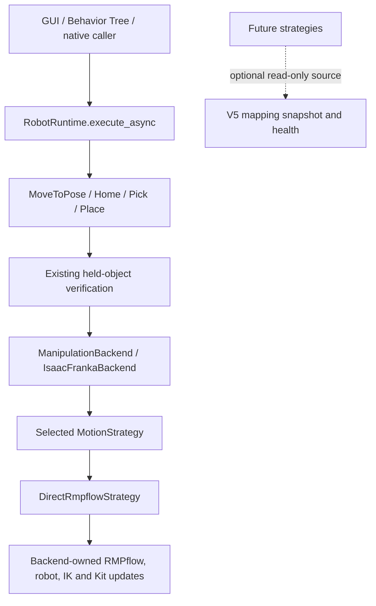

# Motion strategies

Current runtime selection supports `direct` and opt-in `reactive`. Direct remains
the default and the complete Pick/Place baseline. Reactive uses prepared Spatial
Mapping cuboids for free-space MoveToPose/Home and reports unsupported contact
or carrying requests explicitly. See [V2](#v2--obstacle-aware-rmpflow) for the
current obstacle, freshness and model boundaries. Global and hybrid planning are
not implemented.

## V1 checkpoint — direct strategy extraction

V1 adds initialization-time motion selection while retaining V5's validated
direct RMPflow behavior. At the V1 checkpoint (`04190a6`), only `direct` was
implemented and occupancy did not affect motion. The following V1 architecture
and measurements are retained as the historical baseline; V2 extends the
selection and mapping connection without changing the direct loop.

## Execution and ownership

The previous path was GUI/BT → `RobotRuntime` → skill → Franka backend's direct
RMPflow loop. The new path inserts a selected strategy behind the same backend
API:



`RobotRuntime.execute_async()` dispatches the selected skill. Its motion phase
uses `HeldState.run_motion()` and `IsaacFrankaBackend.move_to_pose_async()`;
Home first enters `backend.home_async()`, which calls that same move method.
The selected `DirectRmpflowStrategy.move_to_pose_async()` uses the existing
`MotionPolicyController.forward()`, `robot.apply_action()` and
`backend._next_update()` → Kit's `next_update_async()` loop.

`ManipulationBackend` remains the public skill API. The Franka backend owns the
robot, gripper, controller, Lula solvers, feedback policy, startup Home reference
and simulator resources. `DirectRmpflowStrategy` borrows those resources. It
neither creates a second controller nor owns simulator lifecycle.

The backend's constructor accepts `strategy_factory(backend)`, called once
after its existing resources and Home reference are initialized. The SDK factory
validates configuration, selects direct and injects this constructor callback.
The resulting `backend.motion_strategy` property is read-only. Test-only
alternative strategies exercise the same delegation without adding unsupported
production implementations.

`RobotRuntime` retains its existing command reservation and `BUSY` behavior.
The backend also rejects a concurrent arm-motion request before entering its
strategy, releasing that reservation in `finally` on result, exception or
cancellation. Commands run cooperatively on Kit. No background control thread,
worker process, strategy switching or command queue is introduced.

## Small generic contracts

`manipulation/motion/strategy.py` defines the SDK-free `MotionStrategy` protocol:

```python
async def move_to_pose_async(
    target: Pose,
    position_tolerance=None,
    orientation_tolerance=None,
    grasp_check=None,
) -> BackendResult:
    ...
```

This is the existing pose request/result contract, including positional optional
arguments. The backend forwards the original target, tolerances and grasp
callback, and returns the strategy's result. Skills, held-state transitions,
grasp/placement planners and Behavior Trees are unchanged.

`integrations/isaac/manipulation/motion/direct.py` contains the sole direct
motion loop. Its complete operation order matches the frozen V5 implementation:
frame validation, Lula IK, tolerance resolution, controller reset, action
generation/application, Kit yield, grasp check and TCP error evaluation. Timeout
details and the `finally` action retaining the last arm positions with zero
requested velocities are preserved, including cancellation and exceptions.

Home still calls `backend.move_to_pose_async` with its captured startup TCP
reference and existing 25 mm / 0.10 rad tolerances, so it uses the selected
strategy. Backend factory defaults remain 10 mm / 0.05 rad; individual skills
and diagnostic requests retain their existing overrides.

## Configuration

Add this optional section to a complete scene profile:

```toml
[motion]
strategy = "direct"
```

Omitting `[motion]` also selects direct. All existing checked-in profiles remain
valid without editing. In V1, `reactive`, `global` and `hybrid` produced explicit
unsupported/not-implemented errors; V2 adds `reactive` below. Other names produce unknown-strategy errors.
There is no fallback. Loading validates before runtime SDK construction, and the
backend factory also validates programmatic selectors before constructing a
backend. Reinitialize to change selection; V1 has no live strategy switching.

## Optional spatial mapping boundary

The generic `MappingSource` protocol exposes only `snapshot()` and `health`.
V5's existing mapping service satisfies it directly. Strategies can receive an
optional `MappingSourceProvider`, a callable returning that service or `None`.

Bootstrap injects the callable only when mapping is enabled. Its late binding
preserves the existing backend-before-observation initialization order and the
exact time at which the Home reference is captured. Before the mapping service
exists it returns `None`; after construction it returns the same service exposed
by `bundle.spatial_mapping`. A disabled provider is also `None`. Direct stores
the callback but never invokes it, so its behavior is independent of mapping.

A future consumer can obtain the current view without camera or worker access:

```python
source = mapping_source_provider() if mapping_source_provider else None
if source is not None:
    health = source.health
    view = source.snapshot()
```

Presence alone does not mean fresh or collision-free. Health preserves source
status, original timestamp and generation. The immutable read view retains
revision, evidence timestamps and per-voxel TTL behavior. Read health and view
on the owning context without yielding between them; recheck after yielding or
reinitialization. `snapshot()` is O(1); sparse queries age only queried cells.
Dense exports/counts scan the map and must stay out of control callbacks. Closing
the runtime leaves the source observably closed, rather than manufacturing
freshness. V1 implemented no voxel-to-obstacle conversion or collision-clearance
inference; V2 adds the bounded conversion described below.

## Future planning responsibilities

A reactive strategy can resolve current obstacle evidence during execution and
update its local controller under the same Kit command ownership. Its eventual
obstacle adapter must explicitly handle unknown/stale evidence and robot/model
limits. V1 supplied only source access; V2 implements this local strategy below.

A global planner consumes a measured joint configuration and produces a joint
route or a planning failure. Planning and low-level trajectory execution are
different responsibilities. A future executor must handle joint limits,
timing, cancellation, tracking and final hold. A joint-space route must retain
its joint configurations; representing it only as Cartesian waypoints could
lose the selected IK branch and route. V1 adds none of those planner/executor
interfaces or algorithms.

A future hybrid strategy can coordinate a global route with local reactive
control and bounded replanning through the one backend command boundary. It
must not run two independent arm controllers. Its internal executor operates
inside the admitted strategy call; re-entering the public backend move method
would be rejected as an overlapping request. Planning failure must remain
distinguishable from IK rejection, timeout and interrupted execution, using
explicit result semantics when that strategy is implemented. Existing failure
codes and manipulation policy are not expanded speculatively here.

## Validation

The fresh pre-refactor V5 baseline uses the unmodified runtime diagnostic,
stationary and moving objects, ordinary hover/side/return/Home and both services
active. All eight commands passed. Controller-apply p99 was 27.593/29.305 ms,
with approximately 5 Hz semantic publication and 2 Hz mapping. Large traces
remain under ignored `outputs/motion-planning-v1-*` directories.

The [acceptance protocol](assets/motion_planning_v1/acceptance_protocol.json)
declares baseline-relative gates before the refactored timing run. SDK-free
tests compare exact V5 event/action/result traces, including rejection, timeout,
grasp failure, paused stepping, SDK exceptions, cancellation and final hold.
They also exercise a genuine test-only alternative strategy and Home delegation.
Native validation uses explicit `[motion]` direct with real Pick/Home/Place,
attached-object checks and automatic V5 observations. The existing five
regression groups run sequentially through `run_isaac_python.sh`.

The matched refactored run passes every declared gate:

| Condition | Controller-apply p99, V5 → direct | Four motions, V5 → direct |
| --- | --- | --- |
| Stationary objects | 27.593 → 29.421 ms | 2.418 → 2.365 s |
| Moving objects | 29.305 → 28.366 ms | 2.191 → 2.183 s |

All eight targets and step counts match, with 343 controller forwards and 351
arm applications, including holds, in both runs. All four stationary result
payloads match exactly. Moving endpoint errors differ by at most 0.000169 mm
and 0.000000303 rad; wall-time phase windows permit different simulated settling
before those commands. Deterministic same-input operation traces and the
normalized complete loop AST match V5 exactly. These measurements support
equivalent motion, without asserting identical wall-clock scheduling.

The refactored sweep publishes approximately 5 Hz semantics and 2 Hz mapping,
with zero replaced/discarded jobs, publication rejections or source/worker
errors. Original observation ages stay below the unchanged one-second budget.
Maximum controller-apply gaps are 30.131/30.381 ms, with no controller waits over
100 ms. The 6.6% stationary p99 increase and 3.2% moving decrease are within the
predeclared baseline-relative limits; no numerical controller parameters or
tolerances were changed.

The explicit-direct native acceptance passes all 22 checks: real Pick, held
Home, Place, released Home, current map-service identity, per-update grasp
checks, frame/IK rejection without action, actual cancellation, competing-command
rejection and Home recovery. Its 10 executed motions all issue the existing
final zero-velocity hold. The representative standalone run measures 92.2 mm
actual lift and 21.174 mm placement error, with Pick/Place taking 4.222/3.922 s;
its controller-apply p99 is 28.262 ms. Occupancy does not alter any command.

The complete offline run passes 721 discovered tests, all eight standalone
modules and architecture/syntax checks. Initial runner-fixture failures from
adding a ninth startup scenario are retained; corrected fixtures preserve all
original scenarios, strict NumPy-before-SDK checks and crash propagation.
The sequential native suite passes all 22 unique scenarios: seven spatial
mapping, six multi-view, three Isaac integration and six manipulation regression
cases. The new explicit-direct acceptance also passed separately before those
groups. All runs use the established launcher and NumPy 1.26.4 environment.

Compact records:

- [Matched baseline and direct evaluation](assets/motion_planning_v1/evaluation.json), including all declared gates, distributions, tracking, source ages and counters.
- [Scope audit](assets/motion_planning_v1/scope_audit.json), including unchanged V5 workers/algorithms/skills/launchers and the exact direct-loop comparison.
- [Verification](assets/motion_planning_v1/verification.json), including original failures, corrected unit runs and individual native outcomes.

## V2 — obstacle-aware RMPflow

`ReactiveRmpflowStrategy` satisfies the existing motion contract and borrows the
same backend-owned Franka articulation, RMPflow controller, Lula IK and feedback
adapter. It validates the target and reachability, checks mapping availability,
then runs the cooperative Kit action loop with prepared obstacles. It adds no
second controller, articulation, arm thread or independent motion queue.
`DirectRmpflowStrategy` remains the unchanged baseline.

Native evidence demonstrates useful avoidance with ground-truth occupancy.
The current RGB-D obstacle cases do **not** establish reliable avoidance:
contact, source-availability failures and one unmeasurable paired route remain.
The comparison below reports these outcomes separately from passing software
regressions and valid measurement checks.

```mermaid
flowchart LR
    Acquire[Existing Kit acquisition and matched robot poses] --> Worker[Existing SDK-free mapping worker]
    Worker --> Grid[Occupancy evidence]
    Grid --> Extract[Optional occupied-cell cuboid extraction]
    Extract --> Packet[Immutable obstacle packet]
    Packet --> View[MappingService read view]
    View --> Reactive[Kit-owned reactive strategy]
    Reactive --> Registry[Bounded numeric obstacle registry]
    Registry --> RMP[Existing RMPflow and feedback adapter]
    RMP --> Arm[Franka action and Kit yield]
```



The runtime enables extraction only for `motion.strategy = "reactive"`, as an
optional product of the existing mapping processor. There is no additional
long-lived worker or acquisition stage. Direct mapping runs without this
derived product. Camera sharing, ray budgets, occupancy thresholds, evidence
timestamps and semantic computation retain their existing meanings.

### Exact occupied-cell approximation

`world/spatial_mapping/obstacles.py` operates on the worker's immutable occupancy
snapshot. Only confirmed OCCUPIED cells with observed, finite, unexpired
evidence are eligible. FREE and UNKNOWN cells are never filled to simplify a
shape. Sparse support uses a radius-two Chebyshev neighbor graph: occupied cells
connect when each grid-axis separation is at most two voxels. Components with
fewer than three occupied cells are rejected. The neighborhood determines
support only; it is not dilation and never becomes obstacle geometry. Only the
original occupied cells can reach cuboid extraction. This fixed rule can still
omit isolated real features, and sparse rejection is reported.

The extractor finds contiguous Z runs, merges equal adjacent runs in Y, then
merges matching slabs in X. Every emitted axis-aligned cuboid contains only
eligible occupied cells. It does not place one enclosing box around a hollow,
irregular or disconnected cluster. Clear gaps remain gaps. Bounds clip to the
configured map workspace; there is no added padding, semantic classification,
target-pose hole or inferred hidden solid volume.

The default budget is 64 cuboids, with an allowed maximum of 128. Above-support
hazards receive priority over support-plane-only boxes; within each category,
the largest exact cuboids come first with deterministic grid-coordinate tie
breaks. The optional extraction support plane is derived from the existing
`scene.support_plane_z`, not a new user setting. A box whose top lies at or below
that plane plus one voxel is placed in the lower-priority category. Such boxes
remain when slots are available: the floor is not erased or labeled FREE.
`represented_floor_voxels` and `omitted_floor_voxels` expose any budget loss.
A separate internal run budget bounds pathological intermediate work.
`omitted_voxels`, `truncated`, sparse rejection and represented-volume diagnostics
expose undercoverage instead of joining free gaps to fit a budget. Increasing
the count trades SDK cost against represented detail; it does not improve the
underlying depth observation.

This support policy follows an observed failure, not a synthetic success claim.
The first RGB-D post pilot contained 1,125 occupied cells, but face-connected
support retained only three cells, all from the floor, and discarded the real
post. That failed attempt and the original extractor study remain in the
[V2 evaluation](assets/motion_planning_v2/evaluation.json) and
[original extraction record](assets/motion_planning_v2/obstacle_extraction_v1.json).
The revised [full-arm synthetic extraction record](assets/motion_planning_v2/obstacle_extraction.json)
measures the radius-two policy without filling any FREE or UNKNOWN cells. On
the 1,573,200-cell grid, the floor/two-box case has a 9.64 ms median over five
runs; adversarial dense noise takes 72.54 ms. All recorded cases fill zero FREE
or UNKNOWN cells. These offline geometry results do not establish native RGB-D
avoidance; that requires the separate physical comparison.

Each immutable `ObstaclePacket` retains map generation, revision, original
source timestamp, extraction time and `ObstacleBox` records. A box expires at
the oldest contributing voxel timestamp plus the map's existing evidence TTL.
No new timestamp or unrelated aging clock is introduced. A whole box is removed
when that earliest evidence expires; later publications can represent its
remaining valid cells. Old occupied evidence can remain until contradicted or
expired under V5's temporal map behavior, so moving objects may leave bounded
trails. Proxy identity reuse does not extend that evidence lifetime.

Full-grid classification, noise rejection, run extraction and approximation run
in the mapping subprocess. `MappingReadView.obstacles` exposes the small packet
alongside the O(1) read view. The reactive control loop never calls dense map
exports, scans voxel arrays, acquires another camera frame or waits for a worker.

### Numeric RMPflow registrations and lifecycle

The installed Isaac Sim 5.1 `RmpFlow.add_cuboid` accepts the numeric getters
`get_size`, `get_local_scale` and `get_world_pose`. Its general `add_obstacle`
dispatcher instead checks SDK wrapper types. The registry therefore calls the
public cuboid-specific method with plain numeric Python objects. It does not
insert objects through private Lula world APIs.

These objects create no USD prims, physical colliders, render products, materials
or semantic labels. The real SDK probe verified unchanged stage prim paths and
unchanged root/session-layer text through registration, pose/size updates,
disable/enable, removal, reset and cleanup. There is no planning geometry for
RGB-D, semantic perception or ground-truth mapping to observe. See the
[SDK validation record](assets/motion_planning_v2/sdk_validation.json) for all 16
checks and hashes of the actual installed implementation.

`RmpflowObstacleRegistry` runs only on its creating Kit thread. Numeric getters
convert meters to stage units and return independent arrays because the SDK
scales returned positions in place. Unchanged immutable packets use a fast path
until the next evidence expiry. A changed packet updates existing numeric poses;
deterministic overlap matching can preserve registration identity when a moving
box crosses voxel-coordinate IDs. That matching changes allocation only, never
the desired geometry or number of boxes. Dimension changes remove and re-add
only the affected cuboid because the installed world-update API updates poses,
not dimensions.

Changed batches refresh the RMPflow world. The existing
`MotionPolicyController.forward` also updates its world each control step, using
bounded numeric pose getters rather than USD reads. The SDK's normal controller
reset erases obstacle registrations; the strategy calls `reset_tracking` after
that backend-owned reset and registers the current accepted packet. Normal
completion, timeout, cancellation and failure apply the existing final
zero-velocity arm hold, then remove owned registrations. Runtime shutdown closes
the selected strategy before stopping observation resources, including when
another cleanup step fails. Cleanup never resets another controller or removes
another subsystem's obstacles.

### Freshness and failure behavior

A new reactive request requires an available, fresh mapping publication and a
matching obstacle product. Packet generation, revision and source timestamp
must match the published view. Startup waiting, missing products, source errors,
closed services, future timestamps and stale evidence return a descriptive
`WORLD_STATE_UNAVAILABLE` result before arm progress. Initialization does not
wait indefinitely for its first asynchronous product; a later request can use
the recovered source.

Robot readiness is checked before IK and after each Kit yield. Native Stop/Play
can restore mapping freshness while leaving Isaac's articulation handles
invalid. Such a request returns `WORLD_STATE_UNAVAILABLE` with reinitialization
guidance; it does not interpret missing finger measurements as a carried object
or command an uninitialized arm. Clean public runtime reinitialization restores
the SDK handles and creates a new strategy/mapping owner. Automatic arm-handle
repair inside motion or physics callbacks is not attempted.
The retained native lifecycle run passed 23 checks, including source/worker
failure, generation reset, cancellation, Stop/Play rejection, clean public
reinitialization and shutdown cleanup; see [V2 verification](assets/motion_planning_v2/verification.json).

During an active move, an accepted `no_frame` source can be reused only while
its original timestamp remains inside the map's configured freshness budget.
It is not fresh enough to start a new command. Source failure, excessive age,
revision rollback, a new generation or Stop ends progress and applies the hold;
reactive never silently becomes direct. Generation changes cannot reuse the
previous registry. Stop is checked after each Kit yield as well as before the
next action, and cancellation propagates after cleanup. A timeout remains a
failed motion, not a successful avoidance result.

Results and diagnostics retain `map_generation`, `map_revision`, `map_timestamp`
and `map_age_seconds` for the evidence actually applied. Registry diagnostics
separate proxy counts, pose/size changes, identity reuse and update cost. The
source's roughly 2 Hz map cadence limits how recent obstacle knowledge can be,
regardless of a faster arm loop. UNKNOWN remains unmodeled space, not certified
clearance, and arbitrary fast-obstacle avoidance is not implied.

### Robot model and intentional contact

The installed Franka descriptor supplies 55 environment-avoidance spheres:

| Robot region | Descriptor links | Spheres |
| --- | --- | ---: |
| Base | `panda_link0` | 1 |
| Shoulder/upper-arm approximation | `panda_link1`–`panda_link2` | 8 |
| Elbow/forearm region | `panda_link3`–`panda_link4` | 8 |
| Forearm | `panda_link5` | 12 |
| Wrist | `panda_link6`–`panda_link7` | 8 |
| Palm/gripper-body approximation | `panda_hand` | 18 |

These are an approximation, not the robot's complete visual or collision mesh.
The environment sphere list has no separate finger links. Hand spheres extend
only to local Z = 0.056 m, and descriptor finger joints are fixed at 0.025 m.
The RMPflow YAML also names fingertip `body_collision_controllers` against base
body cylinders; those self/base constraints are distinct from environmental
finger-volume coverage. No carried-object shape is attached. SDK robot geometry,
policy YAML, controller feedback and numerical direct-motion settings are not
changed to claim broader coverage.

V2 therefore supports free-space MoveToPose/Home with a confirmed empty gripper.
Held or uncertain gripper feedback returns an explicit unsupported-motion
result. `supports_contact_motion = False` reaches Pick/Place through a narrow
backend capability query: those skills return `MOTION_UNSUPPORTED` before
motion, gripper commands, held-state changes or association hints. Their public
signatures, grasp/placement planners and the direct strategy's successful
behavior remain intact. V2 does not remove obstacles near a requested TCP to
guess intended contact. Pick/Place and payload-aware reactive transport require
an explicit manipulation context and a tested collision model in future work.

Ground-truth mapping must exclude the configured robot subtree; RGB-D reactive
mapping must enable exposure-matched automatic robot self-filtering. External
occupancy remains independent of robot geometry. Ground truth can represent
known solid geometry, whereas RGB-D supplies partial, sometimes occluded
surfaces. Neither source removes voxel aliasing, calibration limits or unknown
interiors. Native evaluation uses independent scene/physical geometry rather
than the map's own voxels to assess robot-link clearance. It copies actual
PhysX cooked convex hulls before the timed window; any authored-mesh fallback
is identified explicitly. Full robot/actor contact-sensor coverage and the
elbow, forearm, wrist and gripper reference groups are checked. Sampled unsigned
hull clearance excludes contact/rest offsets and does not certify continuous
separation between captured poses. A zero-clearance reference contradicting
empty contact reports is flagged, not counted as successful avoidance.

### Selecting V2

Use a complete copied profile and choose reactive explicitly:

```toml
[motion]
strategy = "reactive"
max_obstacles = 64 # optional; 1 through 128

[spatial_mapping]
enabled = true
source = "ground_truth"
excluded_prim_paths = ["/Franka"]
```

For RGB-D mapping, use `source = "rgbd"` and explicitly set
`automatic_robot_filter = true`; its existing default remains false. Normal
camera-path sharing and source-independent semantic selection still apply.
Reactive without enabled mapping, RGB-D self-filtering or the ground-truth
robot exclusion fails configuration validation. Defaults in checked-in profiles
are unchanged. `global` and `hybrid` remain unsupported. No global route search,
trajectory generation or hybrid coordinator is introduced.

### V2 native comparison protocol

The final `final-v2` cohort pairs direct and reactive in eight ground-truth
scenarios and four RGB-D scenarios. A conditional ground-truth partial-scene
control distinguishes an occluder's physical geometry from RGB-D observation
and approximation limits when the RGB-D partial case is unsuccessful or
ambiguous. Each case runs in a fresh Isaac process. Earlier exploratory runs,
failed measurements and superseded source iterations remain separate evidence.
The comparison record checks source hashes and matching configuration; it does
not combine the best outcomes from different iterations.

Test actors and contact-reporting topology exist before runtime initialization.
Both strategies use ordinary asynchronous setup/motion commands, with no robot
joint teleport. External actors are placed before measurement, then every source,
strategy and scene receives the same fixed five-second settling interval.
The delay allows ordinary evidence accumulation; it is not an adaptive wait for
the desired proxy or avoidance outcome. Actual initial joints and actor poses
are recorded rather than assumed bit-identical. Synchronous collision-reference
preparation is outside timing, followed by a barrier requiring genuinely new
mapping publications and original source timestamps.

Ground-truth comparison profiles use 2 Hz mapping. The RGB-D comparison profiles
explicitly use **2.5 Hz for both strategies** as an experimental workload;
the repository's mapping default remains **2 Hz**, and no checked-in profile is
changed to select reactive. Semantic perception remains configured at 5 Hz.
Ray budgets, voxel size, robot filtering, source freshness and evidence TTL are
matched within each pair. Reported publication rates cover each command's short
wall-time window and can vary with the phase of the next publication.

The comparison distinguishes reaching the goal, timeout/local blockage, source
failure, observed contacts and invalid initial conditions. A diagnostic `PASS`
means a valid measurement, not successful avoidance. The strict avoidance
criterion requires goal success, zero reported PhysX contact points and positive
independent cooked-hull separation when an external object is present. A timeout
is never counted as successful avoidance. Positive reported contact separation
with no penetrating pairs or impulse is **contact-offset proximity**, not proof
of solid penetration; the point count, penetrating-pair count, signed separation,
impulse and geometric clearance remain separate values.

Geometry reduction uses copied PhysX cooked hulls and captured body poses after
runtime closure, without further Kit stepping. Sampling covers the forearm,
elbow, wrist and gripper groups and checks contact sensor/actor coverage. It is
independent of both occupancy and RMPflow collision spheres. Surface separation
excludes PhysX contact/rest offsets and does not certify continuous clearance
between samples. Goal error, duration, action intervals, proxy count, worker
extraction and Kit registry/world-update costs are retained with the source age
and observation rates in the [comparison record](assets/motion_planning_v2/evaluation.json).

### V2 native outcomes and runtime impact

The table contains all 12 planned source/scenario pairs and the conditional
ground-truth partial-scene control. **D/R** means direct/reactive. Clearances are
minimum sampled cooked robot-hull to physical-obstacle surface distances, in
millimeters. Contacts are **reported points / penetrating pair samples**; they
are not counts of unique collision events. `—` means no external obstacle or
no measured route, as stated in the outcome. Proxy counts are the reactive
maximum, including support-plane proxies.

| Source / scenario | Direct outcome | Reactive outcome | Cooked clearance D/R, mm | Contacts D/R, points / penetrating | Duration D/R, s | Apply p99 D/R, ms | R proxies |
| --- | --- | --- | ---: | --- | ---: | ---: | ---: |
| GT / no external obstacle | Reached | Reached | — / — | 0/0 ; 0/0 | 1.739 / 1.728 | 22.367 / 21.638 | 1 |
| GT / static post | Reached with penetration | Reached, clear | 0.000 / 40.579 | 841/58 ; 0/0 | 2.278 / 2.691 | 22.381 / 21.846 | 2 |
| GT / separated obstacles | Reached with contact-offset proximity | Reached, clear | 15.755 / 58.931 | 79/0 ; 0/0 | 1.776 / 1.811 | 22.214 / 19.399 | 3 |
| GT / narrow passage | Reached with penetration | Reached, clear | 0.000 / 43.857 | 1570/115 ; 0/0 | 2.776 / 2.119 | 21.052 / 23.302 | 3 |
| GT / irregular obstacle | Reached with penetration | Reached, clear | 0.000 / 33.975 | 1061/50 ; 0/0 | 2.261 / 3.600 | 22.718 / 24.362 | 3 |
| GT / large obstruction | Timeout with penetration | Blocked timeout, no contact | 0.000 / 37.417 | 6665/703 ; 0/0 | 12.139 / 12.161 | 22.128 / 23.253 | 2 |
| GT / nearby off-route obstacle | Reached, clear | Reached, clear | 194.385 / 194.710 | 0/0 ; 0/0 | 1.645 / 1.610 | 18.962 / 23.834 | 2 |
| GT / moving obstacle | Reached with penetration | Reached, clear | 0.000 / 49.800 | 156/4 ; 0/0 | 1.655 / 1.976 | 21.484 / 21.929 | 2 |
| RGB-D / no external obstacle | Reached | Reached | — / — | 0/0 ; 0/0 | 1.678 / 1.721 | 30.238 / 26.270 | 64 |
| RGB-D / static post | Reached with penetration | Contact, then source abort; retry | 0.000 / 0.000 | 838/58 ; 497/32 | 2.158 / 6.641 | 26.726 / 29.391 | 64 |
| RGB-D / partial observation | Reached with penetration | Unavailable in setup, 2/2 attempts; no route measured | 0.000 / — | 837/58 ; — | 2.167 / — | 27.212 / — | — |
| RGB-D / sparse thin post | Reached with penetration | Reached with penetration | 0.000 / 0.000 | 139/3 ; 135/2 | 1.640 / 1.788 | 26.463 / 31.397 | 64 |
| GT / partial-scene control | Reached with penetration | Reached, clear | 0.000 / 40.534 | 808/57 ; 0/0 | 2.205 / 2.721 | 23.749 / 26.599 | 3 |

The ground-truth static post supplies the clearest avoidance comparison:
reactive reached the same target with 40.579 mm minimum reference separation
and no contact reports, while direct produced penetrating contacts. The usable
separated/narrow passages, irregular geometry and off-route object also retained
successful reactive goals without joining the clear gaps into a large proxy.
The separated direct run's positive contact separation and zero penetrating
pairs indicate contact-offset proximity, not demonstrated solid penetration.
The large obstruction remained a reactive local blockage: its 37.417 mm
separation is useful evidence of stopping short, **not** successful transport or
proof that no global route exists.

In the ground-truth moving case, reactive accepted four map revisions, including
the initial packet, while three new maps and ten semantic batches were published
during the 1.976 s command. The registry made two pose updates, one size update
and three identity reuses as the physical obstacle moved. The goal remained
reachable with 49.800 mm sampled separation and zero contact reports; its
registry-sync p99 was 0.256 ms and maximum map age at sync was 598.363 ms. The
short-window publication rates were 1.518 Hz mapping and 5.061 Hz semantics,
so these counts are reported instead of implying perfectly periodic 2 Hz data.
This run demonstrates a local response to observed changes, not a guarantee for
faster motion or an indefinitely accurate moving-object volume.

RGB-D has a different outcome. Both static-reactive attempts had a source-related
failure: the original stopped during setup, before a valid route comparison;
the identical-profile retry became a valid measurement but recorded 497 contact
points and 32 penetrating pair samples before aborting for unavailable/stale
world state after 6.641 s. Its last applied map age was 995.629 ms, just inside
the unchanged one-second budget; the next invalid observation stopped progress.
Initially, that settled map supplied no above-plane hazard candidate and only
32 floor proxies. Later candidate fragmentation and the 64-proxy cap also
omitted substantial evidence. This is **not** a reliable static RGB-D avoidance
result, and the setup failure is not hidden by reporting only the retry.

Both RGB-D partial-reactive attempts likewise stopped in setup, so no reactive
route clearance, duration or apply p99 exists for that required pair. The last
applied age in the retry was 996.645 ms. It remains **not evaluable as a paired
route**, rather than passing or being assigned zero contacts. The conditional
ground-truth partial control reached with 40.534 mm separation and no contacts;
the same physical occluder fixture is therefore not itself proof of an
unreachable route. That control does not isolate one RGB-D cause: availability,
partial observation and approximation limits remain intertwined.

The RGB-D sparse case reached the target while observations remained available,
but still produced 135 points, two penetrating pair samples and zero reference
separation. Source freshness alone is insufficient to establish avoidance.
No further attempt, padding change, target-neighborhood exclusion or silent
direct fallback was used to turn these failed outcomes into successes.

Control responsiveness and functional avoidance are separate results. The
evaluated routes' p99 intervals above remain in the workstation's ordinary
roughly 20–31 ms range, including the failed RGB-D runs, but a smooth collision
or source abort is still a failure. In the static RGB-D retry, registry sync
p99/worst was 5.089/7.335 ms, compared with the much cheaper two-proxy GT static
case; its source age reached the allowed window despite ongoing publications.
The existing direct strategy and worker algorithms remain the reference.
Before global/hybrid integration, RGB-D obstacle evidence/availability and
bounded representation need further work; a global planner alone cannot repair
unobserved geometry. Payload modeling and intended-contact context are also
still required for reactive manipulation.

Across the 12 evaluable paired routes, the maximum reactive/direct apply-p99
ratio was 1.257, below the declared 1.5 limit. The largest reactive apply
interval was 44.779 ms, the largest cooperative wait was 42.995 ms, and no
measured wait exceeded 100 ms. Maximum Kit obstacle synchronization was
7.335 ms. Actually applied source ages stayed below one second; stale-source
refusals are reported separately from the age of the last accepted packet.
Ground-truth runs used one to three proxies; measured RGB-D runs reached the
64-proxy budget. These responsiveness results do not turn the failed RGB-D
outcomes or the wall timeout into successful avoidance.

### V2 regression preservation

The final wrapper run passed **787 discovered unit tests**, architecture/syntax
checks and all eight standalone offline modules. All **23 native scenarios**
passed sequentially: seven spatial-mapping, six multi-view, four Isaac acceptance
and six manipulation regression cases. The added reactive native case passed
five acceptance checks and all 23 lifecycle checks; the original 22 native files
and the direct strategy remain unchanged. The [verification record](assets/motion_planning_v2/verification.json)
separates these passing regression results from the obstacle evaluation's
**partial failure**, including RGB-D collisions, source refusals and the missing
reactive partial-observation route measurement. The [scope audit](assets/motion_planning_v2/scope_audit.json)
lists all 39 changed files and protected baseline hashes.
