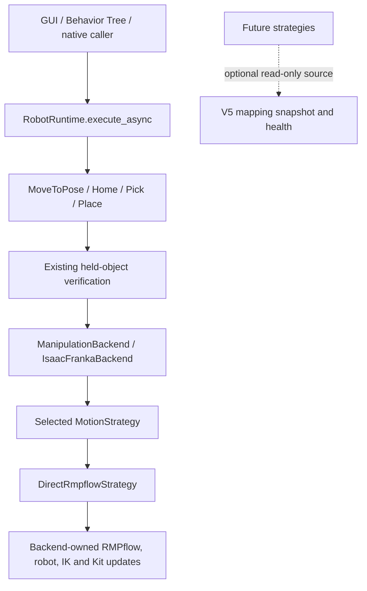

# Motion strategies V1

V1 adds initialization-time motion selection while retaining V5's validated
direct RMPflow behavior. Only `direct` is implemented. Perception and spatial
mapping retain their independent V5 workers; occupancy does not affect motion.

## Execution and ownership

The previous path was GUI/BT → `RobotRuntime` → skill → Franka backend's direct
RMPflow loop. The new path inserts a selected strategy behind the same backend
API:



`RobotRuntime.execute_async()` dispatches the selected skill. Its motion phase
uses `HeldState.run_motion()` and `IsaacFrankaBackend.move_to_pose_async()`;
Home first enters `backend.home_async()`, which calls that same move method.
The selected `DirectRmpflowStrategy.move_to_pose_async()` uses the existing
`MotionPolicyController.forward()`, `robot.apply_action()` and
`backend._next_update()` → Kit's `next_update_async()` loop.

`ManipulationBackend` remains the public skill API. The Franka backend owns the
robot, gripper, controller, Lula solvers, feedback policy, startup Home reference
and simulator resources. `DirectRmpflowStrategy` borrows those resources. It
neither creates a second controller nor owns simulator lifecycle.

The backend's constructor accepts `strategy_factory(backend)`, called once
after its existing resources and Home reference are initialized. The SDK factory
validates configuration, selects direct and injects this constructor callback.
The resulting `backend.motion_strategy` property is read-only. Test-only
alternative strategies exercise the same delegation without adding unsupported
production implementations.

`RobotRuntime` retains its existing command reservation and `BUSY` behavior.
The backend also rejects a concurrent arm-motion request before entering its
strategy, releasing that reservation in `finally` on result, exception or
cancellation. Commands run cooperatively on Kit. No background control thread,
worker process, strategy switching or command queue is introduced.

## Small generic contracts

`manipulation/motion/strategy.py` defines the SDK-free `MotionStrategy` protocol:

```python
async def move_to_pose_async(
    target: Pose,
    position_tolerance=None,
    orientation_tolerance=None,
    grasp_check=None,
) -> BackendResult:
    ...
```

This is the existing pose request/result contract, including positional optional
arguments. The backend forwards the original target, tolerances and grasp
callback, and returns the strategy's result. Skills, held-state transitions,
grasp/placement planners and Behavior Trees are unchanged.

`integrations/isaac/manipulation/motion/direct.py` contains the sole direct
motion loop. Its complete operation order matches the frozen V5 implementation:
frame validation, Lula IK, tolerance resolution, controller reset, action
generation/application, Kit yield, grasp check and TCP error evaluation. Timeout
details and the `finally` action retaining the last arm positions with zero
requested velocities are preserved, including cancellation and exceptions.

Home still calls `backend.move_to_pose_async` with its captured startup TCP
reference and existing 25 mm / 0.10 rad tolerances, so it uses the selected
strategy. Backend factory defaults remain 10 mm / 0.05 rad; individual skills
and diagnostic requests retain their existing overrides.

## Configuration

Add this optional section to a complete scene profile:

```toml
[motion]
strategy = "direct"
```

Omitting `[motion]` also selects direct. All existing checked-in profiles remain
valid without editing. `reactive`, `global` and `hybrid` produce explicit
unsupported/not-implemented errors; other names produce unknown-strategy errors.
There is no fallback. Loading validates before runtime SDK construction, and the
backend factory also validates programmatic selectors before constructing a
backend. Reinitialize to change selection; V1 has no live strategy switching.

## Optional spatial mapping boundary

The generic `MappingSource` protocol exposes only `snapshot()` and `health`.
V5's existing mapping service satisfies it directly. Strategies can receive an
optional `MappingSourceProvider`, a callable returning that service or `None`.

Bootstrap injects the callable only when mapping is enabled. Its late binding
preserves the existing backend-before-observation initialization order and the
exact time at which the Home reference is captured. Before the mapping service
exists it returns `None`; after construction it returns the same service exposed
by `bundle.spatial_mapping`. A disabled provider is also `None`. Direct stores
the callback but never invokes it, so its behavior is independent of mapping.

A future consumer can obtain the current view without camera or worker access:

```python
source = mapping_source_provider() if mapping_source_provider else None
if source is not None:
    health = source.health
    view = source.snapshot()
```

Presence alone does not mean fresh or collision-free. Health preserves source
status, original timestamp and generation. The immutable read view retains
revision, evidence timestamps and per-voxel TTL behavior. Read health and view
on the owning context without yielding between them; recheck after yielding or
reinitialization. `snapshot()` is O(1); sparse queries age only queried cells.
Dense exports/counts scan the map and must stay out of control callbacks. Closing
the runtime leaves the source observably closed, rather than manufacturing
freshness. No voxel-to-obstacle conversion or collision-clearance inference is
implemented.

## Future planning responsibilities

A reactive strategy can resolve current obstacle evidence during execution and
update its local controller under the same Kit command ownership. Its eventual
obstacle adapter must explicitly handle unknown/stale evidence and robot/model
limits; this stage supplies only access to the source.

A global planner consumes a measured joint configuration and produces a joint
route or a planning failure. Planning and low-level trajectory execution are
different responsibilities. A future executor must handle joint limits,
timing, cancellation, tracking and final hold. A joint-space route must retain
its joint configurations; representing it only as Cartesian waypoints could
lose the selected IK branch and route. V1 adds none of those planner/executor
interfaces or algorithms.

A future hybrid strategy can coordinate a global route with local reactive
control and bounded replanning through the one backend command boundary. It
must not run two independent arm controllers. Its internal executor operates
inside the admitted strategy call; re-entering the public backend move method
would be rejected as an overlapping request. Planning failure must remain
distinguishable from IK rejection, timeout and interrupted execution, using
explicit result semantics when that strategy is implemented. Existing failure
codes and manipulation policy are not expanded speculatively here.

## Validation

The fresh pre-refactor V5 baseline uses the unmodified runtime diagnostic,
stationary and moving objects, ordinary hover/side/return/Home and both services
active. All eight commands passed. Controller-apply p99 was 27.593/29.305 ms,
with approximately 5 Hz semantic publication and 2 Hz mapping. Large traces
remain under ignored `outputs/motion-planning-v1-*` directories.

The [acceptance protocol](assets/motion_planning_v1/acceptance_protocol.json)
declares baseline-relative gates before the refactored timing run. SDK-free
tests compare exact V5 event/action/result traces, including rejection, timeout,
grasp failure, paused stepping, SDK exceptions, cancellation and final hold.
They also exercise a genuine test-only alternative strategy and Home delegation.
Native validation uses explicit `[motion]` direct with real Pick/Home/Place,
attached-object checks and automatic V5 observations. The existing five
regression groups run sequentially through `run_isaac_python.sh`.

The matched refactored run passes every declared gate:

| Condition | Controller-apply p99, V5 → direct | Four motions, V5 → direct |
| --- | --- | --- |
| Stationary objects | 27.593 → 29.421 ms | 2.418 → 2.365 s |
| Moving objects | 29.305 → 28.366 ms | 2.191 → 2.183 s |

All eight targets and step counts match, with 343 controller forwards and 351
arm applications, including holds, in both runs. All four stationary result
payloads match exactly. Moving endpoint errors differ by at most 0.000169 mm
and 0.000000303 rad; wall-time phase windows permit different simulated settling
before those commands. Deterministic same-input operation traces and the
normalized complete loop AST match V5 exactly. These measurements support
equivalent motion, without asserting identical wall-clock scheduling.

The refactored sweep publishes approximately 5 Hz semantics and 2 Hz mapping,
with zero replaced/discarded jobs, publication rejections or source/worker
errors. Original observation ages stay below the unchanged one-second budget.
Maximum controller-apply gaps are 30.131/30.381 ms, with no controller waits over
100 ms. The 6.6% stationary p99 increase and 3.2% moving decrease are within the
predeclared baseline-relative limits; no numerical controller parameters or
tolerances were changed.

The explicit-direct native acceptance passes all 22 checks: real Pick, held
Home, Place, released Home, current map-service identity, per-update grasp
checks, frame/IK rejection without action, actual cancellation, competing-command
rejection and Home recovery. Its 10 executed motions all issue the existing
final zero-velocity hold. The representative standalone run measures 92.2 mm
actual lift and 21.174 mm placement error, with Pick/Place taking 4.222/3.922 s;
its controller-apply p99 is 28.262 ms. Occupancy does not alter any command.

The complete offline run passes 721 discovered tests, all eight standalone
modules and architecture/syntax checks. Initial runner-fixture failures from
adding a ninth startup scenario are retained; corrected fixtures preserve all
original scenarios, strict NumPy-before-SDK checks and crash propagation.
The sequential native suite passes all 22 unique scenarios: seven spatial
mapping, six multi-view, three Isaac integration and six manipulation regression
cases. The new explicit-direct acceptance also passed separately before those
groups. All runs use the established launcher and NumPy 1.26.4 environment.

Compact records:

- [Matched baseline and direct evaluation](assets/motion_planning_v1/evaluation.json), including all declared gates, distributions, tracking, source ages and counters.
- [Scope audit](assets/motion_planning_v1/scope_audit.json), including unchanged V5 workers/algorithms/skills/launchers and the exact direct-loop comparison.
- [Verification](assets/motion_planning_v1/verification.json), including original failures, corrected unit runs and individual native outcomes.
