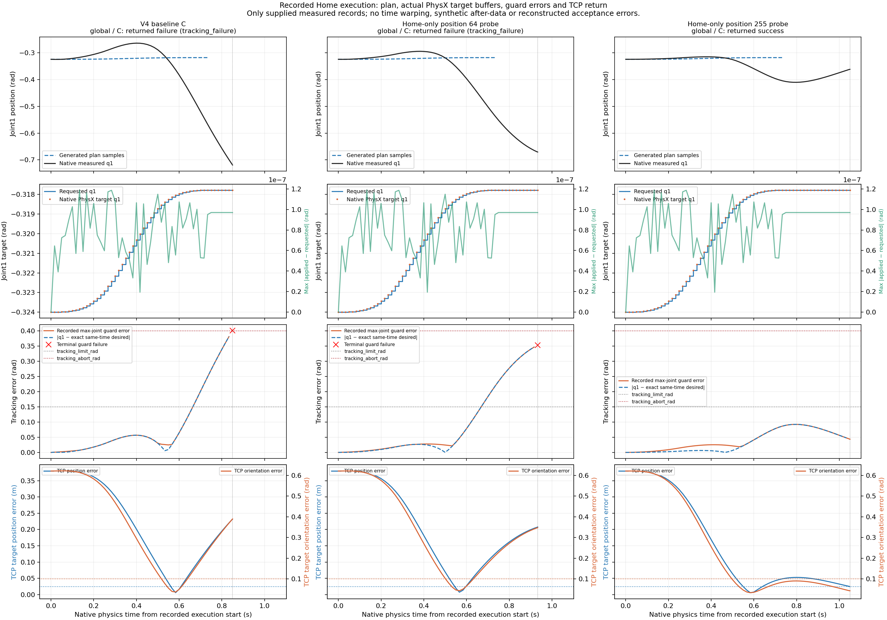
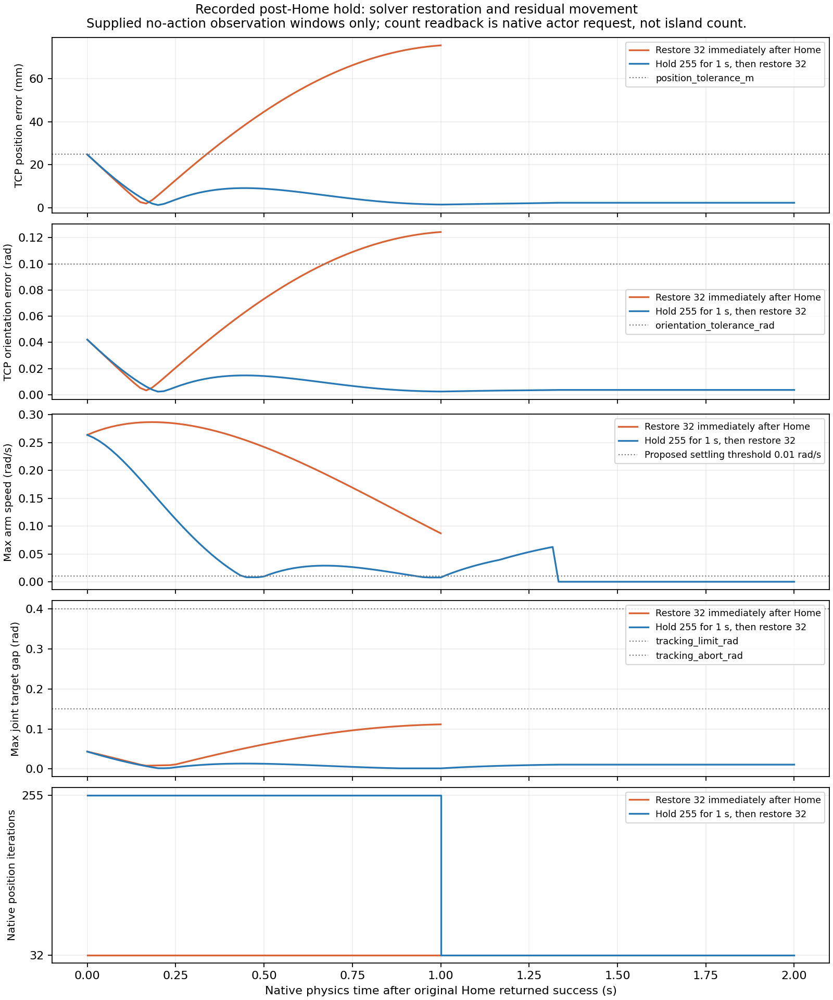
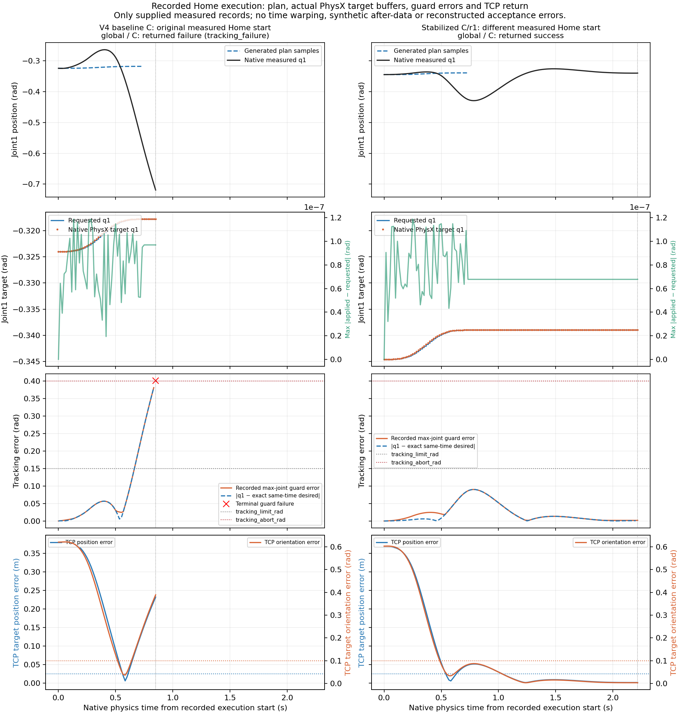
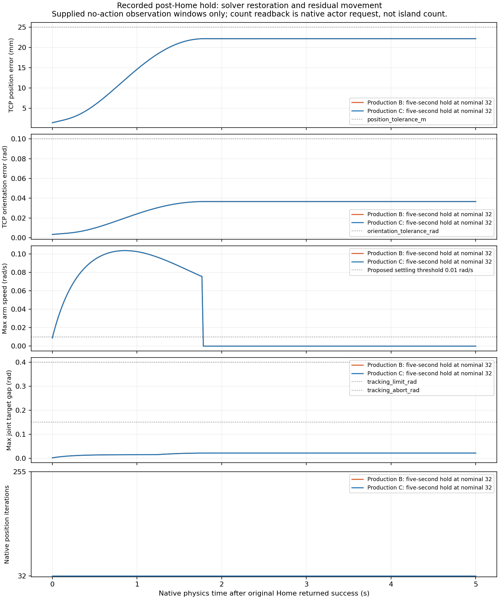
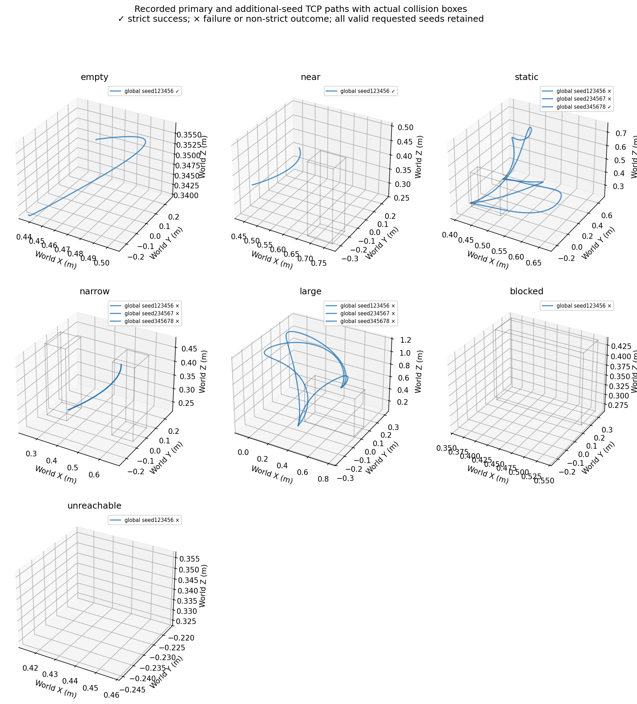
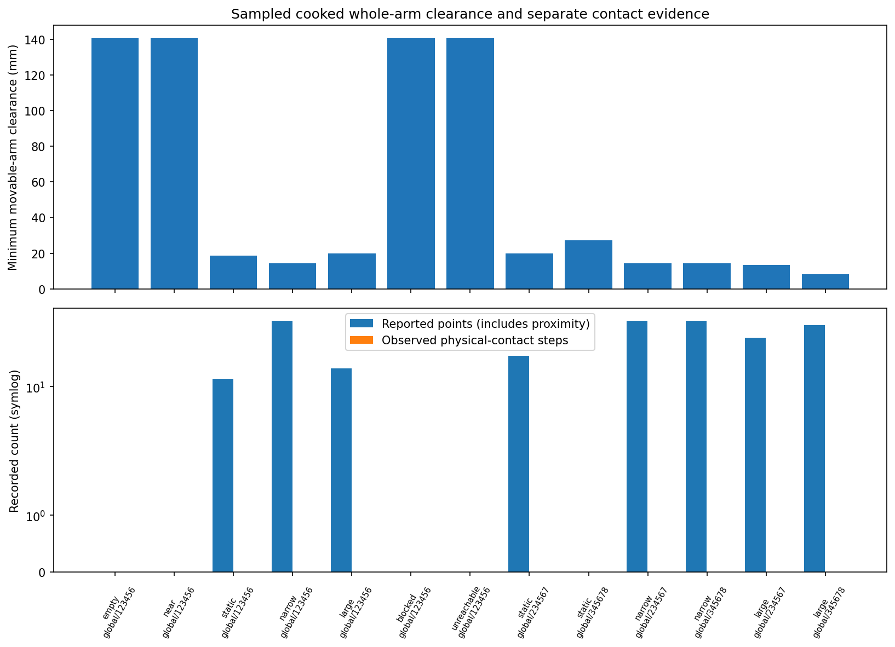
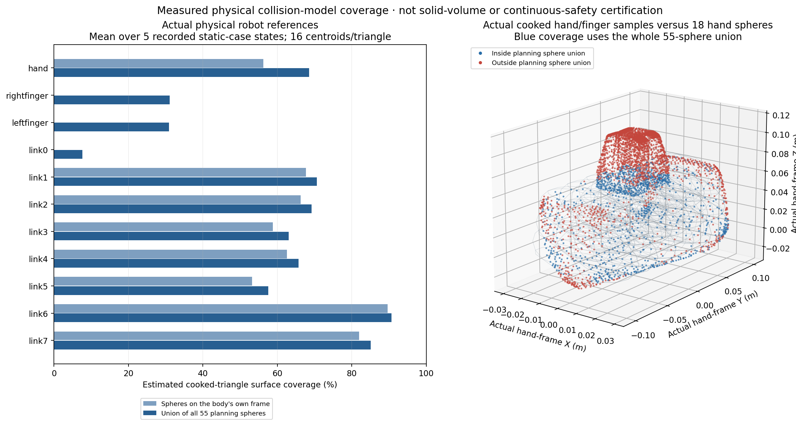
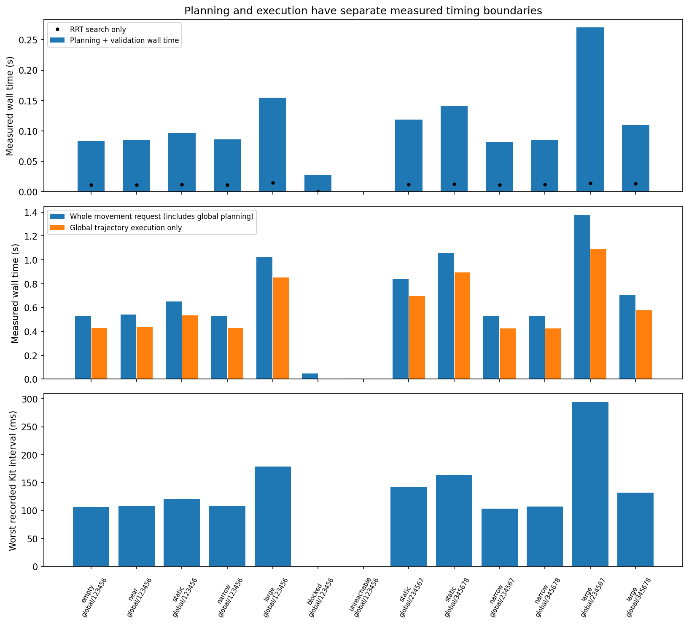

# Motion planning V4.1: global executor stabilization

Branch: `feature/global-motion-planning-v4-1`, based on the unchanged V4 checkpoint `8725b48978d0096a1e759453d9a64bb1e4c80f35`. This report records a bounded investigation of the moving Home failure. Direct remains the default. No hybrid execution, RGB-D obstacle integration, dynamic replanning or contact skills are added.

**Home execution is stabilized in the tested native protocols. Overall static acceptance remains PARTIAL.** Five fresh cancellation/Home repetitions pass without changing the original tracking or pose limits. Additional ordinary and cancelled Home trials remain within tolerance during five-second nominal-solver holds. Global still reaches all eleven reachable static trials, including all three large-obstruction seeds. Only three retain strict zero-report success; collision-model gaps and the missing positive Home-after-detour demonstration remain explicit. Native capture validity and motion acceptance are separate throughout this report.

## Controlled reproduction before production changes

All 547 tracked V4 files remained byte-identical through the original reproduction and six controlled comparisons. The diagnostic-only checkpoint is `cb1a47c` (published equivalent `24328ba8`); raw evidence and source manifests are retained under ignored `outputs/motion-planning-v4-1/`. Each comparison starts a fresh native Isaac Sim process, uses the existing launcher, the unchanged V4 scene and seed 123456, and retains the original trajectory timing, joint limits, gains and full-pose checks.

The original V4 cancellation/Home diagnostic reproduced an immediate tracking abort at **0.4014517 rad**, 0.8500000 simulation seconds into Home. The subsequent controlled comparison reproduced the same failure. No slower trajectory or preferred Home IK branch was enabled.

| Comparison | Observed result | Relevant measurement |
|---|---|---|
| A: ordinary global movement | Reached requested full pose | No reported physical contacts |
| B: completed global movement, then Home | Home tracking failure | Maximum joint error at abort 0.400986 rad |
| C: global movement, cancel return, then Home | Home tracking failure | Maximum joint error at abort 0.401452 rad |
| D: same cancellation, then a different reachable goal | Reached requested full pose | Position/orientation error 3.86 mm / 0.00845 rad |
| E: unchanged direct movement, then Home | Reached Home | Position/orientation error approximately 23.8 mm / 0.0107 rad |
| E with cancellation | Reached Home | Position/orientation error approximately 23.9 mm / 0.0107 rad |

B demonstrates that cancellation is not necessary for the failure. D demonstrates that the cancelled state does not prevent every subsequent global movement. All six captures are valid; B and C fail motion acceptance. All recorded operations in this controlled empty-scene comparison have zero contact reports and zero observed physical-contact steps. The physical asset's authored self-collision setting is disabled, so absent self-contact reports alone do not establish geometric self-clearance.

## Articulation and cancellation evidence

The observer reads requested position/velocity commands and the actual PhysX target buffers separately. In failed B/C Home, requested and applied positions agree within 1.19e-7 rad. Independent parent/child rigid-body rotations agree with the measured joint-1 displacement within 4.29e-8 rad. Physical hand motion agrees with Lula FK to submicrometre precision. The negative joint-1 movement is actual body motion, rather than a target-index, joint-readback or FK artifact.

The cancellation hold retains the last commanded position and requests zero arm velocity. Its joint-1 measured-minus-target gap is only -0.001063 rad in C. Ownership is released and the competing request is rejected. No production hold-policy change is justified by this observation.

The installed articulation exposes force-type implicit drives, with the original nonzero proportional/derivative gains. Recorded effort signals are projected or reaction observations, not calibrated motor torques. The physical joint limits, effort limits and drive gains remain unchanged. The authored articulation configuration is 32 position iterations and one velocity iteration; these SDK getters read USD properties, not an independent native solver-count buffer.

The arm mass matrix becomes strongly coupled in B/C Home: the joint-1/joint-3 two-by-two condition number approaches 9,500 and correlation approaches 0.99979. This is a differentiated observation, not proof of a condition-number threshold: another successful setup motion reaches still higher conditioning. Gravity and Coriolis observations do not establish an exceptional joint-1 load during failed Home.

## Bounded solver hypothesis

NVIDIA's [Implicit Spring Joint Drives](https://nvidia-omniverse.github.io/PhysX/physx/5.6.0/_downloads/6acf3afb8f69452757e0e766b5a22978/implicitDrives.pdf) derives force-drive behavior for reduced-coordinate articulations and describes a TGS time-stepping discrepancy between many position iterations and a single velocity iteration. The paper also describes a solver implementation remedy; it does not prove that this installed build contains that defect. This supports a controlled numerical-solver hypothesis, not a diagnosis by documentation alone.

The [OmniPhysics 107.3 limitations](https://docs.omniverse.nvidia.com/kit/docs/omni_physics/107.3/dev_guide/guides/current_limitations.html) suggest zero or few TGS velocity iterations when drive behavior is problematic. Its D6-specific guidance is not treated as direct proof about Franka's reduced-coordinate revolute joints. The isolated counterfactual tests Home with zero velocity iterations while retaining 32 position iterations, identical preceding movement/cancellation, exact trajectory, targets, gains, limits and acceptance thresholds. No production change is adopted without native evidence.

## Counterfactual results and settling

| Isolated Home intervention | Original moving Home checks | Separate hold result |
|---|---|---|
| B/C, velocity iterations 1 → 0, position 32 | Both failed almost identically | No successful Home to qualify |
| C, position iterations 32 → 64, velocity 1 | Failed sustained tracking at 0.353292 rad | Not a fix |
| C, position iterations 32 → 255, velocity 1 | Passed; maximum trajectory tracking error 0.092345 rad | Immediate restoration still needed testing |
| B/C at 255, immediate restoration to 32 | Both passed initial endpoint checks | Failed after one second: approximately 75 mm TCP error |
| C at 255, retain for one second of zero-command hold, then restore 32 | Passed unchanged endpoint checks | Both consecutive one-second holds passed; final error 1.55 mm at 255, then 2.39 mm at 32 |

Every Home intervention preserves the exact measured initial positions/velocities, physics time/index, planned route, sampled trajectory and common command prefix of its baseline. Native Dynamic Control actor-property readbacks confirm requested count changes and restoration; effective island counts are not directly exposed. The scene uses CPU TGS dynamics with minimum velocity count zero and maximum position count 255. Component rigid-body velocity requests remain one, so the negative velocity-zero experiment is qualified rather than treated as a conclusive test of effective zero island iterations.

At matched elapsed time 0.833333 seconds, doubling position iterations reduces joint-1 error from 0.381478 to 0.301899 rad (20.9%); it is not sufficient for acceptance. The 255-iteration test is the existing scene ceiling, not a demonstrated optimum or minimum. It changes numerical convergence while retaining the same physical gains, force limits and motion. This supports an execution-configuration correction; it does not identify a particular NVIDIA source-code defect.

The immediate-restoration failures matter: reaching pose tolerance while joint 1 still moves at approximately 0.264 rad/s does not establish a stable final hold. Even a single low-speed sample can occur at a turning point. The retained-hold trace shows speed falling below 0.01 rad/s and rising again before settling, which motivates a continuous terminal dwell rather than an instantaneous crossing.





## Production correction

Implementation checkpoint: `daeabe68685185036e21fbe4ae8acea3e38fe877` (published equivalent `4a76487a928cc23f9d7d4366a79cc79c9d5d0b33`). [Source checkpoints](assets/motion_planning_v4_1/source_checkpoints.json) verify exact tree equality: connected GitHub publication changes commit metadata, while measured file hashes remain unchanged.

`global_solver.py` owns a temporary session-layer position-iteration opinion. For a validated moving global trajectory on TGS, it requests at least 255 position iterations without lowering an existing request. If the scene maximum cannot support the validated setting, execution fails before the first arm command. PGS receives no TGS override. No velocity iteration, joint gain, effort limit, joint limit, vendor file, saved scene or configuration default is changed.

`GlobalRrtStrategy` acquires the scope after planning and validation, immediately before execution. It retains the same time-parameterized position/velocity trajectory and physical-time progression. Completion requires the original final pose and 0.05 rad joint conditions plus all measured arm speeds at or below **0.01 rad/s**, continuously for **0.25 simulation second**. The existing **three-second** settling budget remains unchanged. This strengthens completion rather than extending its budget or relaxing a tolerance.

Normal completion, failure and cancellation apply the existing live final hold, then restore the exact prior session default/opinion. Stop/reset and close also clean the scope without stale joint commands. Cleanup uses the captured USD stage, preserves pre-existing metadata and time samples, removes only newly owned empty overrides, refuses to overwrite conflicting foreign opinions, and retains a failed cleanup handle for retry. An unresolved cleanup failure blocks subsequent commands.

The direct/reactive source paths are unchanged. New unit cases cover the velocity turning point, bounded settling, invalid velocity feedback, activation rejection without actions, cleanup retry, cancellation and lifecycle interruption, and session ownership.

## Native Home and lifecycle acceptance

| Check | Measured result |
|---|---|
| Ordinary global movement followed by moving Home | PASS; Home error 1.46 mm / 0.00345 rad at completion |
| Original cancelled-movement/Home sequence, five fresh processes | 5/5 PASS; maximum Home tracking error 0.09014 rad, genuine joint displacement in every run |
| One-second nominal-count hold after all six B/C runs | 6/6 within original pose/tracking bounds; no additional arm commands |
| Additional five-second holds after ordinary and cancelled Home | Both PASS; maximum TCP error 22.17 mm / 0.03667 rad, maximum joint-target gap 0.02148 rad, zero measured velocity at the end |
| Three MoveToPose/Home cycles in one process | PASS; no accumulated tracking failure |
| Cancellation of genuinely moving Home | PASS; measured movement before interruption 0.0249 rad; backend and runtime overlap requests rejected |
| One-second cancelled-motion hold | PASS; maximum joint-target gap 0.01150 rad, final measured velocity zero, no new commands and ownership released |
| Stop during moving Home | PASS; trajectory invalidated, no stale restart, normal rebuild followed by a genuinely moving Home |
| Reset during moving Home | PASS; trajectory invalidated, fresh strategy/views, genuine move-away and Home after rebuild |
| Close during moving Home | PASS; ownership released and strategy invalidated |
| Home with the unchanged off-route obstacle | PASS; obstacle-presence regression, not a forced-detour demonstration |
| Home after the unchanged static-post avoidance trial | Clean `invalid_goal` rejection of all four checked IK candidates; zero Home commands and zero physical-contact steps |

The five-second check was added after final review found approximately 0.1025 rad/s residual speed at the end of the original one-second nominal-count window. During the longer observations the pose error peaked at 22.1625 mm after cancelled Home and 22.1671 mm after ordinary Home, then motion stopped. These results establish bounded holding within the original 25 mm tolerance, with approximately **2.83 mm remaining margin**. They do not establish stationary 1.46 mm accuracy or indefinite stability. No lifetime solver override was adopted.



The production before/after figure uses each recorded plan and measured state. Its start states differ because the corrected preceding global movement settles more accurately. The isolated solver comparisons above establish the exact same-start, same-trajectory counterfactual separately.



Four first-attempt interruption captures were invalid because the new fixture's `asyncio.sleep(0)` loop starved Kit frame progress. The reusable fixture now awaits the backend's existing Kit update future; this does not manually step physics. All four original failures, logs and empty trace artifacts remain retained and classified as invalid observations. The four corrected fresh attempts pass. Invalid attempts are not counted as executor failures or silently omitted. Future invalid captures also retain partial observations when final geometry capture is unavailable.

For Stop/reset/close, old tensor sampling ends explicitly before handle invalidation. Command quiescence and normal rebuilt-runtime behavior are checked separately; post-fault physical tensor observations are not invented.

## Home geometry and the remaining acceptance gap

The actual stored Home pose is the recorded scene startup reference, rather than an assumed default Franka pose. The original recorded Home configuration intersects the final static-post geometry at links 5/6. Its hand intersects the unchanged narrow and large fixtures. All four tested static-post Home IK candidates are rejected by the original planning collision checks. This does not prove that every possible alternative IK branch for the post scene is infeasible.

The unchanged near/off-route fixture is independently clear by 103.704 mm at the recorded Home configuration and supports a positive obstacle-presence/Home regression. It does **not** replace the required positive Home-after-obstacle-detour demonstration. No target, obstacle, collision mask or candidate-search bound was changed to manufacture that result. Derived counterfactual geometry and input hashes are in [home_fixture_clearance.json](assets/motion_planning_v4_1/home_fixture_clearance.json); these intersections are not observed motion contacts.

## Static global planning regression

All thirteen fresh attempts are valid. Every reachable generated trajectory passes the unchanged sampled SDK-model collision, joint, velocity, acceleration and jerk checks. The difficult scenes retain seeds 123456, 234567 and 345678 and the original 10,000-iteration bound. All thirteen geometric fixture signatures and measured initial joint states match their V4 references exactly.

| Scene | Reachable outcomes | Strict zero-report successes | Minimum movable-link clearance | Contact reports | Physical-contact steps |
|---|---:|---:|---:|---:|---:|
| Empty | 1/1 reached | 1/1 | 140.96 mm | 0 | 0 |
| Off-route obstacle | 1/1 reached | 1/1 | 140.96 mm | 0 | 0 |
| Static post, three seeds | 3/3 reached | 1/3 | 18.59–27.24 mm | 0–20 | 0 |
| Narrow passage, three seeds | 3/3 reached | 0/3 | 14.44 mm | 44 each | 0 |
| Large obstruction, three seeds | 3/3 reached | 0/3 | 8.15–19.98 mm | 15–40 | 0 |
| Blocked target | Rejected: `invalid_goal` | Not a reachable-goal success | No requested movement | 0 | 0 |
| Unreachable target | Rejected: `unreachable` | Not a reachable-goal success | No requested movement | 0 | 0 |

Both rejected requests produce zero requested joint movement. Maximum tracking error across reachable static trials is 0.04182 rad. Final reachable pose errors are 0.64–1.24 mm and 0.00103–0.00288 rad. The large-obstruction capability remains 3/3; the earlier direct/reactive large-scene failures are historical V4 references, not newly rerun large-scene comparisons.

All reported obstacle separations are positive (minimum approximately 8.16 mm); measured maximum penetration and normal impulse are zero. The eight reachable trials with proximity reports still fail the original strict zero-report criterion. Movable-link clearance is displayed separately from the all-scene minimum, which includes the fixed mounted base approximately 2.38e-8 m above the plane. No mounted-base reports or proximity reports were hidden to improve the headline.





## Physical collision-model audit

The installed 55-sphere Lula model is useful for the existing static planning demonstrations, but it does not conservatively cover the physical robot. This is a measured readiness limit for future collision-aware motion, separate from the Home tracking failure. No robot model, collision mask, runtime setting or physical scene was changed during this audit.

The offline audit compares the original PhysX-cooked convex robot meshes with native Lula spheres at five actual recorded states each from the original static, narrow and large seed123456 cases (15 configurations). Mesh-to-body scale, actual body transforms, descriptor/URDF and source hashes are retained. Equal-area triangle-centroid sampling estimates surface coverage; it does not establish exact area, solid-volume coverage or continuous-motion safety. Hand/finger sampling refinement changed estimates by at most 0.585 percentage points, which is observed sensitivity rather than a certified error bound.

| Observation | Measured result |
|---|---|
| Arm/hand model FK versus actual physical body frames | Maximum translation difference 0.402 µm; rotation-matrix difference <5.42×10⁻⁷ |
| Actual finger opening versus descriptor fixed joint positions | 2.197–2.593 mm per joint versus 25 mm; finger-frame mismatch 22.407–22.803 mm |
| Sphere allocation | 37 arm/base spheres, 18 hand spheres, zero on either finger |
| Estimated physical surface inside the full sphere union, refined sampling | Hand 69.10%; each finger 30.66–30.94% |
| Largest sampled outside gap | Fingers 39.56 mm; hand 9.62 mm; gaps also exist on arm/base bodies |
| Native model-gap witnesses | 30 mathematical ≤2 mm spheres centered on real finger-surface samples remain clear to native Lula at all 15 sampled configurations |

Each witness configuration also passes the original copied static world, original joint limits, the existing URDF-derived fixed/adjacent-link exclusions, and the ground-plane conversion domain check. Witnesses were introduced only in an offline numeric Lula world: they are configuration-level counterexamples to physical coverage, not complete validated routes or observed contacts in the real scenes. A gripper-only box cannot justify conservative coverage of the remaining bodies, so no enlarged collider or model change was adopted. The hand-to-TCP transform is fixed independently of finger opening; this opening mismatch does not explain the Home TCP tracking failure.

The support audit retains the physical ground plane and all original fixture obstacles. The selected scene has no separate tabletop. The ground halfspace conversion is certified only inside its explicit checked domain; all sampled configurations lie inside it. Self-collision exclusions come from the actual URDF fixed-joint collapse and immediate adjacency, never from observed overlaps. Missing finger spheres prevent the planner's sphere inspector from establishing physical finger self coverage.

Actual physical self geometry was checked separately during failed B/C Home motion: six fixed actual body-pose states per case and all 42 nonadjacent cooked-solid body pairs under the same URDF exclusions. Minimum distance was **4.20081 mm in B** and **4.19989 mm in C**, both between the fingers; no selected pair had zero clearance. The next closest nonadjacent pair was link5/link7 at approximately 22.86 mm. Actual arm/hand body frames still matched encoder-based FK within 0.402 µm, supporting that the failed tracking reflects real physical body motion rather than an encoder/FK discrepancy. These finite states do not certify the intervals between samples. The public articulation getter reads an **USD-authored disabled self-collision setting**; this was not independently verified through a native PhysX getter or physical response test. Therefore zero reported self contacts alone cannot establish geometric clearance.



Evidence: `docs/assets/motion_planning_v4_1/collision_coverage.json`, `home_self_geometry.json`, and `collision_coverage.png`. Producer: `scripts/audit_global_collision_v4_1.py` (SHA256 `68ee114a6396aedcd0b598cc8a5663dd6cd1576c099370bbfb60681805067e9c`). Seven focused offline tests pass. The final bounded analysis completed in 1.74 s; raw coordinates remain under ignored `outputs/motion-planning-v4-1/collision-audit/frozen/`.

## Performance and cleanup

These are descriptive comparisons of the eleven reachable, matching-fixture trials. Each source cohort has one attempt per declared scene/seed; these are not confidence intervals or a full application throughput benchmark. Camera and mapping workloads are disabled in these static fixtures. All per-attempt p50/p95/p99/worst intervals, planning phases, route lengths and physical metrics are retained in [stabilization_summary.json](assets/motion_planning_v4_1/stabilization_summary.json).

| Measurement | V4 | V4.1 | Interpretation |
|---|---:|---:|---|
| Median native RRT time | 12.287 ms | 12.238 ms | Approximately unchanged |
| Median planning and validation | 93.358 ms | 96.538 ms | +3.4% in single descriptive cohorts |
| Median generated trajectory duration | 1.198 s | 1.198 s | Every matched generated duration unchanged |
| Median execution simulation time | 1.217 s | 1.750 s | +43.8%; includes measured settling/dwell |
| Median execution wall time | 0.334 s | 0.533 s | +59.7%; includes stronger completion and numerical work |
| Median per-run Kit p50 interval | 4.429 ms | 4.822 ms | +8.9% |
| Median per-run control p50 interval | 4.462 ms | 4.827 ms | +8.2% |
| Worst observed Kit interval | 293.959 ms | 294.146 ms | Synchronous planning pause remains |

The additional completion latency is material and intentional: generated motion timing is unchanged, while the executor waits for measured settlement inside the original three-second budget. The modest interval increase is consistent with increased solver work. No additional planning thread, dynamic world refresh, route modification or fallback is introduced. The approximately 294 ms owner-loop planning stall remains a future hybrid-design limitation.

All valid native runtimes close, temporary solver opinions restore, and tested lifecycle paths release ownership without stale commands. Native actor readbacks confirm 32 → 255 → 32 for the controlled requests and 32 throughout the subsequent nominal holds. The scope creates no scene proxies and restores only owned session state. Fresh-process repeats and intentionally retained diagnostic buffers do not isolate long-run resident-memory growth; no memory-leak or indefinite-hold guarantee is claimed.



## Regression and source preservation

Release checks and artifact hashes are recorded in [validation.json](assets/motion_planning_v4_1/validation.json).

The release regression passes **1,133 unit tests** in 34.721 seconds, plus architecture and all existing unit-regression components. The unchanged native direct test passes Pick, actual lift, held Home, Place/release, cancellation, overlap rejection and released Home. The unchanged reactive native test passes movement, Home, source/lifecycle barriers and cleanup.

Of the 547 baseline tracked files, 545 remain byte-identical. Only `global_rrt.py` and its existing unit test changed; the solver helper, research tools, tests and evidence are additions. All 38 protected initial refs and all nine pinned vendor SDK hashes remain unchanged. Existing perception, cameras, mapping, grasp/placement code, launchers, saved scenes, configuration defaults and historical V4 evidence are preserved. Untracked `models/` is unstaged. No package, driver, permission or launcher-dependency changes were made; all native runs use the existing `.sh` launcher without a ROS-environment bypass.

The observer's effort-mode field has an SDK provenance caveat: that getter reads USD and may apply a missing DriveAPI on the un-driven mimic finger. All seven arm drive APIs already exist, and native arm drive types/gains remain unchanged; the native mimic-finger type remains zero in the observations. The mode string is not treated as native drive-state or calibrated torque evidence.

## Acceptance decisions A–H

| Question | Decision |
|---|---|
| **A. Cause of Home failure?** | The baseline numerical articulation execution was inadequate for this strongly coupled Home path; exact-path position-iteration counterfactuals establish solver sensitivity. Cancellation and target-buffer/FK errors do not explain it. A specific PhysX implementation defect is unproven. |
| **B. Fixed or worked around?** | The executor now provides tested temporary solver accuracy and requires measured settlement before success. This corrects the observed execution/completion behavior without weakening checks; it does not repair vendor engine internals or establish an optimal iteration count. |
| **C. Home reliable after cancellation and ordinary movement?** | PASS within tested conditions: five fresh cancelled sequences, ordinary Home, repeated cycles and additional five-second holds. Long-hold accuracy is approximately 22.17 mm, not 1.46 mm. |
| **D. Static RRT capability preserved?** | Yes: 11/11 reachable trials, including large obstruction 3/3; blocked/unreachable goals reject cleanly. Strict zero-report success remains 3/11. |
| **E. Direct/reactive affected?** | Their source paths and defaults are unchanged; both required native regressions pass. Numerical settings restore before those controllers can be rebuilt normally. |
| **F. Physical collision-model gaps remain?** | Yes: incomplete arm/hand/finger coverage and finger-state mismatch are measured. No conservative whole-robot or continuous-time safety certificate is claimed. |
| **G. Latency acceptable?** | Practical for the measured static research fixture: approximately 12 ms RRT and 97 ms total planning median, with stronger settling increasing completion time. The 294 ms synchronous stall remains. |
| **H. Ready for frozen RGB-D / eventual hybrid planning?** | Qualified execution baseline, not full static-safety acceptance. A positive feasible Home-after-detour case and the physical model gaps still need resolution/review before treating it as a dependable whole-robot collision baseline. No RGB-D global or hybrid implementation is included. |

## Reproduction and evidence locations

Reusable plans refuse to overwrite existing attempts. Use fresh output directories when repeating them. The following commands use the unchanged normal launcher:

```bash
./run_isaac_python.sh scripts/run_all_regressions.py --unit-only --artifacts-dir outputs/motion-planning-v4-1/unit-release
./run_isaac_python.sh scripts/run_global_validation_v4_1_jobs.py --suite controlled --jobs docs/assets/motion_planning_v4_1/controlled_jobs.json --result outputs/motion-planning-v4-1/stabilized/driver_result.json
./run_isaac_python.sh scripts/run_global_validation_v4_1_jobs.py --suite static --jobs docs/assets/motion_planning_v4_1/static_jobs.json --result outputs/motion-planning-v4-1/native/driver_result.json --continue-invalid
./run_isaac_python.sh scripts/run_global_validation_v4_1_jobs.py --suite acceptance --jobs docs/assets/motion_planning_v4_1/acceptance_jobs.json --result outputs/motion-planning-v4-1/acceptance/driver_result.json --continue-invalid
./run_isaac_python.sh scripts/run_global_validation_v4_1_jobs.py --suite acceptance --jobs docs/assets/motion_planning_v4_1/acceptance_jobs_r2.json --result outputs/motion-planning-v4-1/acceptance/driver_result_r2.json --continue-invalid
./run_isaac_python.sh tests/isaac/test_motion_strategy.py --result outputs/motion-planning-v4-1/regressions/direct/result.json --artifacts-dir outputs/motion-planning-v4-1/regressions/direct
./run_isaac_python.sh tests/isaac/test_reactive_motion.py --result outputs/motion-planning-v4-1/regressions/reactive/result.json --artifacts-dir outputs/motion-planning-v4-1/regressions/reactive
```

The exact additional five-second commands, source hashes and paths are in [long_hold_protocol.json](assets/motion_planning_v4_1/long_hold_protocol.json). Solver diagnostic probes require a source-matched unchanged baseline and now reject changed sources before launching Isaac; they must not be interpreted as isolated interventions against the already corrected executor.

Raw logs, traces, actual body transforms, meshes, contacts and large analyses remain ignored under `outputs/motion-planning-v4-1/`. Only reusable code, derived scalar evidence, input hashes and measured figures are committed. The branch is published for review and is not merged into `main`.
