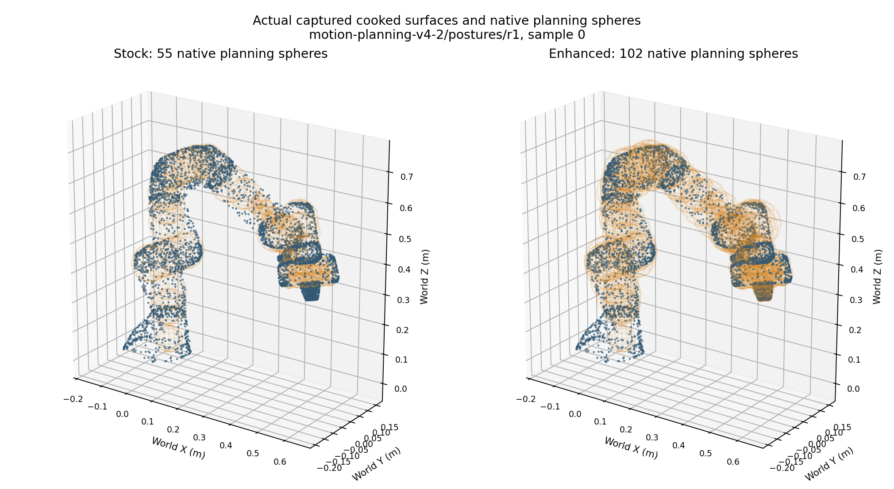
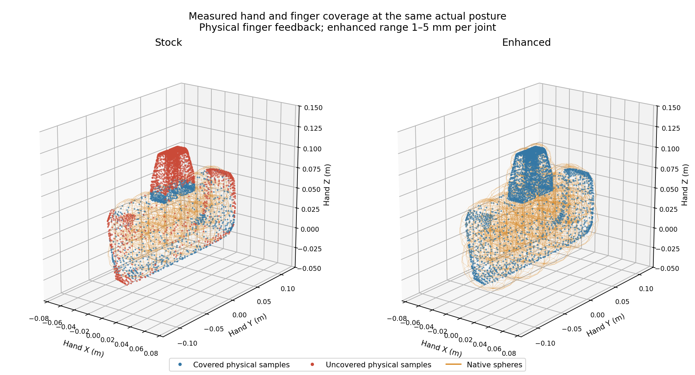
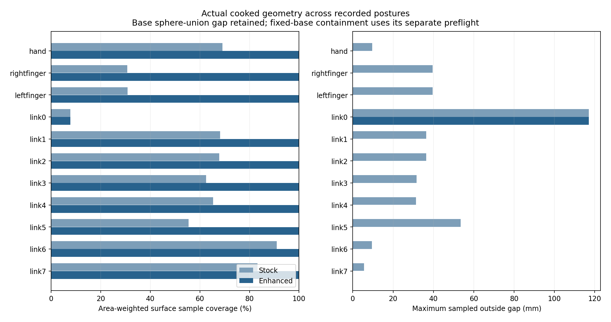
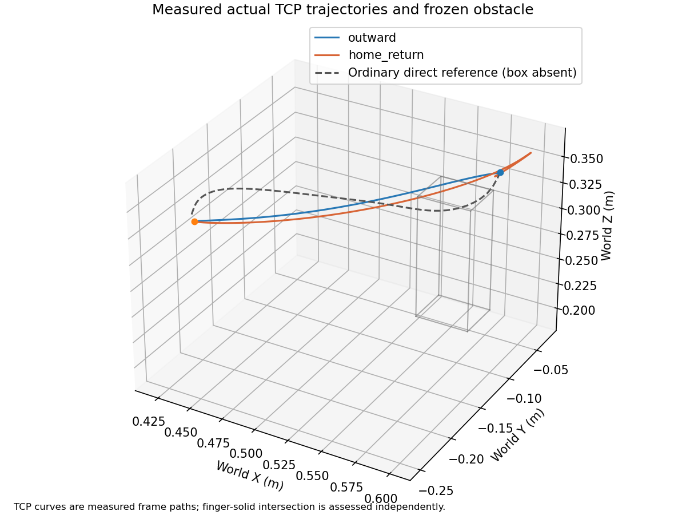
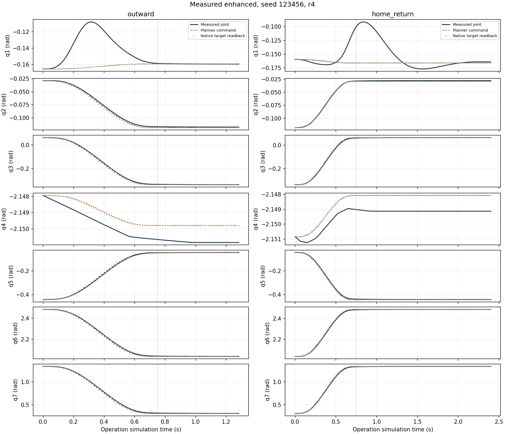
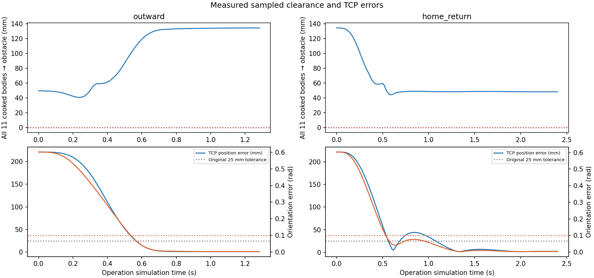
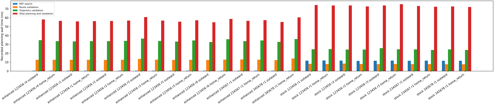

# Motion Planning V4.2 — Collision model and static acceptance

Measured on 2026-10-25 with native Isaac Sim 5.1 through the unchanged `run_isaac_python.sh`, normal ROS environment and NumPy 1.26.4. Baseline: `5ce1b7053d2fd94cd1ed62b93384d3979abed33c`; branch: `feature/global-motion-planning-v4-2`. No merge, vendor edits, physical robot changes, scene-default changes, RGB-D global planning or hybrid execution.

The opt-in enhanced model substantially improves physical geometry coverage while retaining all 11 reachable historical static completions. All 13 new round trips completed with zero contact reports. This is a bounded static research checkpoint: the new round-trip routes are identical two-waypoint joint paths, so they establish avoidance of the measured direct-RMPflow reference, **not an obstacle-induced global path change or difficult stochastic RRT detour**. Numerical solid containment, sampled native motion and broader safety acceptance remain separate claims.

## Implementation and preserved execution

Select the model in an existing scene profile:

```toml
[motion]
strategy = "global"
global_collision_model = "enhanced" # "stock" remains the default
```

The project owns [the description](../config/motion/franka_enhanced_v4_2.yaml), [its certificate](../config/motion/franka_enhanced_v4_2.json), the offline generator and a simulator-free contract helper. Enhanced selection overrides only Lula's robot-description path. Installed URDF/RRT resources and seven active arm joints remain unchanged. RRT search, IK/FK, trajectory generation and the explicit route/spline inspector use the same selected description. Descriptor and URDF hashes bind the certificate; a post-plan hash check rejects a mismatched description before execution.

The description has **102 spheres: the original 55 plus 47 additions**—33 on links 1–7, eight on the hand and three on each dedicated finger frame. Descriptor SHA256: `6801f0c053dba1944157385ae484feb661b3edc14197bf7ba5cf01e568e04a5d`.

V4.1's executor is preserved: 0.15 rad sustained tracking bound with 0.25 s grace; 0.40 rad immediate abort; original joint/derivative limits; final joint error ≤0.05 rad; original full-pose tolerances; measured arm speed ≤0.01 rad/s continuously for 0.25 simulated seconds within the original 3 s terminal window. Temporary TGS position iterations remain 255, with original velocity settings and exact original session opinion restored. `global_solver.py` is byte-identical to the baseline. No direct/reactive implementation changes were made.

Enhanced global motion requires **each actual finger joint and each exposed native position target in [1,5] mm**. The description fixes fingers at the 3 mm midpoint and adds 2 mm sweep padding to each dedicated finger sphere. Unique physical DOF names resolve the measurements; checks run before/after planning and before each execution-loop iteration. Unsupported state/target changes reject execution, and a contract abort holds the measured arm configuration with zero velocity. Partial getters also validate every available finger target. Canonical native capture measured 2.197–2.304 mm, with unchanged exposed targets inside the range. There are no gripper commands in the global acceptance fixture, and carrying remains unsupported.

The installed API exposes no watched finger coordinates to this RRT interface. A guarded envelope is therefore explicit rather than assuming stock's nominal 25 mm fingers. Its left/right sphere envelopes overlap, but independent physical finger solids have disjoint hand-Y projections throughout the entire guarded range, separated by at least 1.9205 mm. This supports exactly one additional explicit-validator self exclusion: left/right finger. All finger/forearm checks remain. Native RRT's internal self filtering is not exposed or asserted equivalent to the explicit validator's documented mask.

## Geometry validity and independent measurements

The generator partitions independently copied PhysX-cooked convex solids using principal-axis clipping planes. Every complete convex cell is contained by **one** assigned sphere; covering separate vertices with different spheres would not prove solid coverage. Rebuilding hull edges after each clip retains intersections between clipping planes. The 47 cells partition all ten moving solids; maximum relative partition-volume discrepancy is 6.58e-16. Radii come from checked maximum vertex distances, with a 10 µm numerical/frame allowance and the additional finger sweep allowance. This is a source-bound floating-point geometric argument, not formal interval arithmetic or a future execution certificate.

The mounted base retains its stock sphere, whose union coverage remains incomplete. Enhanced planning separately preflights its cooked-solid enclosing sphere against finite obstacles. For the certified mounting plane only, verified slab/domain correspondence and cooked-base AABB corners establish halfspace nonpenetration. This avoids inflating the flat mounting footprint below its plane. The finite-obstacle sphere can conservatively reject a nearby usable obstacle. The plane result assumes the unchanged mount and captured frame alignment; its approximately 24 nm observed clearance is **not a useful safety margin**.

[Coverage evidence](assets/motion_planning_v4_2/collision_coverage.json) uses 44 actual states spanning achieved Home/Extended/Raised/Low, near obstacles, stock usable static/large passages and the enhanced round trip. Physical vertices, body transforms, nine-DOF feedback and meter units are independently captured. Triangle-area quadrature uses 64 centroids per input triangle.

| Measurement | Stock | Enhanced |
|---|---:|---:|
| Planning spheres | 55 | 102 |
| Moving-body area-weighted sampled surface coverage | 67.02% | 100% |
| Hand sampled coverage | 69.10% | 100% |
| Left / right finger sampled coverage | 30.74% / 30.81% | 100% / 100% |
| Maximum sampled finger gap | 39.575 mm | 0 mm |
| Base sphere-union sampled coverage | 7.69% | 7.69%; separate base preflight |
| Obstructed known usable sampled states | 0 / 44 | 0 / 44 |

Measured-prismatic-corrected FK/body alignment differs by at most **0.320 µm** in translation and **5.58e-7** per rotation-matrix element. Stock's nominal finger frame opening remains wrong for the physical fingers; correcting FK for alignment measurement does not silently change the stock planning geometry. Zero sampled gaps alone would not establish solid containment; the partition argument above is separate evidence.

Thirty retained actual-state counterexamples place numeric witness balls in physical finger regions missed by stock. The final rerun verifies source hashes, actual q/step matching, independent ball/cooked-solid intersection and native isolated-obstacle queries: **stock misses 30/30; enhanced detects 30/30**. These are numeric collision configurations, not physically executed witness-ball trials.

[Independent self/IK evidence](assets/motion_planning_v4_2/self_and_rejected_ik.json) checks all 42 nonadjacent cooked-body pairs at 23 actual states: **966/966 positive separation bounds**, minimum **4.336 mm**. Thirteen URDF structural/adjacent pairs are explicitly excluded; the physical finger pair is included in this independent audit. The authored self-collision setting remains disabled. No conclusion is inferred merely from absent native self-contact reports; continuous self clearance and every native filtering behavior remain unproven.







## Frozen outward-and-Home acceptance

[The separate fixture](assets/motion_planning_v4_2/roundtrip_fixture.json) and [protocol](assets/motion_planning_v4_2/roundtrip_protocol.json) were frozen before candidate RRT evaluation. The physical box center is (0.55, −0.05, 0.25) m, dimensions (0.04, 0.04, 0.12) m. Startup and return use the original recorded named Home, TCP approximately (0.59749, −0.08604, 0.36449) m; outward target is the historical START, (0.45, −0.25, 0.35) m with the original downward orientation.

Independent cooked-solid design evidence establishes 49.554 mm Home clearance and 125.579 mm retained target clearance. A predeclared 2,431-center design grid selected a box against an independently assembled witness, without V4.2 RRT outcomes. Across 553 witness intervals, conservative numeric continuous bounds are 26.680 mm external and 4.187 mm nonadjacent self clearance. These bounds apply to the constructed witness, **not** subsequent planned or actual trajectories. Fixture SHA256: `79270a3d691451d631830bc9d130945d58d1ebc44a14ec7630d6a86ea7b0f54b`.

A fresh ordinary direct-RMPflow reference ran with the physical box absent. Scoring actual cooked finger poses against the fixed counterfactual box gives verified positive-volume intersections: inscribed-ball radius **0.703 mm left / 9.248 mm right**, maximum halfspace residual 2.22e-16 m. No physical impact was required to establish obstruction.

Fresh native global processes retained actual joint/body/contact observations at every observed physics step, plus update/operation boundaries. Startup geometry, named Home, all 11 cooked bodies, source hashes, world snapshot, box dimensions/collision state and native box actor pose are checked. The same box remains present and stationary throughout both directions.

| Model / seed | Fresh round trips | Physical completion | Strict zero-report completion |
|---|---:|---:|---:|
| Enhanced / 123456 | 6, including 3 after final guard fix | 6 / 6 | 6 / 6 |
| Enhanced / 234567 | 1 | 1 / 1 | 1 / 1 |
| Enhanced / 345678 | 1 | 1 / 1 | 1 / 1 |
| Stock / 123456 | 3 | 3 / 3 | 3 / 3 |
| Stock / 234567 | 1 | 1 / 1 | 1 / 1 |
| Stock / 345678 | 1 | 1 / 1 | 1 / 1 |

[All 13 results](assets/motion_planning_v4_2/roundtrip_results.json) retain both genuinely moving directions, unchanged fixture/world, complete observed physics-step coverage, source freshness, unsaturated contact buffers and runtime close. There are no failed round-trip attempts omitted. The final-source primary enhanced r4 result is:

| Metric | Outward | Return Home |
|---|---:|---:|
| Maximum measured arm displacement | 1.029 rad | 1.028 rad |
| Minimum actual cooked-solid clearance to box | 40.511 mm | 44.261 mm |
| Closest robot link to box | Right finger | Right finger |
| Final TCP position / orientation error | 1.128 mm / 0.001833 rad | 1.937 mm / 0.004083 rad |
| Worst actual/command tracking error | 0.05511 rad | 0.07463 rad |
| Final measured maximum arm speed | 0.005835 rad/s | 0.006280 rad/s |
| Independently observed terminal dwell | 0.250 s | 0.250 s |
| Actual execution, simulation time | 1.283 s | 2.400 s |
| Observed physical-contact steps / reported contact points | 0 / 0 | 0 / 0 |
| Solver requested position counts before / after | 32 / 32 | 32 / 32 |

No reported penetration or normal impulse occurred. All-scene minimum clearance is dominated by the fixed mounting plane; the box margins above should not be confused with that mounting result. The physical clearance reductions are retrospective sampled checks, including for the outward leg before the return is assessed; they are not an online exact-geometry interlock.

**Interpretation limit:** every accepted stock/enhanced route and generated trajectory is identical within each direction across these seeds, with two waypoints and IK candidate zero. The global joint-space path avoids the ordinary direct-RMPflow path's collision. This satisfies the declared direct-reference-based round-trip criterion, but does not establish an obstacle-induced change from an empty-world global path, a multisegment global detour, enhanced-specific improvement in this fixture, or stochastic search robustness. Those stronger experiments are not marked PASS.



TCP curves are frame paths; physical finger-solid intersection is assessed independently.





## Historical static scenarios and rejections

[All 26 comparisons](assets/motion_planning_v4_2/static_results.json) retain the original fixtures, targets, budgets and three established seeds for static/narrow/large. Model selection is confined to ignored generated profiles. Measurement validity is distinct from reaching the requested goal.

| Scene | Stock completion | Enhanced completion | Strict stock → enhanced | Minimum movable-arm clearance, stock → enhanced |
|---|---:|---:|---:|---:|
| Empty | 1/1 | 1/1 | 1 → 1 | 140.965 → 140.965 mm |
| Off-route | 1/1 | 1/1 | 1 → 1 | 140.965 → 140.965 mm |
| Static post | 3/3 | 3/3 | 1 → 3 | 18.590 → 28.213 mm |
| Narrow | 3/3 | 3/3 | 0 → 0 | 14.436 → 14.436 mm |
| Large | 3/3 | 3/3 | 0 → 0 | 8.151 → 17.600 mm |
| Blocked target | Rejected | Rejected | — | No requested movement |
| Unreachable target | Rejected | Rejected | — | No requested movement |

All reachable movements have positive sampled cooked-solid clearance and **zero observed physical-contact steps**, maximum reported penetration 0 and normal impulse 0. Positive-separation reports remain visible: stock has 249 reported points across reachable runs, enhanced 162. These are observations, not a new harmless-contact criterion. Strict completion is **3/11 stock versus 5/11 enhanced**. Per-attempt metrics include final errors, tracking, timings, proximity severity and the closest physical robot link for every obstacle.

Both blocked models reject four retained IK candidates; independent nine-DOF FK and cooked solids establish verified positive-volume intersections at all eight endpoints (intersection-ball radius approximately 23.39 mm). This explains those candidate rejections, not a general proof over every IK branch/path. Unreachable targets hit the unchanged upstream workspace gate before RRT and command no requested movement.

Enhanced static/345678 rejects its first route and accepts the next candidate. Its rejected candidate endpoint is independently clear; the failed route interior is not retained, so an endpoint-only audit cannot attribute that route rejection to actual collision versus conservative geometry. This limitation remains explicit. No rejected full-goal physically feasible case was observed, and no extra collision check was disabled to preserve completion.

## Performance, lifecycle and regressions

[Matched performance evidence](assets/motion_planning_v4_2/performance.json) pools 11 successful stock/enhanced pairs with exactly matching task, physical world, initial joints and source cohort. These are descriptive fresh-process measurements, without confidence intervals. Changed geometry changes routes/query counts, so reduced elapsed RRT time is not evidence of faster individual queries.

| Matched successful-case median | Stock | Enhanced |
|---|---:|---:|
| RRT elapsed | 12.17 ms | 1.25 ms |
| Route validation | 12.90 ms | 26.49 ms |
| Generated-trajectory validation | 38.81 ms | 76.44 ms |
| Total planning and validation | 92.81 ms | 113.68 ms (+22.5%) |
| Explicit configuration checks, aggregate | 36.45 ms | 80.65 ms |
| Generated trajectory duration | 1.198 s | 1.747 s |
| Actual execution, simulation time | 1.750 s | 2.333 s |
| Actual execution, wall time | 0.522 s | 0.697 s |
| Worst recorded Kit interval, successful cohort | 297.03 ms | 250.56 ms |

Static worst tracking is 0.04182 rad in both cohorts. Final static position errors span 0.637–1.236 mm stock and 0.845–1.230 mm enhanced; orientation errors remain below 0.00304 rad. Whole-process median RSS after runtime close is approximately 4.81 GB for both, including Kit and retained benchmark observations. Memory differences do not establish resource leaks or absence thereof.

A separate quiet [query microbenchmark](assets/motion_planning_v4_2/collision_query_cost.json) uses five first actual canonical-phase states, one warmup and 11 batches ×128 calls per type/model/state against the same captured plane world. Combined external/self/position query median of state-batch medians rises **27.24 → 63.42 µs (2.33×)**; p95 across those five state medians is **30.30 → 68.05 µs**. External-only median is 0.867 → 0.946 µs; self-pair queries 13.81 → 39.62 µs. These are explicit Python/native inspector calls. Native internal RRT collision-query counts and isolated query time are **unavailable**, retained as null rather than estimated.



[Lifecycle evidence](assets/motion_planning_v4_2/lifecycle.json): all five modes pass normal/global Home, repeated three-cycle movement/Home, cancellation and Home recovery, Stop/rebuild, reset/rebuild, close/shutdown, competing-command rejection, ownership release and stale-command suppression. All final solver opinions are restored. Interrupted Stop/reset/close operation snapshots deliberately end before the fault, so their transient active-scope restoration flag is separate from the awaited post-fault and final-close restoration results, which are true.

[Regression evidence](assets/motion_planning_v4_2/regressions.json): **1,212 unit tests, architecture checks and all eight existing auxiliary unit scripts pass**, plus unchanged native direct and reactive regressions. The direct regression includes the established Pick/held Home/Place/released Home flow and mapping; reactive retains its established mapping fixture. Enhanced resources are selected only for global motion, and no shared physical parameters are modified.

[Preservation evidence](assets/motion_planning_v4_2/preservation.json): 586 of 594 baseline files are byte-identical; only four existing integration files and their four tests change. All previous repository branches/refs are preserved. Historical fixtures/evidence, Spatial Mapping, perception/RGB-D, WorldModel, grasp/place, camera configurations, launchers, requirements and untracked `models/` remain intact. Generated logs/meshes/captures remain ignored.

## Decisions A–H

| Question | Decision and practical limit |
|---|---|
| **A. Representative model without vendor edits?** | **Yes, within the declared numeric scope.** Ten moving cooked solids have source-bound cell containment; fixed base has a separate preflight. Vendor and physical assets are unchanged. |
| **B. Coverage improvement?** | Moving-body sampled surface 67.02% → 100%; sampled finger gaps 39.575 mm → 0. Base sphere union remains explicitly incomplete. |
| **C. Actual gripper/fingers represented?** | **Yes for independent [1,5] mm finger positions/targets.** Midpoint-plus-sweep model and runtime guards replace the incorrect 25 mm assumption. Open grippers/payloads are outside global scope. |
| **D. Previously missed configurations prevented?** | **Yes, 30/30 retained numeric physical counterexamples.** This is configuration evidence, not arbitrary-route or real-robot safety proof. |
| **E. Outward and Home with obstacle unchanged?** | **Yes under the declared direct-reference criterion:** 13/13 moving round trips, zero reports, measured positive box clearance. **Stronger obstacle-induced global detouring/search acceptance is not established** by identical two-waypoint paths. |
| **F. Original static effectiveness retained?** | **Yes in the recorded set:** 11/11 reachable for each model; blocked/unreachable reject. Strict reports remain separate and one rejected-route attribution remains unresolved. |
| **G. Cost?** | Matched median planning +22.5% to 113.68 ms; quiet explicit combined queries 2.33×. Execution duration also increases with changed routes. No native internal-query count claim. |
| **H. Ready for frozen RGB-D checkpoint?** | **Ready for a bounded research checkpoint and design review**, with this model, fixed base, supported gripper and explicit uncertainty limits. Full continuous/native-self-search/global-detour acceptance and safe treatment of incomplete RGB-D observations remain unestablished; this is not a production or physical-robot safety certificate. |

## Reproduction and provenance

Source checkpoints and exact local/published Git tree equivalence are recorded in [source_checkpoints.json](assets/motion_planning_v4_2/source_checkpoints.json). The 26 static comparisons and initial ten round trips used the initial source freeze; three additional enhanced primary repetitions, lifecycle and direct/reactive checks use the tightened partial-target guard. The model/fixture and the installed full-target-getter path did not change. Offline reducers bind their own final producer hashes. Frozen protocol status strings describe freeze-time state; current experiment statuses live in the result assets.

From the repository root, use the existing launcher, without environment bypass:

```bash
./run_isaac_python.sh scripts/run_all_regressions.py --unit-only \
  --artifacts-dir outputs/motion-planning-v4-2/units-reproduction

./run_isaac_python.sh -m scripts.run_global_validation_v4_2_jobs \
  --suite roundtrip \
  --jobs docs/assets/motion_planning_v4_2/roundtrip_jobs.json \
  --result outputs/motion-planning-v4-2/roundtrip_driver.json --continue-invalid
```

Equivalent frozen queues are `capture_jobs.json` (`--suite capture`), `direct_reference_jobs.json` (`--suite roundtrip`), `static_jobs.json` (`--suite static`), `roundtrip_guard_jobs.json` (`--suite roundtrip`), `lifecycle_jobs.json` (`--suite lifecycle`), `direct_jobs.json` (`--suite direct`) and `reactive_jobs.json` (`--suite reactive`). Run serially. Every queue refuses overwriting an existing attempt: use a fresh declared output tree when reproducing on a workstation that already holds these artifacts. Raw results are under ignored `outputs/motion-planning-v4-2/`; offline command receipts and full geometry/trace hashes are retained there and linked from compact evidence.

The round-trip preflight also requires the retained V4.1 reference capture and frozen witness archives at the protocol's ignored local paths. They are present on this workstation and preserved, but a fresh clone alone does not contain those large inputs. Supply the matching local artifacts before replay; the harness fails closed when they are missing or their hashes differ. Compact certificates do not substitute for the raw geometry/trajectory inputs when independently rerunning the design proof.

The reusable offline tools are `generate_franka_collision_model_v4_2.py`, `audit_franka_collision_model_v4_2.py`, `audit_rejected_ik_v4_2.py`, `analyze_roundtrip_v4_2.py` and `summarize_global_validation_v4_2.py`. Do not regenerate/tune the frozen geometry or revise the fixture based on accepted outcomes. Continuous executed swept volume, contact/rest offsets, arbitrary asset changes, unobserved motion and missing future RGB-D occupancy remain outside these measurements.
