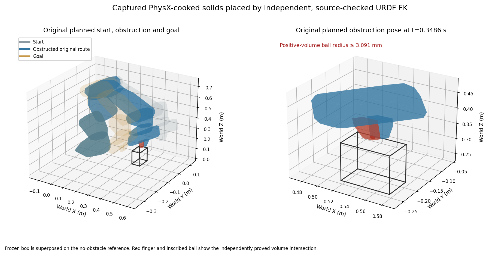
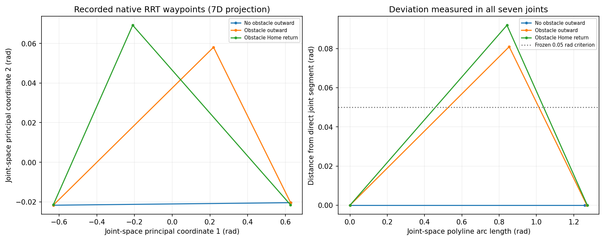
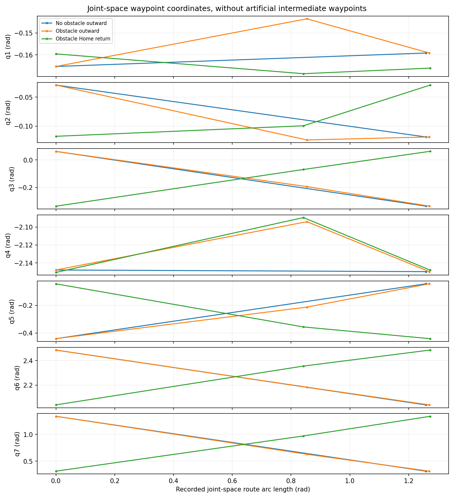
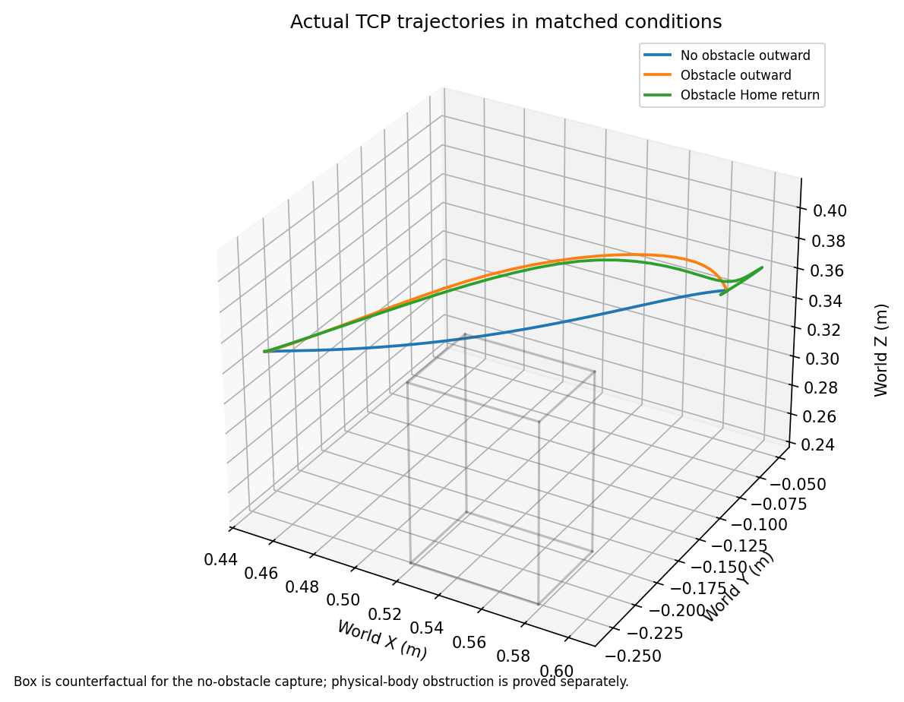
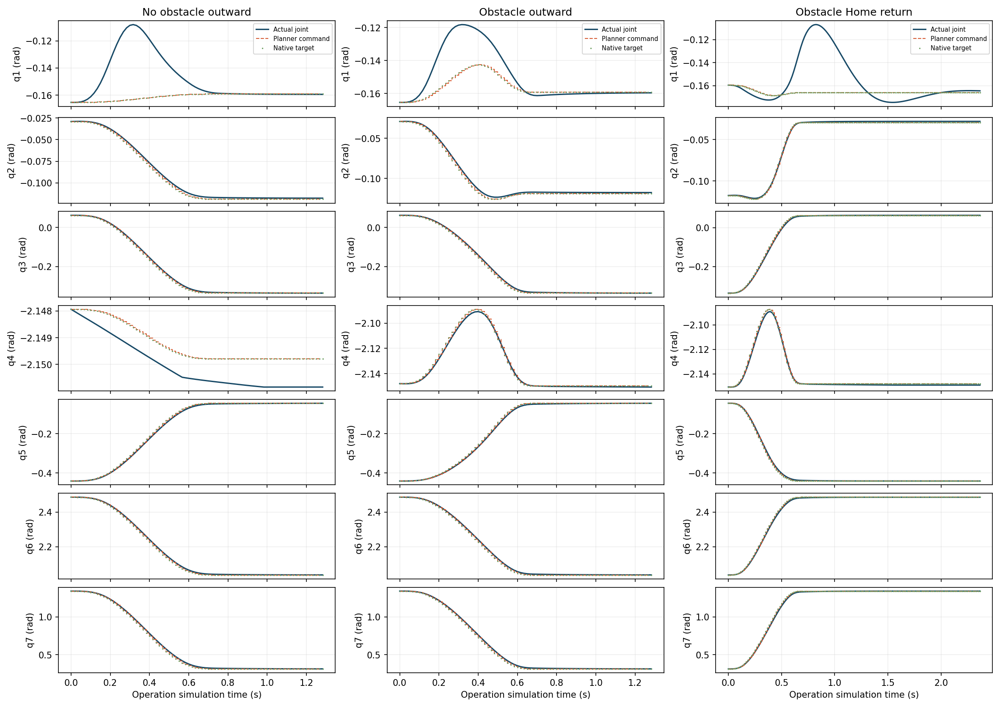
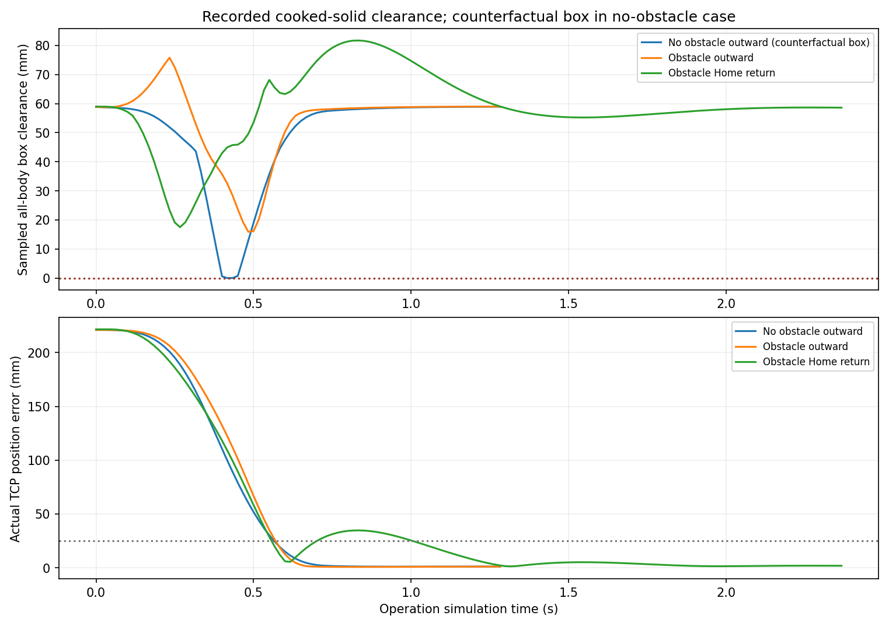
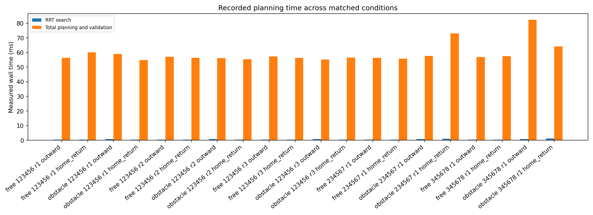

# Motion Planning V4.3 — Obstacle-induced global detour verification

Measured on 2026-10-25 with native Isaac Sim 5.1, NumPy 1.26.4 and the unchanged `run_isaac_python.sh` environment. Starting commit: `83a1197da593286d7057977ecd5ed711111b37cf`. Branch: `research/global-rrt-detour-v4-3`. No merge and no V5, RGB-D global or hybrid implementation.

**The declared static experiment passes.** Five fresh matched comparisons retain exactly the same measured start and validated seven-joint goal. Without the box, RRT returns the original two-waypoint route. With the independently frozen box, it returns genuinely different three-waypoint routes, which execute and return Home with the box unchanged. All five obstacle-present round trips pass the strict zero-report criterion, including three primary repetitions and both additional seeds. Numerical geometric validity, sampled physical observations and general safety guarantees remain separate.

## Why this closes the V4.2 experimental gap

The historical V4.2 box intersects the ordinary direct-RMPflow reference but leaves the two-waypoint global joint path clear. Its successful Home round trips did not demonstrate obstacle-induced global route selection. That fixture and all its results remain unchanged.

V4.3 first captured a new ordinary-IK enhanced global baseline, without any candidate obstacle. The outward and Home motions both passed strict physical acceptance. The outward route has two waypoints, unweighted seven-joint Euclidean length **1.258776275 rad**, with direct-segment deviation only numerical roundoff. Its generated trajectory, actual body poses, selected IK goal, limits and source hashes are retained.

The requested full pose is world position **(0.45, −0.25, 0.35) m**, quaternion **[w,x,y,z] = [0,0,1,0]**. Exact coordinates and native initial feedback are in [fixed_target.json](assets/motion_planning_v4_3/fixed_target.json). Rounded values below are descriptive, not replay inputs.

| Joint | Measured initial q (rad) | Validated fixed goal q (rad) |
|---|---:|---:|
| panda_joint1 | −0.165367 | −0.159183 |
| panda_joint2 | −0.029043 | −0.118824 |
| panda_joint3 | 0.062327 | −0.336248 |
| panda_joint4 | −2.147939 | −2.149790 |
| panda_joint5 | −0.441255 | −0.044545 |
| panda_joint6 | 2.485305 | 2.037695 |
| panda_joint7 | 1.340413 | 0.310938 |

## Controlled IK and unchanged production semantics

The research-only [fixed-target adapter](../scripts/global_detour_fixed_target_v4_3.py) supplies that one recorded IK candidate through a planner-instance-local kinematics proxy. Production still performs its original joint-limit, full-pose FK, start/goal collision, real Lula RRT, interpolated-route, generated-spline and execution checks. The candidate is revalidated each time; it is not a certificate or bypass. Every warm-start slot receives the same joint candidate, so a rejected route cannot silently switch IK branches. There is no alternate-goal or direct-motion fallback.

Only outward comparisons use the adapter. The original planner factory is restored before ordinary named Home. No witness points, synthetic intermediate configurations or Cartesian RMPflow waypoint commands enter the RRT or executor. Native route coordinates are captured from the unchanged planner result.

All five A/B pairs verify exact nine-DOF initial positions, named joint ordering, initial base pose, native position targets, named Home, full requested pose, fixed selected IK goal, all five joint-limit vectors, seed, original **10,000** iteration bound, enhanced-description hash and source cohort. The world differs only by the frozen candidate cuboid. The same 102-sphere description and actual/exposed-target **[1,5] mm** finger contract remain active. The free comparison must also reproduce the original captured baseline route exactly.

No production file changed. Original RRT search semantics, 0.05 rad step configuration, route/spline checks, derivative limits, tracking limits and V4.1 TGS settling/restoration remain intact. The creating Kit thread still owns planning and execution.

## Independent design and freeze

The main box is an axis-aligned physical kinematic cuboid:

| Property | Frozen value |
|---|---|
| Center | (0.55, −0.225, 0.30000000000000004) m |
| Dimensions | (0.06, 0.06, 0.12) m |
| Orientation [w,x,y,z] | [1,0,0,0] |
| Prim | `/World/ReactiveEvaluation/GlobalRouteDetourV43` |
| Fixture SHA256 | `d5c78c58343f40f559ff174ded89814493ac147d62aad1e00327657efd08680f` |

[The frozen fixture](assets/motion_planning_v4_3/frozen_fixture.json) binds the design protocols, copied PhysX-cooked geometry, independent URDF-only FK, original baseline, independent witness, control correction and raw proofs. No candidate-obstacle RRT instance/search was used during design. The native harness verifies its job-plan hash and source chain before running, then checks fresh cooked geometry and actual starting state.

Three geometric stages are explicit and retained:

1. [Initial bounded protocol](assets/motion_planning_v4_3/design_protocol.json): fixed 14,858-box grid per independent witness, two box sizes and seven predeclared witness alternatives. The conservative swept-AABB pass retained **47,479** candidate checks but found no qualifying original-route obstruction. [Its negative result](assets/motion_planning_v4_3/design_initial_result.json) is preserved; it does not prove physical fixture infeasibility.
2. [Exact-geometry protocol](assets/motion_planning_v4_3/design_exact_protocol.json), declared before its selection: same grid, sizes, witness library and geometric margins. Exact convex-distance lower bounds replace rejection solely from overlapping AABBs. There are 275 boxes with verified original planned/actual obstruction and clear endpoints. The fixed ranking and witness priority select the main box; [main_design_lock.json](assets/motion_planning_v4_3/main_design_lock.json) binds it before control finalization.
3. The historical 180 mm goal-blocking control overlaps startup Home. A separately declared [control-only protocol](assets/motion_planning_v4_3/control_finalization_protocol.json) checks 80/60/40 mm cubes in that order. The first 80 mm cube qualifies. Only this control's dimensions change; the main box, witness, ranking result and clearance criteria remain identical. The exact emitter and separate finalizer/protocol override have distinct source hashes.

These are pre-RRT geometric design outcomes, not failed or suppressed native RRT trials. Original and exact design producers/protocols are different files, all preserved. The finalizer invokes the unchanged exact emitter and records its own component identity. No geometric requirement was reduced and no candidate-RRT outcome influenced selection.

### Obstruction, endpoints and independent feasibility

The obstruction proof uses actual cooked convex solids for all eleven bodies, including the mounted base, hand and both fingers. Independent nine-DOF URDF FK is checked against captured body frames before evaluating the original commanded trajectory. Physical intersection is established by a verified positive-radius ball satisfying both solid and box halfspaces, rather than treating zero distance as penetration.

| Independent numeric measurement | Result |
|---|---:|
| Original commanded global trajectory, left-finger intersection ball | **3.091 mm** radius, sample 35 at approximately 0.34865 s |
| Actual baseline corroboration, left-finger intersection ball | **3.742 mm** radius |
| Actual original Home/start clearance to box | **58.835 mm** |
| Fixed validated joint-goal clearance to box | **59.116 mm** |
| Independent witness continuous external lower bound | **10.126 mm** |
| Independent witness continuous nonadjacent self lower bound | **4.496 mm** |
| Independent witness enhanced-sphere external bound | **15.443 mm** |

The selected witness comes from retained empty-world V4.1 Home/GOAL/START captures with bridges to the new exact endpoints. It predates the candidate-obstacle RRT trials and is independently tested against the new box. It is never supplied to the tested planner or executed as a substitute. Joint-linear intervals are subdivided to the declared 0.005 rad bound; conservative descendant-motion bounds qualify the geometric intervals. This is source-bound floating-point geometric feasibility, not a dynamic execution certificate or a certificate of the subsequently generated RRT spline.

[The independent native-model receipt](assets/motion_planning_v4_3/reference_model_check.json) evaluates the same 75 original commanded joint samples without constructing RRT or SimulationApp. Enhanced geometry rejects samples **33–44**, including physical obstruction sample 35, while both endpoints remain clear. Removing the box restores identical clear results; the off-route control remains clear. Native sphere-placement disagreement is approximately 4.01e-16 m, below the numerical allowance. This links the physical obstruction to the actual planning representation.



## Matched route selection and native execution

[All results and paired checks](assets/motion_planning_v4_3/detour_results.json) retain the initial baseline, ten matched runs and both controls. Each matched run is a fresh native process. A/B use the same measured start and fixed IK goal, original bounds and model. Box actor pose, dimensions, collider state, world geometry and stage membership remain stationary through every observed B physics step and both operations. No joint teleport or reset occurs between outward movement and Home.

| Seed | Fresh A/B pairs | A → B outward waypoints | A → B joint-path length (rad) | B maximum deviation from direct connection (rad) | B strict outward/Home |
|---|---:|---:|---:|---:|---:|
| 123456 | 3 | 2 → 3 | 1.258776 → 1.270555 | **0.080928** | 3/3 |
| 234567 | 1 | 2 → 3 | 1.258776 → 1.336994 | **0.218259** | 1/1 |
| 345678 | 1 | 2 → 3 | 1.258776 → 2.050100 | **0.600000** | 1/1 |

The predeclared meaningful-detour gate is at least three native waypoints and maximum Euclidean distance from the original direct joint segment **greater than 0.05 rad** across all seven joints. This metric uses full joint coordinates, not TCP displacement or only trajectory duration. All five B cases exceed it. The three primary repetitions reproduce the same route; the other seeds produce different valid intermediate joint configurations. Every A route exactly restores the original direct connection, including fresh A cases after preceding B processes.

Both directions execute through the existing time-parameterized joint controller. Home uses the normal production full-pose IK, so the exact paired joint-goal claim belongs to outward motion; Home is separately assessed as genuine motion to the original named full pose with the box unchanged.

| Seed | Minimum actual B box clearance: outward / Home | Physical-contact steps | Reported contact points |
|---|---:|---:|---:|
| 123456, each repetition | 15.922 / 17.494 mm | 0 / 0 | 0 / 0 |
| 234567 | 16.289 / 15.403 mm | 0 / 0 | 0 / 0 |
| 345678 | 18.265 / 25.964 mm | 0 / 0 | 0 / 0 |

Every measured B route reaches its target and returns Home. No reported penetration or normal impulse occurs. Closest link/obstacle pairs, per-step clearances and contact severity remain in the compact metrics and raw traces. All-scene clearance is dominated by the unchanged mounted-base/plane result (approximately 24 nm), which is not a useful safety margin; the table reports the candidate-box margin separately.

For primary B/r1, outward/Home final TCP errors are **1.060 / 1.831 mm**, orientation errors **0.001700 / 0.003893 rad**, worst tracking **0.03652 / 0.05929 rad**, and final measured maximum speeds **0.005695 / 0.006278 rad/s**. Each direction independently retains 0.250 s terminal dwell. Across all B runs, the largest tracking error is **0.12247 rad** (Home, seed 234567), below the original 0.15 rad sustained bound. Maximum final TCP error is 1.832 mm. Original 0.40 rad immediate abort, 0.05 rad final joint bound, pose tolerances and three-second settling budget are unchanged.

Requested TGS position iterations activate at 255 and restore **32 → 32** for every accepted leg, with original session opinions restored. Effective native island counts are not directly read by these getters. Completion accuracy and settling are measured here; indefinite stationary holding is not newly certified.











The free-condition box curve is explicitly counterfactual: no candidate box exists in A. Zero convex distance alone is not a penetration proof; the separate positive-volume planned/actual witnesses above establish obstruction. Actual executed clearance remains sampled, even with complete observed physics-step coverage. Retrospective cooked-solid reductions are not an online exact-geometry interlock.

[Independent actual self geometry](assets/motion_planning_v4_3/actual_self_geometry.json) checks 28 actual states across the baseline and all three B seeds: **1,176/1,176 nonadjacent pair queries separated**, minimum **4.328 mm** between the physical fingers. Thirteen URDF structural/adjacent pairs are explicitly excluded; finger/finger and finger/link6 remain included. This uses direct actual body poses and does not infer clearance from absent PhysX or Lula self-contact reports. It is not a continuous self-sweep or native-filtering proof.

## Negative controls, performance and regression preservation

The off-route box permits strict outward/Home completion, with positive independent physical route clearance. The 80 mm goal cube has a **10.469 mm** fixed-goal intersection-ball radius and **69.616 mm** actual Home clearance; native enhanced checking confirms clear start and blocked goal. Its native request returns `invalid_goal` with **zero arm commands**, no Home attempt and no obstacle-unaware fallback. The removal receipt and all five native A comparisons restore the original clear route.

Planning timings are descriptive matched observations, not statistical confidence or a complete application throughput benchmark. Camera/mapping workloads are disabled equally, and both conditions use the same instrumentation and fixed-goal adapter. Five paired samples include three repetitions of the primary seed.

| Outward metric, median across five paired cases | A: no box | B: box present |
|---|---:|---:|
| RRT success | 5/5 | 5/5 |
| Selected validated joint goal | Exact frozen q | Same exact q |
| RRT waypoints | 2 | 3 |
| RRT elapsed | 0.344 ms | 0.735 ms |
| Planning/validation elapsed | 56.886 ms | 57.588 ms |
| Generated trajectory duration | 0.737 s | 0.687 s |
| Actual simulated execution duration | 1.283 s | 1.283 s |
| Goal reached | 5/5 | 5/5 |
| Physical contacts / reports | 0 / 0 | 0 / 0 |
| Candidate-box physical clearance | Box absent; original curve independently intersects it counterfactually | At least 15.922 mm outward |

The shorter median B trajectory duration is a time-parameterization outcome, not detour evidence. Route shape, proven obstruction and unchanged joint endpoints establish the route-selection claim. Outward total planning ranges to 82.440 ms in B. Across B runs, maximum per-run Kit p99 is 16.853 ms and worst interval 111.298 ms; A maxima are 14.045 and 97.043 ms. Kit timings include planning stalls; execution-only waits must not be interpreted as nonblocking planning. Internal RRT collision-query counts/time are not exposed or estimated.



[Global regressions](assets/motion_planning_v4_3/regressions.json) pass the unchanged V4.2 round trip, original large-obstruction movement and cancellation/Home-recovery checks. The large case retains positive-separation reports and is not relabeled strict zero-report success. Cancellation/ownership, competing-command rejection, stale-command suppression and final solver restoration pass in the existing native fixture. New matched round trips close their runtime normally; forced cancellation is not injected into those comparisons.

[Preservation evidence](assets/motion_planning_v4_3/preservation.json): all **649 baseline files** remain byte-identical, all prior repository refs remain unchanged, and untracked `models/` is preserved. Changes are new research tooling, tests, fixtures and evidence only. Perception, Spatial Mapping, WorldModel, direct/reactive strategies, Pick/Place, physical assets, launchers and dependencies are untouched. Direct/reactive native tests were not rerun because production motion code did not change; their existing V4.2 PASS evidence remains unchanged, rather than being counted as new runs.

The complete **1,279-test unit suite**, architecture checks and eight existing auxiliary unit scripts pass. Final test counts and native attempt inventory are bound in [validation.json](assets/motion_planning_v4_3/validation.json). No failed candidate-obstacle RRT seed or failed native execution is omitted; all five declared B trials succeed. The earlier negative geometric design and invalid historical control are retained separately.

## Decisions A–H

| Question | Decision |
|---|---|
| **A. Does the box invalidate the original global route?** | **Yes.** Independent cooked-solid positive-volume intersection on its generated joint trajectory, actual corroboration and native enhanced rejection of samples 33–44 establish obstruction. |
| **B. Does RRT select a genuinely different joint route?** | **Yes, 5/5 paired cases.** Exact start/goal and controlled IK, original 2-waypoint A versus native 3-waypoint B, with 0.0809–0.6000 rad direct-segment deviation. |
| **C. Is the alternative physically clear?** | **Yes within the declared evidence scope.** An independent continuous numeric feasibility witness exists; actual executed B poses have positive all-body cooked clearance. This does not certify continuous swept volume of the tested spline/execution. |
| **D. Can the detour execute without observed collision?** | **Yes, 5/5**, with zero reports, physical-contact steps, reported penetration and impulse. |
| **E. Can it return Home with the box present?** | **Yes, 5/5**, genuinely moving and settled, with the same stationary box. |
| **F. Does it hold across declared seeds/repetitions?** | **Yes for this set:** primary seed in three fresh processes and one each for 234567/345678; their A comparisons remain paired. |
| **G. Is enhanced geometry practical?** | **Yes for this instrumented static experiment:** median outward planning/validation 57.588 ms; no bounds, model or executor tuning. This is not a camera/application scalability benchmark. |
| **H. Ready for the next frozen RGB-D experiment?** | **Yes as a bounded static research baseline.** The obstacle-induced route-selection gap is closed in the declared fixture. Future incomplete/stale RGB-D observations, unknown space, dynamic obstacles, carrying and hybrid behavior remain separate design/acceptance work. |

These decisions establish a measured static-planning result, not general completeness, real-robot safety, arbitrary-scene success or continuous collision safety. The fixed base, captured cooked assets, supported gripper range, static-world assumption and explicit self exclusions remain required scope conditions.

## Reproduction and source binding

[Source checkpoints](assets/motion_planning_v4_3/source_checkpoints.json) map measured local commits to exact-tree-equivalent published commits. Initial ordinary-IK capture used local `d7bdda0`; matched pairs, controls and global regressions used local `139b9e8` (published `e24481f689d9543cf1fa738d30bf6ed8c65bd183`). Offline reducers bind their final producer and figure hashes separately. GitHub publication changes commit metadata, not the verified file trees.

The main launch queues are `baseline_jobs.json`, `paired_jobs.json` and `control_jobs.json` under `docs/assets/motion_planning_v4_3/`. Original matched launch command:

```bash
./run_isaac_python.sh -m scripts.run_global_detour_v4_3_jobs \
  --jobs docs/assets/motion_planning_v4_3/paired_jobs.json \
  --result outputs/motion-planning-v4-3/paired_driver.json --continue-invalid
```

For a fresh single obstacle-present replay on this workstation:

```bash
./run_isaac_python.sh scripts/benchmark_global_detour_v4_3.py \
  --condition obstacle --seed 123456 --headless \
  --fixed-target docs/assets/motion_planning_v4_3/fixed_target.json \
  --fixture docs/assets/motion_planning_v4_3/frozen_fixture.json \
  --fixture-sha256 d5c78c58343f40f559ff174ded89814493ac147d62aad1e00327657efd08680f \
  --artifacts-dir outputs/motion-planning-v4-3/replay-example \
  --result outputs/motion-planning-v4-3/replay-example/result.json
```

All queues/referees refuse overwriting prior attempts. Clone queue output paths into a fresh declared output tree for repeated paired replay. The frozen preflight also requires matching ignored baseline captures, witness archives and historical V4.1 inputs at their recorded paths. They remain on this workstation; a fresh clone alone does not contain them. A fresh independently captured source dataset must receive its own hash binding rather than pretending to match these artifact hashes.

Large geometry, arrays, traces, prior plot versions and logs stay under ignored `outputs/motion-planning-v4-3/`. Compact evidence contains their paths/hashes. Design commands, selected geometry, fixed IK, actual-source alignment and all native launch/driver receipts remain reviewable. No `sudo`, package/driver/environment modification, `--no-ros-env`, main merge or next-stage implementation was used.
