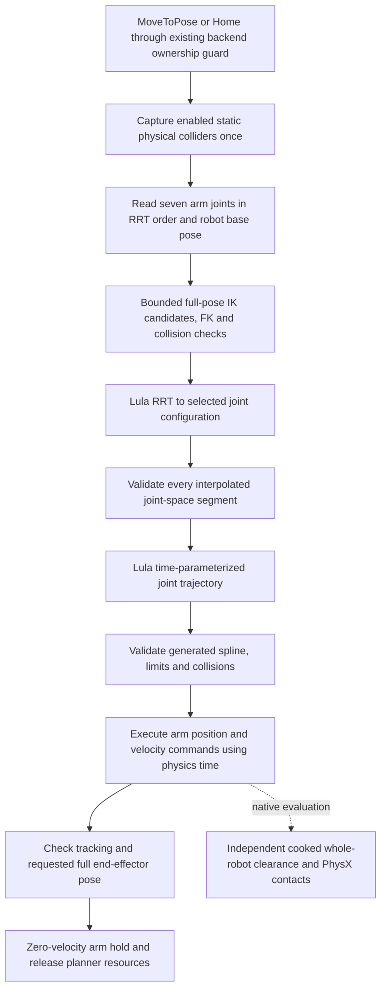
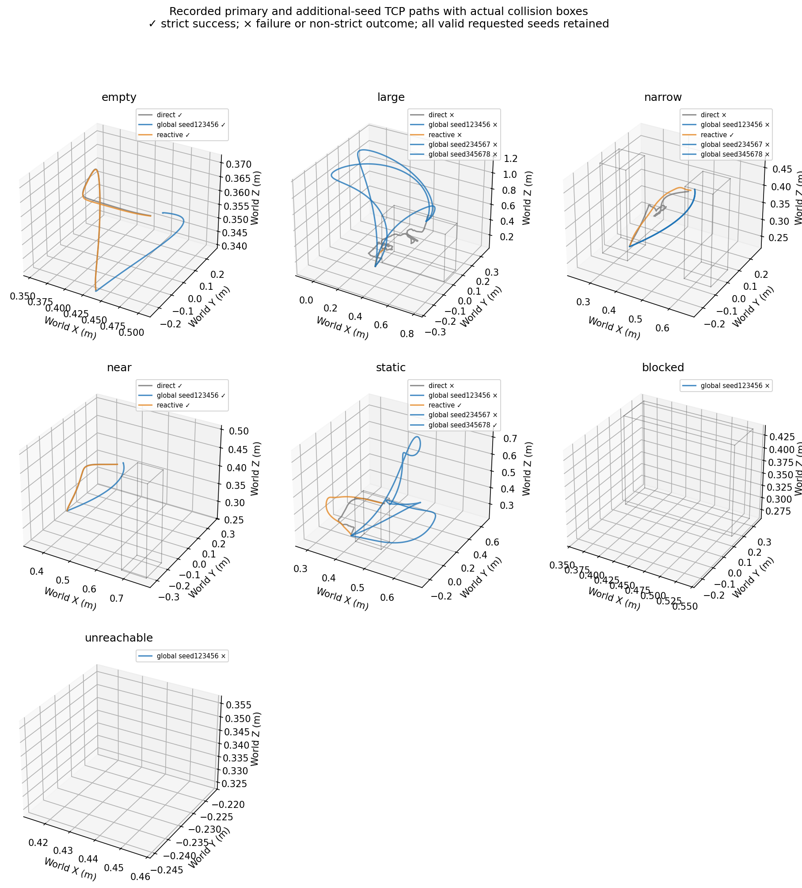
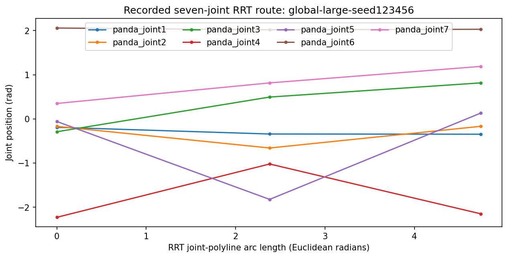
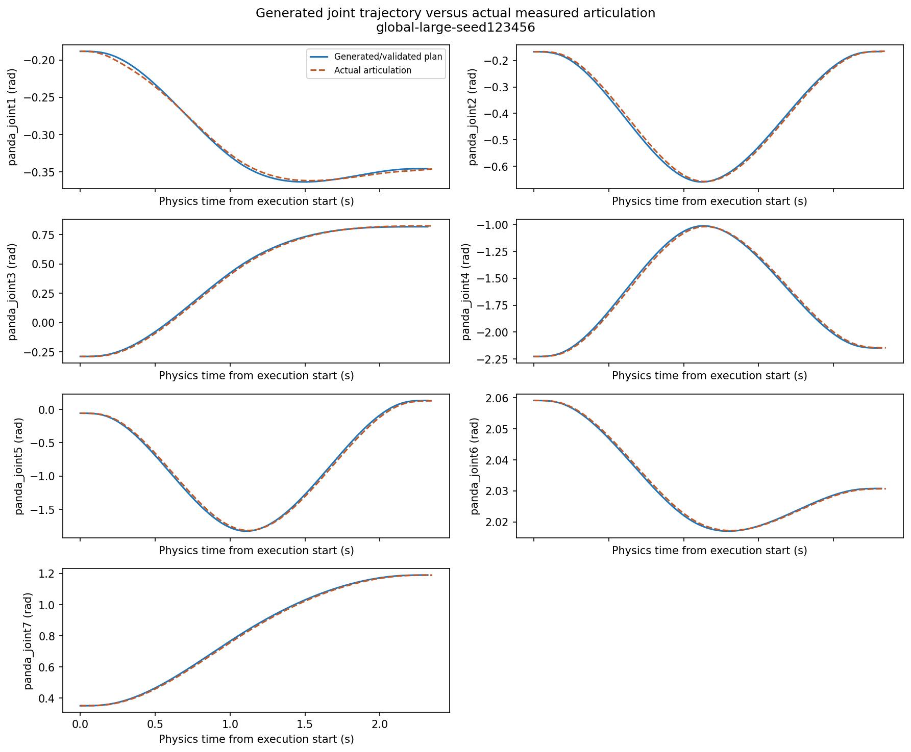
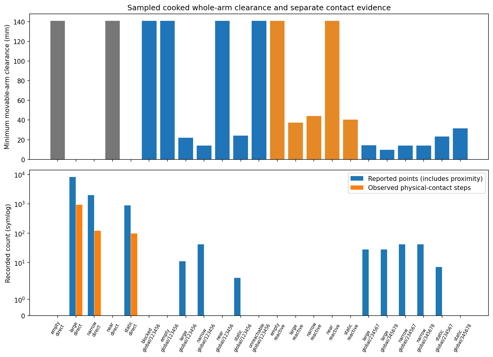
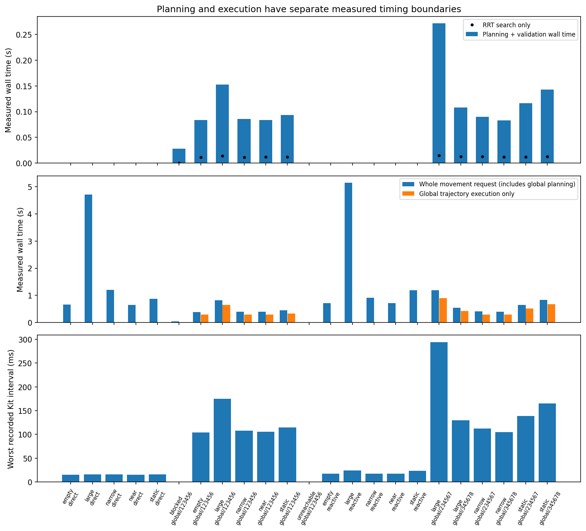

# Motion planning V4: static global Lula RRT

Branch: `feature/global-motion-planning`, based on V3 checkpoint `4f64b356013aea6de887adf5986ec400c77affa0`. Initial implementation: `182b7438f034ff4f69c20fdf888f2615cf7b1c89`; primary experiment implementation and protocol: `f8ea1558871d0f0db5a80800fa9cade96792dc98`. All main native cases bind the latter source hashes. Direct/reactive algorithms, physical joint drives, mapping/perception, shipped scenes and launch configuration remain unchanged. `direct` remains the default and `hybrid` remains unsupported.

**Acceptance: PARTIAL — moving Home remains blocked by execution tracking.** The opt-in global strategy generates seven-joint, full-pose RRT routes and checks generated trajectories before actual articulation motion. All eleven reachable global primary/seed trials reached the goal with zero observed physical-contact steps, but only three passed the stricter zero-report criterion (empty, off-route and one static-post seed). Global reached the large-obstruction goal in 3/3 recorded seeds where direct and reactive timed out; its proximity reports still prevent strict success. The complete V4 acceptance criteria are not met because moving Home failed reproducibly. No gains, hard limits, tolerances or physical problems were relaxed to manufacture a PASS.

The main matrix retained 26 attempts, of which 25 were valid; the failed lifecycle case, separate accepted pilot, three failed Home diagnostics and both failed manual feasibility witnesses remain explicit. The final nominal planner is restored in `d913540fe8b19f6a13210f0b11dfbb989dbd9be8` (published equivalent `408d538e7004f7867aead88ca0fdce3358a91b50`). [Source checkpoints](assets/motion_planning_v4/source_checkpoints.json) map measured local commits to exact-tree-equivalent published commits; GitHub commit metadata differs, while source trees and SHA bindings match.


## Architecture and request contract



The backend continues to own one arm command. The global strategy does not call `backend.move_to_pose_async()` recursively or convert the joint route into Cartesian RMPflow waypoints. It never queries a Spatial Mapping worker, starts perception, refreshes obstacles, repairs a route, or falls back to direct movement. Its synchronous planning and validation calls stay on the Kit owner thread; the measured planning stall is explicit rather than hidden inside execution intervals.

A successful backend result confirms the requested full pose within the existing tolerance after a sampled SDK-model-checked plan and monitored joint execution. It is not a continuous-time physical collision certificate. Native strict acceptance independently requires target reach, zero reported contact points and no sampled cooked-mesh intersection. Positive-separation reports, measured penetration, impulse and mounted-base support clearance remain separately visible.

## Architecture and opt-in scope

`MotionStrategy` remains the backend boundary. `GlobalRrtStrategy` owns the request lifecycle and simulation-time executor; `LulaGlobalPlanner` owns IK, RRT, trajectory generation and pre-execution checks; `StaticWorldSnapshot` contains immutable numeric collision primitives. `joint_route.py` keeps joint naming, route validation and reset-clock contracts independent of Isaac types. Neither skills nor Behavior Trees dispatch through a second motion stack. The existing backend's overlapping-arm-command guard still surrounds the delegated request; global never recursively calls `backend.move_to_pose_async()`.


The opt-in configuration is:

```toml
[motion]
strategy = "global"
rrt_seed = 123456
rrt_max_iterations = 10000
```

`direct` remains the default; `reactive` remains available with its original Spatial Mapping prerequisites; `hybrid` is explicitly rejected. RRT objects are created lazily only during a global request. The existing backend still constructs its original RMPflow resources, but global does not use them to execute the route. Global has no mapping-source provider, camera requirement or dependency on the reactive 64-proxy packet. It does not start or modify perception/mapping. The benchmark's global cases use mapping disabled, whereas the reactive comparison uses its existing 2 Hz ground-truth mapper. This isolates static global planning from RGB-D evidence limitations, while retaining the qualification that background workloads differ by strategy.

Global advertises `supports_contact_motion=False`. MoveToPose and Home route through the same existing interface, but nontrivial Home failed native acceptance and is not a validated capability; intended-contact Pick/Place and held or uncertain payload states are rejected before planning. No payload geometry is modeled. Direct's existing contact skills remain unchanged.

## Installed SDK and version-specific choices

The installed Isaac Sim 5.1 motion-generation module supplies `RRT`, `LulaKinematicsSolver`, `LulaCSpaceTrajectoryGenerator` and `ArticulationTrajectory`. The Franka RRT configuration is loaded with `interface_config_loader.load_supported_path_planner_config("Franka", "RRT")`; the selected frame is `right_gripper`. Its URDF `base_link` is rigidly coincident with `panda_link0`. Both `get_active_joints()` and IK/trajectory joint lists resolve to `panda_joint1` through `panda_joint7`, with no watched joints. Articulation DOF indices are obtained by name, preserving that order and excluding both fingers. The constructor rejects missing, duplicate or inconsistent joint mappings.

The [official RRT tutorial](https://docs.isaacsim.omniverse.nvidia.com/5.1.0/manipulators/manipulators_lula_rrt.html) was checked against the installed source. Contrary to the task's assumed limitation, this installed version also exposes native pose-target planning. V4 nevertheless uses the requested full-pose IK followed by `set_cspace_target(q_goal)` and `compute_path(q_start, empty_watched_joints)`. This makes the selected seven-joint IK branch explicit and retains it throughout execution.

The vendor configuration declares step size 0.05, 50,000 iterations, 10,000 sampling limit, distance weights `[3, 2, 2, 1.5, 1.5, 1, 1]` and C-space exploration fraction 0.5. V4 sets the recorded seed and a fixed default **10,000 iteration bound per IK candidate**, without escalating it after failure. At most four warm starts are tried. The bundled native planner reports a CPU `BasicTree` because CUDA is not enabled in this build; GPU-backed robot simulation remains a separate native requirement. An iteration bound is not a preemptive wall-clock deadline.

The installed Python wrapper has a reproducibility trap: `set_random_seed()` changes its Python `_seed`, but its C-space generation method does not forward that value to native Lula. V4's narrow installed-version adapter therefore also calls `planner._rrt.set_param("seed", seed)` and requires success. It also uses the wrapper's `_world` and `_robot_description` to attach numeric primitives and the public native `RobotWorldInspector`. These private-field bridges are explicitly version-bound rather than changes to the SDK. Source hashes record the installed configuration and wrapper files.

The [path-planner interface documentation](https://docs.isaacsim.omniverse.nvidia.com/5.1.0/manipulators/concepts/path_planner.html) distinguishes active-joint paths from articulation DOFs. The returned route remains Nx7 joint configurations. V4 never projects it into Cartesian waypoints or asks direct RMPflow to reproduce it.

## Full pose, frames and bounded IK alternatives

The target must contain finite position and scalar-first quaternion orientation in the world frame, with positive request tolerances. The actual robot base pose is applied to the IK and RRT wrappers before solving. Snapshot primitive positions are world **meters**; the robot base translation from the articulation is multiplied by `meters_per_unit`, and each primitive is transformed to robot-base coordinates for native Lula. Quaternion matrices preserve primitive orientation. IK/FK use their installed world/stage-unit interface. All measured V4 stages use one meter per stage unit; other stage-unit conventions are not a measured compatibility claim.

The first warm start is the actual arm configuration, followed by the vendor default and two fixed bounded joint offsets, clipped to valid limits. IK uses ten descents with CCD and BFGS iteration caps of 100 each; its numerical solve tolerances are the smaller of the request tolerance and 1 mm/0.005 rad. A successful solver flag is insufficient: FK independently checks the achieved position and full rotation against the original request, and joint limits and external/unmasked self collisions must pass. Duplicate IK configurations are retained as duplicate attempts without repeated search. These bounds can miss other valid IK branches; failure is explicit rather than an unsafe fallback.

A robot already satisfying the requested full pose still passes start-state collision/domain and FK checks. It returns a validated one-configuration route and zero duration, without manufacturing waypoint motion. The executor also checks the actual end-effector pose before reporting that no-motion result.

## Static collision and robot-model limits

The physical scene is captured once through enabled USD collision geometry, with the robot subtree excluded from external obstacles. Supported geometry becomes compact numeric cuboids, spheres or capsules with preserved world pose and dimensions; unsupported relevant geometry fails the whole request. The installed native enum named `CYLINDER` is a capsule, as confirmed by the SDK source, so flat cylinders are not silently relabeled. The plane is represented by an explicit 50 m × 50 m × 50 m clipped halfspace slab with its upper face at the actual plane. Every checked robot sphere must remain inside the stated plane domain. No USD planning proxies are inserted. Table/support geometry and nearby enabled physical colliders remain part of the snapshot rather than being filtered out to obtain a route.

The **stock 55-sphere Franka model is an approximation**, not the actual cooked mesh union. It places spheres on arm links 0–7 and `panda_hand`, including 18 hand spheres, with no explicit finger-link spheres. The descriptor fixes finger joints at 0.025 m; the actual gripper state remains uncommanded by global and need not equal that nominal value. Complete conservative finger/hand coverage is not established. This limitation is why independent native all-link cooked geometry and contact measurements are retained, including both fingers and the mounted base. A sampled SDK-model PASS is not a complete physical collision-safety certificate.

The stock inspector's raw self-collision Boolean is true even at the vendor default pose because adjacent link spheres intentionally overlap. Native RRT can return a route from that same pose, so V4 does not assume the search already enforces all relevant self-collision constraints. Its explicit validator obtains frame pairs from `frames_in_self_collision(q)`, derives exclusions from the URDF by collapsing fixed joints and allowing immediately adjacent links, and rejects every unmasked pair. It never learns an exclusion list from the current, potentially colliding configuration. This is a documented approximate robot-model self check; it does not independently certify all physical self contacts.

## Route and generated-trajectory validation

Every RRT waypoint is checked for finite seven-joint values, correct start/end joint configurations and vendor position limits. Every linear configuration-space segment is then sampled with **maximum 0.01 rad L-infinity displacement**. Each sample must pass the shared frozen-world inspector, non-adjacent self-collision filter and plane-domain checks. This is a declared discrete resolution rather than an analytic swept-volume proof. Reported geometric joint-path length sums unweighted Euclidean joint increments; the search's weighted nearest-neighbor metric is a separate quantity.

`LulaCSpaceTrajectoryGenerator.compute_c_space_trajectory(route)` supplies a time-parameterized joint spline with the vendor's velocity, acceleration and jerk limits. The [official trajectory tutorial](https://docs.isaacsim.omniverse.nvidia.com/5.1.0/manipulators/manipulators_lula_trajectory_generator.html) confirms that this interpolation can differ from a piecewise linear route. V4 therefore checks the generated trajectory independently: its start/end commands must preserve the selected start/IK joints within 1e-6 rad, and dense samples check finite positions, velocities, accelerations and jerks against the original limits, plus the same external/self/domain collision model. The grid is no coarser than **1/240 simulation second** and **0.01 rad maximum joint displacement**; with the installed maximum velocity 2.61 rad/s the selected temporal bound is approximately 3.831 ms. At most 100,000 validation samples and 120 seconds of generated duration are accepted. If smoothing violates a check, that candidate is rejected. No unchecked smoothing or Cartesian/direct fallback is executed.

The vendor arm velocity limits are `[2.175, 2.175, 2.175, 2.175, 2.61, 2.61, 2.61]` rad/s; acceleration limits are `[15, 7.5, 10, 12.5, 15, 20, 20]` rad/s² and jerk limits `[7500, 3750, 5000, 6250, 7500, 10000, 10000]` rad/s³. The integration does not modify physical joint-drive gains or these hard robot limits.

`ArticulationTrajectory` was inspected, including `get_action_at_time()`. Its example frame-count action sequence uses `np.arange`, omits the exact terminal endpoint and assumes a fixed consumption cadence. V4 instead applies the same seven-joint position/velocity action contract explicitly at actual `world.current_time - execution_start`, using named articulation indices. This preserves the real simulation-time schedule and commands the exact terminal joint target before completion. The gripper indices are never included. No joint-state setter or teleport is used.

## Executor lifecycle, monitoring and responsiveness

The planner and all Isaac API calls stay on their creating Kit thread. Planning completes before movement. After planning the executor rejects changed simulation time/index or a changed initial joint configuration, ensuring the validated start is still the execution start. During movement it monitors physics progression, articulation readiness, Stop/reset, strategy epoch and robot-base pose. It commands each physics-time sample once, checks actual joint tracking, and finally verifies the original position/orientation tolerances after the terminal target has been applied. No periodic obstacle refresh or route repair occurs. The environment must remain static; movement of an obstacle after capture invalidates the assumption without a dynamic safety claim.

The declared execution bounds are maximum joint tracking error 0.15 rad sustained for 0.25 simulation second, immediate abort above 0.40 rad, final endpoint tracking within 0.05 rad, up to 3 seconds simulation-time settling, a 2-second stalled-physics watchdog, a wall-clock watchdog of `max(15, 5*trajectory_duration+10)` seconds, and the existing backend's 1,000 control-update budget. A control-budget exhaustion is an execution timeout; a reached trajectory endpoint without a valid final full pose is a distinct final-pose failure. These checks report deviations; they are not an independently validated reactive collision monitor.

Normal completion, failure and cancellation hold the last arm target with zero velocity only while the same live articulation/epoch/time remains valid. Stop/reset or invalidated handles suppress a stale hold. Shutdown invalidates the strategy before trying the final hold, always attempts planner cleanup and preserves cleanup failures. The planner attempts removal of every owned native obstacle registration even if one removal fails. Cancellation propagates to the caller. The synchronous bounded native RRT call cannot be interrupted by normal Kit-coroutine cancellation until control returns to the event loop; that blocking latency is measured rather than represented as asynchronous planning.

Failure metadata distinguishes unsupported geometry, IK failure, invalid/colliding start, invalid/colliding goal, exhausted RRT search, invalid route or generated trajectory, tracking/execution failures, final-pose failure and lifecycle invalidation. Failed attempts retain actual measured phase times and counts, with zero for phases never entered. There is no direct fallback. Natural collision spheres and the frozen scene are distinct from the independently measured physical contacts and mesh clearances.

## Separate accepted native pilot and timer scope

The empty-scene pilot at `outputs/motion-planning-v4/pilot/global-empty-seed123456-r1/result.json` used implementation `182b7438f034ff4f69c20fdf888f2615cf7b1c89` before the main matrix's metadata-only timer fix. It is retained separately rather than pooled into main-matrix timing or seed counts. All measurement contracts passed; it reached the requested pose with zero reported contacts, zero measured normal impulse and no added scene prims. It is an API/execution pilot, not evidence for solving an obstructed scene.

| Pilot measurement | Observed value | Scope |
|---|---:|---|
| Actual registered static obstacles |1 | Ground/support plane retained |
| IK candidates / RRT waypoints |1 /2 | Full-pose candidate and seven-joint route |
| Snapshot capture |2.001 ms | USD physical snapshot only |
| Frozen-world registration/update |12.537 ms | Includes numeric registration, world views and inspector construction |
| Native RRT call |11.888 ms | Search only |
| Trajectory generation |0.0921 ms | Joint spline/timing generation only |
| Route / trajectory validation samples |112 /272 | Declared discrete checks |
| Dense trajectory validation |35.746 ms | SDK-model checks and limits |
| Adapter plan and validation wall time |87.345 ms | Excludes prior snapshot and initial joint-name acquisition/construction |
| Generated trajectory / actual execution |1.037397 /1.066667 s | Simulation time |
| Execution wall time |0.291815 s | Headless run advanced faster than real time |
| Final position / orientation error |12.637 mm /0.028530 rad | Original 25 mm /0.10 rad request |
| Strategy maximum tracking error |0.032416 rad | Per-update maximum arm-joint error |
| Harness control interval p99 / worst |5.628 /6.325 ms | Motion-time controller wrapper |
| Kit interval p99 / worst |44.069 /108.667 ms | Includes the broader planning/update stall |

The pilot's zero controller waits over 100 ms do not mean planning was nonblocking: the largest Kit interval was 108.667 ms. Execution-only controller intervals exclude the pre-movement planning call. `planning_and_validation_wall_seconds` begins after snapshot capture, planner creation/joint-name acquisition, joint mapping and initial-state reads; in the installed integration initial joint-name access constructs RRT once, and the request's plan method rebuilds its own frozen world. The full Kit interval can therefore include broader command overhead. These timer boundaries preclude treating the 87.345 ms figure as all pre-execution work or equating its difference from the Kit interval to a single cause.

The pilot retained all 11 actual cooked robot-link hulls, including hand/fingers/base. Its mounted-base clearance to ground was approximately 24 nm, while its minimum movable-arm clearance was 140.965 mm. Mounted-base qualification remains explicit and does not erase all-link reports. The pilot does not establish a hard real-time bound, a physical finger-model coverage guarantee, continuous swept clearance or performance on difficult static scenes. Main-matrix results are reported separately.

## Reproduction boundary

A single fresh native case can be launched from the normal configured workstation terminal:

```bash
./run_isaac_python.sh scripts/benchmark_global_motion_v4.py \
  --strategy global --scenario static --seed 123456 --max-iterations 10000 \
  --headless \
  --result outputs/motion-planning-v4/reproduce/global-static-seed123456/result.json \
  --artifacts-dir outputs/motion-planning-v4/reproduce/global-static-seed123456
```

The repeated native queue uses the committed `native_jobs.json` and unchanged launcher. Large result traces, arrays, contact buffers and logs remain under ignored `outputs/`; compact evidence can be published separately. The source/config hashes below bind this architecture description to the frozen main implementation and installed SDK files.

Source binding: main implementation `f8ea1558871d0f0db5a80800fa9cade96792dc98`; frozen adapter SHA256 `7d23cda580e3bc4cc2077e054942970fc35a2c24e729a898fc47b54680493cfc`; frozen executor SHA256 `3ccee7d59f8614fe17f7889142225becfef4ab8508a21c6e592e59d7ea1b0fc1`; pilot result SHA256 `32272c8b804e828926b7dc46a3f4404be309e332d6b91460280386887221ba61`. The installed RRT configuration SHA256 is `7457c82c01c3cb29944171a138859426bf8adaf22a5fd646de4cc27d43434dba`, descriptor SHA256 `f91201b9270bea28fe72ae5466365ba410b373e0e46de7ec3fe36c0af9d2dc59`, URDF SHA256 `e9024642e7952cbcaec0ae14425bf1cd19d674d3c98eeef3793913f63a8101b6`. Full installed wrapper fingerprints are in ignored `outputs/motion-planning-v4/sdk-fingerprints.json`. The final runtime remains byte-identical to the measured nominal executor and adapter; final validation distinguishes the 19 unchanged frozen entries from two later analysis-only changes.


## Fixed native protocol

The [predeclared protocol](assets/motion_planning_v4/native_protocol.json) fixes 10,000 RRT iterations per IK candidate, at most four deterministic IK warm starts, primary seed 123456, and difficult-scene seeds 234567 and 345678. No failed seed is hidden or rerun with increased limits. All comparisons use the same physical scene, start and target, full orientation, 25 mm / 0.10 rad request tolerances, physical joint limits and backend limit of 1,000 control updates. Direct/reactive/global representations and timing methods differ by design; this is an end-to-end static planning comparison, not a pure algorithm CPU benchmark.

The 26-case queue comprises five scenes with direct/reactive/global (15), global-only blocked and unreachable requests (2), six additional global seeds, two independent manual feasibility witnesses and one lifecycle case. The initial empty global pilot remains a separate retained preflight. The camera-free global profile disables mapping by default. Reactive uses the unchanged 2 Hz ground-truth occupancy worker and its existing 64-proxy product; direct remains obstacle-unaware. The global world includes every supported enabled external physical collider, including the ground.

All objects are authored only in the USD session layer, initially parked outside the route. The robot reaches START through an ordinary direct command before fixture insertion; no robot joint positions are set. Physical fixture transforms are checked after insertion. START is `[0.45,-0.25,0.35]` m, GOAL `[0.45,0.25,0.35]` m and orientation `[0,0,1,0]` wxyz. `near`, `static`, `narrow` and `large` reuse the established fixture dimensions and poses. `blocked` puts an 180 mm cube at GOAL; `unreachable` requests `[2.0,0.25,0.35]` m. Each declared comparison checks actual initial joints within 0.01 rad, physical world, target, tolerances and source hashes. References are not expanded into Cartesian seed/baseline pairs.

The independent [feasibility protocol](assets/motion_planning_v4/feasibility_protocol.json) specifies one non-RRT direct lift/cross/descend traversal at fixed height 0.85 m in each unchanged narrow/large scene. These manual waypoints never enter RRT. A clear successful witness establishes an independently observed feasible traversal; a failed witness leaves feasibility unproven and does not prove impossibility. The height, obstacles and criteria are not tuned after seeing results.

## Native measurement methods

One fresh native Isaac process runs each case through the unchanged `run_isaac_python.sh`, preserving NumPy 1.26.4 and the established ROS environment. No GPU telemetry is required. Native timing windows are serialized with no concurrent plotting, replay, test suite or other benchmark. CPU SDK probes are labelled separately from robot-motion evidence.

The harness copies actual PhysX-cooked convex robot solids, including arm, hand, both fingers and mounted base. It records actual body poses while moving and reduces whole-link clearance after runtime shutdown against exact physical cuboids and analytic ground halfspaces. The independent convex-distance method is reused from V3; no TCP-only collision certificate or enclosing robot box is substituted. The ground remains in every reference. All-scene minima can be dominated by the mounted base's near-zero ground separation; movable-arm minima and both full and movable-arm strict outcomes are explicit, not silently substituted.

PhysX reports cover all robot rigid bodies and external colliders. Reported points can have positive separation; these are distinguished from sampled physical-contact steps, negative separation, penetration and normal impulse. No harmless-contact threshold is invented. The 4,096-point contact buffer must remain unsaturated. Duplicated physics-time observations are deduplicated for contact counts. Raw bodies, mesh vertices, traces and contact arrays remain ignored under `outputs/motion-planning-v4/`.

Timing separates SDK RRT computation, IK, registration, generation, dense validation, execution wall time and execution simulation time. Kit update intervals include planning before the first arm action; execution control intervals do not. The `planning_and_validation_wall_seconds` field times `planner.plan()`, excluding prior snapshot acquisition and initial joint-name/RRT construction; full request and Kit measurements expose the wider boundary. Per-run quantiles are not pooled across different scene durations. Tracking error is measured against the command at the same simulation time; nearest geometric route deviation is a separate metric.

## Native matrix: measured results and strict outcomes

All **26 predeclared native attempts** are retained: 17 primary requests, six additional difficult-scene seeds, two independent manual witnesses and one lifecycle case. **25/26 measurements passed** their measurement contracts. The lifecycle case failed its Home check; its successful initial movement does not make the complete measurement valid. The earlier successful pilot is separate (implementation `182b743`) and is not pooled with the main matrix (`f8ea155`). No overall acceptance PASS follows from these counts.

The 15 reachable primary comparisons (five scenes × direct/reactive/global, seed 123456) used actual matched starting joints, identical physical obstacles and full pose, unchanged 25 mm / 0.10 rad request criteria, and the same hard robot limits. Reactive used the unchanged 2 Hz ground-truth occupancy worker and 64-proxy product; global used frozen compact physical geometry with no cameras/mapping worker. End-to-end workload and trajectory parameterization therefore differ. This is not an isolated algorithm/hardware benchmark.

Each table cell below gives **goal / full strict success; whole-request wall seconds; reported points / observed physical-contact steps**. Full strict success requires the target, zero reports, and no sampled cooked-geometry intersection, including mounted base, moving arm, hand/fingers, fixtures and ground/support. Reports can be positive-separation proximity rather than physical impacts.

| Scene (primary n=1 per strategy) | Direct | Reactive (GT occupancy) | Global RRT, seed 123456 |
|---|---|---|---|
| empty | Y/Y; 0.662; 0/0 | Y/Y; 0.715; 0/0 | Y/Y; 0.391; 0/0 |
| near | Y/Y; 0.655; 0/0 | Y/Y; 0.717; 0/0 | Y/Y; 0.400; 0/0 |
| static | Y/N; 0.871; 891/97 | Y/Y; 1.188; 0/0 | Y/N; 0.446; 3/0 |
| narrow | Y/N; 1.196; 1989/122 | Y/Y; 0.914; 0/0 | Y/N; 0.400; 42/0 |
| large | N/N; 4.704; 8268/938 | N/N; 5.144; 0/0 | Y/N; 0.817; 11/0 |

Direct achieved 4/5 goals and 2/5 strict successes; reactive 4/5 and 4/5; global 5/5 and 2/5 in this primary reachable cohort. These are five finite scene outcomes, not estimated general success probabilities. Global reaches the large-obstruction goal while both comparators time out. Its primary static/narrow/large movements have positive-separation proximity reports and therefore fail the unchanged zero-reportstrict criterion despite no observed physical-contact steps, penetration or impulse.

## Additional recorded RRT seeds

Every predeclared seed is retained; no iteration limit was escalated. The following nine rows include each corresponding primary run, not nine extra experiments. The direct/reactive reference for a scene is shared; it is not independently replicated for every seed.

| Scene / seed | Goal / strict | Movable-arm cooked clearance (mm) | Reports / physical steps | RRT ms | Whole request s | RRT waypoints / trajectory validation samples |
|---|---|---:|---:|---:|---:|---:|
| static / 123456 | Y/N | 24.068 | 3/0 | 12.287 | 0.446 | 3 / 314 |
| static / 234567 | Y/N | 23.241 | 7/0 | 12.257 | 0.647 | 3 / 461 |
| static / 345678 | Y/Y | 31.540 | 0/0 | 12.617 | 0.836 | 3 / 639 |
| narrow / 123456 | Y/N | 13.980 | 42/0 | 11.639 | 0.400 | 2 / 272 |
| narrow / 234567 | Y/N | 13.980 | 42/0 | 12.484 | 0.407 | 2 / 272 |
| narrow / 345678 | Y/N | 13.980 | 42/0 | 11.674 | 0.393 | 2 / 272 |
| large / 123456 | Y/N | 22.102 | 11/0 | 14.207 | 0.817 | 3 / 607 |
| large / 234567 | Y/N | 14.319 | 28/0 | 14.524 | 1.184 | 3 / 844 |
| large / 345678 | Y/N | 9.733 | 28/0 | 13.015 | 0.547 | 4 / 392 |

Static completed 3/3 targets but only 1/3 strict successes (seed 345678); narrow and large completed 3/3 targets each and 0/3 strict successes. All eleven reachable global main/seed requests (including empty/near) generated and sampled-validated trajectories, executed to the requested full pose, and had zero observed physical-contact steps/depth/normal impulse. This does not turn proximity reports into strict successes or establish a continuous whole-arm collision guarantee. Narrow produced the same observed geometric behavior for the three recorded seeds; seed variability is not guaranteed when a direct configuration-space connection is found.

Independent cooked references retain every arm/hand/finger collider. All-link minima are dominated by the fixed base above the ground, approximately 2.384e-8 m in successful primary movements; movable-arm minima are reported separately. Minimum movable-arm clearance across the eleven reachable global requests was 9.733  mm (large, seed 345678). This is sampled separation, not a certified safety margin.

## Physical contacts versus proximity

| Direct primary scene | Reported points | Observed physical-contact steps | Maximum penetration (mm) | Peak normal pair impulse (N·s) | Contact links |
|---|---:|---:|---:|---:|---|
| static | 891 | 97 | 11.921 | 3.515523 | panda_hand, panda_link6, panda_link7 |
| narrow | 1989 | 122 | 7.229 | 6.442337 | panda_hand, panda_link5, panda_link6, panda_link7 |
| large | 8268 | 938 | 48.874 | 14.659407 | panda_hand, panda_leftfinger, panda_link4, panda_link5, panda_link6, panda_link7, panda_rightfinger |

These are measured contacts, not severity grades or accepted-contact thresholds. All recorded global reports in reachable main/seed trials were classified `contact_offset_proximity`, with positive cooked separation and zero measured penetration/impulse. Reactive large was a contact-free timeout, which remains a failed movement.

## Explicit failures without fallback

- **blocked:** public `path_blocked`, internal `invalid_goal`; request 45.921 ms; actual maximum joint delta 0.000000000rad; 0 reports; no goal completion.
- **unreachable:** public `unreachable`, internal `not entered`; request 4.955 ms; actual maximum joint delta 0.000000000rad; 0 reports; no goal completion.

Blocked entered global IK and rejected four colliding full-pose goal configurations; it performed zero RRT searches. Unreachable was rejected by the pre-existing backend reachability guard before global planning, so missing RRT timing is N/A rather than an estimated zero-cost search. Both failures had zero joint drift and no requested arm commands or direct fallback.

## Manual feasibility witness results

Both predeclared 0.85 m witnesses were valid measurements but **failed at the first lifted pose**, rejected as `unreachable` by the existing request guard in about 4.8 ms. Each recorded only one failed segment, zero joint movement and no contacts. The witness height was not retuned. The independent manual protocol therefore leaves narrow/large feasibility unproven; it does not prove either scene impossible. The candidate RRT physically traversed them without observed physical contact, but that is candidate evidence rather than an independent predeclared witness.

## Planning, trajectory and execution cost

The table summarizes **eleven per-run values**, with median [range]. It does not pool update intervals or treat shared baselines as extra samples.

| Metric (n=11 reachable global requests) | Median [range] |
|---|---:|
| RRT search (ms) | 12.287 [11.481–14.524] |
| Total planning+validation (ms) | 93.358 [82.866–271.474] |
| Static-world register/update (ms) | 11.483 [11.383–11.690] |
| Trajectory generation (ms) | 0.095 [0.090–0.164] |
| Trajectory duration (physics s) | 1.198 [1.037–3.228] |
| Execution duration (physics s) | 1.217 [1.067–3.250] |
| Execution wall duration (s) | 0.334 [0.290–0.893] |
| Per-run control interval p99 (ms) | 6.180 [5.530–6.588] |
| Per-run Kit interval p99 (ms) | 36.538 [6.044–45.775] |
| Per-run joint tracking p99 (rad) | 0.033 [0.032–0.087] |

Largest single Kit interval was 293.959 ms; largest global execution-control interval was 15.641 ms; largest observed tracking error was 0.088078 rad. Synchronous planning/validation blocks the owner Kit loop before movement; execution uses physics time and no obstacle refresh. Search alone is much shorter than the entire preplanning/validation interval. Headless simulation advances faster than wall time here, so physics duration and wall duration must not be conflated.

All eleven planned trajectories passed sampled joint-limit, velocity, acceleration, jerk, external-obstacle and non-adjacent-self checks before execution. Route segments use ≤0.01 rad interpolation; trajectories use ≤1/240 s and ≤0.01 rad. The stock 55 arm/hand sphere model lacks dedicated finger spheres; independent native cooked geometry includes both fingers. No raw or generated joint trajectory is silently assumed collision-free merely because RRT returned a route.

## Lifecycle result retained as an invalid measurement

The lifecycle case is FAIL because `home_completed` failed, despite a strict-successful initial empty movement. 18/19 lifecycle checks were true. Cancellation released ownership and held the arm; overlapping commands were rejected; Stop/Play/reset/rebuild/shutdown checks passed. The first Home after cancellation failed `tracking_failure` (public `path_blocked`); Home after reset/rebuild succeeded. This is an unresolved execution/lifecycle acceptance failure in this recorded source epoch, not a search failure and not a passed lifecycle regression. Its secondary episode trajectories remain excluded from primary timing and physical comparisons.

The three isolated Home diagnoses below are separately sourced observational probes. No Home success is inferred from process return codes or a successful runtime rebuild.

## Evidence scope

Primary 17, seeds 6, witness 2, lifecycle 1 and pilot 1 are explicit cohorts, not a pooled policy success score. Main matrix source hashes were frozen before all 26 runs. Every generated figure must bind its input result/trace SHA and source helper SHA; invalid lifecycle and historical pilot must be excluded from comparative renderings. Full strict, movable-arm strict and physical-contact classifications remain separate. Raw traces/meshes/contacts are ignored under `outputs/motion-planning-v4/`.

## Acceptance decision: PARTIAL

V4 demonstrates working opt-in static joint-space RRT planning and validated trajectory execution for the measured MoveToPose cases. All eleven reachable global requests in the nominal primary/seed matrix reached the requested full pose without observed physical-contact steps; strict zero-report outcomes remain much narrower, including only one of the three obstructed static-post seeds. Direct physical collisions and reactive large-obstruction timeout were retained rather than used to alter fixtures or tolerances.

The complete V4 acceptance criteria are **not met**: Home after cancellation failed tracking in the nominal lifecycle case. Three separately recorded, bounded Home diagnostic variants also failed; they are separate evidence, not extra nominal matrix trials or pooled seed results. The original nominal runtime was restored afterward. No successful Home behavior is inferred from MoveToPose, a passed reset rebuild, or the successful pre-movement RRT/trajectory validation. The Home execution blocker remains explicit, and the feature is not presented as a dependable replacement for the existing default strategy.

The failed manual feasibility witnesses and positive-separation strict failures are additional limits. This report preserves the full failed lifecycle case, all failed diagnostic variants in their separate compact record, the unsupported witness request, and all original nominal seed outcomes. Final unit counts and protected-source preservation are supplied by the final validation report; they do not override the measured Home failure.

## Figure selection and source audit

The final compact main/pilot evidence is 192,208 bytes and contains 27 distinct artifacts: primary 17, seeds 6, witness 2, lifecycle 1 and pilot 1. Twenty-six measurements are valid; the full lifecycle artifact remains invalid. Nineteen references were explicitly declared, of which 16 are eligible comparison edges using five distinct direct baseline artifacts. The two witness edges cross modes, and the lifecycle edge is invalid; no missing edge is inferred or multiplied across seeds.

The TCP, clearance/contact and timing panels show the 23 valid primary/additional-seed artifacts only, retaining deliberate blocked/unreachable failures. The invalid lifecycle, witness and older-source pilot artifacts remain in compact JSON but are absent from comparative curves. The joint-route and plan-versus-actual panels use the deterministic first available obstructed representative: `global-large-seed123456`. It reached the full-pose goal with 11 positive-separation proximity reports, zero observed physical-contact steps and a failed strict zero-report criterion. Its largest native time-matched joint tracking error was 0.039552 rad. Its largest actual distance to the unsmoothed RRT joint polyline was 0.182620 Euclidean radians; this is a different geometric statistic and includes smoothing, rather than a tracking error against the generated trajectory.

All five PNGs were inspected visually. Their figure hashes, current helper hash, all 27 raw result hashes and every trace/plan-trace binding were verified. No raw action arrays or verbose per-episode plan traces remain in the compact lifecycle record. The reproducible local audit is `outputs/motion-planning-v4/asset-audit.json`; source and PNG bindings also remain in the committed figure metadata. No IK/FK, robot execution or new collision query was used to generate these figures.

## Moving Home: unresolved execution acceptance blocker

V4 does **not** satisfy its complete acceptance criteria. A nontrivial Home after cancellation repeatedly failed the original execution tracking contract, despite successful full-pose IK, RRT and pre-execution route/spline checks. The original native lifecycle case passed **18 of 19** guards: overlap rejection, cancellation ownership release, final hold, Stop/reset invalidation, stale-handle rejection, runtime rebuild and close behavior passed; `home_completed` failed. Home immediately after reset/rebuild was a validated zero-motion case and must not be substituted for a moving Home success.

Three bounded diagnostic attempts were retained. All requested the same recorded startup **pose**, with the same physical DOF properties, hard limits, gains and original 25 mm/0.10 rad request tolerances. The sustained tracking bound stayed 0.15 rad for 0.25 simulation second, with immediate abort above 0.40 rad. No threshold, physical obstacle or drive setting was changed to obtain a PASS.

| Moving Home diagnostic | Generated duration (simulation s) | Execution elapsed (physics s) | Abort tracking error (rad) | Logged tracking maximum (rad) | Joint 1 planned / observed change (rad) | Home observer samples / self reports |
|---|---:|---:|---:|---:|---:|---:|
| Nominal trajectory | 0.738532 | 0.850000 | 0.401452 | 0.381478 | +0.006212 / -0.395240 | 53 / 0 |
| Exact fixed 2× time scaling | 1.477064 | 1.566667 | 0.259400 | 0.259400 | +0.006212 / -0.253188 | 96 / 0 |
| Recorded startup IK preference | 0.826658 | 0.950000 | 0.405860 | 0.388420 | +0.158628 / -0.247231 | 59 / 0 |

The nominal and startup-preference cases crossed the immediate 0.40 rad abort bound. Their normal tracking statistics stop at 0.381478 and 0.388420 rad because the executor checks the immediate bound **before** appending the aborting sample. The separately recorded abort errors are 0.401452 and 0.405860 rad. These are consistent measurements with different sample inclusion, not evidence that the executor aborted below its bound. The 2× case failed the sustained tracking check at 0.259400 rad. None completed Home, and a smaller error in one rejected trial is not an accepted workaround.

### What the measurements establish

The diagnostic captured actual applied commands, position/velocity feedback, projected joint efforts, gains, DOF properties and filtered self-contact reports on the owner thread. Public `robot.get_applied_action()` was traced through the installed controller into `Articulation.get_applied_actions()`, which clones actual PhysX DOF position/velocity target buffers. Across every recorded Home action the seven target indices were correct, maximum position-target discrepancy was below 1.20e-7 rad, and maximum velocity-target discrepancy was below 1.09e-7 rad/s. This excludes a simple cached-command or joint-index mismatch in these observations. It does not establish that the physical solver will track every valid kinematic command.

Joint 1 was the dominant anomaly. In the nominal request its planned movement was approximately +0.0062 rad, while measured movement was −0.3952 rad. The subsequent actual joint tracking violated the unchanged bound while the remaining joints approximately followed the nominal command. Read-back gains remained unchanged before and after each Home; complete physical DOF-property signatures also matched across all three attempts. There were **zero self-contact reports in 214 total observer samples** across the three diagnostic captures (208 during Home), with no self-contact buffer saturation. These finite reports do not prove absence of every brief or filtered physical self contact, and they do not turn this failed execution into a collision-free success.

The projected measured joint-effort signal is not an independent calibrated motor-drive torque measurement. Authored USD drive target attributes are likewise not the live PhysX target readback. The data do **not** establish insufficient torque, saturation, an inactive actuator, a particular coupling term, or a specific SDK defect. The concrete blocker is reproducible failure to track an already validated Home joint trajectory under the existing simulated plant. Its precise coupled-plant/SDK cause remains unresolved.

### Rejected bounded probes

The fixed 2× experiment changed only Home's time parameter, after the same nominal cancellation. It used the exact continuous mapping `q_scaled(t)=q_base(t/2)`: velocity, acceleration and jerk were divided by 2, 4 and 8. The geometric route, full-pose goal, robot collision model, frozen world and hard limits stayed identical. Forty-one identity conditions returned zero error for derivative orders 0–3, and the scaled trajectory was independently checked again with the same frozen inspector, original joint limits and dense resolution (387 samples versus 194 nominal). This mathematically valid slower parameterization still failed execution. It is **rejected and not a production default**; no series of progressively slower profiles was searched.

The second probe used the actual startup arm configuration only as the first IK warm start when the requested target exactly matched recorded Home. Full FK validation returned zero pose error, the resulting first IK target matched that recorded configuration, and all collision/route/spline checks remained mandatory. It neither teleported to the startup joints nor bypassed planning. That independently justified branch preference also failed tracking. It was **rejected and removed from the final runtime** rather than being retained as an ineffective fix.

Commit `d913540fe8b19f6a13210f0b11dfbb989dbd9be8` restores the executor and Lula adapter byte-for-byte to the nominal `f8ea1558871d0f0db5a80800fa9cade96792dc98` runtime. The preference experiment remains inspectable in `b7c4dc46383df76def76d49899e31db91f34cfdb`; the exact time-scaling helper and diagnostic code remain reusable research infrastructure. No retiming, startup-joint preference, reactive correction, unsafe direct fallback, gain modification or relaxed tolerance is enabled by these failed probes.

The next step is a focused simulated-plant/SDK tracking investigation using validated joint trajectories and read-only dynamics/drive observations. It should distinguish internal solver/drive response from desired joint targets before changing execution policy. This task leaves that blocker explicit. Successful MoveToPose/static obstacle results elsewhere in this report do not establish that Home is dependable.

Evidence: [home_execution_diagnostics.json](assets/motion_planning_v4/home_execution_diagnostics.json) contains compact scalar outcomes, exact wrapper/runtime/trace hashes, the analytical scaling protocol, measured identity/revalidation results and source-restoration checks. Raw per-step joint vectors, physical poses, drive arrays and traces remain ignored under `outputs/motion-planning-v4/home-diagnostic/`. The first nominal wrapper predates the later committed scaling option; its exact measured SHA is recorded without assigning it a false later source commit. The original lifecycle result and all three failed Home attempts are retained and excluded from primary matched timing/avoidance counts.


## Measured route, tracking, contact and timing figures



The TCP plot uses the 23 valid primary/seed requests, with every requested seed retained and actual fixture wireframes. Blocked/unreachable requests have singleton TCP samples and no drawn motion line. Check marks denote full strict success; an × can mean proximity reports despite target completion. Axis ranges differ by scene. TCP curves do not certify whole-arm sweeps.





The joint panels use the deterministically selected large/seed123456 trial: three RRT configurations, the independently checked generated spline and measured articulation. This trial had 11 proximity reports, zero observed physical-contact steps and strict failure; it is not selected as a collision-free success. Its maximum observed per-joint tracking error was 0.039552 rad. Its maximum actual-to-RRT-polyline distance was 0.182620 Euclidean joint radians, a different metric: spline geometry and time-matched tracking must not be conflated.

The generated-trajectory check materially changed one decision. In large/seed234567 the first candidate's piecewise-linear route passed 487 samples, but its smoothed trajectory produced an unmasked `panda_hand`–`panda_link5` self collision and was rejected before movement. A second bounded IK/RRT candidate produced a trajectory passing 844 samples and was executed. That rejected candidate is retained; no unchecked smoothing was used.





These comparisons exclude pilot, witness and invalid lifecycle cases. [Figure bindings](assets/motion_planning_v4/figures.json) identify actual result/trace/plan-trace hashes and producer source. [Compact evaluation](assets/motion_planning_v4/evaluation.json) retains all 27 main/pilot attempts and the five-cohort ledger; no raw trajectory, mesh or contact array is committed.


## Reproduction and validation

Opt in through a copied profile; no shipped default changes:

```toml
[motion]
strategy = "global"
rrt_seed = 123456
rrt_max_iterations = 10000
```

A supported static scene is sufficient; RGB-D cameras and Spatial Mapping are not prerequisites. Enabled dynamic bodies, animated colliders, unsupported mesh geometry, invalid transforms and unresolved physical scene composition fail before arm commands. Pick/Place and carrying without modelled payload geometry are explicitly unsupported through `supports_contact_motion=False`; existing direct Pick/Place remain available.

The finite reusable matrix runs from the repository root:

```bash
./run_isaac_python.sh scripts/run_global_motion_v4_jobs.py \
  --jobs docs/assets/motion_planning_v4/native_jobs.json \
  --result outputs/motion-planning-v4/native-driver.json
```

The driver refuses to overwrite recorded attempts, retains failure results, bounds each process at 240 seconds, stops on invalid measurements/fatal GPU errors and never retries failed planning seeds. To run again on this workstation, copy the plan and replace the entire `outputs/motion-planning-v4/native/` prefix, including every `--reference-result`, with a fresh prefix. A fresh repository clone has no generated captures at those paths. Each case stores `result.json`, `launch.json`, `native.log`, `driver_result.json`, the generated profile, raw physical trace, plan trace and copied geometry reference. Witness/lifecycle cohorts remain separate from primary timing claims.

The final regression command was:

```bash
./run_isaac_python.sh scripts/run_all_regressions.py --unit-only \
  --artifacts-dir outputs/motion-planning-v4/unit-final
```

It passed **1,052 unit tests in 35.306 seconds**, the architecture check and all eight standalone modules. Artifacts: `outputs/motion-planning-v4/unit-final/run-q24d9gt9/`. Targeted coverage includes actual joint-name ordering/finger exclusion, IK full orientation and limits, colliding states and unsuccessful search, route interpolation, trajectory endpoints/limits/collisions, seed forwarding, frozen physical geometry, failed-phase timing, physics-clock reset/stall, tracking failures, cancellation/hold/cleanup, configuration/factory isolation and exact time-warp mathematics. Unit PASS does not override the measured Home failure.

Both unchanged existing native regressions passed their result assertions:

```bash
./run_isaac_python.sh tests/isaac/test_motion_strategy.py \
  --result outputs/motion-planning-v4/regressions/direct-strategy/result.json \
  --artifacts-dir outputs/motion-planning-v4/regressions/direct-strategy

./run_isaac_python.sh tests/isaac/test_reactive_motion.py \
  --result outputs/motion-planning-v4/regressions/reactive-strategy/result.json \
  --artifacts-dir outputs/motion-planning-v4/regressions/reactive-strategy
```

The direct test retained successful physical Pick/lift/held Home/Place/released Home, cancellation, single-command ownership and final holds. Reactive retained successful ordinary Move/Home and its complete existing lifecycle assertions. The project launchers, physical drive parameters, shipped scenes, mapping/perception/tracking and existing direct/reactive algorithms remain unchanged. All **254 protected baseline hashes** match. The permitted existing-file changes are configuration/factory integration and their two corresponding unit modules. Final nominal core files match the main measured source exactly: 19/21 main frozen entries remain identical; only the analysis helper and its unit module changed afterward to compact lifecycle data and correct cohort filtering. The pre-existing untracked `models/` directory remains preserved.

The earlier development run retained 1,026 passing unit tests but an architecture failure from an in-progress analysis helper's reserved-keyword syntax. That error was corrected before the main native matrix; later architecture checks and the final full regression passed. The original artifact remains `outputs/motion-planning-v4/unit-preflight/run-voxzc0zb/`.

Rebuild the compact evidence and figures only after native windows finish:

```bash
./run_isaac_python.sh scripts/summarize_global_motion_v4.py \
  --cases outputs/motion-planning-v4/native/*/*/result.json \
    outputs/motion-planning-v4/pilot/*/result.json \
  --result docs/assets/motion_planning_v4/evaluation.json \
  --figures-dir docs/assets/motion_planning_v4
```

The three Home probes stay in their separate compact record. The current restored nominal code can reproduce the nominal and exact 2× diagnostic with fresh output directories:

```bash
./run_isaac_python.sh scripts/diagnose_global_home_v4.py \
  --headless --seed 123456 --max-iterations 10000 --time-scale 1 \
  --result outputs/motion-planning-v4/reproduce/home-nominal/result.json \
  --artifacts-dir outputs/motion-planning-v4/reproduce/home-nominal

./run_isaac_python.sh scripts/diagnose_global_home_v4.py \
  --headless --seed 123456 --max-iterations 10000 --time-scale 2 \
  --result outputs/motion-planning-v4/reproduce/home-time-scale2/result.json \
  --artifacts-dir outputs/motion-planning-v4/reproduce/home-time-scale2
```

The rejected startup-preference variant requires its historical `b7c4dc4` published-equivalent checkpoint from the source index in an isolated checkout; it is deliberately absent from the final runtime. All probes are excluded from primary performance comparisons, and expected failures are retained. A source-only clone lacks the ignored raw traces needed to regenerate old plots; fresh native captures supply new measured evidence rather than identical samples.

[Validation](assets/motion_planning_v4/validation.json), [independent audit](assets/motion_planning_v4/independent_audit.json), [Home diagnostics](assets/motion_planning_v4/home_execution_diagnostics.json) and [source checkpoints](assets/motion_planning_v4/source_checkpoints.json) bind counts, exact sources, SDK fingerprints and artifact hashes. No raw logs, captured meshes, per-step trajectories or contacts are published. No merge or hybrid implementation was performed.


## Decisions and limits

**A. Does global RRT outperform reactive RMPflow in difficult static environments?** It improved goal completion in the large obstruction: 3/3 recorded global seeds reached without measured physical-contact steps, while the matched reactive run timed out contact-free. That does not establish overall superiority. Global had proximity reports in those trials and zero full strict large successes; reactive was strict-clear in its static and narrow primary cases. Global static was strict-clear only for seed345678 (1/3). Shared references and small sample counts are not general success probabilities.

**B. Can collision-free joint trajectories be generated and executed reliably?** Seven-joint routes and generated trajectories were checked before all eleven reachable main/seed executions. Those goals were reached with zero observed physical-contact steps, and one genuinely obstructed static seed passed the full strict criterion where direct had physical collisions. Proximity, approximate finger coverage, discrete collision checks and the reproducible moving-Home failure prevent a dependable general claim. The full V4 acceptance remains PARTIAL; it is not a validated replacement for the default strategy.

**C. Is planning fast enough for this research setup?** Observed search median was 12.287 ms and adapter planning/validation median 93.358 ms, with worst observed Kit interval 293.959 ms. These costs are practical for finite static request experiments, with a visible owner-loop pause before movement. They are not hard latency bounds or evidence of nonblocking/hybrid suitability. No unsafe SDK worker thread or large multiprocessing framework was introduced.

**D. Where do failures originate?** The unreachable request and both fixed high-lift witness poses failed the existing reachability guard. Blocked rejected four colliding full-pose goals without RRT or arm movement. One smoothed candidate was rejected for non-adjacent self collision before execution, then a bounded alternative succeeded. Native search exhaustion was not observed; its clean failure path is unit tested. Moving Home failed joint tracking after validated IK/route/spline checks. Actual PhysX targets matched intended targets and no self contacts were reported, but its physical-plant/SDK cause remains unresolved; neither exact 2× timing nor recorded Home IK preference solved it, and both were rejected. No gains, robot limits, acceptance thresholds or fixtures were altered.

**E. Can frozen RGB-D snapshots reasonably feed V5?** The immutable world/planner boundary can accept a future numeric source, but V4 is not ready to claim dependable RGB-D manipulation. Home tracking, physical collision-model coverage, source age and incomplete/UNKNOWN evidence must be addressed and independently validated. Frozen RGB-D snapshots would not remove sparse-evidence or static-world assumptions. No occupancy integration or dynamic replanning was implemented here.

**F. What is reusable in a future hybrid planner?** The backend strategy boundary, explicit full-pose IK targets, named seven-joint mapping, frozen numeric world, seeded bounded RRT adapter, route and spline validators, physics-time execution/ownership/cleanup contracts, and independent native measurement infrastructure are reusable. First resolve the moving-Home execution blocker and validate physical collision-model coverage; then evaluate a separate hybrid architecture. This feature remains opt-in and unmerged, with `direct` unchanged as default.
