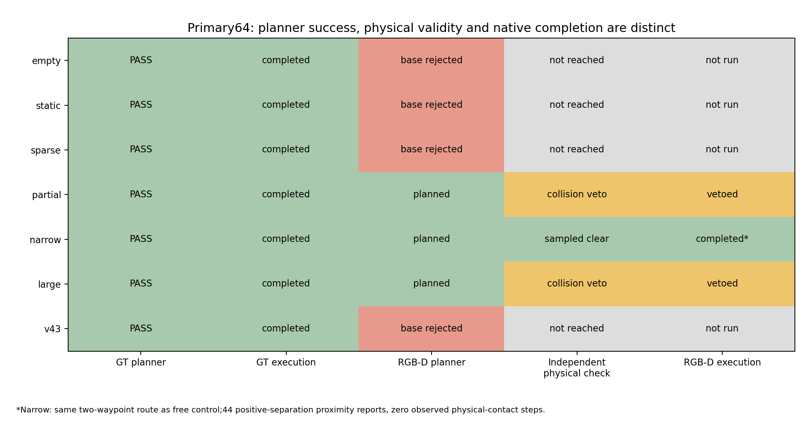
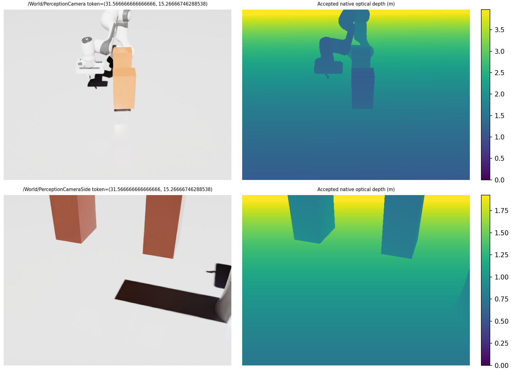
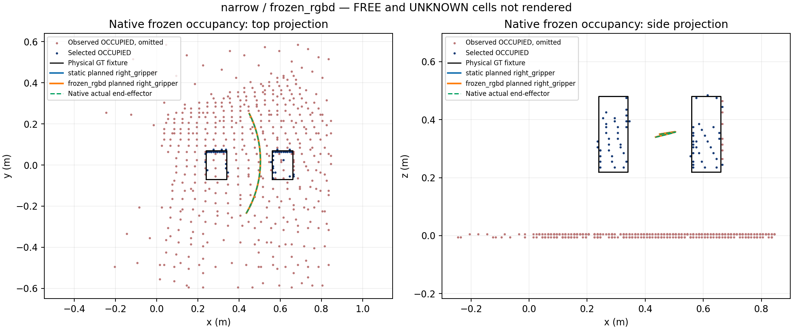
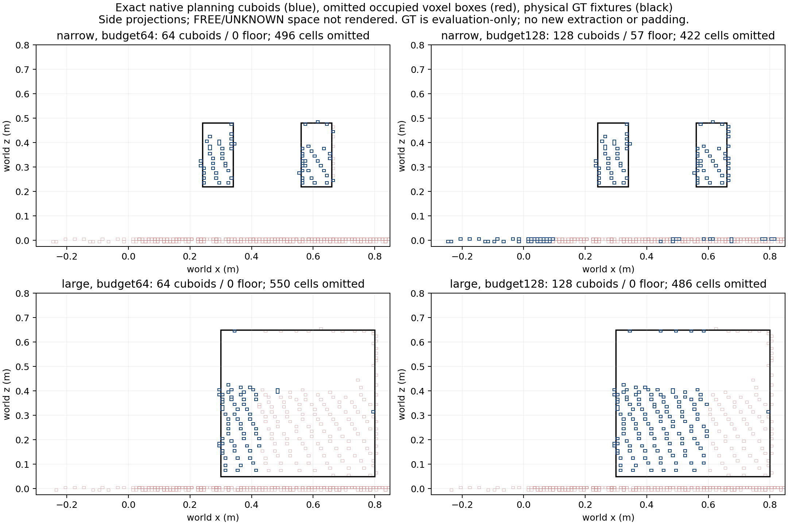
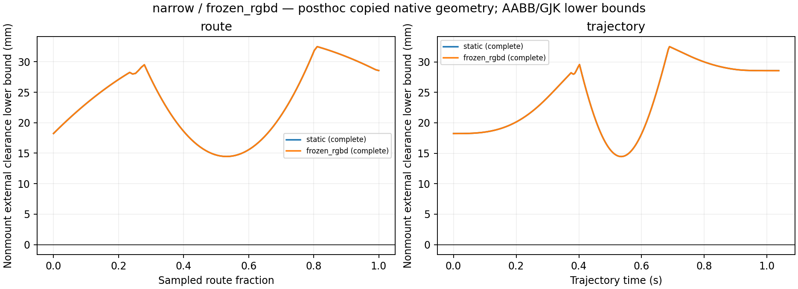
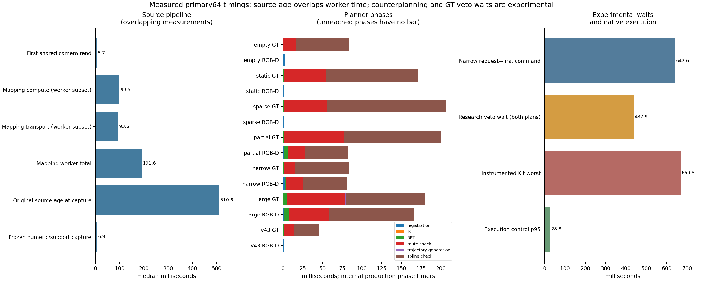

# Motion Planning V5 — Global RRT from frozen RGB-D occupancy

**The frozen RGB-D integration works, but the current observation/representation is insufficient for reliable obstacle-aware global motion.** In the seven-scene primary comparison, GT completes 7/7 motions; RGB-D returns 3/7 plans, two are independently unsafe and vetoed, and only the narrow case completes. Its route is identical to empty GT, so obstacle-induced RGB-D detouring is not demonstrated. The study starts from `aef5f2fe0af0229a1c69c64035b7de0b07173b0b` on `research/global-rrt-detour-v4-3`, with development on `feature/global-rgbd-planning-v5`. No merge into `main` is part of this task.

V5 asks whether the existing camera observations contain enough useful obstacle evidence for static Lula RRT planning. It reuses the occupancy worker, automatic robot filtering, numeric obstacle registration, enhanced Franka collision model, trajectory validation and V4.2 executor. It introduces an opt-in obstacle source; it does not introduce hybrid planning, online replanning or reactive trajectory correction.

## Source selection and architecture

The default motion strategy remains `direct`. Existing global configurations retain `global_obstacle_source = "static"` and the established V4.3 known-geometry capture. Camera-derived global planning is explicit:

```toml
[motion]
strategy = "global"
global_collision_model = "enhanced"
global_obstacle_source = "frozen_rgbd"
max_obstacles = 64
rrt_seed = 123456
rrt_max_iterations = 10000
```

The full profile also requires enabled RGB-D Spatial Mapping and automatic robot self-filtering. Configuration validation rejects incompatible combinations. The backend uses the existing late-bound `MappingSourceProvider`; it resolves mapping only when a request captures its world, after observation runtime construction.

```text
Existing authored depth cameras
  → existing exposure-matched robot filtering and RGB-D mapping worker
  → immutable occupancy publication + worker-prepared bounded ObstaclePacket
  → SDK-free capture_frozen_rgbd: validate and copy bounded descriptors once
  → Isaac adapter: exact numeric cuboids + explicitly known support Plane
  → existing StaticWorldSnapshot / Lula full-pose IK and RRT
  → existing route and spline validation against that same world
  → existing timed joint executor
```

The SDK-free boundary is [frozen.py](../robot_skill_stack/world/spatial_mapping/frozen.py). The Isaac translation and narrow support read are [motion/frozen_rgbd.py](../robot_skill_stack/integrations/isaac/manipulation/motion/frozen_rgbd.py). Source selection is integrated into the existing [global strategy](../robot_skill_stack/integrations/isaac/manipulation/motion/global_rrt.py), backend factory and observation-runtime worker setup. There is one occupancy pipeline and one global executor.

Only accepted RGB-D worker completions gain small provenance records: source type, frame count, camera IDs, frame tokens, original acquisition times, depth dimensions, intrinsics and camera-to-world transforms. This metadata contains no new acquisition and copies no image buffers into the control path.

## Exact frozen-world contract

`capture_frozen_rgbd(source, max_obstacles=64)` reads the service's existing clock once and requests exactly one fixed-time `MappingReadView` with that time. It validates all of the following before accepting a world:

- Mapping exists, is enabled, uses `rgbd`, and requires automatic robot self-filtering.
- There is an accepted publication in the current generation, with positive revision, healthy `ok`/fresh status and an original timestamp within `min(stale_after, max_frame_age)`.
- The view and worker obstacle packet share generation, revision and original timestamp; extraction time is valid; configured bounds, evidence TTL and freshness semantics agree.
- Accepted exposure identities and calibrated cameras agree with the publication, configured mapping cameras and successful automatic filter records.
- The prepared budget matches the requested budget. Selected evidence remains unexpired at capture.
- Selected boxes are nonempty, unique, disjoint exact grid-cell cuboids with valid accounting. Geometry cannot silently expand, bridge gaps or leave the mapping bounds.

The returned immutable `FrozenRgbdWorld` retains the original timestamp, capture time, generation, revision, grid specification, exact box descriptors, health and provenance metadata, and the fixed-time read view. `StaticWorldSnapshot.timestamp` preserves the original acquisition time. Metadata identifies selected, supported, represented and omitted occupied cells, extraction policy, camera calibration and known support separately. Worker count diagnostics are explicitly labeled with their extraction time; capture performs no dense recount.

All dense occupancy processing, evidence support and exact cuboid packing remain in the existing mapping worker. Owner-thread capture validates at most the configured 64 or 128 descriptors and small metadata records. Dense offline scoring accesses the retained view after runtime cleanup. No later publication, reset, close or wall-clock expiry can mutate this already captured world or the fixed-time query results.

RRT, route checks and spline checks receive the same numeric snapshot. The executor follows that result without another mapping lookup, obstacle registration or active-world refresh. Existing arm ownership, cancellation, Stop/reset, simulation-progress, tracking, terminal-settling and solver-restoration checks remain active. A later scene change invalidates the static assumption; V5 does not detect or correct it.

## Occupied geometry, support and uncertainty

The primary representation remains the existing 64-cuboid worker packet. The optional 128-cuboid condition is a separately labeled diagnostic of omitted observed evidence. Neither condition changes packing, confidence, camera position, resolution or the shared mapping-ray budget. The boundary never truncates a prepared 128 packet and calls it a 64 result, and never relabels a prepared 64 packet as a 128 result.

The existing worker selects unexpired observed OCCUPIED cells, retains spatially supported components of at least three cells in the radius-two Chebyshev graph, and additionally retains strong sparse RGB-D cells at probability ≥0.95. Support neighborhoods never become obstacle geometry. Exact Z runs are merged along Y and X before the existing deterministic bounded selection.

World positions and dimensions remain in meters. IDs retain their occupied-cell bounds. The final grid cells retain clipped boundary dimensions, rather than being forced to a nominal full voxel. Occupancy cuboids remain axis-aligned with identity orientation. Every selected worker box is preserved, including selected floor evidence. The known support plane does not silently erase camera-derived cells.

The RGB-D adapter performs no scene traversal. Its only external USD geometry access is the explicit allowlist `/World/GroundPlane/CollisionPlane`, required to be an enabled, static `Plane` collider with a valid transform. That known support halfspace uses the existing certified finite-domain representation. No physical test fixture position, name, dimension, semantic class or hidden collider enters the RGB-D planner through GT capture. GT scene capture is confined to the control condition and independent research evaluation. Failed RGB-D capture cannot substitute GT, direct motion or an empty world.

`OCCUPIED`, `FREE`, `UNKNOWN` and `OUT_OF_BOUNDS` remain distinct. The planner registers selected positive occupied evidence. UNKNOWN space remains traversable by this incomplete collision representation; it is not physically verified FREE. Expired evidence is UNKNOWN in the retained fixed-time occupancy queries. Offline route exposure reports sampled FREE/OCCUPIED/UNKNOWN/OUT_OF_BOUNDS coverage and qualifies sampling limits. There is no occupancy dilation, unseen-interior completion, gap filling or arbitrary obstacle padding.

A nonempty but sparse map does not establish that the physical scene is empty. Surface evidence retention is distinct from solid-object reconstruction. A camera return on one cube face does not establish the cube's complete volume. Omissions from camera visibility, finite rays, confidence/support filtering and proxy selection must be scored separately.

## Robot and execution scope

Both comparison sources use the enhanced 102-sphere Franka model and unchanged Lula, derivative limits and executor behavior. The enhanced model requires each measured finger joint and exposed native finger position target to remain in its validated **[1, 5] mm** interval. The descriptor's fixed nominal finger coordinate is 3 mm, with its existing swept-range geometry and certified self-pair exclusion. This contract is checked before planning and during movement.

Carrying without modeled payload geometry, intended-contact Pick/Place and unsupported finger configurations remain rejected. V5 does not change skill or Behavior Tree APIs. Robot-base transforms remain part of normal numeric registration and execution checks. Conservative mounted-base checks can reject camera floor geometry that overlaps the base enclosure; such a rejection must remain a measured model/representation finding rather than trigger silent removal of evidence.

## Declared native comparison

The primary layout is **A_current**, the camera transforms authored in `scenes/multiview_perception_final.usda`. Neither `EYES` from older diagnostic scripts nor a `set_viewpoint` override belongs to this condition. Both sources keep the authored two-camera layout and 640×480 resolution, semantic perception at 5 Hz, mapping at 2 Hz, stride 8, one shared 1,024-ray budget, 10 mm voxels, automatic robot self-filtering, 5 s evidence TTL and 1 s acquisition/publication freshness limit.

Motion workspace bounds are `[-0.3, -0.6, -0.02]` to `[1.0, 0.6, 1.12]` m. Mapping bounds are `[-0.3, -0.6, -0.02]` to `[0.85, 0.6, 1.12]` m. These are generated run-local profiles; shipped scene/profile files stay unchanged. The primary RRT seed is 123456 with the original 10,000-iteration limit. Position/orientation tolerances remain 0.025 m and 0.10 rad in the research protocol.

| Declared scene | Unchanged physical fixture; center / dimensions (m) | Target |
|---|---|---|
| `empty` | No added fixture | GOAL |
| `static` | Post: (0.45, 0, 0.35) / (0.09, 0.12, 0.26) | GOAL |
| `sparse` | ThinPost: (0.45, 0, 0.35) / (0.035, 0.06, 0.20); historical rectangular box, not a cylinder | GOAL |
| `partial` | Same Post plus Occluder: (0.79, −0.30, 0.53) / (0.08, 0.40, 0.40) | GOAL |
| `narrow` | Left/Right: x = 0.45 ± (0.22 + 0.10)/2, y = 0, z = 0.35; each (0.10, 0.14, 0.26) | GOAL |
| `large` | Wall: (0.55, 0.05, 0.35) / (0.50, 0.12, 0.60) | GOAL |
| `v43` | `/World/ReactiveEvaluation/GlobalRouteDetourV43`: (0.55, −0.225, 0.30000000000000004) / (0.06, 0.06, 0.12) | START, from the original startup/Home configuration |

START is (0.45, −0.25, 0.35) m, GOAL is (0.45, 0.25, 0.35) m and orientation is `[w,x,y,z] = [0,0,1,0]`. The six historical crossing fixtures are copied exactly from the previous diagnostic, including the original floating-point arithmetic. They are created parked before setup and moved into their declared physical poses afterward. The bounded common warmup exceeds the evidence TTL and requires accepted publications; it does not change freshness rules. V4.3 is not moved to improve camera visibility. Its original fixture lies inside the mapped region and is visible in both retained camera frames, but only seven current occupied cells represent its observed surface.

The serial driver declares 14 fresh processes: each scene's GT execution condition followed by its RGB-D execution condition. `protocol.json` freezes choices and fixtures before launch; `jobs.json` binds source choices, separate output folders and per-job 600 s or 900 s timeouts. Existing run directories and attempts are never overwritten. GPU startup failure stops the queue; an unavailable GPU is not replaced with CPU performance estimates.

### Research-only paired counterplan and veto

Inside each measurable request, the harness captures the physical scene and actual start, then computes GT and RGB-D plans at the same unadvanced physics instant when the source permits. A valid selected GT IK joint goal is supplied to the RGB-D control through the existing research-only fixed-target adapter. Only that validated joint target crosses this experimental seam; GT fixture geometry does not. If a common validated joint goal is unavailable, the result must be marked unmatched rather than counted as a matched joint-goal comparison.

All eleven robot convex hulls are copied from actual PhysX-cooked shapes. The fixtures are native analytic box colliders: their exact Cube dimensions and recorded native actor poses define the physical reference, with an analytic support-plane halfspace. They do not require mesh cooking. These copied physical references and independent URDF FK score both route and generated trajectory samples. The FK start-frame check, sample bounds and query budgets are explicit. A verified physical-collision prediction vetoes execution and records planner success separately from physical validity. It is not credited as an RGB-D avoidance decision. Unverified alignment, incomplete queries or evaluation failure cannot grant execution. This independent evaluator checks external geometry, including the base, hand and fingers. It does not independently evaluate self collision; the unchanged production enhanced-model self checks remain separate. This sampled numeric evidence is not a continuous collision certificate.

The ordinary production planner remains synchronous on the Kit owner thread. This experimental paired counterplan adds work before the first arm command. Its independent physical evaluator runs in the existing bounded worker, but the harness **waits synchronously on the Kit owner thread** to preserve the unchanged simulation instant and executor start state. That experimental wait can stall Kit before movement. Report counterplan and physical-veto wait separately from production source preparation, RRT, trajectory validation, execution-only controller timing and total request-to-first-command latency. No asynchronous responsiveness claim follows from using a worker for the evaluator.

## Cohorts and matched inputs

The retained experiment contains **22 valid native V5 cases**: 14 primary-64 execution trials, six separately declared 128 diagnostics and two separately declared verified-occlusion trials. Ten existing native regressions also complete. Two earlier `pilot01` processes remain in ignored outputs and are excluded because their wrapper cleanup failed; they are not silently counted as valid measurements. This is 34 native process attempts in total. A harness `PASS` means a retained valid measurement, including a legitimate planner rejection or research veto; it does not mean completed motion or physical safety.

The [primary lock](assets/motion_planning_v5/primary64_lock.json) was frozen before the [128 diagnostic protocol](assets/motion_planning_v5/budget128_protocol.json). The original seven primary conditions remain unchanged. Geometry tables below use each scene's GT-execution capture, with its same-instant paired RGB-D counterplan. Native RGB-D completion comes from the separate RGB-D-execution trial. The curated narrow figure uses that completed RGB-D trial. The [primary summary](assets/motion_planning_v5/primary64/summary.json), [128 summary](assets/motion_planning_v5/diagnostic128/summary.json) and [native command/cleanup audit](assets/motion_planning_v5/native_execution.json) retain these distinctions.

[Exact input matching](assets/motion_planning_v5/matched_inputs.json) verifies identical actual nine-joint starts and validated fixed IK goals in all ten original GT/RGB-D execution-trial pairs and all six cross-budget comparisons. The 20 original captures have identical per-camera intrinsics, extrinsics and 640×480 resolution. Occupied masks, all occupancy labels and probabilities match exactly within every original pair and corresponding budget comparison. Full canonical-array hashes differ because original absolute `last_observed` clocks differ; observations were not restamped to manufacture identity.

All eleven cooked-body vertex/triangle hashes match across those 20 captures. Full fingerprints, including body-to-mesh transforms, match exactly within each comparison pair. The two V4.3 startup/Home captures differ from the other START captures only in moving-body transform hashes, with a maximum numeric component difference of 2.22e−16. Physical fixture before/after poses and scene signatures remain stable; maximum native fixture center error against the declared geometry is 3.77e−8 m. These 20-capture assertions do not silently include the later verified-occlusion pair, whose separate matched input checks are recorded in its own reduction.

## Primary 64-cuboid result

All seven primary sources pass frozen-world acceptance. Four RGB-D requests then fail the conservative fixed-base preflight before IK/RRT: they contain selected finite floor cuboids, whereas the known support Plane receives the established mounted-base halfspace check. `base_geometry_rejected` means that enclosure cannot establish clearance; it is not a proven physical collision or an RRT search failure. Floor cells were preserved and the collision model was not weakened to obtain movement.

| Primary scene | GT plan / native completion | RGB-D plan | Independent RGB-D validity | RGB-D native completion |
|---|---|---|---|---|
| empty | Success / success | Base preflight rejection | No returned route | No commands |
| static Post | Success / success | Base preflight rejection | No returned route | No commands |
| sparse ThinPost | Success / success | Base preflight rejection | No returned route | No commands |
| nominal `partial` | Success / success | Success, 3 waypoints | Positive-volume physical intersection; veto | No commands |
| narrow | Success / success | Success, 2 waypoints | Sampled external geometry accepted | Success, with proximity reports |
| large Wall | Success / success | Success, 5 waypoints | Positive-volume physical intersection; veto | No commands |
| V4.3 detour fixture | Success / success | Base preflight rejection | No returned route | No commands |

Thus RGB-D planning succeeds in **3/7** primary scenes where GT succeeds, and **2/3 returned RGB-D plans are physically unsafe** according to independent geometry. Native RGB-D completion is **1/7**. The unsafe paths are not executed. GT's independent veto is an experimental protection and is never credited as RGB-D avoidance.

The narrow success establishes integration and actual execution, but not obstacle-induced route selection: both its GT and RGB-D two-waypoint routes are **exactly identical to empty GT**, with the same start, validated goal and 1.413158 rad joint-path length. Partial's GT/RGB-D lengths are 4.490133/2.297995 rad; large's are 4.373761/5.285088 rad. A different or longer incomplete-world route can still be physically unsafe. Large chooses a different IK goal from empty, with maximum joint difference 0.070368 rad, so its route cannot be treated as an exact-endpoint empty-route comparison. V4.3 also has a different start/target.



## What the cameras and occupancy actually retain

The map contains 1,573,200 cells. The following are frozen labels and worker counts, not completed physical-object volumes. Here all eligible occupied cells survive the existing support policy; finite selection is the immediate source of the reported supported-cell omissions.

| Primary scene | FREE | UNKNOWN | OCCUPIED = supported | Candidate cuboids | Selected cuboids / cells | Omitted supported cells | Selected floor cuboids |
|---|---:|---:|---:|---:|---:|---:|---:|
| empty | 97,971 | 1,474,717 | 512 | 501 | 64 / 75 | 437 | 64 |
| static | 95,294 | 1,477,369 | 537 | 526 | 64 / 75 | 462 | 28 |
| sparse | 97,306 | 1,475,375 | 519 | 508 | 64 / 75 | 444 | 56 |
| partial | 87,835 | 1,484,776 | 589 | 578 | 64 / 64 | 525 | 0 |
| narrow | 92,487 | 1,480,151 | 562 | 550 | 64 / 66 | 496 | 0 |
| large | 82,412 | 1,490,171 | 617 | 608 | 64 / 67 | 550 | 0 |
| V4.3 | 98,888 | 1,473,796 | 516 | 505 | 64 / 75 | 441 | 57 |

The selected cells contain zero FREE, UNKNOWN, expired, unsupported or ineligible cells in the offline invariant checks. Exact voxel geometry can nevertheless extend into physically free portions of a boundary voxel; correct occupancy-label conversion is not an exact physical surface model.

[Current native-depth attribution](assets/motion_planning_v5/primary64/summary.json) separates visible occupied evidence from selection losses:

| Fixture | Observed supported occupied cells | Selected at 64 | Omitted | Surface-evidence retention |
|---|---:|---:|---:|---:|
| Static Post | 36 | 36 | 0 | 100% |
| Thin rectangular Post | 8 | 8 | 0 | 100% |
| Partial Post | 36 | 36 | 0 | 100% |
| Partial Occluder | 77 | 28 | 49 | 36.4% |
| Narrow Left | 34 | 34 | 0 | 100% |
| Narrow Right | 39 | 32 | 7 | 82.1% |
| Large Wall | 218 | 67 | 151 | 30.7% |
| V4.3 cuboid | 7 | 7 | 0 | 100% |

A 100% entry means all of that fixture's currently attributed occupied cells are retained. It does not mean full solid reconstruction, complete surface recall, back-face observation or a safe collision world. In particular, retaining all seven V4.3 cells does not encode the original complete 60×60×120 mm physical box.

### Visibility and the original nominal partial scene

The [original-frame visibility audit](assets/motion_planning_v5/camera_visibility.json) uses calibrated optical rays at the full stride-8 candidate grid and a 15 mm native-depth match tolerance. These counts are **not the mapper's shared 1,024 allocated rays**. The static Post has 82/82 matching main-camera rays and 235/235 side-camera rays, with zero occluded candidate rays. The thin box similarly has 27/27 and 73/73 returns; the V4.3 fixture has 24/24 and 42/42. The V4.3 negative result therefore cannot be explained as wholly outside the map or invisible.

The historical scene named `partial` does **not** partially occlude the Post under A_current: the same 82/82 and 235/235 Post rays remain visible, with zero Post occlusion. Its Occluder has 734/734 main-camera returns and no potential side-camera rays. The primary scene name is retained, but it does not satisfy a verified partially occluded Post condition. The additional explicitly labeled diagnostic below closes that measurement gap without replacing the primary result. Narrow does have observed overlap: the main camera sees 45 of 75 potential Left rays with 30 occluded, while the side camera retains all 286 Left rays.

| Primary scene | Real RGB-D capture | GT / occupancy / selected and omitted worlds and routes | Physical clearance |
|---|---|---|---|
| empty | [Frames](assets/motion_planning_v5/primary64/empty-frames.png) | [Worlds/routes](assets/motion_planning_v5/primary64/empty-worlds-routes.png) | [Clearance](assets/motion_planning_v5/primary64/empty-clearance.png) |
| static | [Frames](assets/motion_planning_v5/primary64/static-frames.png) | [Worlds/routes](assets/motion_planning_v5/primary64/static-worlds-routes.png) | [Clearance](assets/motion_planning_v5/primary64/static-clearance.png) |
| sparse | [Frames](assets/motion_planning_v5/primary64/sparse-frames.png) | [Worlds/routes](assets/motion_planning_v5/primary64/sparse-worlds-routes.png) | [Clearance](assets/motion_planning_v5/primary64/sparse-clearance.png) |
| partial | [Frames](assets/motion_planning_v5/primary64/partial-frames.png) | [Worlds/routes](assets/motion_planning_v5/primary64/partial-worlds-routes.png) | [Clearance](assets/motion_planning_v5/primary64/partial-clearance.png) |
| narrow | [Frames](assets/motion_planning_v5/primary64/narrow-frames.png) | [Worlds/routes](assets/motion_planning_v5/primary64/narrow-worlds-routes.png) | [Clearance](assets/motion_planning_v5/primary64/narrow-clearance.png) |
| large | [Frames](assets/motion_planning_v5/primary64/large-frames.png) | [Worlds/routes](assets/motion_planning_v5/primary64/large-worlds-routes.png) | [Clearance](assets/motion_planning_v5/primary64/large-clearance.png) |
| V4.3 | [Frames](assets/motion_planning_v5/primary64/v43-frames.png) | [Worlds/routes](assets/motion_planning_v5/primary64/v43-worlds-routes.png) | [Clearance](assets/motion_planning_v5/primary64/v43-clearance.png) |





## The separately frozen 128-cuboid diagnostic

The [bounded diagnostic](assets/motion_planning_v5/diagnostic128/summary.json) changes only the prepared proxy budget after inspecting the primary omissions. Starts, fixed goals, native fixture poses, camera calibration, occupied labels and probabilities match the corresponding 64 cases exactly. All three GT executions complete; RGB-D returns two physically unsafe plans and no RGB-D execution completes.

| Scene | Fixture evidence selected at 64 → 128 | Total selected cells / omitted supported cells at 128 | Selected floor cuboids | RGB-D result at 128 |
|---|---|---|---:|---|
| partial | Post 36/36 → 36/36; Occluder 28/77 → 77/77 | 139 / 450 | 15 | Same 3-waypoint route; physical collision veto remains |
| narrow | Left 34/34 → 34/34; Right 32/39 → 39/39 | 140 / 422 | 57 | Base preflight rejects; zero IK/RRT attempts |
| large | Wall 67/218 → 131/218 | 131 / 486 | 0 | 5-waypoint route changes; physical collision veto remains |

More cuboids improve observed surface retention without repairing unobserved physical geometry. Narrow gets all 73 observed fixture cells, but the additional selected floor boxes reintroduce finite-box base rejection. Partial retains all currently observed Occluder cells and remains unsafe. Large still omits 87 observed wall cells as well as unobserved solid geometry. No additional budgets or packing architecture were introduced.

For the canonical GT-execution captures, partial registration grows from 1.41 to 2.70 ms and RRT from 4.89 to 8.60 ms; large registration grows from 1.35 to 2.54 ms and RRT from 6.36 to 14.44 ms. These are individual matched diagnostic measurements, not a scaling law or a reason to raise the bound indefinitely.

[Partial 128 worlds/routes](assets/motion_planning_v5/diagnostic128/partial-worlds-routes.png), [narrow 128 worlds/routes](assets/motion_planning_v5/diagnostic128/narrow-worlds-routes.png), and [large 128 worlds/routes](assets/motion_planning_v5/diagnostic128/large-worlds-routes.png) preserve the budget comparison.

The exact cuboid comparison renders the original archived 64/128 packet outlines in blue, exact omitted occupied-voxel boxes in red and evaluation-only physical fixture outlines in black, including selected floor geometry. Omitted cells remain individual occupied voxels; the figure does not repack them into hypothetical candidate cuboids. This plot performs no new extraction, padding or GT-to-planner transfer. The other world/route figures show sampled occupied/selected centers for spatial context.



## Verified partial occlusion — separate secondary native diagnostic

The [pre-RRT geometric/physical protocol](assets/motion_planning_v5/verified_occlusion_protocol.json) freezes the original Post and a separately labeled Occluder at (0.79, −0.015, 0.40) m, dimensions (0.08, 0.40, 0.40) m. It verifies positive sampled initial external clearance and predicts partial main-camera occlusion from retained original calibration before any candidate RRT. Cameras, sampling, budget and the seven primary scenes are unchanged; this is an additional 64-cuboid condition, not a repaired primary result.

Both fresh native trials are valid measurements. Rendered original-grid evidence confirms **20 visible + 62 occluded of 82** main-camera Post rays, with all **235/235** side-camera rays visible and zero side-camera occlusion, exactly matching the predeclared optical condition. This establishes actual partial occlusion, whereas the geometric preflight alone did not.

The frozen publication has 581 occupied/supported cells; 64 proxies retain 65 cells and omit 516 supported cells. The Post retains **28/28** currently observed occupied cells. The Occluder retains **37/103**, omitting 66. GT completes its native motion with 164 observed actions, zero contact reports and 28.2131 mm minimum sampled moving-arm clearance. RGB-D returns a plan, but independent positive-volume physical intersection vetoes execution with **zero arm commands**. Its trajectory surface samples are 96.36% UNKNOWN, or 98.45% with triangle-area weights; route surface samples are 96.90% UNKNOWN. Each trial's first native veto witness and all 59 complete post-hoc witness/body/sample pairs are UNKNOWN-never-observed, with no selected proxy at the witness centers. These counts are repeated sample/pair evidence, not independent collision counts. The pair has the same measured start and identical occupancy states/probabilities/observed/expired flags; original last-observed clocks differ. Source ages are 503.89 ms in the GT-execution trial and 438.83 ms in the RGB-D-execution trial.

The [secondary summary](assets/motion_planning_v5/verified_occlusion/summary.json), [native frames](assets/motion_planning_v5/verified_occlusion/frames.png), [worlds/routes](assets/motion_planning_v5/verified_occlusion/worlds-routes.png), and [clearance](assets/motion_planning_v5/verified_occlusion/clearance.png) retain this negative result separately. It does not add a successful RGB-D avoidance condition.

## Uncertainty and physical false coverage

UNKNOWN is the central representation limitation, not a synonym for clear physical space. Primary generated-trajectory surface probes are approximately **94.2–98.5% UNKNOWN** by point count; area-weighted fractions can be higher. For the three returned primary RGB-D trajectories, point-count UNKNOWN fractions are 94.39% narrow, 96.34% nominal partial and 96.38% large. Newly traversed surface voxels are reported separately from the initial self-filtered robot volume. The results are explicit finite samples at the fixed read time, not continuous swept-volume fractions.

The [collision-witness occupancy audit](assets/motion_planning_v5/collision_witness_occupancy.json) evaluates independently verified positive-volume intersection-ball centers against the original frozen map and selected boxes. In the canonical primary records, partial's seven witness/body/sample pairs are UNKNOWN-never-observed; large has 380 UNKNOWN-never-observed and one UNKNOWN-expired. At 128, partial has seven UNKNOWN-never-observed witnesses and large has 197. No selected proxy contains these witness centers. These are correlated sample/pair counts, not counts of independent collisions. The witnesses show why retaining all currently observed surface evidence cannot establish complete solid clearance; they do not justify filling unseen interiors or turning all UNKNOWN into OCCUPIED.

[Whole-proxy physical FREE-space quadrature](assets/motion_planning_v5/proxy_free_space.json) uses 4×4×4 interior probes per selected cuboid against known physical fixture boxes, the physical support halfspace and all eleven cooked robot solids at the original actual start pose. The canonical primary FREE volume estimates are 68.0% empty, 46.0% static, 67.7% sparse, 21.1% partial, 18.2% narrow and 34.3% large, with 66.0% for V4.3. At 128, partial/narrow/large are 32.7%/45.7%/35.1%. These are finite selected-proxy volume estimates, not whole-object false-positive rates, exact overlap volumes, an occupancy precision score or swept-motion proof. Boundary probes are kept separate.

Selected cuboids reach observed fixture surfaces: minimum unsigned distance intervals include zero, with tiny upper bounds for at least one selected cuboid per fixture. Some individual GJK queries do not converge; their conservative AABB lower/vertex-pair upper intervals and unresolved counts remain in the artifact. Zero unsigned distance alone is not positive-volume penetration. GT geometry and these measurements are evaluation-only and never modify the RGB-D world.

## Native movement, contacts and lifecycle

The [native execution audit](assets/motion_planning_v5/native_execution.json) records 11 moving V5 trials among the original 20: seven primary GT, primary RGB-D narrow and three diagnostic GT. The later verified-occlusion GT move is recorded separately in its own summary. Every original selected request captures its source once and performs zero active-world refreshes. All original failed selected requests issue zero observed arm commands. Runtime/strategy closure, ownership release, complete observed physics-step coverage, terminal holds, original final tolerances and solver restoration pass. The verified secondary preserves the same command/veto boundary.

The completed primary RGB-D narrow motion has:

| Measured property | Result |
|---|---:|
| Actual maximum joint displacement | 1.10713 rad |
| Native trajectory updates / captured actions | 86 / 87 |
| TCP position / orientation error | 0.9897 mm / 0.002204 rad |
| Maximum trajectory tracking error | 0.03137 rad |
| Minimum sampled moving-arm physical clearance | 14.4359 mm |
| Observed physical-contact steps | 0 |
| Reported proximity points | 44 |
| Minimum reported separation | +14.4360 mm |
| Penetrating reported pairs / normal impulse | 0 / 0 |
| Strict zero-report success | **False** |

The 44 positive-separation reports are contact-offset proximity reports; they must not be relabeled zero reports. Zero observed physical-contact steps and positive sampled clearance do not certify continuous contact-free motion. The reported feedback/held-target gap (approximately 0.007396 rad) is distinct from the 0.03137 rad trajectory tracking maximum. The whole-body minimum is dominated by the unchanged fixed-base/support separation of approximately 23.84 nm, which is not a useful path-hazard clearance; the moving-arm value is reported separately.

Every executed original-cohort move requests TGS position iterations **32 → 255** and restores the original session opinion. These are requested USD/native articulation settings, not an independent measurement of effective island counts. The independent external evaluator uses copied PhysX-cooked geometry; production enhanced-model self checking remains separate. Route, spline and actual-state clearance checks are discrete, not continuous safety certificates.



## Source-to-plan cost and responsiveness

[Timing evidence](assets/motion_planning_v5/performance.json) reports source age, worker stages, internal planner timers, research sampling/veto costs and execution intervals separately. The following medians use the **seven primary RGB-D-execution captures**, including conservative rejections; they are not pooled with GT-execution timing:

| Source preparation measurement | Median |
|---|---:|
| Original source age at capture | 510.59 ms |
| Bounded frozen-world preparation | 6.85 ms |
| Mapping computation, including filtering/extraction | 99.54 ms |
| Mapping transport component | 93.64 ms |
| Total mapping worker job | 191.58 ms |
| Worker queue | 1.08 ms |
| Worker-to-publication | 7.24 ms |

These intervals overlap: source age already includes acquisition/mapping/publication history, compute includes filtering/extraction, and worker duration includes transport. They must not be added as independent pipeline stages. Sensor acquisition is measured around existing calls; for the completed narrow run, mapping-tap acquisition has 0.0416 ms median and semantic acquisition 5.693 ms median. These do not expose full GPU rendering time.

For the same narrow request, GT/RGB-D numeric registration is 0.304/2.384 ms, RRT 0.462/1.253 ms, route validation 14.10/19.49 ms, trajectory generation 0.106/0.066 ms and spline validation 62.02/53.51 ms. Both validate 386 explicit configurations. Internal native RRT collision-query counts/time are unavailable and are not estimated.

The measured request-to-first-command time is **642.57 ms** and the worst Kit update gap is **669.80 ms**. These include the experimental GT counterplan, both research sampling passes and two synchronous physical-veto waits of approximately 221.18/216.71 ms. They are not production-only source/planner latency, and the use of a worker does not make the owner wait nonblocking. Production Lula planning is itself synchronous; no claim of acceptable end-to-end interactive responsiveness follows from these instrumented waits.

For this executed move, Kit interval p50/p95/p99/worst is 16.86/27.91/128.25/669.80 ms. Execution-only controller interval p50/p95/p99/worst is **16.40/28.81/32.21/41.88 ms**. No new mapping publication was observed during that short movement, and zero new publications were consumed by its active world. Separate immutability tests exercise later map reset/failure/publication; the observed zero refresh is not a test of dynamic-obstacle response.



## Failure attribution and regression preservation

The four primary base rejections arise from finite floor boxes versus the existing conservative fixed-base enclosure, not camera invisibility or failed RRT search. The partial/large failures occur after successful RRT under an incomplete sensed world. Both selected-budget loss and unobserved physical solid geometry matter: recovering all observed partial-Occluder cells at 128 still leaves an unsafe route. Fragmentation is explicit in 501–608 candidate cuboids for only 512–617 occupied cells; this study does not conceal it by merging free gaps. The original nominal partial scene's lack of actual Post occlusion is retained as a protocol limitation and corrected only through the separately declared secondary trial.

[Source-validation coverage](assets/motion_planning_v5/source_validation.json) maps exact unit-test names to configuration, source and lifecycle checks. It is a test-source inventory, not a native fault-injection receipt. The boundary distinguishes `planning_source_unavailable`, `disabled`, `wrong_source`, `filter_required`, `no_publication`, `no_usable_evidence`, `stale`, `invalid_clock`, `expired_evidence`, `unhealthy`, `generation_changed`, `product_mismatch`, `invalid_product`, `invalid_budget`, `budget_mismatch` and `support`. Only the first name is shown in full here; the remaining suffixes use the same `planning_source_` prefix. Source rejection must not create an empty, direct or GT fallback.

These source failures remain distinct from `base_geometry_rejected`, IK/goal/search/route/spline rejection, unsupported gripper/payload, lifecycle invalidation and the independent research physical veto. Unit tests preserve fixed-time identity/UNKNOWN semantics, exact boundary cells, no dense capture processing, allowlisted support/no traversal, no direct fallback, zero active-world refresh, late binding and existing static behavior. Cancellation and Stop/reset/close execution barriers remain authoritative even though a later mapping reset cannot mutate a frozen world. No dedicated Stop/reset injection inside synchronous native Lula search is claimed.

The [validation receipt](assets/motion_planning_v5/validation.json) binds three passing full offline suites. The authoritative latest run, `outputs/motion-planning-v5/unit-final-after-analysis/run-nx8bsbej/summary.json`, records complete unit discovery, architecture checks and all eight existing auxiliary scripts passing. Independent `unittest` discovery counts **1,373 unit cases** in that final runtime/harness tree. The subsequent plot-only extension was rendered, inspected and checked for architecture/syntax separately. [Ten native regressions](assets/motion_planning_v5/regressions.json) pass their original behavioral/fixture contracts: direct Pick/Place/Home, reactive ordinary movement/Home/lifecycle, global roundtrip, global large, cancellation, Stop, reset, close, and V4.3 free/obstacle roundtrips. Direct intended contact is behavioral preservation. The large regression retains four positive-separation reports and `strict_success=false`; it is not relabeled strict zero-report success.

The separate known-geometry V4.3 replay reproduces the original free route, validated trajectory and commanded stream exactly. The retained independent certificate shows that this original free reference intersects the unchanged fixture when evaluated with the box present. With the box present, the replay selects three waypoints instead of two, with 0.080928 rad deviation from the free chord and strict outward/Home roundtrips. This preserves the established GT detour baseline; it is not RGB-D avoidance evidence. [Preservation checks](assets/motion_planning_v5/preservation.json) retain all 692 baseline files: 684 unchanged and eight intended integration/test modifications, with no missing files or unexpected changes. All 47 original refs and local `main` remain preserved; pre-existing untracked `models/` remains untouched. Source-tree checkpoints and canonical publication bindings are recorded in [source_checkpoints.json](assets/motion_planning_v5/source_checkpoints.json). The production implementation checkpoint remains unchanged while later checkpoints add research tooling and the separately labeled occlusion diagnostic.

## Reproduction and artifact layout

Use the unchanged repository launcher and its Isaac Python/NumPy environment. No package/driver changes, administrator access or `--no-ros-env` are involved. Every replay requires a fresh output directory; the examples below do not overwrite the measured cohorts.

```bash
# Prepare the unchanged seven-scene primary matrix without native execution.
./run_isaac_python.sh -m scripts.run_global_rgbd_v5 \
  --artifacts-dir outputs/motion-planning-v5/replay-prepare

# Run 14 primary cases serially with the original 64 bound.
./run_isaac_python.sh -m scripts.run_global_rgbd_v5 \
  --artifacts-dir outputs/motion-planning-v5/replay-primary64 \
  --timeout 900 --continue-invalid --run

# The three evidence-driven 128 diagnostics, separately labeled.
./run_isaac_python.sh -m scripts.run_global_rgbd_v5 \
  --artifacts-dir outputs/motion-planning-v5/replay-diagnostic128 \
  --case partial --case narrow --case large --budget 128 \
  --timeout 900 --continue-invalid --run

# Additional verified occlusion, never part of the default 14 jobs.
./run_isaac_python.sh -m scripts.run_global_rgbd_v5 \
  --artifacts-dir outputs/motion-planning-v5/replay-verified-occlusion \
  --case verified_occlusion --timeout 900 --continue-invalid --run
```

One native case and offline reduction use the same existing harness and numeric reducer:

```bash
./run_isaac_python.sh scripts/benchmark_global_rgbd_v5.py \
  --scenario narrow --execution-condition frozen_rgbd --budget 64 --headless \
  --artifacts-dir outputs/motion-planning-v5/replay-single \
  --result outputs/motion-planning-v5/replay-single/result.json
./run_isaac_python.sh -m scripts.evaluate_global_rgbd_v5 \
  --results-root outputs/motion-planning-v5/replay-primary64 \
  --output-dir outputs/motion-planning-v5/replay-offline-full
```

The full unit/architecture and ten native preservation fixtures can be repeated with:

```bash
./run_isaac_python.sh scripts/run_all_regressions.py --unit-only \
  --artifacts-dir outputs/motion-planning-v5/replay-unit
./run_isaac_python.sh -m scripts.run_global_rgbd_v5_regressions \
  --artifacts-dir outputs/motion-planning-v5/regressions/replay-all \
  --case direct --case reactive --case global_roundtrip --case global_large \
  --case global_cancel --case global_stop --case global_reset --case global_close \
  --case detour_free --case detour_obstacle --continue-invalid --run
```

Measured raw roots are `outputs/motion-planning-v5/primary64/`, `diagnostic128/`, `verified-occlusion64/`, `regressions/final-native/`, `pilot01/`, and ignored offline reductions. The driver retains protocol/jobs/summary JSON, and each case retains launch/result/log receipts. Raw accepted sensor input, frame/depth arrays, voxel arrays, cooked geometry, trajectories, command/contact traces and complete clearance/exposure reductions remain ignored under `outputs/`.

The primary/128 curated subset is approximately 5 MB; adding the separately labeled verified-occlusion subset brings the current compact evidence directory to approximately 6.3 MB. It retains source-bound summaries and representative measured figures. [publication_selection.json](assets/motion_planning_v5/publication_selection.json) records representative selection, original ignored paths, file sizes and hashes. It selects a GT-execution frame/world/clearance set per original scene except narrow, which shows actual RGB-D execution; 128 retains the three world comparisons. Full reductions remain archived and hash-bound; omitted duplicate figures and repeated per-sample details do not alter any result. No raw array, mesh, complete route or contact trace is needed in the publication.

## Decisions A–H and recommendation

| Question | Measured decision |
|---|---|
| **A. Can existing Spatial Mapping provide valid frozen worlds to Lula RRT?** | **Yes as an input boundary.** Every primary source is accepted consistently, exact numeric worlds remain frozen and the existing executor runs a camera-derived plan. This does not establish sufficient collision information. |
| **B. How much relevant physical evidence survives?** | Small observed surfaces survive, but 64 selects only 30.7% of observed Wall evidence and 36.4% of the original partial Occluder. Some fixtures retain 100% of a very small observed cell set. Current surface retention is not complete-object geometry. |
| **C. How often does RGB-D find a route where GT succeeds?** | **3/7 primary**, versus GT 7/7. Only 1/7 RGB-D requests completes, and that route is identical to empty GT. The verified-occlusion secondary returns another physically unsafe plan. |
| **D. How often are returned RGB-D routes unsafe?** | **2/3 primary returned plans**, both independently vetoed before commands. Both returned 128 plans and the verified-occlusion plan are also vetoed. GT vetoes are not RGB-D avoidance successes. |
| **E. What causes failures?** | Conservative floor/base interaction blocks four primary cases. Sparse/partial surfaces, UNKNOWN physical volume, fragmentation and bounded omissions explain limitations of the returned worlds. The genuine partial-occlusion secondary also fails physical validation. RRT success under incomplete geometry is not physical validity. |
| **F. How sensitive is the result to 64 cuboids?** | Strongly, but increasing to 128 is insufficient: evidence retention improves, unsafe partial/large plans remain, and narrow changes from completed motion to base rejection after 57 floor cuboids enter. |
| **G. Is added computation acceptable?** | Bounded freezing is approximately 6.85 ms median and source preparation is measurable, but this instrumented experiment has a 642.57 ms first-command delay and 669.80 ms Kit stall in its successful RGB-D trial. Separate production latency/responsiveness acceptance is not established by these paired/veto timings. |
| **H. Is this representation sufficient for a future hybrid planner?** | **No reliable-avoidance acceptance yet.** A bounded refinement and fresh acceptance study are required before hybrid execution can rely on it. More proxies alone do not repair unseen volume or the conservative floor/base interaction. |

Keep the opt-in frozen-source integration and existing GT baseline as reviewable infrastructure. Refine the separately measured support/robot collision interaction and the information/representation requirements for safe routes before designing V6 hybrid behavior. Any refinement must preserve observed evidence, source identity and uncertainty and must receive an explicit new condition, rather than silently dropping floor boxes, filling interiors, relaxing freshness or importing GT fixtures. No general dynamic-obstacle, payload, intended-contact, continuous collision-safety or real-robot claim follows from this experiment. The preferred genuine obstacle-induced RGB-D avoidance outcome is **not demonstrated** by these trials.
