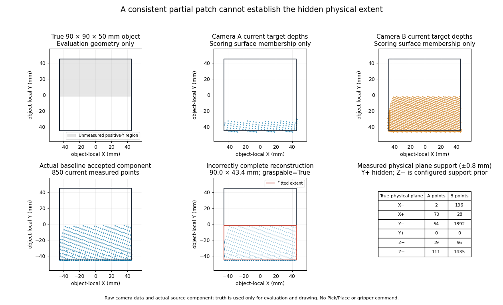
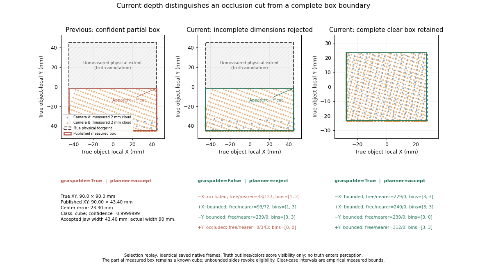
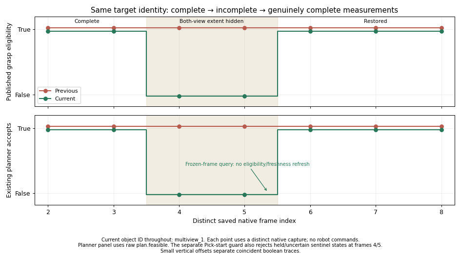

# Multi-view geometric observability and grasp safety

Latest summary: [final cube/sphere perception checkpoint](multiview_perception_final.md). This historical report retains its original results and limitations.

This focused continuation starts from merged research parent
`3314eafcfd8199ad711172b955a373d63350b1eb` (PR #10), on
`research/multiview-geometric-observability`. V1, ground truth, WorldModel,
updater, planning/manipulation, robot control, baseline scenes, launchers and
dependencies remain outside the production change scope. No multi-view Pick,
Place, gripper action or contact trajectory is authorized or exercised.

The hidden 90 mm box is now rejected through the full existing planner path.
The frozen holdout has zero target-width violations, while unmodeled-cover
clearance failures keep the assessment **NO-GO for supervised manipulation**.
Required unit, multiview, V1 Isaac and legacy regression suites pass. This PR
remains isolated research and does not establish manipulation readiness.

## A. Reproduced failure and measured boundaries

All seven merged package modules are preserved in an isolated import namespace
under `outputs/multiview-observability/baseline_snapshot/`. Its manifest records
the original Git commit/tree and original/exported SHA256 hashes. The fresh
baseline offline suite passed 374 discovered units, eight standalone checks
and architecture, at
`outputs/multiview-observability-baseline-unit/run-wxa6n20t/`.

Before fixture or detector changes, the existing native partial-box benchmark
reproduced its **FAIL** at
`outputs/multiview-observability/baseline-partial/`: five targets, four correct
classifications, one false-feasible grasp and one actual width violation, with
zero source/runtime errors or robot commands. Its original two invalid B-control
audit rows remain preserved. They do not invalidate the separately valid
both-camera unsafe case.

The actual box is 90 × 90 × 50 mm, centered at `[445, -10, 25]` mm. Its measured
source component has 850 current points. The baseline reports
90.002 × 43.401 × 50.001 mm centered at approximately
`[445.000, -33.301, 25.001]` mm: 23.301 mm center error, cube confidence
0.999999923, `parameter_observable=True`, `graspable=True`. The unchanged planner
accepts a 43.401 mm closing width; its actual required width is 90 mm.

The combined views constrain both X limits and the negative-Y limit. The true
positive-Y physical boundary is at +35 mm world Y; the fitted apparent boundary
is approximately −11.601 mm, leaving 46.601 mm of actual extent hidden. Neither
camera measures the physical positive-Y boundary. Raw target-associated depth
samples are 235 in A and 3463 in B at stride one. Under an evaluation-only
±0.8 mm physical-plane check, positive-Y has zero samples in both views, while
negative-Y has 54/1892 and positive-X 70/28. Such plane proximity includes edge
samples and is not proof of a full visible face. Top height is measured;
the lower-Z support plane is a configured prior, not a reconstructed hidden face.



This figure replays the preserved source to recover its actual accepted
component and verifies its center/dimensions against the native result. Ground
truth is used only to draw and score physical geometry. Original raw frames,
camera poses/intrinsics, full camera/fused clouds, fitting scores, estimated
geometry and planner decisions remain in the baseline artifacts. Figure data
and large exports are under `outputs/multiview-observability/figures/`.

Small residuals explain the visible rectangular patch but do not establish that
its measured limits are object edges. A smaller complete box and a larger box
hidden behind the same foreground surface can explain these measurements.
More frames from unchanged obstructed viewpoints do not resolve that ambiguity.
The source must distinguish occupied surface, observed free space, nearer
occluders, invalid depth and field-of-view truncation before establishing action
eligibility. A free ray beyond an edge bounds an interval; it does not establish
the fitted sample minimum/maximum as an exact physical boundary.

## Reproduction environment

Use the unchanged workstation wrapper, Isaac Sim 5.1.0-rc.19/Python 3.11,
repository NumPy 1.26.4 before SimulationApp, and py_trees 2.6.0. Native
processes run sequentially. No dependency/environment changes or `--no-ros-env`.
Commands below identify the recorded artifact paths. Use fresh output directories
for repeats to preserve these results; profiling CLIs reject existing result files.

```bash
./run_isaac_python.sh scripts/preserve_multiview_baseline.py \
  --ref 3314eafcfd8199ad711172b955a373d63350b1eb \
  --output outputs/multiview-observability/baseline_snapshot
./run_isaac_python.sh scripts/run_all_regressions.py --unit-only \
  --artifacts-dir outputs/multiview-observability-baseline-unit
# This command was run before repairing the B-only control fixture.
./run_isaac_python.sh scripts/benchmark_multiview_partial_grasp.py --no-ik --strict \
  --result outputs/multiview-observability/baseline-partial/result.json \
  --artifacts-dir outputs/multiview-observability/baseline-partial
./run_isaac_python.sh scripts/plot_multiview_observability.py \
  --capture outputs/multiview-observability/baseline-partial \
  --baseline-pythonpath outputs/multiview-observability/baseline_snapshot \
  --output outputs/multiview-observability/figures \
  --docs-dir docs/assets/multiview_observability
```

That partial-benchmark invocation is historical: at the PR head it uses the
corrected fixtures and new provider. To reproduce the original fixture/provider
combination in a separate output directory, export its script from the parent
and select the preserved baseline explicitly:

```bash
git show 3314eafcfd8199ad711172b955a373d63350b1eb:scripts/benchmark_multiview_partial_grasp.py \
  > outputs/multiview-observability/baseline_snapshot/benchmark_partial_original.py
./run_isaac_python.sh \
  outputs/multiview-observability/baseline_snapshot/benchmark_partial_original.py \
  --baseline-only --baseline-pythonpath outputs/multiview-observability/baseline_snapshot \
  --no-ik --strict \
  --result outputs/multiview-observability/baseline-original-repeat/result.json \
  --artifacts-dir outputs/multiview-observability/baseline-original-repeat
```

## B. Current physical-boundary evidence

The corrected B-only roof ends at world X = 420 mm, rather than 450 mm. It
still blocks B, but no longer removes 6.548 mm of the target's extent from the
intended clear A view. The valid both-camera 90 mm fixture is unchanged. A fresh
native baseline run with the corrected controls detects/classifies all five
targets, passes all fixture audits, and still has one false-feasible/width
violation. See `outputs/multiview-observability/corrected-partial-baseline/`.
The original failed controls and captures remain available separately.

Four methods were compared on 51 frozen baseline candidate clouds, including
18 box candidates, extracted without oracle masks from the old partial and
selection captures. This is a single-frame functional comparison; it does not
establish publication, current freshness or live performance.

| Method | Bounded boxes / 18 | Reason retained or rejected |
| --- | ---: | --- |
| Require direct support for every vertical face | 0 | Rejects the usual unseen opposite faces despite physical silhouette evidence. |
| Anchored top-plane free-space strip 4 mm outward | 14 | Conservative, but sparse free samples and a fixed outward offset lose useful observations. |
| Contradict an extra 4 mm box extension on each side | 17 | Stronger coverage, but a unilateral 4 mm limit costs up to 8 mm across a dimension. |
| Adjacent measured-top/free-depth transitions, with side-plane tightening | 16 | Retains 16/17 candidates excluding the mandatory unsafe box; rejects that hidden dimension and one close-neighbor ambiguity. |

The comparison script, candidate arrays, rows, parameters and source hashes are
saved in `outputs/multiview-observability/method-comparison-initial/`. The selected
method's accepted boxes grow by a mean 0.811 mm on their most affected axis,
worst 3.241 mm in a close-pair case. Clear 80/90 mm reference boxes grow only
0.226/0.249 mm. These are resolution-aware empirical bounds under the fitted
single-box model, not certified physical bounds for arbitrary hidden shapes.

The selected helper inspects a bounded ribbon around each fitted top edge in
each current calibrated depth image. It distinguishes measured occupied top,
valid depth farther than the proposed top-plane intersection, nearer occluder,
missing depth, and pixels outside the image. The helper accepts a candidate boundary only with adjacent
occupied/free pixels with free evidence outward from the measured interior in
three separated intervals along the edge. Foreground, invalid and out-of-view
space never count as free. An edge can be supported by either camera; one
occluded camera does not veto the other's actual physical-boundary evidence.

Each accepted ray transition supplies an outward interval, rather than an
assertion that the last cloud sample is the physical edge. Current measured
side planes can tighten that interval only when a top/free transition also
exists. Top-plane spread contributes a lateral ray margin; top/side edge voxels
are excluded from the plane-noise estimate. Both local X and Y signs must be
bounded, the top must be measured, and current low-side samples must support
the configured table-contact prior. Z support remains an explicit prior.

`geometric_observability` records per-axis/sign status, interval, per-camera
occupied/free/occluded/missing/out-of-frame counts, transitions and side-plane
evidence. The source combines this decision with its existing surface-parameter
check. It preserves classification scores and measured geometry; eligible boxes
publish the current outward geometry, with the pre-bound estimate retained in
metadata. An ambiguous known box remains a known box with `graspable=False`.
Sphere/cylinder finalization, point clouds, fit budgets, association, timestamps
and held/uncertain state retain their existing paths. There is no gripper-width
constant, history cache or simulator import in the helper.

Repeated obstructed fixed views cannot reveal a hidden boundary. The temporal
experiment therefore requires a new complete view to restore eligibility;
merely repeating frozen input cannot do so. The method assumes one supported
yaw box, finite depth and useful calibration. Correlated calibration/top-plane
error, thin hidden extensions and unsupported box shapes remain limitations;
the perturbation experiments measure their effect without claiming a universal
safety certificate.

```bash
./run_isaac_python.sh scripts/probe_multiview_observability.py \
  --capture outputs/multiview-readiness/partial-boxes \
            outputs/multiview-iteration2/selection-capture-v2 \
  --baseline-pythonpath outputs/multiview-observability/baseline_snapshot \
  --output outputs/multiview-observability/method-comparison-initial
```

## C. Evaluation protocol and source freeze

The development seed is `11235813`; the independent holdout seed is
`223606797`. Each split draws four randomized box geometries, one per size band (42–49,
61–69, 72–79 and 82–90 mm short sides), with aspect ratios 1.08–1.24 and
different yaws. Each geometry is repeated across ten visibility conditions,
producing 40 box scenes, rather than 40 independent geometric draws.
The larger bands include long sides above the robot's supported closing width. Each band
covers clear-both, A-clear, B-clear, the same extent hidden in both views,
opposite extents hidden in opposite views, partial top occlusion, no measured
vertical sides, a physical edge beside an occluder, an in-frame silhouette near
the image boundary, and alternative views. Three sphere/upright/lying-cylinder
controls, the exact mandatory legacy 90 mm box and one temporal eligibility
sequence complete the 45 scenes. The holdout uses distinct object draws,
aspect/yaw values and relative camera angles. Its repeated legacy regression
is identified separately from its new randomized cases.

Fixture audits use actual native depth, known physical planes/corners and
configured visibility requirements. Truth is restricted to scoring and fixture
validation. The first 45-scene native selection capture revealed four invalid
top-only fixtures: inherited stage foreground at world Z 0.46–0.59 m blocked
the high camera origins. Their failed captures/audits remain in
`selection-capture/`. Lowering only those camera origins to Z 0.35/0.40 m
restored the intended top-only views. A separate native four-scene capture
passes all audits at `selection-corrected-top-only/`.

`selection-capture-v2/capture_manifest.json` explicitly assembles the untouched
41 native scenes with those four corrected native scenes, retaining input
manifest hashes and links to original arrays. Pixels, frame tokens and native
acquisition timestamps are unchanged. Both sources receive exactly the same
frames. The final code can also recapture all 45 corrected scenes directly.

Production was frozen at commit `e12e0f24ff0f0d5e75254a3a8483bd4425b3c78e`,
UTC `2026-10-20T20:56:31.310237+00:00`, before the holdout generator was called.
The [freeze manifest](assets/multiview_observability/source-freeze.json) records
SHA256 for all eight production modules. The capture CLI verifies every hash
before generating holdout scenes. No production tuning follows the freeze.
Evaluation/figure/report commits can follow without changing those hashes.
The byte-identical published freeze commit is
`56380bb795db1792375f6abaa225ae50ff9d3c9d`; GitHub publication changes commit
metadata, and its Git tree exactly matches the local freeze commit.

The evaluation follows the complete existing source → `ObservationBatch` →
`WorldModelUpdater` → `WorldModel` → unchanged grasp-planner path. Captured-frame
replay uses an explicit research clock following original acquisition times;
it never fabricates tokens, timestamps or confirmation frames and does not
claim current wall-clock freshness. Native contract tests separately validate
live freshness. Query-only backends reject commands. The new CLI constructs no robot/controller
backend wrapper; inherited stage assets remain present and unchanged.

The first holdout capture also had eight invalid controls: its changed relative
A angle saw around a canonical 47 mm-wide panel. Raw depth showed only
0.27–0.84 mm Y clipping, failing the declared partial-occlusion requirement.
Before detector evaluation, a single fixture-only correction widened that panel
to 67 mm in the eight B-clear/opposite-extent cases. Targets, seeds, cameras,
centers, yaws, all other covers and the remaining 37 scenes are unchanged.
Independent native-lens ray audits and a fresh eight-scene native capture pass
all intended conditions. The failed `holdout-capture/`, correction proposal and
exact fixture diff remain available. `holdout-capture-v2/` explicitly combines
the unchanged 37 scenes with those eight recaptures. Production hashes remain
identical to the pre-holdout freeze; no detector output was used to choose the
fixture correction.

Planning has two explicit scopes. Target-geometry checks preserve the previous
protocol's true closing width, support and target/palm clearance. A second
unchanged-planner check adds every physical cover and clutter solid, then
checks the actual proposed pose against those solids. Here `full_scene` means
all declared experimental targets/covers/clutter plus the configured support
check; it does not validate inherited robot meshes, robot self-collision or a
continuous executed trajectory. Both measured scopes must be safe
for strict acceptance. A dimensionally correct proposal that hits an unmodeled
cover is a real failure, not a passing manipulation result. Missing/unknown
targets, accepted mixed clouds, real detected clutter and off-geometry false
positives have separate counters. Invalid fixtures retain their rows and cause
the experiment gate to fail rather than silently improving the denominator.

The temporal object keeps its identity while fresh complete → incomplete →
frozen → complete observations change eligibility. A held/uncertain sentinel
checks that existing manipulation state is preserved. Existing unknown,
stale-source, TTL, cleanup, fit-budget and duplicate-ID assertions remain active.

```bash
./run_isaac_python.sh scripts/benchmark_multiview_observability.py \
  --capture-only --split selection \
  --result outputs/multiview-observability/selection-capture-direct/result.json \
  --artifacts-dir outputs/multiview-observability/selection-capture-direct
./run_isaac_python.sh scripts/benchmark_multiview_observability.py \
  --capture-only --split holdout \
  --freeze-manifest docs/assets/multiview_observability/source-freeze.json \
  --result outputs/multiview-observability/holdout-capture-direct/result.json \
  --artifacts-dir outputs/multiview-observability/holdout-capture-direct
# Fresh direct capture uses the final corrected fixtures. The recorded run
# replays holdout-capture-v2; repeat for each split and perturbation variant.
./run_isaac_python.sh scripts/benchmark_multiview_observability.py \
  --replay outputs/multiview-observability/holdout-capture-direct --variant clean \
  --baseline-pythonpath outputs/multiview-observability/baseline_snapshot --strict \
  --result outputs/multiview-observability/holdout-clean/result.json \
  --artifacts-dir outputs/multiview-observability/holdout-clean
```

## D. Read-only planning and observed limitations

The final selection replay has 95 scored target-frame rows across 45 valid
scenes. These are repeated observations, not 95 independent physical objects.
The first eight top-only invalid rows were replaced by valid native recaptures;
all eight corrected top-only rows are missing detections in both providers.
The existing box support/segmentation path cannot recover them from top-only
samples. This is an observed failure, retained in the total rather than removed.

| Selection variant | Correct / 95, both sources | Eligible, baseline → current | Target false-feasible, baseline → current | Target false-infeasible, baseline → current | Current cover/palm clearance blocks |
| --- | ---: | ---: | ---: | ---: | ---: |
| Clean | 79 | 79 → 63 | 6 → 0 | 14 → 20 | 8 |
| Depth noise, σ = 0.5 mm | 70 | 38 → 35 | 2 → 0 | 37 → 38 | 1 |
| 35% invalid-depth dropout | 78 | 78 → 63 | 6 → 0 | 16 → 21 | 7 |
| Camera-B calibration perturbation | 79 | 79 → 63 | 6 → 0 | 14 → 20 | 8 |

Every listed current variant has zero target width, support/palm-clearance or
physical-overlap violations. Its strict result is nevertheless **FAIL** because
of the separately preserved cover clearance blocks. Clean data has 14 missing and
two unknown observations; depth noise has 16/9 and dropout 11/6. False-infeasible
totals include these missing/unknown cases as well as conservative eligibility
rejections. They are not all caused by the new helper.
Calibration perturbs B by 0.05° yaw and `[+0.5, −0.3, +0.2]` mm translation;
native pixels, tokens and acquisition times remain unchanged. The final replay
for every row in this table has stable start/end source and harness hashes.

On clean selection boxes, eligibility is 57/73 known-box rows, versus 73/73
for the baseline. All 52 known box rows in clear-both, A-clear, B-clear,
partial-top, adjacent-edge, near-image-boundary and alternative-view conditions
remain eligible. The 16 revoked rows are both-hidden/opposite-extent cases,
the mandatory legacy box and incomplete temporal observations. All six
sphere/cylinder control rows retain their original eligibility. Thus this
change does not simply disable box grasps or every partially visible box.

The mandatory 90 mm box remains classified as a box, with the same incomplete
measured dimensions for display/tracking, but is non-graspable and rejected by
the unchanged planner. Its positive-Y edge has no top/free transition in either
camera. The temporal sequence retains object ID `multiview_1` while eligibility
changes True → False → True. The frozen query publishes no replacement batch
or freshness refresh and cannot restore eligibility. Held/uncertain state and
cleanup/source guards pass independently. Planner geometry metrics use the raw
planner decision; actual Pick precondition guards are retained separately so a
deliberately held sentinel cannot hide a geometric acceptance.





The eight clean current cover clearance blocks are four scenes observed twice:
small/medium A-clear and partial-top scenes. Their accepted box dimensions have
only about 0.30–0.59 mm error, but the proposed palm envelope is blocked by an elevated cover
that the source's supported-object path does not publish as an obstacle. The
unchanged planner can only reject obstacles represented in its WorldModel.
This is a distinct obstacle-completeness blocker. Resolving it requires evidence
for current obstacle coverage, including elevated/unsupported geometry, and
approach-space completeness. These are conservative swept hand/held-object
OBB versus GT object-AABB clearance checks with the existing 5 mm margin,
not observed mesh contact: no proposed grasp was executed. That evidence has not been established here. The
full-scene failure remains explicit, with no planner-threshold or supported-object
filter changes made to hide it.

## E. Regression evidence

### Frozen independent partial-box holdout

All 45 corrected holdout scenes and all 95 scored phase frames pass physical
visibility audits. The final four paired replays have stable source/harness
hashes and zero runtime errors. The production source remains unchanged from
the freeze before any holdout generation or evaluation.

| Holdout variant | Correct / 95, both sources | Eligible, baseline → current | Target false-feasible, baseline → current | Target false-infeasible, baseline → current | Current cover/palm clearance blocks |
| --- | ---: | ---: | ---: | ---: | ---: |
| Clean | 77 | 77 → 65 | 6 → 0 | 18 → 22 | 8 |
| Depth noise | 65 | 47 → 42 | 1 → 0 | 26 → 30 | 4 |
| Invalid-depth dropout | 77 | 77 → 64 | 6 → 0 | 18 → 23 | 8 |
| Calibration perturbation | 77 | 77 → 65 | 6 → 0 | 18 → 22 | 8 |

Current target-width, support/palm-clearance and overlap violations are zero in
all 380 scored holdout-variant rows. The baseline has 19 width violations.
The current full-scene clearance checks still block 28 accepted proposals
across those repeated variants, so **all four strict holdout results are FAIL**.
No broad manipulation-safety pass is claimed from the zero target-width count.

Clean holdout has 87 detections, 77 correct known classifications, ten unknowns
and eight missing observations for both sources. Excluding the repeated legacy
90 mm regression only as an additional independence note leaves 44 new scenes
and 93 scored frames: 75 correct, ten unknown, eight missing, and target
false-feasible decisions 4 → 0. The all-case totals above retain the legacy rows.
All eight top-only rows are missing in both sources. There are zero off-geometry
false positives, false splits, duplicate IDs or identity switches; six accepted
mixed-cloud flags are all unknown and none is eligible. Sixteen non-target
observations are supported by actual physical covers, retained as real clutter.
Across noise/dropout/calibration there are 18/6/6 mixed-cloud flags. A separate
32-call source replay records the eight stress clouds unmatched to primary
targets: all are unknown and non-graspable in both sources, with identical IDs,
point counts, tokens and source hashes. Every mixed-cloud flag across all four
holdout variants is therefore explicitly unknown; no known/eligible merged
cloud was introduced. See `mixed-unmatched-supplement.json`.

Clean eligibility retains 65/77 previously eligible known rows, including all
54 known fixed-box rows in the clear/one-clear/partial-top/adjacent-edge/near-FOV/
alternative-view conditions and all six curved controls. The revoked known rows
are the deliberately ambiguous boundaries and incomplete temporal samples.
Eligible known fits have mean/worst dimension error 0.248/1.129 mm; ineligible
known fits retain their measured incomplete geometry, with mean/worst
28.863/39.998 mm. Such estimates are useful for display but explicitly unsuitable
for manipulation. Unknown/missing rows have separate counts.

The eight clean clearance blocks are four valid small/medium A-clear and
partial-top scenes, each observed twice. None is a held-state sentinel artifact.
Under the full-scene GT-planner verdict, both sources correctly accept 23/27
feasible rows and falsely reject four (top-only misses); baseline false-feasible
acceptances fall 18 → 8. Thus target-only false-infeasible totals should not be
read as 22 newly lost physically accessible grasps.

All clean current contracts pass, including 218 source/identity/manipulation-state
checks. All 185 current samples preserve their original batch/object acquisition
timestamps; numerical fits peak at six of the unchanged 24-call limit, with no
budget exhaustion. Calibration and dropout finish with complete-observation
eligibility restored. Dropout has one intermediate restored frame conservatively
rejected for insufficient current boundary evidence, then accepted on the next
fresh complete frame. Noise exposes an existing surface-envelope instability:
both sources restore frames 6/7 but reject frame 8 as
`inconsistent_box_surface_extent`, causing the final-state temporal contract to
fail in both sources. Class and identity remain correct. This real eligibility
instability is retained as a further limitation; no post-holdout tuning is made.

### Prior multi-view regressions

The latest prior detection holdout is now a regression set, rather than a new
independent holdout for this method. Exact saved-frame baseline/current replay
preserves 46/52 clean classifications and 92/103 across clean, noise, calibration
and sparse variants. Missing observations remain 3 clean and 5 overall; unknown
observations remain 10 overall. No new false positives, false splits, duplicate
IDs or identity switches appear. The five existing mixed-cloud flags remain.
For 88 correctly classified dimension-bearing fits, dimension MAE changes
0.726 → 0.802 mm across all variants because eligible boxes
publish outward ray bounds; primitive scores and curved-shape dimensions are
unchanged.

The older iteration-two holdout also preserves baseline/current classifications:
52/52 clean, 102/103 overall, with zero false positives, mixed accepted clouds,
splits, duplicate IDs or identity switches. Its sole missing observation remains
the sparse 4 mm box/cylinder-gap target B. Conditional dimension MAE changes 0.636 → 0.764 mm
clean and 0.863 → 0.971 mm across all variants (51 clean/98 all-variant correctly classified,
dimension-bearing fits; missing/unknown targets retain separate counts). These conservative geometry costs are
reported rather than hidden behind unchanged class accuracy. All 294 existing
source-contract replay checks pass in each prior holdout evaluation.

Persistent replay of all three saved moving-Franka captures consumes 65/65
original native samples per capture, preserving original timestamps and a single
provider/updater/model across all phases. Tall and ROI-height captures each
retain 135/135 correct target rows, all eligible, with zero missing observations
or identity switches. All 90 confirmed box rows per capture have bounded current
edge evidence. Temporal replay preserves 34/45 correct sphere rows and 11 misses
(two transition, three hidden, six sparse), with the same ID after reveal.
Saved capture-to-capture reacquisition is 220.693 ms for both sources; this is
distinct from the earlier live 266.109 ms capture-to-delivery measurement. These
replays validate saved-motion geometry and association, not a new live native
update rate. No robot motion was repeated for them.

```bash
./run_isaac_python.sh scripts/benchmark_multiview_readiness_holdout.py \
  --replay outputs/multiview-readiness/final-holdout-capture --split holdout \
  --baseline-pythonpath outputs/multiview-observability/baseline_snapshot \
  --result outputs/multiview-observability/latest-detection-replay/result.json \
  --artifacts-dir outputs/multiview-observability/latest-detection-replay
./run_isaac_python.sh scripts/benchmark_multiview_robustness.py \
  --replay outputs/multiview-iteration2/holdout-capture \
  --baseline-pythonpath outputs/multiview-observability/baseline_snapshot \
  --result outputs/multiview-observability/old-detection-replay/result.json \
  --artifacts-dir outputs/multiview-observability/old-detection-replay
# Repeat with robot-final-temporal/height and corresponding output directories.
./run_isaac_python.sh scripts/replay_multiview_observability_robot.py \
  --input outputs/multiview-readiness/robot-final-tall \
  --baseline-pythonpath outputs/multiview-observability/baseline_snapshot \
  --output outputs/multiview-observability/robot-tall-persistent
```

## F. Performance and implementation cost

Profiling runs after the functional benchmark workers stop, with methods
serialized. The helper has no image-history cache, SDK calls, robot policy,
new dependency or background thread. Each side inspects at most 48 projected
edge samples with a 7 × 7 pixel ribbon, deduplicates those pixels and performs
bounded neighbor lookups; it does not scan the whole image for every candidate.
Existing point, object and numerical-fit limits remain unchanged. The provider
records `observability_ms` separately and subtracts it from `fitting_ms` to
avoid double-counting.

The SDK-free profile uses 51 actual frozen candidate clouds in 31 nonempty
capture batches, 20 repetitions after three warm-ups, plus 32 complete
captured scenes with three distinct original confirmation frames. Its results
are CPU processing measurements, not live native frequencies:

| Measurement | Mean ms | p95 ms | Worst ms |
| --- | ---: | ---: | ---: |
| Box helper, 360 calls | 8.883 | 9.387 | 14.920 |
| Actual captured candidate batch, 620 calls | 5.144 | 17.638 | 19.125 |
| Baseline whole provider, final frame, 96 samples | 103.949 | 177.416 | 187.805 |
| Current whole provider, final frame, 96 samples | 109.747 | 194.278 | 206.486 |

Sphere/cylinder/unknown helper paths average below 0.001 ms. Captured batches
contain up to four candidates; the two-box p95 is reflected in the batch tail.
The actual link-clutter batch has one box and one other candidate, about
8.7 ms helper cost in its representative sample. Additional source CPU cost
averages 5.798 ms across the paired historical scene distribution. Repetitions
measure timing variability on fixed inputs, not independent safety trials.

A separate allocation-tracing phase excludes timing and preloaded arrays.
Maximum extra helper allocations are 310 KiB peak and 17.0 KiB retained for a
box's returned evidence; an actual batch retains at most 28.3 KiB. Maximum
whole-provider traced peaks are 6.429 MiB baseline and 6.439 MiB current.
The profiler's approximately 1 GiB process peak includes every preloaded frame
and import; it is not additional helper memory, GPU memory or native Kit RSS.
These are measured allocation scopes, not a universal memory bound.

```bash
./run_isaac_python.sh scripts/profile_multiview_observability.py \
  --cached-manifest outputs/multiview-observability/method-comparison-initial/candidate_manifest.json \
  --repeats 20 --allocations --provider-repeats 3 \
  --baseline-pythonpath outputs/multiview-observability/baseline_snapshot \
  --output outputs/multiview-observability/helper-profile
```

Fresh native baseline/current runs use the unchanged original workload: two
camera arrangements, six scenarios, two repeats, 24 trials and 72 timed updates
per method. They use identical seeded workloads with separately acquired fresh
frames, rather than claiming exact-image pairing. Native timing includes eight
render steps between observations. Raw stage samples and their mean/p95/worst
aggregation are in `native-performance-summary.json`.

| Native measurement | Baseline mean / p95 / worst ms | Current mean / p95 / worst ms |
| --- | ---: | ---: |
| Source total | 165.549 / 216.202 / 225.732 | 173.278 / 225.590 / 232.727 |
| Observability stage | — | 7.685 / 9.904 / 10.218 |
| Fitting, excluding observability | 121.804 / 163.309 / 186.176 | 121.793 / 180.585 / 192.109 |
| Render + source loop | 245.178 / 293.631 / 304.428 | 254.308 / 306.100 / 333.018 |

Effective native rate is **4.079 → 3.932 Hz**, a 3.6% reduction from the fresh
baseline. The earlier reported 4.14 Hz is historical; 5 Hz remains unmet.
Most added source time is the separately measured boundary check. The elevated
clutter source mean changes 196.356 → 206.085 ms; its current observability
mean/p95/worst is 9.431/10.022/10.029 ms. The two-nearby-sphere scenario uses
only 0.012 ms of observability overhead and preserves its separation.

Both native runs retain **87/88 correct**, one missing target, zero false
positives, duplicates or mixed clusters. Conditional dimension MAE changes
0.572 → 0.647 mm over the same 87 measured known objects; center MAE changes
0.191 → 0.232 mm. All axis scores remain unchanged. Kit process peak RSS is
5279/5247 MiB in the separate runs; Kit/caches dominate that varying total,
while the allocation profile above isolates helper costs.

```bash
./run_isaac_python.sh outputs/multiview-observability/baseline_snapshot/benchmark_original.py \
  --repeats 2 --result outputs/multiview-observability/original-baseline/result.json \
  --artifacts-dir outputs/multiview-observability/original-baseline
./run_isaac_python.sh scripts/benchmark_multiview_detection.py --repeats 2 \
  --result outputs/multiview-observability/original-final/result.json \
  --artifacts-dir outputs/multiview-observability/original-final
```

An additional serialized analytic-depth profile stresses multiple supported
objects and fragmented clutter at the native 640 × 480 resolution, stride two,
with seed `8675309`, 20 measured repetitions after three warm-ups. Rendering and
allocation tracing are outside timing; these are CPU tests, not live sensor
rate or grasp-safety evidence.

| Analytic workload | Baseline mean ms | Current mean / p95 / worst ms | Current observability mean ms |
| --- | ---: | ---: | ---: |
| Four supported primitives | 127.195 | 137.989 / 140.739 / 165.528 | 14.191 |
| Eight supported primitives | 214.381 | 233.006 / 235.644 / 236.446 | 23.058 |
| 64 disconnected small solids | 126.608 | 153.078 / 155.407 / 156.001 | 30.940 |
| Four primitives + 64 thin fragments | 199.292 | 208.646 / 212.653 / 214.174 | 14.329 |

All four/eight normal objects keep their classes and eligibility. The 64-solid
fixture has 64 measured broad components, 43 fine components and 5544 fused
points; the existing source publishes eight (three cubes, five unknown) and
reports 56 object-limit rejections in both methods. The mixed fragment fixture
has 20 broad groups and 2488 fused points; both methods retain the four intended
primitives plus four unknown groups, rejecting 12 additional groups at the
existing object limit. Numerical fits peak at eight of 24, detections at eight,
with no budget exhaustion. Maximum current whole-source traced peak allocation
is 5.78 MiB above preloaded inputs. Component/output counts and every stage are
retained in `fragmented-profile-native-resolution/`.

The initial 320 × 240 attempt remains in `fragmented-profile/` with **FAIL**:
only 19 measured disconnected components, below its predeclared 24-component
stress precondition. The 640 × 480 rerun passes with all 64 measured; no source
threshold or computation limit changes were made.

```bash
./run_isaac_python.sh scripts/profile_multiview_fragmented_clutter.py \
  --baseline-pythonpath outputs/multiview-observability/baseline_snapshot \
  --output outputs/multiview-observability/fragmented-profile-native-resolution \
  --repeats 20 --allocations --resolution 640 480
```

## G. Required validation and readiness decision

Every result below was checked in its JSON as well as its process exit status.
The initial development native attempt had a source-hash failure caused by a
metadata edit during execution, despite all nine new geometric/temporal rows
passing. It remains in `multiview-observability-development-native/`; the final
group below reruns all five tests with stable files and passes. Selection's
calibration attempt overlapping a fixture-harness edit is likewise retained as
`selection-calibration-harness-change/`, with a stable final rerun used above.

| Required check | Result | Saved directory under `outputs/` |
| --- | --- | --- |
| Offline units, standalone checks, architecture | PASS: 396 discovered + 8 standalone + architecture | `multiview-observability-final-unit/run-evcapd5f/` |
| Native multiview | PASS: 5/5, including full-path 90 mm and temporal regression | `multiview-observability-native/run-gbc2624v/` |
| V1 Isaac | PASS: 2/2 | `multiview-observability-v1-isaac/run-2h5ufoyi/` |
| Legacy V1/manipulation regressions | PASS: 6/6 | `multiview-observability-v1-regression/run-3xcuxh5q/` |
| Corrected old partial-box benchmark | PASS: 5/5 classified, zero unsafe decisions, all fixtures valid | `multiview-observability/partial-final/` |
| Existing 39-scene planning selection | PASS: 37/40 classifications; 6 estimated feasible, 0 false-feasible, 6 false-infeasible, unchanged from baseline | Native multiview `multiview_test_grasp_planning_readiness/` |
| Existing 28-scene planning holdout | PASS: 26/29 classifications; false-feasible/width/clearance zero; feasible 6 → 5, false-infeasible 4 → 5 | `multiview-observability/planner-holdout-final/` |

The additional old-holdout rejection is a true 86 × 69.6 × 47 mm box. It remains
classified and geometrically eligible, but its published closing-width bound
grows 69.655 → 70.167 mm and the unchanged planner rejects the side-clearance
requirement. The old native selection retains all six previously accepted plans.
The new source neither knows nor alters those robot-specific thresholds. E39
performs 18 endpoint IK queries and zero backend commands; E28 and the partial
benchmark use `--no-ik`, with zero backend commands. These checks validate
geometry/known-object envelopes, not executed approach paths or grasp success.

```bash
./run_isaac_python.sh scripts/run_all_regressions.py --unit-only \
  --artifacts-dir outputs/multiview-observability-final-unit
./run_isaac_python.sh scripts/run_all_regressions.py --group multiview \
  --artifacts-dir outputs/multiview-observability-native
./run_isaac_python.sh scripts/run_all_regressions.py --group isaac \
  --artifacts-dir outputs/multiview-observability-v1-isaac
./run_isaac_python.sh scripts/run_all_regressions.py --group regression \
  --artifacts-dir outputs/multiview-observability-v1-regression
./run_isaac_python.sh scripts/benchmark_multiview_partial_grasp.py --no-ik --strict \
  --result outputs/multiview-observability/partial-final/result.json \
  --artifacts-dir outputs/multiview-observability/partial-final
./run_isaac_python.sh scripts/benchmark_multiview_grasp_readiness.py \
  --split holdout --baseline-pythonpath outputs/multiview-observability/baseline_snapshot \
  --no-ik --strict \
  --result outputs/multiview-observability/planner-holdout-final/result.json \
  --artifacts-dir outputs/multiview-observability/planner-holdout-final
./run_isaac_python.sh scripts/plot_multiview_observability_results.py \
  --evaluation outputs/multiview-observability/selection-final-clean \
  --freeze-manifest docs/assets/multiview_observability/source-freeze.json \
  --output outputs/multiview-observability/figures \
  --docs-dir docs/assets/multiview_observability
```

The unchanged wrapper selects `/home/etfrobotics/isaacsim`, whose version is
`5.1.0-rc.19+release.26219.9c81211b.gl`. Python is 3.11.13, NumPy is the existing
1.26.4 repository dependency loaded before SimulationApp, and py_trees is 2.6.0.
No driver, SSH, credential, launcher, dependency or environment setup changes
were made. Production changes are only the new observability helper and its
integration in the opt-in multiview provider. All protected core/V1/GUI/robot
files retain their parent versions.

**Decision: NO-GO for supervised manipulation testing.** The demonstrated
hidden-dimension false-feasible grasp is resolved, and most valid box eligibility
is retained. However, fully valid holdout proposals still violate the existing
planner's clearance envelope around unmodeled covers. The zero-width result
does not establish approach-space completeness. Noise also exposes preexisting
eligibility instability, and partial invalid depth can conservatively interrupt
eligibility until another complete observation arrives. Four new box geometry
draws, their visibility variants and repeated frames are limited evidence on a
tested distribution, not a universal safety guarantee.

Further work should establish current obstacle coverage for unsupported/elevated
geometry and validate it through the existing read-only planner path, followed
by a wider independently frozen evaluation. More fixed-camera frames cannot
recover a consistently hidden boundary. No multiview Pick, Place, gripper action
or contact trajectory was executed. Required legacy V1/GT fixtures exercised
their existing documented motions; saved moving-Franka captures were replayed
without repeating their motion. The branch is for review against
`research/multiview-rgbd-fusion`; it must not be treated as manipulation approval.
