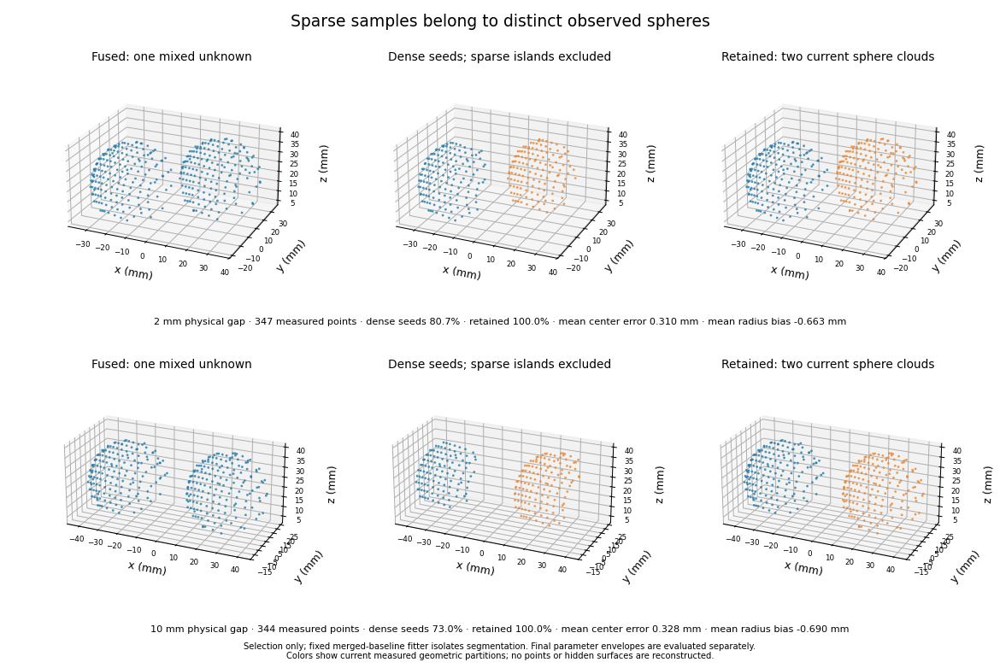
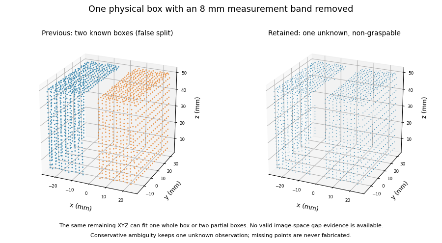
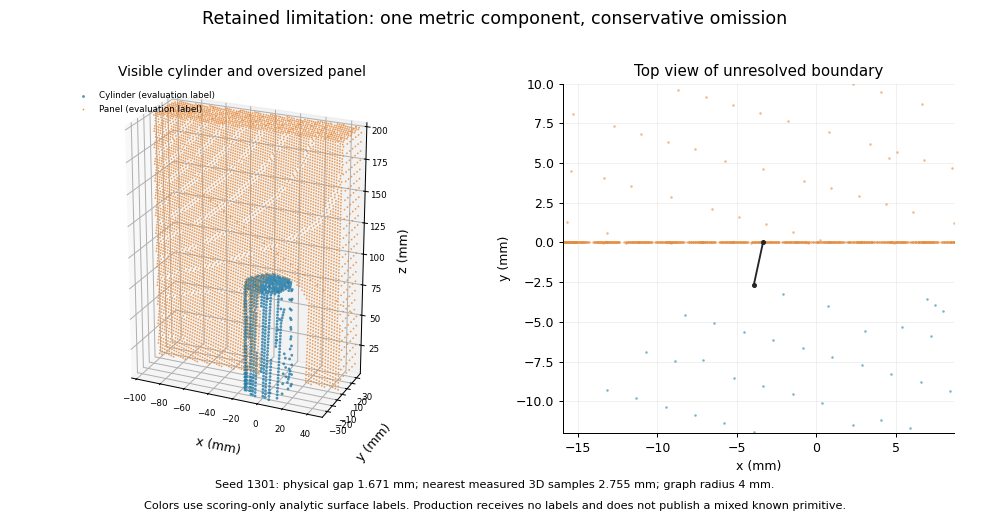

# Multi-view manipulation readiness

**Decision: continue controlled observation and read-only planning research;
NO-GO for supervised Pick/Place integration and autonomous manipulation.**
A valid physical-occlusion test exposes an oversized 90 mm box as a confident,
graspable 43.4 mm box. The unchanged planner accepts it. No multi-view grasp was
executed. Improved detection and isolated-width results do not remove this
demonstrated hidden-dimension blocker.

This research branch starts at `7d1eb65e26354ac9bfc5a6b19664005729a6491d`
on `research/multiview-rgbd-fusion`. The original observation interface and the
V1, WorldModel, manipulation, controller and planner implementations are
unchanged. This experiment does not execute multi-view Pick/Place.

## A. Reproducible baseline and failure analysis

The previous implementation is exported, with original and import-isolated
SHA256 hashes, to `outputs/multiview-readiness/baseline_snapshot/manifest.json`.
The export contains all seven package modules and the instrumented original
benchmark. Its only changes are import isolation and research capture/timing
instrumentation. The original package tree is
`1a611c419dd07117759073b932ea43eabbaf1334`.

The complete baseline suite passed before production edits:
`outputs/multiview-readiness-baseline/run-gplmi46n/`. This includes 340 discovered
unit tests, eight standalone checks, architecture checks, two V1 native Isaac
tests, six robotics regressions and the two existing multi-view native tests.
The original accuracy gates and launch environment were preserved.

A fresh two-repeat original benchmark reproduced **87/88 correct**, one miss,
zero unknown, false-positive, duplicate or mixed observations. Mean center error
was **0.196 mm**, dimension error **1.150 mm**, and axis error **0.0169 degrees**.
Mean processing was **162.807 ms**, rendering **81.359 ms**, and the combined
loop **244.179 ms / 4.095 Hz**. Artifacts:
`outputs/multiview-readiness-baseline-detection/`. The earlier report's 4.15 Hz,
44/52 clean holdout and 85/103 perturbed holdout remain historical until their
matched replays below; they are not fresh results from this run.

| Failure | Selection evidence | Consequence |
| --- | --- | --- |
| Sphere pairs at 2/4/6/10 mm | Dense metric seeds contain only 72–81% of measured points; sparse islands cause the old coverage rejection | Measurements support two surfaces; retain exclusive model-consistent assignments and refit the changed clouds |
| Single object with an artificial missing-depth band | Old hierarchy splits one box or lying cylinder into two known primitives | Mathematical fit quality alone cannot establish a physical gap; check original depth rays |
| Cylinder beside the original occluder | Actual separation is approximately 1.671 mm | Preserve the failure capture; distinguish visibility/resolution limits from the sphere coverage issue |
| Close box/cylinder under sparse sampling | Competing models remain insufficiently distinct | Retain conservative rejection rather than a confident merged primitive |
| Small panel fragment | 26 measured points, below the fitter's 30-point minimum | Reject unsupported sample counts before emitting an object |
| Curved dimension bias | Native USD curves versus explicit high-resolution meshes with identical nominal dimensions | Investigate the rendered surface and observable outer envelope; do not apply a nominal-radius multiplier |
| Incomplete curved arc | High class confidence can coexist with an underestimated radius and displaced center | Geometric observability must govern grasp eligibility independently of primitive class |

Complete selection evidence, seed proposals, assigned clouds and model scores
are retained under `outputs/readiness-segmentation/`. Twenty controlled native
geometry captures, including two camera arrangements and explicit tessellation
ablations, are under
`outputs/multiview-readiness/geometry/controlled-capture/`.

The first native planner-selection run is preserved at
`outputs/multiview-readiness/planner-baseline-selection/`: its JSON result is
**FAIL** because the research serializer encountered a NumPy boolean. Its process
exited zero because the diagnostic writes failures to its result file. Native
results in this report must therefore be checked from the result JSON, not only
the process exit code. This is invalid fixture evidence, not a detector score.

## Reproduction environment

Always initialize repository NumPy 1.26.4 before SimulationApp and use the
unchanged wrapper. Isaac Sim is 5.1.0-rc.19 with Python 3.11 and py_trees 2.6.0.
Native processes run sequentially.

```bash
./run_isaac_python.sh scripts/preserve_multiview_baseline.py \
  --ref 7d1eb65e26354ac9bfc5a6b19664005729a6491d \
  --output outputs/multiview-readiness/baseline_snapshot
./run_isaac_python.sh scripts/run_all_regressions.py --group all \
  --artifacts-dir outputs/multiview-readiness-baseline
./run_isaac_python.sh outputs/multiview-readiness/baseline_snapshot/benchmark_original.py \
  --result outputs/multiview-readiness-baseline-detection/result.json \
  --artifacts-dir outputs/multiview-readiness-baseline-detection --repeats 2
./run_isaac_python.sh scripts/benchmark_multiview_dimensions.py \
  --output outputs/multiview-readiness/geometry/controlled-capture
```

## B. Separation method selected before final holdout

The retained hierarchy uses metric dense seeds, exclusive assignment of sparse
islands to primitive surfaces, refits of changed measured clouds, and conservative
non-overlapping footprints. If one whole primitive also explains the cloud, raw
depth rays through the proposed separating corridor decide whether the gap is
observed free space, occupied foreground, or unresolved missing measurements.
Occupied foreground keeps one model; missing/conflicting evidence produces one
unknown. The algorithm never adds surface points or uses object truth.

Nearest-seed assignment and model-surface assignment both recovered four sphere
pairs in selection. Nearest assignment retained fewer samples and, without the
whole-parent/depth check, both methods falsely split objects with a missing band.
Organized depth-discontinuity proposals added no selection gain and were not
retained as a second production pipeline. New normal/curvature clustering or a
third production camera was unnecessary to resolve the demonstrated sphere
coverage failure. Conservative model surface residuals and current per-camera
evidence were sufficient for that case.

Holding the merged-baseline fitter fixed, the last captured frame of each of the
27 old selection scenes improved from **37/47 to 45/47 correct**, mixed clouds
from five to one, missing targets from five to one, and false positives from one
to zero. Known mixed clouds and false splits remained zero. All four sphere
pairs became eight known spheres. These 47 targets are a segmentation isolation
experiment, not the full temporal benchmark denominator. The remaining 2 mm
box/cylinder proposals already contain 92.9% of the measurements, but both seed
fits are unknown: this is model/partition ambiguity rather than sparse-island
coverage. The 26-point panel fragment is rejected below the existing fitter's
30-point minimum.

The negative missing-band control retains one sphere and conservatively returns
one unknown for a box or lying cylinder; the previous implementation returned
two false known objects for the latter cases. Eight old and nine new focused
segmentation/budget tests passed before the final source freeze.

## C. Dimensions and grasp eligibility

Controlled captures compare native USD curved primitives with explicit 32/128
segment meshes at identical nominal dimensions in two camera arrangements.
For a 71 mm sphere, mean baseline radius error was **1.123 mm native versus
0.0123 mm with the 128-segment mesh**. Corresponding values were 1.223/0.0134 mm
for a 76 mm sphere, 1.133/0.0072 mm for an upright cylinder and 1.158/0.0068 mm
for a lying cylinder. Each pair includes Camera A, Camera B and fused clouds
from both arrangements; these are correlated measurements, not independent
statistical trials. This isolates rendered surface tessellation as the dominant
source of inward bias in these controlled captures.

The finalizer preserves the original classification fit and scores. It derives
an empirical outer extent from current measurements (`2*P95-P50` of measured
radii), including separate view estimates. Sphere and lying-cylinder contact
constraints are used only when the original fit already infers support within
the existing 4 mm tolerance. Upright cylinders require at least semicircular
curvature; lying cylinders require quarter-circle curvature and measured cap
interiors. Inconsistent views or detected observability failures retain the class but
publish `graspable=False`. Boxes use observed extents and measured residual
spread. No gripper-width constants or simulator tessellation correction enter
the production estimator.

The **unguarded reflected-P95 alternative** covered all 60 evaluated clean radii
and reduced radius MAE from 0.553 to 0.234 mm. Sparse and noisy alternatives also
covered all 60 in that study. The final guarded method accepts parameter
observability for 44/60 clean clouds and covers all 44; radius MAE across all
60 clouds, including rejected parameter estimates, is 0.285 mm;
classification remains correct for all 60. Overall dimension MAE improves from
1.121 to 0.582 mm and center error from 0.190 to 0.152 mm. With independent
0.3 mm standard-deviation XYZ point noise,
conservative extent estimation costs accuracy: dimension error is 1.279 versus
1.284 mm and center error 0.307 versus 0.512 mm. An incomplete upright arc exposed a displaced
center and underestimated radius despite high class confidence; this motivated
the explicit observability rejection. These are empirical envelopes, **not
certified upper bounds on hidden dimensions**. Opposite box faces in particular
may remain unobserved. Independent partial-occlusion and width tests below
therefore determine readiness separately from classification confidence.
Contact-P95 alone had lower clean radial error but covered only 8/60 radii and
left a partial-cloud false-feasible case. Reflected-P90 missed three sparse
radii; P99 added noise bias without a coverage benefit. Neither was retained.

The provider emits an explicit current boolean for graspability. This fixes the
old known-observation `None` convention retaining a previous `False` in the
unchanged WorldModel. Both no-new-frame retention and same-ID recovery from a
new real measurement are tested.

The first improved native planner-selection run passed its strict gate:
40/40 detected, 37/40 correctly classified, zero false-feasible, width or
clearance violations, and six conservative false-infeasible decisions. All 18
queried endpoint IK checks succeeded and all freshness/held/hint contracts
passed. The baseline had three false-feasible and three false-infeasible
decisions and four clearance shortfalls of approximately 0.5–0.96 mm.
These initial native runs used separate captures; the exact-frame comparison
and final holdout are reported separately. Artifacts:
`outputs/multiview-readiness/planner-improved-selection/`.

The selected production algorithm is frozen before evaluating the new
independent final holdouts. Subsequent checkpoints record hashes and all
outcomes, including failures; readiness is not inferred from selection results.

## D. Real Franka, motion and visibility

The actual simulated Franka starts stationary. With explicitly confirmed
workstation supervision it uses only the existing documented empty-gripper TCP
sequence: hover at `[0.45, 0, 0.25]` m, move to `[0.45, 0.08, 0.25]` m, return.
These are the existing `scripts/diagnose_isaac_control.py` and
`docs/control_diagnostic.md` poses and unchanged backend commands. There are no
new joint targets, gripper actions, Pick/Place requests or controller changes.
The fixture records stationary rest, hover and side configurations, empty
workspace at each, moving objects with the robot stationary, and stationary
objects during motion. Three motion commands succeed in each supervised run.
The separately added native regression defaults to a stationary robot; motion
requires `--supervised-motion` explicitly.

The default 220 mm-high tabletop ROI excludes the gripper at these documented
poses. Short targets in the first clear run were never occluded; its 53 fresh
samples, zero false objects/misses/ID switches **do not** establish occlusion
coverage. Tall supported targets were then placed in the actual measured arm
viewing shadows. The camera-A box falls from 72 to 57 measured points while its
other view retains 680; camera-B cylinder falls from a run maximum 451 to 254
while A retains 167. These ratios are point-count proxies, not calibrated
fractions of visible physical surface.

The final tall run (`robot-final-tall`) has **65 fresh samples, 135/135 confirmed
classifications, zero misses, false positives, mixed clouds, false splits,
duplicate IDs or ID switches**. No synchronization, source-health, timestamp,
token-integrity or provenance errors occur. In 47 occupied samples, delivery
mean/p95/worst is **97.251/112.589/115.036 ms**. Source processing is
97.179/112.515/114.966 ms. The numerical fit maximum is five of the global 24.
Recording/scoring produces occupied delivery intervals
409.796/460.234/497.678 ms; those include research I/O and are not pure source
throughput. Simulated physics intervals are 134.752/150/150 ms.

A separate overlapping-shadow camera arrangement deliberately tests full
occlusion without changing robot poses. The original 36 mm sphere run is
preserved (`robot-selection-temporal`): 24/45 correct, 21 misses (four fully
hidden, six low-density, eleven visible), one same-ID reacquisition at 700.3 ms,
and failures after the return. Enlarging the **test target**, not the detector,
to 48 mm separates a sampling limit from association behavior. The final run
(`robot-final-temporal`) records **34/45 correct**, eleven misses (three fully
hidden, six low-density and two visible transitional misses), and one correct
same-ID reacquisition **266.109 ms** after the first reappearance with at least
eight union surface points. Both-view hiding is measured in three captures;
17 object samples have scoring-surface depth in only one camera. Side, return and final
retreat phases recover 6/6, 3/3 and 6/6. No observations are fabricated while
fully hidden; all 65 source captures remain fresh. These two target sizes are
documented fixture ablations, not untouched independent temporal holdouts.
Source liveness is therefore
distinct from object visibility. Occupied delivery mean/p95/worst is
39.448/51.884/53.079 ms, with at most one numerical fit.

An explicit 320 mm-height ablation includes measured hand/arm geometry in the
point-cloud ROI; the default configuration is unchanged. Existing geometric
support/contact and oversized-component checks reject the observed floating
robot pieces. No robot filter, semantic mask or kinematic oracle was added.
The final height run (`robot-final-height`) has 65 fresh samples, 135/135 correct
classifications and zero misses/false objects/ID switches. Its 47 occupied
samples have delivery mean/p95/worst **122.248/152.568/165.096 ms**, source
122.176/152.489/165.026 ms and at most seven numerical fits. Start/end hashes
match, with no source, synchronization or recording-integrity failures.

The nearest sampled non-target depth within 120 mm of measured TCP is about
55.9 mm from the near-gripper box in the tall fixture. This is a hand/arm-depth
proxy, not a segmented-finger or near-contact guarantee. Close-contact
occlusion, grasp-height robot/object merging, other trajectories, speeds and
camera placements remain unvalidated. Moving-robot observation readiness is
limited to the tested clear-space fixture and its measured visibility.

## E. Read-only planning, temporal contracts and the blocker

Actual current observations populate the unchanged WorldModel through the
unchanged updater. The existing planner and optional backend endpoint IK are
queried without motion. A query-only wrapper fails on any command attempt.
Synchronous existing Pick preconditions are inspected; no Pick is submitted.
Ground-truth geometry is used only to score planner decisions and the true
width/clearance of proposed poses.

The backend's nominal 5–75 mm width range is not the full planner criterion:
80 mm opening minus two 5 mm clearances gives a 70 mm effective aperture, and
rounded-object palm/contact geometry further constrains feasibility. The
evaluation uses the real planner on ground truth, including yaw and cylinder
axis, rather than a 75 mm threshold shortcut.

| Width experiment | Previous / improved detected | Previous / improved correct | False-feasible | False-infeasible | Clearance shortfalls | Width violations |
| --- | --- | --- | --- | --- | --- | --- |
| Selection, 39 scenes / 40 targets, identical saved frames | 39 / 40 | 35 / 37 | 3 / **0** | 3 / 6 | 4 / **0** | 2 / **0** |
| Independent holdout, 28 scenes / 29 targets, identical native frames | 28 / 29 | 24 / 26 | 2 / **0** | 2 / 4 | 4 / **0** | 1 / **0** |

Holdout center error is 1.132/0.246 mm and dimension error 1.679/0.889 mm;
axis/yaw error is unchanged at 0.0262 degrees. Improved holdout false rejections
are thin 5.4/6.4 mm boxes, a 69.6 mm upright cylinder rejected for clearance,
and an unobservable 59.5 mm lying cylinder. All 48 paired endpoint IK queries
succeed, including eighteen for the six improved proposals. This validates
endpoints, not a trajectory, collision-free execution or grasp success.

The improved selection strict native gate passes. The **paired holdout result
is overall FAIL**, because the preserved baseline has unsafe decisions and its
known-observation recovery contract fails. The improved method independently
passes the same strict criteria: zero unsafe decisions in these isolated-width
scenes and every contract true. No baseline failure was removed to make this
paired result green. Artifacts are `planner-baseline-selection-v2`,
`planner-improved-selection`, `geometry/planner-selection-replay` and
`planner-final-holdout` under `outputs/multiview-readiness/`.

Contracts include three-frame confirmation; persistent identity; no publication
or freshness refresh from frozen frames; rejection of stale, failed, invalid
and unknown inputs; protection of held and uncertain identities through
occlusion/TTL; placement hints without fabricated current poses; and same-ID
reacquisition from new measurements. Previous rejection remains in force until
a new real known observation explicitly restores eligibility. All 112 improved
holdout sample checks are fresh with no identity/class switches or early
confirmation. Detection replay additionally passes 294 source checks with zero
repeated-frame publication or stale timestamps.

### Physical partial-box ablation: NO-GO evidence

Isolated widths do not test hidden object extents. Five separate static scenes
therefore compare 80/90 mm box references, A-only clipping, B-only clipping,
and clipping the same extent in both views. These are additional fixed
research fixtures; neither the frozen source nor width/detection holdouts are
tuned after their results. Complete frame clouds, physical blocker geometry
and per-camera raw/voxel/fused spans are saved.

`outputs/multiview-readiness/partial-boxes/result.json` is **FAIL**. The valid
`selection_partial_box_both` fixture measures Y spans of **15.17 mm in A,
43.42 mm in B, and 43.399 mm fused**, for a true **90 mm** box. The detector
returns a known cube with confidence **0.9999999**, `graspable=True`, dimensions
approximately **90.002 × 43.401 × 50.001 mm**, and a displaced center by
23.301 mm. The unchanged planner accepts a 43.401 mm jaw width; its true jaw
width is 90 mm. This is one false-feasible decision and one actual width
violation. No plan is executed.

The full five-scene fixture audit also retains two invalid rows for the B-only
control: its nominally clear A view loses 6.548 mm, beyond the predeclared
5 mm reference tolerance. Those invalid controls are not evidence for or
against readiness. **Both frames of the unsafe both-view case pass its own
visibility/extent preconditions**, so the blocker does not depend on the
invalid control. Do not discard the failed run or count all five as valid.

Root cause: small residual spread proves consistency of the visible rectangular
patch, not that its edges are physical object edges. The empirical box extent
therefore cannot certify the hidden opposite face. High class confidence is
not bounded dimensional uncertainty. The smallest next source-only research
change is organized-depth edge/ray visibility evidence, or fail-closed box
grasp eligibility when dimensions are unbounded, followed by a new source
freeze and independent partially clipped near-width validation. More radius
padding or a changed gripper policy would not resolve this observability gap.

## F. Frozen accuracy, latency and regression validation

All seven production package hashes remain identical to
`outputs/multiview-readiness/frozen_final/manifest.json`, frozen before the first
new holdout capture. Changed-module SHA256s are:

| Module | SHA256 |
| --- | --- |
| clouds | `34cd97153e7a825ab8cb28d852576cbc3346cf78ec493de59d89b07987dfcd93` |
| fitting | `0fe1a9e24bcac2f8b5e62b823416bc24ca4a7572119ad55200faf8f83d29ad6e` |
| provider | `408d92f71832791dcdb7be323284be28d23bc0bffd4f8cf38d11ede61d9d29ec` |
| segmentation | `327c75d0ad5736d278c59dda35e8e3076da779de7709b3a5b89fa5a7cc9a76f2` |

The original and final implementations remain reproducible even if publication
changes commit metadata. Start/end hashes on benchmark artifacts distinguish
frozen final runs from earlier exploratory runs with in-progress files.

| Workload, correct classifications / all targets | V1 A | V1 B | Previous multi-view | Frozen multi-view |
| --- | --- | --- | --- | --- |
| Original native, 24 trials | 82/88 | 80/88 | **87/88** | **87/88** |
| Previous selection, clean | 33/52 | 39/52 | 42/52 | 50/52 |
| Previous holdout, clean, now prior selection data | 35/52 | 40/52 | **44/52** | **52/52** |
| Previous holdout, all reported perturbations | 76/103 | 78/103 | **85/103** | **102/103** |
| New independent holdout, clean | 25/52 | 37/52 | 38/52 | **46/52** |
| New independent holdout, all perturbations | 62/103 | 83/103 | 78/103 | **92/103** |

V1 and both multi-view methods receive identical saved frames in the matched
replays. The original native baseline/final runs use the same unchanged
workload and separate fresh captures. Missing targets remain in all accuracy
denominators. The historical 44/52 and 85/103 reproduce exactly; they are not
claimed as independent holdout evidence after becoming prior data. The new
holdout uses seed 141421357, new dimensions and arrangements, and camera eyes
`(1.58, .18, 1.02)` / `(.29, -.81, .59)` m; it is captured and evaluated only
after source freeze. Repeated frames of a static geometry do not establish
statistical significance.

On the new clean holdout, matched detection recall improves **45/52 to 49/52**,
unknown observations fall **8 to 4**, and mixed clouds **7 to 3**. Across all
103 clean/noisy/calibrated/sparse targets, detection is **91/103 to 98/103**,
unknown **17 to 10**, mixed **12 to 5**, and missing **12 to 5**. All remaining
mixed clouds are UNKNOWN; **known mixed, false positives, false splits,
duplicate IDs and ID switches are zero**. The three clean failing pairs are
2 mm box/box, 2 mm box/cylinder and 6 mm box/cylinder, each one unknown plus
one miss. Noisy/sparse 4 mm box/cylinder adds two analogous failures; one
noisy temporal observation becomes unknown. Dimension error on known clean
holdout fits improves 0.883 to 0.590 mm, center error over detected targets
3.902 to 1.570 mm, with unchanged axis error 0.00559 degrees. These metrics
have different eligibility denominators; unknown merged centers remain in
localization error, and unknown objects do not have primitive dimensions.

The unresolved original approximately 1.671 mm cylinder/occluder remains the
single original miss. Original mean center error is 0.196 to **0.191 mm**,
dimension error 1.150 to **0.572 mm**, and axis error remains 0.0169 degrees.
Zero original false objects, duplicates or mixed outputs are added.

### Native original workload profile

Each entry is **mean / p95 / worst milliseconds**, 72 samples over the same
24-trial workload; V1 replay/scoring and diagnostic disk exports are excluded
from timed samples. Processes and numerical workloads are sequential.

| Stage | Previous | Frozen final |
| --- | --- | --- |
| Acquisition | 5.321 / 6.638 / 8.313 | 5.279 / 6.668 / 7.137 |
| Projection | 15.648 / 20.340 / 20.541 | 9.320 / 14.188 / 14.300 |
| Fusion | 2.882 / 7.145 / 7.277 | 2.863 / 7.013 / 7.166 |
| Segmentation | 26.081 / 57.770 / 58.190 | 25.747 / 57.520 / 58.359 |
| Fitting/measurement | 112.717 / 154.094 / 157.102 | 123.378 / 166.415 / 200.639 |
| Tracking/publication | .157 / .195 / .229 | .164 / .208 / .296 |
| Total source | 162.807 / 215.713 / 224.909 | 166.750 / 220.988 / 231.471 |
| Native render/update | 81.359 / 99.266 / 133.783 | 74.888 / 86.789 / 106.944 |
| Render through observation return | 244.179 / 294.000 / 320.530 | 241.652 / 294.278 / 338.437 |

The measured native rate is **4.095 to 4.138 Hz**. The **5 Hz target is not
met**; total source processing is slightly slower despite faster projection.
Measured rendering variability affects the combined rate, so this is not a
claim of a reliable throughput gain. The previous report's five-scene 5.62 Hz
measurement remains historical, not a replacement for this original workload.

Projection restricts work to the calibrated workspace image window while
preserving the original stride grid and exact cropped rays. Crossing the
optical plane falls back to the full projection. Functional equivalence is
tested at four strides and two analytic views. Exact voxel membership retains
which current view supports each partition. Candidate work is bounded at eight
objects, sixteen broad components, eight dense proposals and **24 numerical
fits per batch**; preflight avoids spending a partial budget on a split.
Exhaustion returns current-cloud UNKNOWN geometry without numerical fitting or
historical synthesis. Adversarial fragmented-clutter measurements are recorded
below; a fit-count bound is not a real-time wall-clock guarantee.

The isolated CPU profile constructs sixteen broad groups, each with either
eight or sixteen fragmented planes. It repeats deterministic geometry three
times, without Kit or concurrent numerical work; this measures latency
variation, not independent scene reliability. All outputs remain rejected
unsupported clutter.

| Fragment planes per group | Previous fits / final fits | Previous mean / p95 / worst ms | Final mean / p95 / worst ms |
| --- | --- | --- | --- |
| 8 | 144 / 24 | 1739.246 / 1775.304 / 1781.548 | 463.778 / 464.535 / 464.575 |
| 16 | 272 / 16 | 3178.650 / 3187.560 / 3188.389 | 487.680 / 488.564 / 488.573 |

This removes a demonstrated multi-second candidate explosion, while difficult
clutter still approaches half a second before native rendering. It does not
establish general 5 Hz operation. Artifact:
`outputs/multiview-readiness/fragmented-clutter-profile.json`.

### Representative measured clouds



Selection-only 2/10 mm sphere pairs. Error annotations use the **fixed previous
fitter** to isolate segmentation, before the final extent correction. No hidden
surfaces or extra points are constructed.



One box with an 8 mm measurement band removed: two previous known objects
become one conservative unknown when depth cannot establish a physical gap.



The 1.671 mm physical separation remains unresolved. Truth colors in this
diagnostic are scoring only. High-resolution figures, full clouds, raw frames
and proposed partitions remain under ignored `outputs/`.

Final native regression results and exact artifact run IDs are appended after
the sequential checks complete.

## G. Readiness decision and smallest next steps

| Level | Decision | Evidence and limit |
| --- | --- | --- |
| Controlled multi-view observation | **GO, experimental scope** | Better matched/independent recall and dimensions, no new known mixed classifications; very close box boundaries still reject |
| Observation with Franka moving | **Conditional GO for tested fixture** | Three documented supervised motions, partial A/B occlusion and measured full-hiding/recovery; sparse/visible transitional misses remain, no near-contact evidence |
| Dry-run grasp planning | **GO for read-only diagnosis** | Existing contracts and isolated-width improved gates pass; proposals must be inspected because the partial-box test demonstrates a false-feasible grasp |
| Supervised Pick/Place integration | **NO-GO** | Valid 90→43.4 mm hidden-dimension false feasibility is an execution blocker |
| Autonomous manipulation | **NO-GO** | Same blocker, no executed multi-view grasps, unvalidated contact occlusion/trajectory collision and task outcomes |

Next work should bound box dimensions using actual edge/occlusion visibility,
fail action eligibility when evidence is incomplete, and validate a newly
frozen implementation on independent clipped and near-limit objects. Then
measure contact-height visibility with another **existing validated** supervised
motion fixture; do not invent unsafe poses to fill coverage. Preserve the
current under-resolved close-boundary rejection and investigate new views only
as a separately measured visibility ablation. No planner, controller or safety
check change is required to demonstrate or address the perception blocker.

The branch is intended for review against `research/multiview-rgbd-fusion`.
It must not be merged automatically or interpreted as authorization to run
multi-view manipulation.
