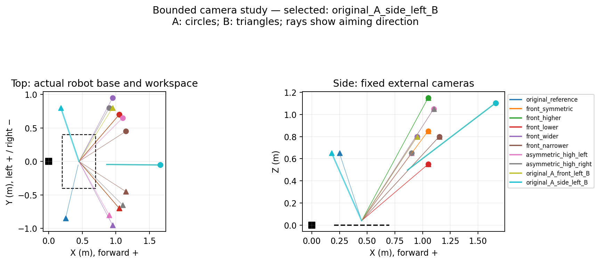
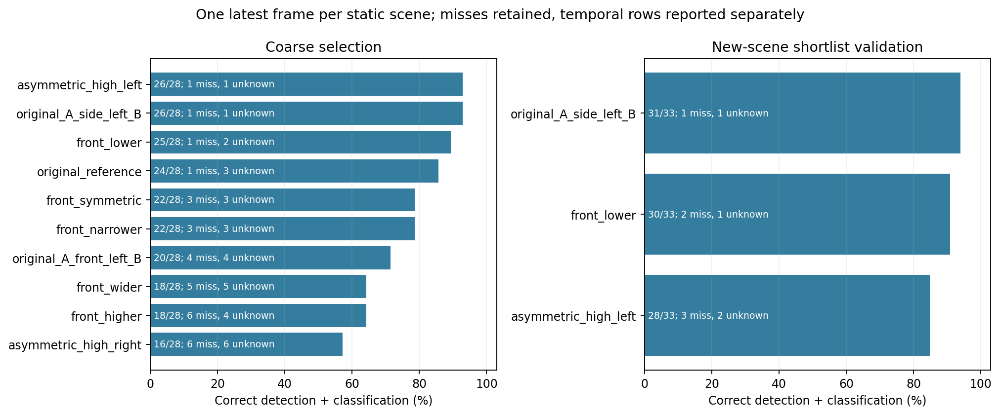
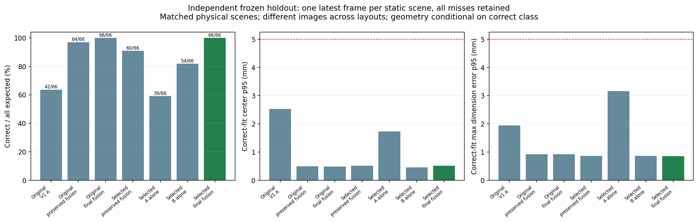
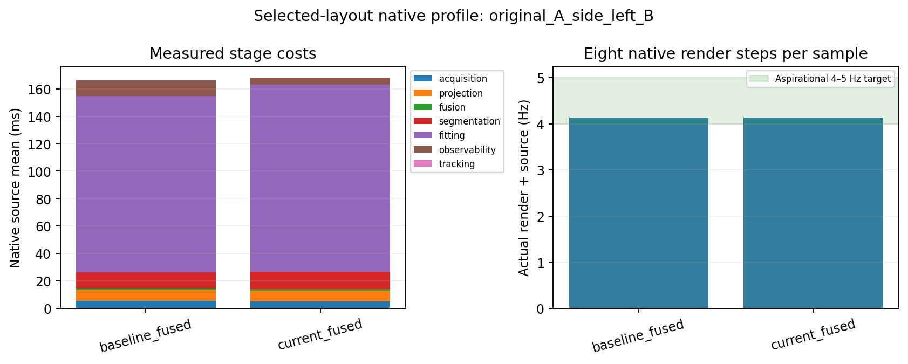
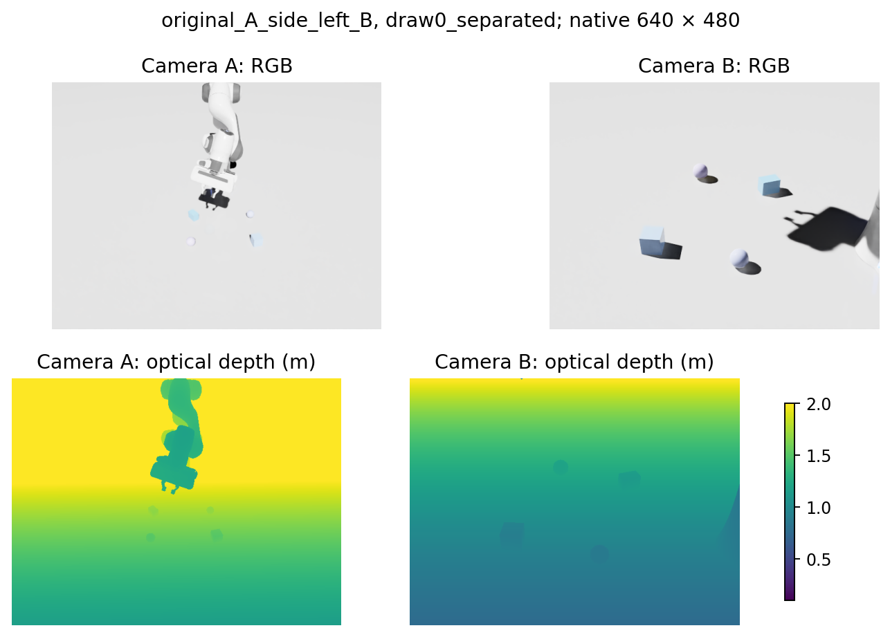
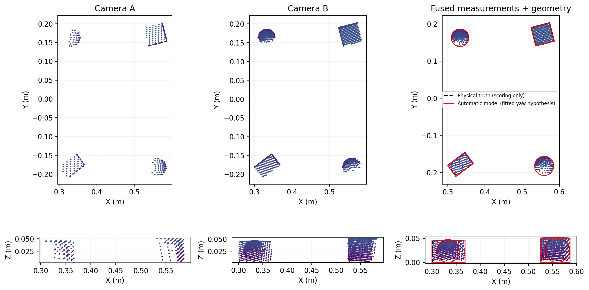

# Final cube/sphere multi-view perception checkpoint

**Checkpoint decision: GO for the controlled simulated cube/sphere presentation; freeze feature development pending professor feedback.** The selected camera arrangement preserves original Camera A and places Camera B at **(0.18, 0.80, 0.65) m**, looking toward **(0.45, 0, 0.04) m**. It gave the strongest independent shortlist result, 31/33 static classifications, before the final source refinements. The preferred symmetric front-left/front-right hypothesis was tested and did not win.

This checkpoint concerns controlled simulated perception for the course presentation. It does not resolve the historical manipulation NO-GO or authorize autonomous Pick/Place. Development stops at the reviewed perception checkpoint pending professor feedback.

## Architecture and scope

The opt-in `multi_view` source consumes two synchronized calibrated RGB-D frames, projects them into world coordinates, removes the configured support plane, balances per-camera voxel density, fuses current surfaces, segments candidate objects, fits geometric primitives, assesses current geometric observability, and associates persistent identities. It publishes the existing `ObservationBatch`/`ObjectObservation` contract through the unchanged updater and WorldModel.

Original V1 remains the default provider. V1, WorldModel, planning, manipulation, controllers, Behavior Trees, runtime, GUI, baseline scenes, launchers and dependency pins are unchanged. Production changes remain inside the separate multi-view package. Research scoring and V1 comparison adapters are outside that package; truth masks, expected object counts and semantic labels never enter automatic perception.

The existing limits remain: 12,000 fused workspace points, eight detections, sixteen broad candidate components, bounded refinement proposals and 24 numerical fits per batch. Confirmation requires three distinct frames. Repeated buffers publish no batch, and the source retains original acquisition timestamps. One-view visibility of an object is supported when both physical cameras are healthy; this is distinct from silently falling back after camera failure.

The main study uses supported cubes/rectangular boxes and spheres, including supported boxes that occlude other objects. Arbitrary shelves, unsupported environmental obstacles and collision-aware manipulation are outside this study. Cylinder support remains available and covered by existing regressions.

## Camera study and selection

The preserved baseline is `a347126b8bc8c94c86a308f2fa7c3f88151b0b46`, after merged PR #11, tree `3c2fde13bdbaa130b0c0ea3a5f6678c3843864c2`. Its eight package files are exported to `outputs/multiview-final/baseline_snapshot/` with original/exported hashes. Both camera-selection phases used that unchanged implementation, before the refinements below.

The actual Franka base is identity. Forward is +X from the base toward the workspace center, left +Y, right −Y and up +Z. The workspace is X 0.20–0.70 m, Y −0.40–0.40 m and Z 0–0.22 m. New views aim at (0.45, 0, 0.04) m. “Authored” below preserves the complete original transform, including roll; it does not re-aim the camera using an approximate eye/target pair.

| Layout | Camera A position m | Camera B position m | Aim convention |
| --- | --- | --- | --- |
| Original reference | (1.659, −0.053, 1.104) | (0.250, −0.850, 0.650) | Both authored |
| Front symmetric | (1.050, 0.700, 0.850) | (1.050, −0.700, 0.850) | Both workspace target |
| Front higher | (1.050, 0.700, 1.150) | (1.050, −0.700, 1.150) | Both workspace target |
| Front lower | (1.050, 0.700, 0.550) | (1.050, −0.700, 0.550) | Both workspace target |
| Front wider | (0.950, 0.950, 0.800) | (0.950, −0.950, 0.800) | Both workspace target |
| Front narrower | (1.150, 0.450, 0.800) | (1.150, −0.450, 0.800) | Both workspace target |
| Asymmetric high left | (1.100, 0.650, 1.050) | (0.900, −0.800, 0.650) | Both workspace target |
| Asymmetric high right | (0.900, 0.800, 0.650) | (1.100, −0.650, 1.050) | Both workspace target |
| Original A + front-left B | (1.659, −0.053, 1.104) | (0.950, 0.800, 0.800) | A authored, B workspace target |
| **Original A + side-left B** | **(1.659, −0.053, 1.104)** | **(0.180, 0.800, 0.650)** | **A authored, B workspace target** |

Exact positions, full original rotations and optical-axis aim markers are recorded in [selection.json](assets/multiview_final/selection.json). Actual 640 × 480 intrinsics stayed unchanged: A fx/fy approximately 554.256 pixels, B 732.999 pixels, principal point (320, 240). Symmetric positions therefore retain different fields of view. Native captures store each camera's actual transform and calibration.

Every layout sees identical physical arrangements and seeds within a phase. A cyclic layout order balances capture position. Coarse screening uses 13 scenes/31 physical objects per layout: isolated and separated shapes, exact and near-square boxes, workspace edges, nearby pairs, supported-object occlusion and a temporal sequence. The independent shortlist uses a different seed, fifteen scenes/37 objects, additional supported-cover cases and a versioned temporal sequence. No final holdout outcome is used for camera selection.

Static scenes have four genuine native frames. Frames 0/1 provide confirmation; frames 2/3 are scored. The ranking below uses only frame 3 per static scene, so repeated frames and long temporal sequences do not dominate selection. All other scored frames and failures remain in the complete results.



### Coarse screening before source refinement

Latest-static denominator: **28 physical targets across twelve scenes per layout**. Geometry is conditional on correct classification; each distribution's sample count is in JSON. Native rates use only twelve measured source-only samples per layout, one per static scene after three fresh warmups, with eight rendered steps. They exclude comparisons, truth scoring and exports.

| Layout | Correct/28 | Missing | Unknown | Edges/4 | Center p95 mm | Dimension p95 mm | Screening Hz |
| --- | ---: | ---: | ---: | ---: | ---: | ---: | ---: |
| Asymmetric high left | 26 | 1 | 1 | 4 | 0.365 | 0.706 | 4.201 |
| **Original A + side-left B** | **26** | **1** | **1** | **4** | **0.404** | **0.825** | **4.135** |
| Front lower | 25 | 1 | 2 | 4 | 0.510 | 1.037 | 4.408 |
| Original reference | 24 | 1 | 3 | 3 | 0.472 | 0.936 | 4.265 |
| Front symmetric | 22 | 3 | 3 | 4 | 0.260 | 0.525 | 4.846 |
| Front narrower | 22 | 3 | 3 | 4 | 0.449 | 0.920 | 4.925 |
| Original A + front-left B | 20 | 4 | 4 | 4 | 0.672 | 1.164 | 4.950 |
| Front wider | 18 | 5 | 5 | 4 | 0.374 | 0.782 | 5.492 |
| Front higher | 18 | 6 | 4 | 4 | 0.416 | 0.792 | 5.614 |
| Asymmetric high right | 16 | 6 | 6 | 4 | 0.322 | 0.612 | 5.125 |

All layouts have zero false positives, known mixed clouds, duplicate IDs and ID switches. Unknown mixed objects remain failures. Faster weak layouts can process fewer accepted objects, so rate alone is not a quality ranking. Full scoring retains 86 target-frame rows per layout: 56 static and 30 temporal.

Initial passive robot settling affects the first two recorded trial snapshots. All 130 trials remain. Hand displacement reaches 22.527 mm/2.199° relative to trial 0; link/hand snapshots from trial 2 through 129 are exactly equal. These are per-trial snapshots, not a per-frame stability proof. All camera origins are outside the resolved robot AABB, minimum distance 0.573 m; that is not mesh-intersection clearance validation.

### Independent shortlist

The shortlist is fixed to the three leading layouts. Latest-static scoring has **33 targets across fourteen scenes**, and temporal scoring separately has **four objects × ten frames = 40 rows**. Overall scoring retains all 106 rows per layout, including severe cases.

| Layout | Static correct/33 | Sufficiently visible correct/expected | Severe correct/expected | Missing/unknown | Temporal correct/40 | Fully hidden temporal rows | Center/dimension p95 mm |
| --- | ---: | ---: | ---: | ---: | ---: | ---: | ---: |
| **Original A + side-left B** | **31** | **31/33** | **0/0** | **1/1** | **40** | **0** | **0.544/1.085** |
| Front lower | 30 | 30/32 | 0/1 | 2/1 | 33 | 6 | 0.445/0.915 |
| Asymmetric high left | 28 | 28/32 | 0/1 | 3/2 | 35 | 4 | 0.401/0.656 |

Selected-layout static classification is 93.94% before refinement. Its remaining failure is a nearby box pair in `three_pairs_gap8`: one unknown and one miss. It preserves all four workspace-edge targets and changes only Camera B. This is the best tested practical arrangement on these finite selection sets, not a global optimum or statistical-significance claim. No further camera search is performed after selection.

The selected layout defeats the intended full-hiding geometry; **it does not provide new complete-hiding validation**. It does correctly classify a strict one-view object, with exactly zero raw target points in one camera and at least eight in the other. Latest-static strict one-view results are 1/1 selected and 2/2 for each frontal alternative.

The frontal alternatives provide separate recovery evidence. High-left has four fully hidden target frames and one transitional miss, then recovers the original ID 451.329 ms after the first reappearance capture. Lower has six fully hidden frames and one earlier visible failure; new full hiding censors that earlier episode, and the original ID returns on the first post-hide capture. Its saved capture interval is 0 ms, excluding processing/delivery. Raw rows, initial summaries and corrected event derivation hashes are retained.

Shortlist capture adds measured initial settling without robot/controller commands: 270 rendered physics steps, ending with sixty consecutive steps within 0.0553 mm translation, 0.00565° rotation and 0.0565 mm AABB change. Declared limits are 0.1 mm/0.01°/0.1 mm, bounded at 600 steps. No shortlist native timing was acquired.



## Final source refinements and diagnosis

Three modest changes follow selection; the camera decision is not reopened.

**Selective seed connectivity.** The existing 4 mm seed proposal remains first. If it leaves an untouched parent with two to eight seed components, one 4.5 mm retry can reconnect sparse samples belonging to the same object. It keeps the existing primitive, support, coverage, separation and measured-gap tests. An explicit ambiguous unknown or occupied bridge remains final; one-component clouds do not build a second graph. Both attempts share the existing 24-fit budget. No truth labels, new samples or historical geometry enter the source.

The single-saved-frame candidate diagnostic improves the selected layout from 29/31 to 31/31 proposals, including the problematic box pair. Those counts include one temporal snapshot and precede tracking confirmation; they are not final automatic holdout accuracy. Other unresolved pairs remain when measured child surfaces cannot support two accepted primitives.

**Orientation evidence.** Box metadata distinguishes observable face-grid yaw (90° period) from a uniquely ordered rectangular major axis (180° period). Empirical current side intervals determine whether major-axis ordering is resolved. Overlapping intervals remain ambiguous; this is not an angular confidence interval. The fitted hypothesis stays available for diagnostics. Featureless spheres retain no geometric orientation. Existing sphere radius/contact finalization and cylinder axes are preserved; no simulator-specific radius multiplier is added.

The final scorer first aligns horizontal side correspondence, then applies rectangle 180° or exact-square 90° symmetry. It reports near-square ambiguity and unavailable/incorrect orientations separately, while retaining raw major-axis errors. Dimensions compare horizontal long/short sides and Z separately, avoiding the misleading equivalence from sorting all three sides.

The selected-view geometry diagnostic retains 45 per-camera/fused isolated-object rows, all correctly classified. Across six fused spheres, raw radius bias is −1.071 to −0.622 mm and measured depth surfaces lie 0.552–0.913 mm inside the analytic sphere, consistent with native tessellation. The existing finalizer gives radius bias +0.162 to +0.296 mm and center error 0.165–0.301 mm. Isolated-box maximum dimension error is 0.580 mm. These optimization diagnostics support preserving the existing sphere method; they do not justify another simulator-specific correction. For the failing nearby box pair, acceptable full-object oracle fits and disconnected automatic seed fragments instead identify segmentation as the useful refinement target. Oracle fits remain diagnostic only.

**Equivalent observability computation.** Bounded pixel/ray lookup work is vectorized while preserving the original selected pixel set. All 255 saved original/candidate outputs are exactly equal, including perturbations. A quiet helper-only profile measures mean 8.951 → 3.072 ms over 360 box calls per alternative. This is an isolated CPU result, not a whole-source or native-rate claim. The production candidate's plain identifiers match the reviewed implementation. Evidence and hashes are in `outputs/multiview-final/promotion-report-inputs.json`.

The prior hidden 90 mm box safeguard remains. A good fit to a visible patch does not establish hidden dimensions. Known but incomplete boxes retain measured display geometry with explicit unobservable/non-graspable status; such output is not a safe complete reconstruction. Scores remain geometric consistency scores, not calibrated probabilities.

## Frozen final evaluation

The method froze before holdout generation at **2026-10-20 22:53:17.115859 UTC**. Published source [d89e7c0](https://github.com/BuilderCrafter/robot-skill-stack/commit/d89e7c06c78d0411b1079219c3e8b6b030e37f3e) has the exact same tree as local source `ab5145d`: `f3eb44883d80e6ab5f4938c0a2aafe197bd93e9b`. The [freeze manifest](assets/multiview_final/source-freeze.json), published at [ba6bc77](https://github.com/BuilderCrafter/robot-skill-stack/commit/ba6bc77a948abcb05c5e9090894478c0cdec1e8d), records all eight package hashes, original/selected camera-layout hash and eleven configuration/harness/scene hashes. Full local and published references are retained there.

The capture CLI checked the package and layout hashes before calling the lazy holdout generator. All eleven recorded configuration/harness/scene hashes were separately checked before capture. The final set uses two independent scene draws, seeds 20261219/20261220, thirty physical scenes and 74 objects under original and selected layouts: **60 layout-scene trials and 272 synchronized RGB-D batches** (544 camera frames), all fixture audits valid. The capture stores the freeze-manifest SHA256 `b59229145984d2be27207108b13f651c91dc9eb3a0399ec90f61fef493f039a3`. No source or layout tuning follows these results. An independent capture audit confirms exactly matched physical scenes across layouts, thirty scene seeds disjoint from both selection sets, and no exact reused object geometry/dimension/pose tuples. All saved calibrations and camera poses are fixed within each layout. Camera origins remain outside the robot AABB, minimum distance 0.663 m; all sixty per-trial robot snapshots are equal after measured settling. This remains an AABB/per-trial check, not continuous mesh clearance certification.

Within a layout, preserved baseline/current and single-camera methods consume identical original arrays, tokens and acquisition times. Across layouts, images differ and only physical scenes match. Replays use a declared logical capture clock and do not establish live Hz. Full calibrated clouds, all raw observations, misses, unknowns, mixed/split/duplicate diagnostics, runtime errors and fixture validity remain saved.

Sufficient visibility is declared before holdout: at least thirty fused 2 mm source samples and 0.18 area-weighted visible physical surface above the 4 mm table crop. Surface quadrature uses current exclusive native-depth support. It is a sampled physical-surface estimate, not a point-count ratio or proof of complete dimensions. Severe cases remain in overall denominators. Targets sharing a scene and repeated temporal frames are not claimed statistically independent.

The primary comparison uses **one latest frame per static scene: 66 physical targets (36 boxes, 30 spheres)**. Two temporal sequences contribute another eighty target-frame rows; all scored frames retain 212 target observations per layout/method. Conditional geometry includes every correctly classified object, including incomplete geometry. Numbers in parentheses are sample counts.

| Latest-static comparison | Correct/66 | Missing/unknown | Center p95 mm | Max dimension p95 mm | Sphere radius p95 mm | Observable yaw p95° |
| --- | ---: | ---: | ---: | ---: | ---: | ---: |
| Original V1 A | 42 | 18/6 | 2.525 (42) | 1.948 (42) | 1.011 (26) | 0.241 (14) |
| Original preserved multi-view | 64 | 1/1 | 0.491 (64) | 0.925 (64) | 0.234 (29) | 0.022 (31) |
| Original frozen multi-view | 66 | 0/0 | 0.488 (66) | 0.921 (66) | 0.233 (30) | 0.022 (32) |
| Selected preserved multi-view | 60 | 3/3 | 0.517 (60) | 0.862 (60) | 0.251 (30) | 0.024 (28) |
| Selected frozen single A | 39 | 13/14 | 1.726 (39) | 3.162 (39) | 0.256 (26) | 0.020 (7) |
| Selected frozen single B | 54 | 6/6 | 0.458 (54) | 0.864 (54) | 0.260 (28) | 0.024 (23) |
| **Selected frozen fused** | **66** | **0/0** | **0.510 (66)** | **0.859 (66)** | **0.251 (30)** | **0.023 (34)** |

Max dimension is the largest horizontal-long/short/Z box error or sphere **diameter** error; sphere radius is reported separately. The selected fused cube-only maximum-dimension p95 is **1.233 mm (36 boxes)**, height p95 0.020 mm. Static worst center/dimension errors are 1.076/2.065 mm. All 66 selected correct fits have bounded parameters; no incomplete fit was excluded to obtain these numbers.

| Comparison | Box correct/36 | Sphere correct/30 | Temporal correct/80 | Temporal missing/unknown | All scored correct/212 |
| --- | ---: | ---: | ---: | ---: | ---: |
| Original V1 A | 16 | 26 | 30 | 50/0 | 114 |
| Original preserved multi-view | 35 | 29 | 76 | 0/4 | 204 |
| Original frozen multi-view | 36 | 30 | 76 | 0/4 | 208 |
| Selected preserved multi-view | 30 | 30 | 80 | 0/0 | 200 |
| Selected frozen single A | 13 | 26 | 52 | 12/16 | 130 |
| Selected frozen single B | 26 | 28 | 80 | 0/0 | 188 |
| **Selected frozen fused** | **36** | **30** | **80** | **0/0** | **212** |

**Placement and algorithm effects differ.** On the new holdout, changing only the layout with the preserved algorithm reduces static classification from 64/66 to 60/66 (−6.06 percentage points). Refinement adds 2/66 with original cameras and 6/66 with selected cameras. The frozen algorithm ties at 66/66 static under both layouts; selected temporal accuracy improves from 76/80 to 80/80. Its static center p95 is slightly higher (0.510 versus 0.488 mm), while dimension p95 is slightly lower. This is a layout/segmentation interaction, not universal evidence that moving B improves every metric. The selected arrangement remains the best tested selection-stage choice and is retained without holdout-driven camera tuning; the original arrangement is also a strong final static alternative.

Fusion adds 27 and twelve correct static targets over selected A/B alone: **100% versus 59.09%/81.82%**. V1 A on original images reaches 63.64%; original preserved fusion reaches 96.97%. The single-camera multi-view rows are saved-frame ablations using a one-frame research rig. They do not enable live one-camera fallback: production acquisition still requires two healthy synchronized cameras.

Across all twelve method/layout comparisons, false positives, false splits, duplicate IDs, identity switches, wrong known primitive labels and known/graspable mixed clouds are zero. Unknown mixed clouds in V1/preserved/single-view methods remain recorded failures. Selected frozen fusion has no mixed clouds and passes **276/276 source checks**, with a maximum eighteen of 24 allowed numerical fits and no budget exhaustion. All 212 selected correctly classified observations have bounded parameters, including all 132 box-frame observations; sphere orientations remain absent.

For yaw, exact squares use 90° face-grid symmetry, distinct rectangles 180° major-axis symmetry. The two near-square static targets are excluded from the precision-eligible yaw statistic, with their raw yaw/errors retained. Their measured side intervals are disjoint, so the source retains a major-axis hypothesis; the evaluation still withholds a precise near-square yaw claim. These empirical intervals do not model all calibration or sensor uncertainty. Selected static yaw has 34 eligible boxes, p95 0.02339°; raw all-36-box p95/worst is 0.02332°/0.02456°. Four exact-square boxes correctly lack a unique major axis; no distinct rectangular box lacks one in the selected static set. Interval overlap and missing boundaries remain ambiguous, and no angular confidence interval is claimed.

**Visibility limitation:** every scored final-holdout target remains sufficiently visible under both layouts; the severe stratum is **0/0**, not a successful severe-occlusion test. Strict one-view static targets are 2/2 for each layout (4/4 scored rows per layout). The intended cover/full-hide fixtures remain in the dataset, but neither final layout produces complete hiding. Full-hide recovery evidence therefore comes from the separate frontal shortlist alternatives and retained native regressions, not these 80/80 temporal results.

Selected fusion has no interruption event. Original frozen fusion has four sufficiently visible temporal unknowns in draw one: frames 2/3 recover at frame 4 after 1053.054 ms on the original capture clock, while frames 10/11 remain unknown at capture end. The initial episode has no prior confirmed ID, so it is not same-ID reacquisition evidence. Its complete 208 correct observations include ten explicitly unobservable box-frame fits, retained in geometry scoring; worst dimension error is 5.412 mm. Selected all-scored p95 center/dimension is 0.373/0.771 mm (212 fits), worst 1.076/2.065 mm, with no incomplete fits.

The final selected configuration meets the suggested ≥95% classification and ≤5 mm/≤5° geometry aims on this finite controlled set. It does not establish general visibility, independent-sample statistical confidence or real-world performance. Compact aggregates and artifact hashes are in [checkpoint.json](assets/multiview_final/checkpoint.json); complete failures for every comparison, raw orientations and observations remain in ignored `outputs/multiview-final/final-holdout-evaluation/` and `final-holdout-analysis.json`.



### Historical regression data

These old holdouts are now regression sets, not independent final validation. Each complete variant comparison has 103 expected observations, including four expected unknown fixtures; each clean subset has 52, including one expected unknown.

| Prior dataset | Baseline/final clean correct | Baseline/final all-variant correct | Baseline/final missing overall | Baseline/final mixed clouds |
| --- | ---: | ---: | ---: | ---: |
| Iteration two | 52/52 → 52/52 | 102/103 → 103/103 | 1 → 0 | 0 → 0 |
| Readiness | 46/52 → 48/52 | 92/103 → 94/103 | 5 → 4 | 5 → 4 |

Both comparisons have zero false positives, false splits, duplicate IDs or identity switches, zero runtime errors, and 294 source checks with no early confirmations, stale timestamps or repeated-frame publications. Remaining mixed cases stay explicit. Artifacts: `outputs/multiview-final/prior-holdout-iteration2/` and `prior-holdout-readiness/`. The inherited reports provide the original cylinder, missing-band and hidden-boundary evidence; this iteration does not expand cylinder research.

## Native performance and completed validation

The unchanged original workload preserves **87/88 correct** before/after refinement, including the same cylinder miss. All 87 matched center and dimension values are exactly unchanged: center mean/p95 0.232/0.496 mm, dimension mean/p95 0.647/1.150 mm. Fresh baseline/final throughput is **3.950 → 4.038 Hz**, with source mean 172.482 → 172.511 ms and complete-loop mean 253.148 → 247.634 ms. This preserves practical throughput; it does not establish an algorithmic whole-loop speedup. The final run has 72 fresh timed samples across 24 trials, artifacts `outputs/multiview-final/original-final/`.

This historical workload contains cylinders and surrogate clutter and uses two reference B poses, including its documented benchmark override. Its old yaw/axis summary compares boxes modulo 90° universally, so it is retained as a regression metric rather than the corrected rectangular-yaw claim below. It is separate from both exact-authored-layout screening and the independent cube/sphere holdout.

The dedicated selected-layout profile uses fourteen static shortlist scenes, three fresh warmups and five measured samples per scene and implementation: **70 samples each**. Baseline/current method order alternates by trial. Each sample renders eight native steps before observation; comparisons, truth scoring, capture exports and disk I/O are outside timing. Sources execute serially, with other research CPU jobs paused. The two sources see the same physical scene and independently acquired live frames; this timing run is not the saved-identical-image accuracy comparison.

| Cost, ms | Preserved mean | Final mean | Final p95 | Final worst |
| --- | ---: | ---: | ---: | ---: |
| Acquisition | 5.431 | 5.216 | 6.359 | 6.999 |
| Projection/filtering | 7.815 | 7.789 | 10.331 | 12.101 |
| Fusion | 1.215 | 1.195 | 4.064 | 4.253 |
| Segmentation | 11.621 | 12.354 | 36.863 | 38.004 |
| Primitive fitting/refinement | 128.642 | 136.538 | 496.684 | 536.859 |
| Geometric observability | 11.508 | 4.948 | 10.175 | 13.274 |
| Tracking | 0.099 | 0.106 | 0.314 | 0.336 |
| Total source | 166.331 | 168.147 | 541.531 | 580.929 |
| Eight rendered steps | 75.214 | 73.956 | 78.132 | 88.186 |
| Render + observation loop | 241.571 | 242.130 | 616.363 | 654.329 |

Actual throughput is **4.140 → 4.130 Hz** (1000 divided by mean complete-loop ms). Preserved-loop p95/worst is 502.413/543.451 ms. The equivalent helper reduces native observability cost, while additional accepted/refined close pairs increase fitting and tail latency. Numerical fitting remains the dominant cost. Mean frequency meets the intended range, but difficult frames can take about 0.65 seconds; no whole-loop speedup or fixed 4 Hz deadline is claimed. No background threads or dependency/runtime changes are introduced.



| Validation | Completed evidence | Artifacts |
| --- | --- | --- |
| Final offline | PASS: 432 discovered units + eight standalone suites + architecture | `outputs/multiview-final-unit/run-mu9rshu8/` |
| Native multi-view | PASS: 5/5, including existing source, recovery, cylinder and hidden-box/temporal contracts | `outputs/multiview-final-native/run-liua2z08/` |
| Saved demo and saved camera edits | PASS: 4/4 classes in each capture; every center error <0.29 mm; sphere orientations absent; repeated frames silent | `outputs/multiview-final/demo-scene-verification/` |
| Unchanged V1 Isaac | PASS: 2/2 on retry | `outputs/multiview-final-v1-isaac/run-6qzwh88t/` |
| Unchanged legacy robotics | PASS: 6/6 scenario JSON and exit codes | `outputs/multiview-final-regression/run-oaqg1ngg/` |
| Independent frozen final holdout | PASS: all 60 trials, six methods, valid audits/contracts; selected 212/212 correct | `outputs/multiview-final/final-holdout-evaluation/` |
| Dedicated final native profile | PASS: 70 fresh samples per implementation, stable source/harness hashes | `outputs/multiview-final/selected-native-profile/` |

The initial V1 run `run-i2hx0t8u` encountered an NVIDIA/GLX crash and left a scenario result missing. It is retained as an infrastructure failure, followed by the complete passing retry; process exit status alone is not acceptance. Every native result JSON must also be inspected. Original V1 and robotics acceptance thresholds remain unchanged.

No new multi-view Pick, Place, gripper action or contact trajectory is executed. Required existing legacy fixtures may exercise their documented original motions. The final perception study itself constructs no robot backend or planner.

## Editable demonstration scene

Open `scenes/multiview_perception_final.usda` and select `config/scenes/multiview_perception_final.toml` through the existing configuration flow. The separate experimental layer contains two cubes/rectangles and two spheres, overrides only its camera poses, and preserves `scenes/playground.usd` and historical camera layers.

To change a camera manually:

1. Make the final experimental layer the active edit target, preserving the original baseline layers.
2. In Stage, select `/World/PerceptionCamera` or `/World/PerceptionCameraSide`.
3. Use the ordinary Move/Rotate tools or transform properties, then save the experimental layer.
4. Reload that saved scene with its opt-in multi-view TOML. Acquisition reads actual current camera transforms; no Python coordinate edit is needed.

The ordinary-startup verification saves/reloads translations of A (+13, −9, +6) mm and B (−11, +7, +4) mm, with world-yaw changes +2°/−1.5°, and preserves all four classifications/calibration. Benchmarks intentionally reposition cameras; use the normal saved scene or `verify_multiview_final_scene.py` when checking persistence. A successful modest edit test does not guarantee arbitrary camera placements will preserve coverage.





## Reproduction

Use the unchanged workstation environment: Isaac Sim 5.1.0-rc.19, Python 3.11, repository NumPy 1.26.4 loaded before SimulationApp, py_trees 2.6.0 and `run_isaac_python.sh`. Native sessions run sequentially. Never use `--no-ros-env`; do not change dependency pins, launchers, drivers or workstation configuration. Use new output directories to retain earlier failures.

Export the immutable baseline before comparison. This rewrites only its package import names and adds diagnostics outside the historical benchmark's timing:

```bash
./run_isaac_python.sh scripts/preserve_multiview_baseline.py \
  --ref a347126b8bc8c94c86a308f2fa7c3f88151b0b46 \
  --output outputs/multiview-final/baseline_snapshot
```

The archived layout tables use that preserved source. These commands rerun its camera-study scoring on the saved native images, without generating holdout data:

```bash
./run_isaac_python.sh scripts/benchmark_multiview_final_perception.py \
  --replay outputs/multiview-final/coarse-capture --methods baseline_fused \
  --baseline-pythonpath outputs/multiview-final/baseline_snapshot \
  --result outputs/multiview-final/coarse-baseline-repeat/result.json \
  --artifacts-dir outputs/multiview-final/coarse-baseline-repeat
./run_isaac_python.sh scripts/benchmark_multiview_final_perception.py \
  --replay outputs/multiview-final/shortlist-capture --methods baseline_fused \
  --baseline-pythonpath outputs/multiview-final/baseline_snapshot \
  --result outputs/multiview-final/shortlist-baseline-repeat/result.json \
  --artifacts-dir outputs/multiview-final/shortlist-baseline-repeat
```

Capture-only repeats use the current measured settling protocol; the original coarse run predates that addition. A coarse repeat captures all ten layouts and profiles both sources; use the baseline results to reproduce the pre-refinement comparison. The chosen shortlist and seeds remain fixed:

```bash
./run_isaac_python.sh scripts/benchmark_multiview_final_perception.py \
  --capture-only --split coarse --native-timing-samples 1 --time-baseline \
  --baseline-pythonpath outputs/multiview-final/baseline_snapshot \
  --result outputs/multiview-final/coarse-capture-repeat/result.json \
  --artifacts-dir outputs/multiview-final/coarse-capture-repeat
./run_isaac_python.sh scripts/benchmark_multiview_final_perception.py \
  --capture-only --split shortlist \
  --layout asymmetric_high_left --layout original_A_side_left_B --layout front_lower \
  --result outputs/multiview-final/shortlist-capture-repeat/result.json \
  --artifacts-dir outputs/multiview-final/shortlist-capture-repeat
./run_isaac_python.sh scripts/verify_multiview_final_scene.py \
  --scene scenes/multiview_perception_final.usda \
  --config config/scenes/multiview_perception_final.toml \
  --expected-layout docs/assets/multiview_final/selected-layout.json \
  --artifacts-dir outputs/multiview-final/demo-verify-repeat
```

The final guard is required before independent holdout generation. Execute the following only with the recorded frozen implementation and manifest; any package/layout mismatch must fail before scene generation:

```bash
./run_isaac_python.sh scripts/benchmark_multiview_final_perception.py \
  --capture-only --split holdout \
  --layout original_reference --layout original_A_side_left_B \
  --freeze-manifest docs/assets/multiview_final/source-freeze.json \
  --result outputs/multiview-final/holdout-repeat/result.json \
  --artifacts-dir outputs/multiview-final/holdout-repeat
./run_isaac_python.sh scripts/benchmark_multiview_final_perception.py \
  --replay outputs/multiview-final/holdout-repeat \
  --methods baseline_fused,current_fused,current_single_a,current_single_b,v1_a,v1_b \
  --baseline-pythonpath outputs/multiview-final/baseline_snapshot \
  --export-clouds \
  --result outputs/multiview-final/holdout-comparison-repeat/result.json \
  --artifacts-dir outputs/multiview-final/holdout-comparison-repeat
```

The completed capture is `outputs/multiview-final/final-holdout-capture/`; its six-method evaluation is `outputs/multiview-final/final-holdout-evaluation/`. Repeat commands use separate destinations to preserve the recorded evidence. Native performance is reproduced independently from saved-image accuracy, with other CPU/GPU jobs paused:

```bash
./run_isaac_python.sh scripts/benchmark_multiview_final_perception.py \
  --capture-only --split shortlist --layout original_A_side_left_B \
  --native-timing-samples 5 --time-baseline \
  --baseline-pythonpath outputs/multiview-final/baseline_snapshot \
  --result outputs/multiview-final/selected-native-profile-repeat/result.json \
  --artifacts-dir outputs/multiview-final/selected-native-profile-repeat
./run_isaac_python.sh scripts/benchmark_multiview_detection.py --repeats 2 \
  --result outputs/multiview-final/original-final-repeat/result.json \
  --artifacts-dir outputs/multiview-final/original-final-repeat
```

The required regression suites use the same launcher:

```bash
./run_isaac_python.sh scripts/run_all_regressions.py --unit-only \
  --artifacts-dir outputs/multiview-final-unit-repeat
./run_isaac_python.sh scripts/run_all_regressions.py --group multiview \
  --artifacts-dir outputs/multiview-final-native-repeat
./run_isaac_python.sh scripts/run_all_regressions.py --group isaac \
  --artifacts-dir outputs/multiview-final-v1-isaac-repeat
./run_isaac_python.sh scripts/run_all_regressions.py --group regression \
  --artifacts-dir outputs/multiview-final-regression-repeat
```

Selection definitions and 32 artifact hashes are in [selection.json](assets/multiview_final/selection.json). Freeze hashes are in [source-freeze.json](assets/multiview_final/source-freeze.json). Large RGB/depth captures, cloud exports and row-level JSON/CSV remain under ignored `outputs/` paths. Figures above and below are generated from the recorded measurements, not synthetic illustrations:

```bash
MPLCONFIGDIR=/tmp/multiview-final-mpl ./run_isaac_python.sh scripts/plot_multiview_final_perception.py \
  --coarse outputs/multiview-final/coarse-evaluation \
  --shortlist outputs/multiview-final/shortlist-evaluation \
  --holdout outputs/multiview-final/final-holdout-evaluation \
  --native outputs/multiview-final/selected-native-profile \
  --capture outputs/multiview-final/final-holdout-capture \
  --evaluation outputs/multiview-final/final-holdout-evaluation \
  --selected original_A_side_left_B --output docs/assets/multiview_final
```

## Limits and checkpoint decision

This is a table-supported yaw-box/sphere experiment with retained upright/lying cylinder support. It does not establish arbitrary 6D boxes, stacked/intersecting objects, unrestricted sensor noise, fast motion, arbitrary camera edits or real-world generalization. Sparse close pairs and missing-depth ambiguity can still require unknown output. More frames cannot reveal a boundary consistently hidden from both fixed cameras. Native primitive tessellation and empirical extent uncertainty remain limits; radius/side estimates are not certified bounds for arbitrary hidden geometry.

**Perception presentation decision: GO for the documented controlled simulated demo, using the frozen source and selected scene.** The independent set reaches 66/66 static and 80/80 temporal correct classifications, sub-millimeter aggregate p95 errors and practical 4.13 Hz mean native throughput. Required regressions pass. Preserve the remaining uncertainty gates and the original-camera comparison; do not generalize this result to complete hiding, arbitrary camera movement or manipulation. Feature development stops here until professor feedback.

Remaining failures are explicit: the original final layout has four temporal unknowns, the unchanged original legacy workload still misses one cylinder, and older noisy/missing-depth/close-pair regression variants retain conservative unknowns. Frames requiring additional separation can approach 0.65 seconds. No selected-layout holdout failure was discarded or used for tuning.

**Manipulation decision remains NO-GO.** The earlier unmodeled environmental-obstacle blocker, approach-space coverage and executed multi-view grasp outcomes remain outside scope. A passing perception checkpoint does not imply collision-safe trajectories or autonomous manipulation approval. See the [historical geometric-observability report](multiview_geometric_observability.md).

Review branch: `research/multiview-final-perception`, targeting `research/multiview-rgbd-fusion`. Recommended review tag after approval: **`multiview-perception-2026-10-21`**. No tag is created/pushed and no branch is merged automatically.
