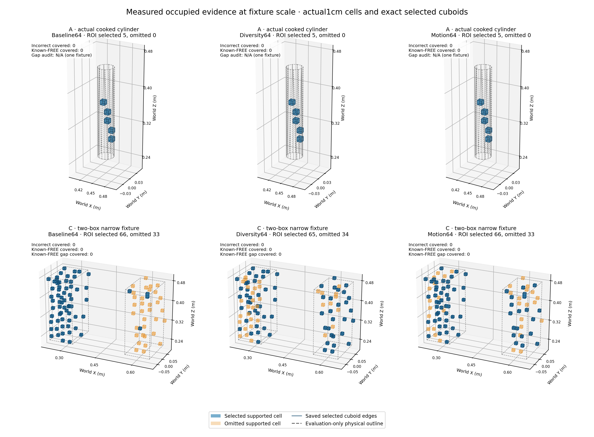
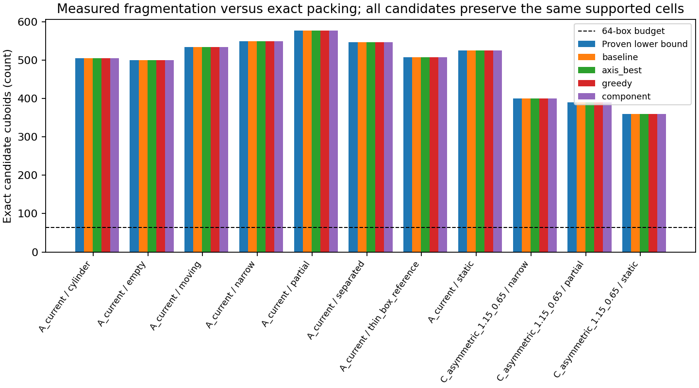
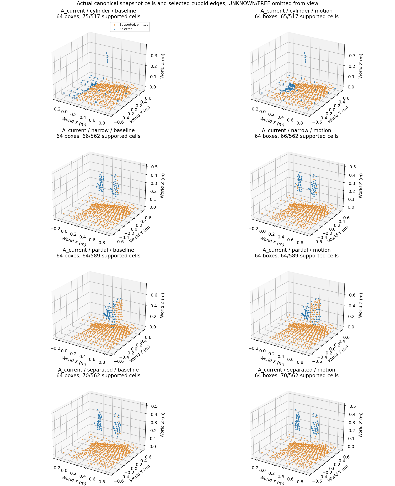
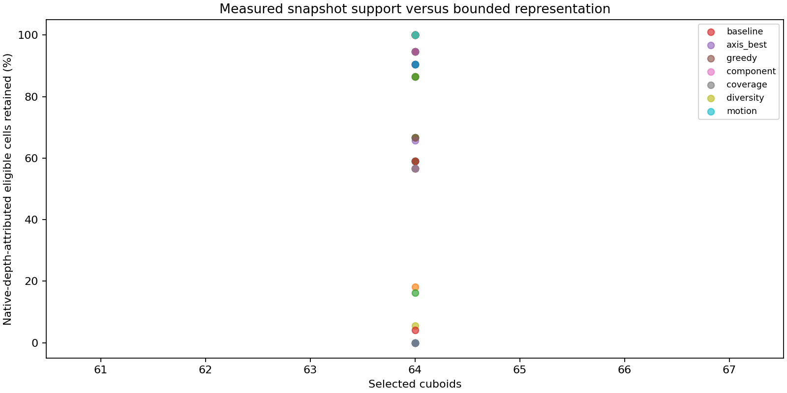
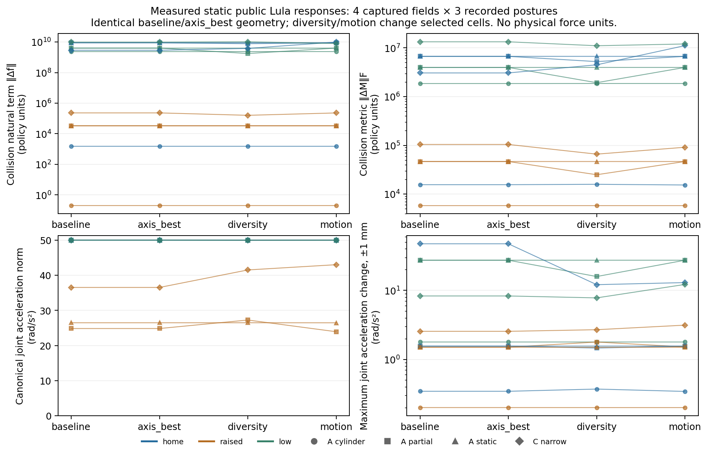
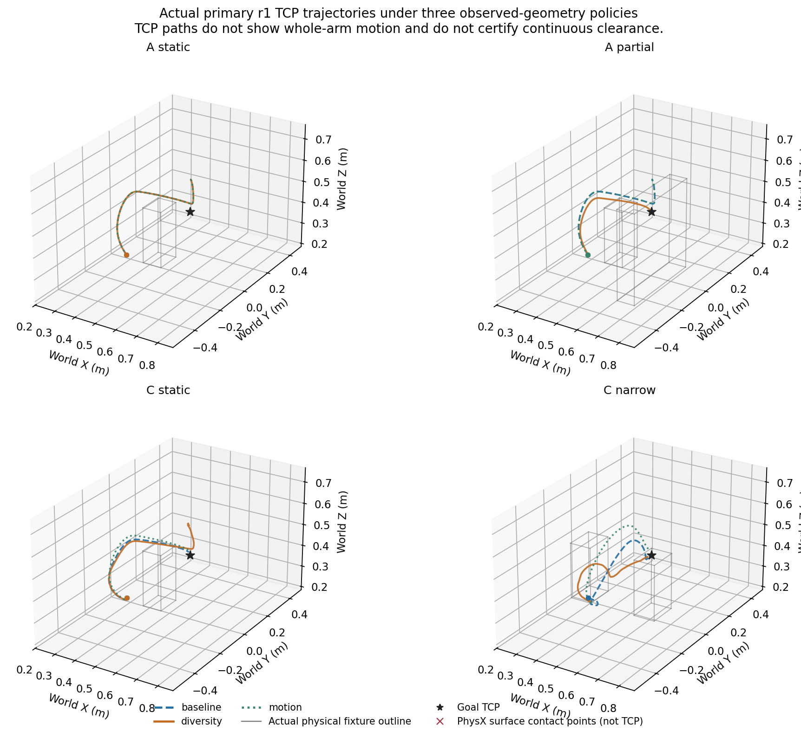

# Motion planning V3: obstacle representation and fragmentation

Research branch: `research/obstacle-representation-v3`, started from camera-study
checkpoint `1a6d4901c52c6fec4e1eeb40d2e44eb16be5b3a8`. Experimental implementation commit: `e810adf7f7a22d27cd1e0982f7f8f5e59482ac61`.
Its published equivalent is `1b91d13930f13c0df9490b8df4f1e3f92fa2ca72`;
both have the identical Git tree `fee7ae808a72617ae87850222e18836780286efe`.
Analysis helpers were subsequently committed locally as
`84f569187f03fe9924c488d00b0954ac8f464aca`, published as
`e6cfc9270cf0789ad1641bf619ef0089443b3f42`, with identical tree
`74033d02e80d955ed8f8701e3c604b41207a1a3e`. GitHub publication assigns
different commit metadata; measured source hashes and exact tree equality bind
these equivalents. None of the seven measured core scripts changed afterward.
Production algorithms,
defaults, launchers, source freshness, occupancy support and controller settings
remain unchanged. The pre-existing untracked `models/` directory is preserved.

The baseline already achieved the proved minimum exact box count in all 66 captured maps. The main limit is disconnected observed evidence, followed by selection under the 64-proxy budget. Diversity changed which hazards were represented and produced repeatable but opposing motion outcomes: A partial improved from 0/3 to 3/3 contact-free goal completions, while C static regressed from 3/3 to 0/3. No tested policy improved the primary total of 12/14. These results support further representation research, not production adoption.

All 85 native measurements were valid: 42 primary, 20 repeats, four fresh direct controls, eight optional three-camera trials and 11 separate forensic captures. Measurement validity is distinct from successful avoidance. Only the 74 timing-eligible runs enter runtime comparisons; full capture I/O trials remain separate.

## Baseline and experimental boundaries

The existing extractor already forms exact Z runs, merges identical adjacent Y
runs and then matching X slabs. Its 64-box selection prioritizes above-support-
plane boxes and then larger voxel volumes with deterministic coordinate ties.
Because its candidate boxes are disjoint, that volume order already maximizes
retained cells within those priority classes. A global coverage selector changes
the floor/hazard tradeoff; it is not an undiscovered improvement to that same
objective.

Eligible evidence is original observed, unexpired OCCUPIED classification with
valid original observation times. The baseline radius-two Chebyshev support and
RGB-D probability support at 0.95 remain identical for every extractor. Support
does not fill intervening cells. Packing uses face-connected geometry: an exact
axis-aligned box cannot span two face-disconnected components without including
an unsupported cell. Component counts therefore provide a packing lower bound,
independent of the quality of any particular greedy algorithm.

The [V2b surface-completion experiment](assets/motion_planning_v2b/rejected_surface_patches.json)
was rejected after its static and sparse native trials failed to reach their
targets. V3 does not reimplement it or search its thresholds. It changes only
grouping and bounded selection of existing evidence. UNKNOWN stays uncertainty;
there is no dilation, padding, gap bridging or completion of unseen interiors.

Historical [retention](assets/motion_planning_v2b/retention_validation.json) and
[Lula composition](assets/motion_planning_v2b/obstacle_composition.json) establish
why temporal support and primitive arrangement matter. The
[camera study](camera_observability_feasibility.md), its
[representation counts](assets/camera_observability_feasibility/representation.json)
and [physical results](assets/camera_observability_feasibility/planning.json)
show that greater visibility does not imply improved motion. Natural RMP force
and metric terms are not measured Newtons, torques or contact impulses.

## Protocol and data

The [predeclared protocol](assets/obstacle_representation_v3/protocol.json) fixes
1,024 total rays, stride 8, 2 Hz mapping, 64 primary proxies, 5-second evidence
expiry and the one-second source limit. Sixteen, 32 and 128 proxies are diagnostic
sensitivity checks; the production budget remains 64.

Existing V2b canonical snapshots contain actual states, probabilities, observed
flags, last-observed times and expiry flags. Their historical diagnostic camera
poses are distinct from authored `A_current`. Guarded camera-study Home cylinder
inputs can be replayed through the canonical mapper, with replay clocks explicitly
qualified. Cumulative free/hit masks are never relabeled canonical map states.
Fresh baseline captures at the authored layouts cover missing scenarios.

The old `sparse` fixture is a thin **rectangular** post. A separate research-only
32-sided cylindrical fixture supplies actual cylindrical evidence and motion
tests. Its explicit physical convex mesh is recorded, including the difference
from an ideal smooth cylinder. Clearance uses its actual PhysX-cooked solid convex hulls and
actual cooked robot hulls, independently of occupancy and RMPflow collision
spheres. The independent support-map GJK implementation uses a 1 nm numerical primal/dual convergence certificate. An audit of 55 actual hull pairs found 54 within 0.1 µm of the older triangle/BVH method; one differed by 4.773 µm where the old cooked polygon fan was slightly nonconvex. Independent convex-hull/SLSQP checks agreed with GJK. This validates the numerical convex-distance calculation, not continuous-time or model fidelity. The 32-sided cylinder differs radially from the ideal smooth cylinder by at most about 0.0843 mm. An enclosing box is not substituted for cylinder clearance. Dense
geometry reduction runs after motion; original PhysX contacts remain separate.

Full forensic snapshot/capture I/O runs in the mapping subprocess and is excluded
from live timing claims. Final motion comparisons use otherwise matched native
runtime behavior and no concurrent replay/plot workloads. All failures and
timeouts remain in their appropriate measured or invalid denominators.

## Exact representation candidates

The SDK-independent research module consumes immutable canonical snapshots and
returns the existing immutable obstacle-packet type. Packing candidates comprise
the actual production baseline, all six fixed run/merge axis orders, a bounded
best-axis diagnostic, deterministic bounded 3D greedy packing, and component-aware
best-axis packing. Component packing selects an axis order independently for
each face-connected group; this differs from applying one order globally.
Every greedy expansion must contain only supported cells; its bounded fallback
keeps exact geometry and reports omissions.

Selection candidates comprise the production priority, global cell coverage,
spatial diversity and public motion relevance. Motion context is an explicit
immutable input containing known robot/goal/corridor information, not object
labels or future collision results. It reserves outside-region slots and reports
remaining omitted evidence; it does not certify hazards outside the corridor.
Camera poses and sampling stay fixed within representation comparisons.

Every candidate is checked at voxel-cell level for invented FREE/UNKNOWN/expired
geometry, overlap duplication, mapping-bound violations, coverage loss, original
expiry and known-free gaps. Geometry-preserving grouping cannot overcome truly
disconnected samples; a negative compression finding is a valid result.

## Immutable-snapshot representation study

The primary comparison used 66 actual canonical worker snapshots: six successive captured revisions from each of eight `A_current` scenarios and three `C_asymmetric_1.15_0.65` scenarios. The A scenarios were empty, static, thin rectangular post, actual cooked cylindrical post, partial occlusion, two separated objects, narrow gap and moving object; C repeated static, partial and narrow. These are the authored camera layouts, not the historical V2b diagnostic camera poses. All variants received identical immutable `states`, `probabilities`, `observed`, `last_observed` and `expired` arrays. Cumulative ray-hit masks were not treated as occupancy maps. The historical 24-snapshot reference manifest remains separate; fresh native captures made a supplemental Home logical-clock replay unnecessary.

The original clocks are distinct. `snapshot_evaluated_at` records the snapshot copy/classification time, validated against its original health age; `evaluated_at` is the original packet's `extracted_at` (or last recorded processor-phase clock). Eligibility uses that later extraction time, the original per-cell observation times and the unchanged five-second TTL. For example, the cylindrical pilot's job 7 copied its snapshot at 3287827.511756330 and extracted at 3287827.517246378, 5.49 ms later. Neither time was replaced with the time of this offline analysis.

Seven 64-box extractors were compared: production baseline, best fixed axis order, bounded greedy, component-wise best axis, global cell coverage, spatial diversity and public motion relevance. All six individual run/merge axis orders were additionally audited. There were **462 passing exact representation audits**. Input-array hashes remained unchanged; candidate and selected unions contained zero invented FREE, UNKNOWN, ineligible, unsupported or overlapping cells. Candidate coverage lost zero supported cells. Every emitted box retained its original oldest-cell expiry and source generation/revision/timestamp, and recorded extraction time. All quiet-packet expiry checks removed the registrations after the original expiries.

## Fragmentation, support and packing are different stages

The unchanged support rule combines radius-two Chebyshev evidence support with repeated-observation probability support at 0.95. A radius-two graph can relate nearby evidence while leaving intervening cells UNKNOWN; it does not license a cuboid across those cells. Exact packing instead requires face-connected geometry.

Across **all 66 snapshots**, the production candidate count equalled the proved lower bound: the number of face-connected components plus the number of nonrectangular components. Each face-connected component needs at least one cuboid; a nonrectangular component needs at least two, and a cuboid cannot join distinct face components without inventing unsupported cells. Sixty snapshots had entirely rectangular components. Six early C revisions included nonrectangular components: C-narrow jobs 13/14 had component-count/lower-bound pairs 687/691 and 614/616; C-partial 631/632 and 625/626; C-static 615/617 and 556/558. Baseline attained even these strengthened bounds. All six global axis orders, greedy packing and component packing returned the same candidate count on every snapshot: **no exact compression improvement was possible on these particular supported masks**. All 11 final maps were entirely rectangular, so their lower bound equals their face-component count. This is an observed-map result, not a claim that the baseline packing is globally optimal for arbitrary maps; the focused synthetic tests contain a counterexample where bounded greedy/component packing improves on all six global orders.

Candidate/lower-bound counts ranged from 360 to 691 over the 66 snapshots. The final 11 snapshots are below. The count of supported cells that belonged to isolated one-cell face components was 83.5106–96.4824% per snapshot. Summing singleton-cell counts and supported-cell counts across the 66 snapshots gives **94.6804%**. This is a snapshot-weighted evidence statistic, including support-plane evidence, not a fraction of unique physical surface area.

| Final map | Eligible cells | Supported cells | Face components = minimum exact boxes | Cells selected by baseline 64 boxes |
|---|---:|---:|---:|---:|
| A empty | 512 | 512 | 501 | 75 |
| A static | 537 | 537 | 526 | 75 |
| A thin rectangular post | 519 | 519 | 508 | 75 |
| A cooked cylinder | 517 | 517 | 506 | 75 |
| A partial | 589 | 589 | 578 | 64 |
| A separated | 562 | 562 | 547 | 70 |
| A narrow | 562 | 562 | 550 | 66 |
| A moving | 571 | 549 | 535 | 78 |
| C static | 367 | 367 | 360 | 71 |
| C partial | 398 | 398 | 391 | 64 |
| C narrow | 410 | 410 | 401 | 66 |

Support admission and the box budget must not be conflated. In the final A-moving snapshot, 571 canonical eligible cells became 549 supported cells; 199 had spatial support and 350 additional isolated cells qualified through the original temporal probability rule. All 549 supported cells were preserved by candidate packing; the 64-box selection retained 78 of them. For the currently visible moving object specifically, 22 depth-attributed eligible cells became 13 supported cells, all 13 were packed, and all 13 were selected. Its nine support-rejected cells cannot be recovered by a packing or selection change under this study's rules.

## Physical endpoint attribution and selection tradeoffs

Physical shape metadata was consulted only after extraction. Static native fixtures use the recorded actual post-insertion kinematic-body poses, independently checked against zero pose drift throughout the motion trace. The cylindrical fixture uses its actual PhysX-cooked convex faces and actual recorded world pose for floating-point halfspace first-hit queries; its enclosing box is not a cylinder depth reference. The moving object's 12 camera exposures from the six selected snapshots all matched an independently recorded physics pose at the same rendering simulation time within 1 microsecond. Unmatched exposures would have remained unmeasured; there was no interpolation or substitution of the initial/current pose.

A 15 mm optical-depth tolerance labels native depth endpoints. The denominator below is **currently eligible occupied cells that also receive a matching current native depth endpoint**. It is not dense solid occupancy, completed surface recall, area-weighted recall or an unseen-interior IoU. Historical-only occupied surfaces are outside that endpoint denominator.

| Final case / object | Eligible endpoint cells | Supported / candidate-covered | Baseline selected | Diversity selected | Motion selected |
|---|---:|---:|---:|---:|---:|
| A partial / Post | 36 | 36 / 36 | 36 | 17 | 36 |
| A partial / Occluder | 77 | 77 / 77 | 28 | 47 | 28 |
| C narrow / Left | 62 | 62 / 62 | 62 | 38 | 46 |
| C narrow / Right | 37 | 37 / 37 | 4 | 27 | 20 |
| A cooked cylinder | 5 | 5 / 5 | 5 | 5 | 5 |
| A moving / MovingPost | 22 | 13 / 13 | 13 | 13 | 13 |

Diversity and motion relevance redistribute the existing 64 slots; they do not compress the evidence. C-narrow improves the less represented right object by surrendering left-object coverage. A-partial diversity surrenders 19 post cells while gaining 19 occluder cells. A-static retained all 36 current attributed post cells and C-static all 40 under all three policies. These are tradeoffs to test in the installed policy and native motion, not evidence of an overall safety improvement.

The global coverage selector was retained as a negative result. It raises or preserves total represented cell count by spending slots on larger support-plane boxes, but drops all five attributed cylindrical cells and all 36 A-static post cells in their final snapshots. It was excluded from native candidate testing. The finite shortlist is **diversity and motion relevance**; packing alternatives remain negative controls.

## Known-free gaps and budget sensitivity

Gap audits consider full voxel cells between pairs of fixture enclosing boxes. They retain actual map classifications, including residual occupied cells; they do not relabel the whole physically intended gap FREE.

| Final reference gap | Known FREE cells | UNKNOWN cells | In-map OCCUPIED cells | Selected FREE / UNKNOWN cells, all variants |
|---|---:|---:|---:|---:|
| A narrow, 0.220 m | 927 | 6,771 | 2 | 0 / 0 |
| A separated, 0.300 m | 1,314 | 8,834 | 2 | 0 / 0 |
| C narrow, 0.220 m | 1,103 | 6,591 | 6 | 0 / 0 |

These regions are conservative whole-cell evaluation ROIs between enclosing boxes, not swept-robot or continuous-path passage certificates. Other scene geometry is not erased. The large UNKNOWN counts remain uncertainty, and the existing occupied counts are reported rather than attributed to invented packing geometry.

A separate diagnostic used one identical final snapshot per sequence at 16, 32 and 128 boxes for baseline/diversity/motion: **99 additional exact audits passed**. This has no temporal or live performance interpretation. Baseline A-partial selected Post/Occluder cells 16/0, 32/0, 36/28 and 36/77 at budgets 16/32/64/128. Baseline C-narrow selected Left/Right 16/2, 32/2, 62/4 and 62/37. Thus 128 admits all currently supported, depth-attributed static fixture cells in these examples, while still omitting other map evidence. The moving object's final 13/22 retention does not improve at 128 because the missing nine cells were rejected before packing. No production budget change is implied.

## Offline cost and registry scope

The following wall-time samples are SDK-free extractor calls on the same workstation, using single-threaded numerical helpers with no concurrent native experiment. Six samples from each of 11 distinct captured sequences give 66 samples per policy; the pooled quantiles are descriptive, not independent repetitions of one scenario. Full capture I/O perturbed the capture sessions and is excluded from live timing claims. Independent prepare/packing/selection helper times are recorded separately in the compact artifact; they are separate calls and should not be summed as an instrumented native pipeline.

| Extractor | p50 ms | p95 ms | p99 ms | Worst ms |
|---|---:|---:|---:|---:|
| Baseline | 10.65 | 11.15 | 13.76 | 17.91 |
| Best fixed axis | 12.29 | 12.86 | 18.20 | 18.28 |
| Bounded greedy | 15.65 | 18.55 | 21.66 | 24.04 |
| Component packing | 18.63 | 26.52 | 33.39 | 37.24 |
| Global coverage | 15.17 | 16.03 | 17.15 | 19.08 |
| Diversity | 16.31 | 17.21 | 19.07 | 20.48 |
| Motion relevance | 15.63 | 16.28 | 18.67 | 22.81 |

These values do not measure Isaac update time, physics, frame freshness, control latency, GPU performance or installed-Lula registration cost. Registry-operation counts use the unchanged real registry with a counting numeric interface. For the five transitions between the six A-moving revisions, baseline and motion requested 55 additions and 55 removals, while diversity requested 82 each; all requested five world updates. Final consecutive ID Jaccard was 0.6623 for baseline/motion and 0.5059 for diversity. Actual SDK costs require the separately scheduled native measurements.

## Figure captions and evidence locations

- **Actual canonical voxel and cuboid views:** final A cylinder, narrow, partial and separated snapshots; baseline versus motion relevance. Blue points are selected cells, orange points supported cells omitted by the 64-box budget, and gray points (where present) eligible cells rejected by unchanged support. Thin blue edges are actual selected cuboids. FREE and UNKNOWN are omitted from the drawing, not converted to obstacles. A cell center is not a raw continuous point cloud or an inferred completed object surface.
- **Fragmentation and packing:** final 11 maps compare the proved exact-packing lower bound against baseline/best-axis/greedy/component candidate counts; the dashed line is the 64-box budget. Equality here demonstrates an evidence-connectivity limit, not a failure to search enough packing thresholds.
- **Proxy count versus endpoint retention:** final case-policy points report retained currently depth-attributed eligible cells. Most policies share 64 proxies; different physical-object allocations and omitted floor evidence can coexist at that count. The chart does not rank motion success or establish collision safety.

Compact measured evidence is `docs/assets/obstacle_representation_v3/offline_primary.json` (66 snapshots, 462 audits, 77 final case-policy rows) and `offline_budget_sensitivity.json` (11 snapshots, 99 budget-policy audits). Full scalar reports, canonical source references, exact original evaluation-source hash/archive, cell-audit NPZs and static-probe packet bundle remain ignored under `outputs/obstacle-representation-v3/{primary-offline,budget-offline}`. The source changes after the primary run added only the compact presentation reducer/CLI: reversing those additions exactly reproduces the recorded measurement source hash; no extraction, attribution or ranking behavior was changed afterward.




Dashed outlines are physical evaluation references; the planning packet contains
only the solid selected voxel cuboids. Unobserved interiors are not completed.





The full audit rows remain ignored; [compact primary evidence](assets/obstacle_representation_v3/offline_primary.json)
and [budget sensitivity](assets/obstacle_representation_v3/offline_budget_sensitivity.json)
retain stage counts, exactness checks, source bindings and latency/churn summaries.

## Actual ray sampling, continuous sparsity and voxel quantization

The additional SDK-free diagnostic measured one actual final input from each of the 11 primary capture sequences. All 11 passed an independent equality check: the cell set reconstructed from the recorded selected pixel coordinates, original depth/calibration, recorded automatic masks, original explicit masks, effective maximum depth and original grid bounds exactly matched the recorded occupied integration input. No sampler, mask provider, mapper, extractor or controller was rerun. The 2.824-second diagnostic wall time includes file reads and analysis; it is not native mapping or control latency.

The original run initially reported 0/11 unmeasured because the generated profiles omitted `max_depth` and the first diagnostic required that field explicitly. That failure is retained at `outputs/obstacle-representation-v3/sampling-diagnostic/initial_failed_summary.json`. The correction did not guess a default: it invoked the actual production `load_scene_config` after proving that both the top-level parser and its imported `spatial_mapping/config.py` defaults class matched protected commit `1a6d490...` and the uniquely case-bound successful capture driver's before/after source hashes. Those drivers also passed their unchanged-source guard. The resulting effective maximum depth was 5 m; stride 8 and the 1,024-ray global budget were explicitly recorded. Both configuration source hashes and the driver/case bindings are retained in the result. The first failure was a diagnostic provenance limitation, not a failed sensor or GPU run.

### What reached the recorded sampler

The following counts sum both native cameras for three representative inputs. Raw pixels satisfy the original finite-positive-depth, maximum-depth and explicit-mask gates and match the independent fixture first-hit depth within 15 mm. The cylindrical fixture uses its actual cooked convex face geometry. Physical references score the already recorded sampling decisions; they do not influence selection. Dense raw counts are not described as densely robot-filtered: the recorded automatic masks were evaluated only at selected pixels.

| Case / physical object | Raw valid matching pixels | Matching pixels on original stride grid | Actually selected matching rays | Matching rays after automatic mask, in grid | Unique current endpoint cells |
|---|---:|---:|---:|---:|---:|
| A cooked cylinder | 4,105 | 51 | 5 | 5 | 5 |
| A partial / Post | 19,691 | 317 | 36 | 36 | 36 |
| A partial / Occluder | 46,569 | 734 | 77 | 77 | 77 |
| C narrow / Left | 32,635 | 507 | 62 | 62 | 62 |
| C narrow / Right | 21,190 | 333 | 37 | 37 | 37 |

Automatic filtering removed no physically attributed rays in these five rows. It did remove other selected rays: 41 in A-cylinder, 24 in A-partial and 203 in C-narrow. Across all rays, the corresponding post-mask counts were 983, 1,000 and 821; respectively 522, 590 and 410 had endpoints inside the original mapping bounds. Out-of-grid endpoints can still contribute intersecting free-space ray evidence; they are not counted as occupied endpoints here. A separate observed example, C-static, had 41 physically matching selected rays before automatic filtering and 40 afterward.

These stage counts expose distinct dense-image, stride and global allocation bottlenecks. Their raw differences are pixel/ray counts, not missing physical surface area, an occupancy IoU or a percentage decomposition of planner failures.

### Continuous spacing precedes quantization

Nearest neighbors were measured on the continuous, unmasked, valid, in-grid selected endpoints before voxelization. Euclidean and L-infinity nearest neighbors were minimized separately, with self excluded; exact duplicate returns would legitimately have zero neighbor distance. These current-input measurements are separate from cumulative canonical eligibility, confidence support and expiry at the original extraction clock.

| Case | Current in-grid endpoints / unique cells | Median nearest L-infinity distance | Endpoints with nearest L-infinity >10 mm / >20 mm | Canonical supported components: face6 / face26 / radius2 |
|---|---:|---:|---:|---:|
| A cooked cylinder | 522 / 517 | 24.09 mm | 91.57% / 68.01% | 506 / 484 / 330 |
| A partial | 590 / 589 | 26.63 mm | 93.90% / 73.39% | 578 / 556 / 399 |
| C narrow | 410 / 410 | 26.71 mm | 97.07% / 75.61% | 401 / 384 / 286 |

Across the 11 complete current clouds, 91.49–97.07% of endpoints had nearest L-infinity distance above 10 mm, and 65.04–77.39% above 20 mm. This demonstrates substantial spacing in the selected continuous measurements before cell assignment. For a uniform 10 mm lattice, a point whose nearest L-infinity distance exceeds 20 mm cannot have another current endpoint in a 26-neighbor cell under any lattice origin. Exceeding 10 mm only rules out sharing one cell. Neither statement says that unseen physical surfaces are empty, or that the temporal map lacks nearby historical evidence.

The physical subsets were also sparse: all their endpoints had nearest L-infinity distance above 10 mm. The cylinder's five endpoints had median L-infinity spacing 19.18 mm, with 40% above 20 mm; A-partial's 77 occluder endpoints had median 33.06 mm and 100% above 20 mm. These are within-object evaluation subsets, not runtime semantic labels.

The moving case illustrates why denominators must remain separate. Its current input supplied 532 in-grid endpoints in 527 unique cells, with face6/face26/radius2 graph counts 513/490/325. The cumulative canonical map instead had 571 eligible cells with 557/533/354 components, and 549 supported cells with 535/511/334 components. Its 30 current selected object endpoints must not be conflated with the earlier study's 22 currently dense-depth-attributed eligible canonical cells or 13 supported/selected cells: those are different measurement sets. The common-set support-stage comparison remains 22 eligible attributed cells to 13 supported, candidate-covered and selected cells; no new causal percentage is inferred by subtracting across these different denominators.

### Fixed evaluation phases measure aliasing, not a grid change

Eight predeclared origin offsets, each axis at zero or half a voxel, were applied only to each identical current point cloud in an evaluation lattice. Every point remained inside the original physical ROI; negative shifted lattice indices were permitted so a phase did not discard boundary points. No phase was selected for use, no canonical occupancy grid or threshold changed, and no shifted packet was constructed or registered.

Quantization can change connectivity: the full A-cylinder cloud's face6 count ranged from 492 to 506 across these eight phases, versus 506 at the original phase; C-narrow ranged 392–403 versus 401. These changes are real phase sensitivity of those fixed current clouds. They are not proof that all lattice origins were searched or that one should be adopted. The cylinder's physical subset retained five unique cells and five separate face6 and face26 components in every tested phase; A-partial's occluder retained 77 separate face6 and face26 cells throughout. Radius-two graph connectivity can relate these measurements without licensing solid cuboids through the intervening UNKNOWN cells.

Together with the immutable-snapshot packing audit, the diagnostic separates four limits. Dense visible pixels are reduced by the recorded stride/global ray selection; the retained continuous endpoints already have substantial physical spacing; 10 mm cell quantization adds measurable phase sensitivity; and exact cuboid selection then faces a separate 64-box budget. On the original canonical masks, baseline and all tested exact packers already attained the proved lower bound in all 66 snapshots. A-partial's 36 post plus 77 occluder endpoint-supported cells were all present in exact candidates, but baseline selected 36 plus 28 at 64 boxes. Reassigning those slots changes the represented subset; it does not undo sparse sampling or complete unseen object interiors. These observations do not support an additive causal percentage decomposition, a production grid change or a new motion-safety claim.

Evidence: `docs/assets/obstacle_representation_v3/sampling_quantization.json` contains 11 scalar rows, method/protected-source hashes, source settings proofs and eight fixed evaluation-phase counts. Its actual size is **68,894 bytes (67.3 KiB)**, slightly above the requested 60 KB target. Raw endpoint coordinates remain ignored under `outputs/obstacle-representation-v3/sampling-diagnostic/`; no raw frames are included in this compact publication artifact.


[Compact sampling and quantization evidence](assets/obstacle_representation_v3/sampling_quantization.json)
retains the actual recorded sampling decisions and source-default proof. The
initial missing-default diagnostic result remains an explicit retained setup
failure; it was not treated as a performance or geometry measurement.

## Installed public Lula static response

The bounded static probe evaluated 336 conditions: four actual captured fields (A static, A partial, C narrow and A cooked-cylinder), four representations, three legitimately recorded arm postures and seven geometry offsets (nominal and ±1 mm along each world axis). Each representation used the same recorded q, explicitly declared qdot=0, target [0.45, 0.25, 0.35] m and original orientation [0, 0, 1, 0]. The fixed actual panda_link0 base pose was read from the native pilot trace, with zero observed drift; world geometry and targets were converted into that base frame. These q values are matched across policy comparisons, **not claimed exposure-matched to each occupancy snapshot**. No simulated motion or runtime geometry was changed by this CPU-only query experiment.

The actual-data `axis_best` negative control used exactly the baseline's numerical cuboids. All **84 matched output comparisons passed**, with maximum absolute difference **0** in natural force, natural metric and canonical acceleration. This is a degenerate actual packing comparison: the observed inputs offer no changed decomposition to evaluate. It is not evidence that different cuboid partitions generally produce equal RMPflow responses, and it does not repeat the earlier synthetic duplication experiment.

All nominal conditions registered 64 cuboids. Diversity and motion changed the selected cell union in every field, so their responses measure **changed selection geometry**, not a repartitioning-only effect. Equal proxy counts do not establish equal occupied coverage or equivalent policy fields. Natural force and metric are joint-space policy terms, **not Newtons, measured torques or physical inertia**. Collision-term norms subtract the matching empty-world policy terms.

The table aggregates the three fixed postures within each field. Direction cosine compares each candidate's nominal joint-acceleration vector to the matched baseline vector; 1 means the same direction. The nominal change is the largest vector difference across those postures. Sensitivity is the largest vector change from that representation's own nominal output among the six measured ±1 mm translations and three postures; it is not a derivative or a stability certificate.

| Actual field | Minimum direction cosine, diversity / motion | Maximum nominal acceleration change, diversity / motion (rad/s²) | Maximum ±1 mm acceleration change, baseline / diversity / motion (rad/s²) |
|---|---:|---:|---:|
| A static | 0.999999993 / 0.999999799 | 0.00580 / 0.01889 | 27.389 / 27.388 / 27.389 |
| A partial | 0.894574 / 0.999192 | 22.959 / 1.338 | 27.389 / 15.881 / 27.389 |
| C narrow | 0.386436 / 0.891256 | 55.396 / 23.321 | 47.400 / 12.102 / 12.978 |
| A cooked-cylinder | 0.999065 / 0.999955 | 2.162 / 0.473 | 1.785 / 1.785 / 1.785 |

The A static field barely changed its nominal responses despite different selected cells. The large low-posture sensitivity remained essentially unchanged across policies; these static results provide no evidence that either selection resolves the existing static-scene motion failure. A partial showed a much larger diversity response change and reduced worst sampled sensitivity, while motion stayed closer to baseline. Those differences identify policy sensitivity, not a better physical trajectory. C narrow showed the strongest direction change: at home, diversity's cosine was 0.3864 and motion's 0.8913, while acceleration norms all remained near 50 rad/s². A cooked-cylinder stayed much closer to baseline across all three postures, with similar measured sensitivity.

The installed policy declares `canonical_resolve.max_acceleration_norm: 50` and `projection_tolerance: .01`. Observed nominal acceleration norms ranged from 23.9383 to 50.0096 rad/s². Many outputs lie near that configured norm cap, so similar norms can hide different directions. Even a lower sensitivity maximum does not establish safer motion, continuous clearance or successful goal completion. The natural terms can be very large while the resolved acceleration remains near its cap; interpreting their numerical magnitudes as physical contact forces would be incorrect.

Measured CPU overhead medians are shown below. Registration/construction count one policy world per actual field and representation (n=4 each); pose/world updates count one update per field and offset (n=28); query timing covers the paired public force/metric and acceleration evaluations for each posture/offset (n=84). Shared costs repeated in raw rows were deduplicated. These are sequential CPU static-query observations, **not native Kit latency, publication latency, or a hardware benchmark**; the small differences do not establish a performance ranking.

| Representation | Policy construction (ms) | Register 64 cuboids (ms) | Update 64 numeric poses (ms) | Update policy world (ms) | Force/metric + acceleration query (ms) |
|---|---:|---:|---:|---:|---:|
| Baseline | 12.720 | 0.427 | 0.252 | 0.00550 | 0.278 |
| Axis best | 12.723 | 0.420 | 0.248 | 0.00550 | 0.278 |
| Diversity | 12.331 | 0.406 | 0.238 | 0.00546 | 0.269 |
| Motion | 11.857 | 0.404 | 0.232 | 0.00529 | 0.282 |

Evidence: `docs/assets/obstacle_representation_v3/static_response.json` (128,664 bytes, original-precision nominal vectors/matrices, per-posture empty baselines and sensitivity extrema); `docs/assets/obstacle_representation_v3/static_response.png`; raw measured conditions and overhead samples remain in ignored `outputs/obstacle-representation-v3/static-probe.json`. The compact artifact records source hashes, actual base conversion and selected-union differences. Static finite outputs and identical-geometry checks remain separate from the independently measured native motion/contact outcomes.




[Compact static responses](assets/obstacle_representation_v3/static_response.json)
retain full-precision nominal natural force/metric/acceleration values, empty-world
comparisons and the measured offset sensitivity summaries. Static responses are
not physical contact forces or an avoidance-success result.

### Adding existing observations: static budget influence

A separate bounded diagnostic used the same final saved C-narrow canonical snapshot (`job-00018`), its original extraction clock **3288301.141811448** and TTL **5 s**, with production baseline packing and selection at budgets 16/32/64/128. All budgets share 410 supported occupied cells and 401 exact candidate cuboids. Increasing the budget admits additional existing observations; no geometry is completed or fabricated.

| Budget / registered cuboids | Represented observed cells | Omitted supported cells | Above-plane / floor cuboids |
|---:|---:|---:|---:|
| 16 | 18 | 392 | 16 / 0 |
| 32 | 34 | 376 | 32 / 0 |
| 64 | 66 | 344 | 64 / 0 |
| 128 | 137 | 273 | 97 / 31 |

The numeric packets are nested unchanged prefixes, adding 16, 32 and 71 observed cells. Their exact masks, bounds and counts match the existing primary and 99-budget-audit results. All new FREE/UNKNOWN/ineligible/unsupported/overlap/expiry audits passed with zero errors; original expiry and immutable canonical arrays were preserved. The 64-budget packet and all 21 corresponding force/metric/acceleration responses exactly reproduce the earlier 336-condition probe's C-narrow baseline. Fourteen protected production/measurement sources remained byte-identical.

The frozen installed public Lula probe evaluated **84 conditions**: four budgets × the same three recorded q postures × nominal/±1 mm translations, with declared qdot=0 and the same target, orientation and measured base conversion. No SimulationApp, physical motion, GT input or new native candidate was used. The collision-metric Frobenius norm increased in **21/21 posture/offset budget chains**; collision natural-force norm was nondecreasing in **7/21**, and canonical acceleration norm in **0/21** (absolute 1e-9 plus relative 1e-12 comparison tolerance). These are finite counterfactual conditions, not independent physical trials. Natural terms remain policy quantities, not Newtons, measured torques or physical inertia.

| Posture | Collision metric norm, budgets 16 / 32 / 64 / 128 | Acceleration direction cosine to 64, same order | Maximum ±1 mm acceleration change, same order (rad/s²) |
|---|---|---|---|
| Home | 1.2903e4 / 2.2239e4 / 3.0614e6 / 1.2001e7 | 0.305779 / 0.266837 / 1 / 0.848136 | 1.257 / 0.989 / 47.400 / 11.250 |
| Raised | 1.5176e4 / 3.7156e4 / 1.0434e5 / 1.1156e5 | 0.639085 / 0.490114 / 1 / 0.991547 | 0.316 / 0.193 / 2.549 / 2.301 |
| Low | 1.4927e6 / 2.5635e6 / 1.3330e7 / 1.3359e7 | -0.082407 / 0.449993 / 1 / 1.000000 | 4.117 / 7.914 / 8.301 / 8.301 |

At home, 16→32 lowers force norm from 39,543.021 to 36,691.792 despite metric growth, illustrating vector cancellation. The 64→128 home metric norm rises about 3.92× while resolved acceleration stays near the unchanged configured 50 rad/s² norm cap; direction and sensitivity still change. Low-posture near-cap norms also hide large small-budget direction changes. This establishes influence of added observed geometry on a static policy response. It neither isolates a same-union repartitioning effect nor establishes improved completion or continuous clearance. **128 remains diagnostic; native candidates and production retain 64.** Recorded postures are not claimed exposure-matched to the occupancy snapshot.

[Compact budget responses](assets/obstacle_representation_v3/static_budget_response.json) retain 28,749 bytes of nominal vectors, norms, sensitivity, exactness checks and source hashes. Full matrices/bundle remain ignored in `outputs/obstacle-representation-v3/static-budget/`. The invocation took about 0.38 s, an execution observation rather than a performance benchmark. Reproduce and run the three focused tests with:

```bash
./run_isaac_python.sh scripts/probe_obstacle_representation_v3_budget.py \
  --artifacts-dir outputs/obstacle-representation-v3/static-budget \
  --result docs/assets/obstacle_representation_v3/static_budget_response.json
./run_isaac_python.sh -m unittest tests.unit.test_obstacle_representation_v3_budget -v
```

## Historical compact ground-truth reference

The existing [V2b compact ground-truth results](assets/motion_planning_v2b/evaluation.json), also retained in the [camera-study reference](assets/camera_observability_feasibility/planning.json), reached strict zero-report success in **9/10** valid cases. Static, partial and narrow completed in 2.773, 2.854 and 2.203 seconds; the large-obstacle case timed out. This is historical oracle context showing that compact known geometry can be useful and that reactive failure also occurs with known geometry. These older source/camera/run conditions are not V3 matched controls, do not include the new cooked-cylinder fixture, and are excluded from the 85-attempt and paired-comparison counts. No new oracle run was required, and no ground-truth geometry entered RGB-D extraction or selection.

## Primary native motion results — single run per condition

All **42 primary native measurements passed** their measurement contracts. This is one run for each of two layouts × seven scenes × three policies. Each policy reached the goal with zero reported contacts in **12/14 conditions**. Diversity gained A partial and lost C static; those opposite changes leave the total unchanged. Motion preserved the baseline's completion pattern, with different durations. Twenty repeat measurements, summarized below, test the localized changes and narrow-passage timing. The primary observations alone do not establish a policy ranking or safety score.

The effective request criteria were **25 mm position error and 0.10 rad orientation error**, unchanged from the original fixture. `MoveToPoseSkill` supplies these defaults explicitly to the strategy; the factory backend's 10 mm/0.05 rad values are fallback defaults. Every primary result records 0.025 m/0.10 rad in its actual motion-result details. The compact reader uses those recorded criteria and never invents tolerance fallbacks. MoveToPoseSkill, bootstrap, reactive strategy and diagnostic fixture were verified byte-identical to baseline `1a6d490`.

There are **28 eligible declared candidate-to-baseline edges and 14 distinct baseline runs**. Each candidate references the exact baseline recorded by its launch command; two policies share each baseline. Every recorded configuration/calibration/source/fixture matching check passed. The largest actual initial-joint difference was **9.059906006e-6 rad**, well below the unchanged 0.01 rad comparison tolerance; A comparisons were bitwise equal. Reference edges are paired comparisons, not 28 independent baseline samples.

In the table, each cell is **goal / strict success; seconds**. `Y/Y` means the effective pose criterion was reached with zero reported contact points; `N/N` here means timeout despite zero reported contact points. A is `A_current`; C is `C_asymmetric_1.15_0.65`. “Thin box” preserves the original rectangular sparse fixture; “cylinder” is the separately authored and PhysX-cooked 32-sided prism.

| Layout and scene (n=1 per cell) | Baseline | Diversity | Motion |
|---|---:|---:|---:|
| A empty | Y/Y; 1.761 | Y/Y; 1.763 | Y/Y; 1.800 |
| A static | N/N; 13.145 | N/N; 12.766 | N/N; 13.047 |
| A thin box | Y/Y; 2.053 | Y/Y; 2.109 | Y/Y; 2.142 |
| A cylinder | Y/Y; 1.985 | Y/Y; 1.908 | Y/Y; 2.044 |
| A partial | N/N; 12.602 | Y/Y; 2.956 | N/N; 12.790 |
| A narrow | Y/Y; 2.905 | Y/Y; 2.968 | Y/Y; 2.977 |
| A moving | Y/Y; 5.326 | Y/Y; 5.721 | Y/Y; 5.284 |
| C empty | Y/Y; 1.808 | Y/Y; 1.762 | Y/Y; 1.763 |
| C static | Y/Y; 4.119 | N/N; 14.684 | Y/Y; 4.026 |
| C thin box | Y/Y; 3.013 | Y/Y; 2.978 | Y/Y; 3.043 |
| C cylinder | Y/Y; 2.400 | Y/Y; 2.269 | Y/Y; 2.284 |
| C partial | Y/Y; 4.070 | Y/Y; 4.231 | Y/Y; 3.595 |
| C narrow | Y/Y; 6.696 | Y/Y; 14.892 | Y/Y; 5.265 |
| C moving | Y/Y; 3.193 | Y/Y; 3.022 | Y/Y; 3.187 |

No PhysX contact points or observed physical-contact steps were reported in this **primary cohort**; observed penetration and normal pair impulse were zero, and no contact buffer was saturated. The smallest sampled independent cooked-link clearance in a nonempty primary scene was **36.922 mm** (A partial/diversity). This remains a sampled geometric reference rather than a continuous whole-arm certificate or an acceptable-contact threshold. Zero observed contact alone does not establish successful motion: all policies timed out in A static, and the two other policy-specific failures were contact-free timeouts.

Earlier full-forensic captures are a separate preparation cohort and included contacts. In particular, the forensic C narrow baseline had contact/timeout, whereas this timing-only C narrow baseline reached the goal without reported contact. The capture includes extra I/O and a different run history, but no experiment isolates which factor caused the difference. C narrow failure must not be described as deterministic. Replication is required before using its primary timing differences as a policy conclusion.

### Representative TCP geometry and endpoint progress

The table uses the predeclared primary r1 attempts only (n=1 per cell). Path length sums successive actual sampled TCP displacements; the nominal START→GOAL straight distance is 0.500 m. X/Z detours are maximum absolute departures from the nominal straight line's X=0.45 m and Z=0.35 m. They describe the TCP, not whole-arm clearance or a swept-volume certificate. Final pose errors come from the actual motion-result details; success criteria remain 25 mm and 0.10 rad.

`S/L` counts overlapping approximately one-second trailing windows: **S** has under 5 mm net TCP displacement; **L** has under 5 mm decrease in Euclidean goal distance. Each qualifying control sample contributes a window, so counts are not distinct stall episodes or seconds. The last column is the longest span of consecutive L-window endpoints, excluding the initial window prefix. Detours, moving away, slow movement and orientation correction can qualify; these statistics do not prove a local minimum or collision.

| Primary r1 case / policy | TCP path (m) | Maximum X / Z detour (mm) | Final position (mm) / orientation (rad) error | S / L windows | Longest L endpoint span (s) |
|---|---:|---:|---:|---:|---:|
| A static / baseline | 0.8931 | 192.34 / 123.31 | 198.35 / 0.05124 | 164 / 691 | 9.038 |
| A static / diversity | 0.8944 | 192.36 / 123.25 | 198.42 / 0.05109 | 157 / 690 | 8.666 |
| A static / motion | 0.8939 | 192.33 / 123.32 | 198.45 / 0.05119 | 159 / 688 | 8.981 |
| A partial / baseline | 0.8953 | 192.30 / 123.52 | 198.54 / 0.05072 | 152 / 687 | 8.586 |
| A partial / diversity | 0.6925 | 182.94 / 96.94 | 24.04 / 0.01398 | 0 / 0 | 0 |
| A partial / motion | 0.8943 | 192.29 / 123.54 | 198.38 / 0.05106 | 154 / 687 | 8.713 |
| C static / baseline | 0.7635 | 200.49 / 92.73 | 24.93 / 0.01527 | 0 / 0 | 0 |
| C static / diversity | 0.9931 | 201.76 / 83.65 | 231.92 / 0.06413 | 146 / 582 | 5.146 |
| C static / motion | 0.7827 | 197.21 / 117.75 | 24.93 / 0.01743 | 0 / 0 | 0 |
| C narrow / baseline | 0.7513 | 42.39 / 169.68 | 24.61 / 0.00766 | 0 / 131 | 1.806 |
| C narrow / diversity | 0.7217 | 63.93 / 106.82 | 24.85 / 0.01266 | 0 / 253 | 3.419 |
| C narrow / motion | 0.8156 | 22.77 / 232.96 | 24.20 / 0.01460 | 6 / 132 | 1.792 |

The timed-out representatives miss position by about 198–232 mm even though their final orientation error is inside 0.10 rad. A partial diversity removes the long low-progress behavior in its primary run and reaches the goal; C static diversity introduces the opposite observed outcome. C narrow motion follows the longest TCP path of those three primary policies while finishing sooner, so path length alone does not explain duration. Its six overlapping stationary windows also show why a nonzero S count is not an automatic failure classification. All twelve representatives had zero reported contacts; physical-contact claims remain scoped to their independent contact/reference measurements.

Source: `docs/assets/obstacle_representation_v3/motion.json`, decoded with `expand_case_table()`. This snippet reads only existing compact scalar data; it adds no motion, trace reconstruction, plot, source edit or new measurement.

## Primary runtime observations

The table below reports the **median and range of 14 per-run statistics** for each policy. Control p99 values are first computed within each run, then summarized across runs; the 15,228 control intervals are not pooled into a heterogeneous global p99. Runs have 139–1,000 control intervals and different completion/timeout durations. “Actual registry update” includes only motion-time synchronization calls with observed geometry/world operations; repeated no-change calls are excluded from that latency distribution.

| Policy | Control interval p99: median [range] (ms) | Largest single control interval (ms) | Actual registry-update p99: median [range] (ms) | Consumed original-source worst age: median [range] (ms) |
|---|---:|---:|---:|---:|
| Baseline | 32.749 [25.683–41.753] | 51.158 | 7.450 [3.027–10.440] | 815.002 [780.916–911.932] |
| Diversity | 33.634 [27.093–49.047] | 66.932 | 7.589 [3.406–24.110] | 840.147 [795.225–876.827] |
| Motion | 33.561 [25.985–39.653] | 51.850 | 8.105 [3.125–10.091] | 840.266 [770.488–892.171] |

Kit/update interval p99 medians were **29.920/31.296/30.840 ms** (baseline/diversity/motion); the largest individual Kit intervals were **66.961/85.383/45.599 ms**. No controller wait exceeded 100 ms. Every consumed original-source age remained below the unchanged one-second freshness boundary; the largest was **911.932 ms**. The largest observed actual registry operation took **10.466/25.307/10.124 ms**. These observed bounds do not establish a hard real-time guarantee.

All runs registered at most **64 proxies**, and every recorded registry synchronization remained on its owner thread. Motion-time geometry-change rates had medians **1.934/1.954/1.920 Hz**, with ranges **0.344–2.688 / 0.337–3.357 / 0.336–2.469 Hz**. These rates count actual registry changes, including removals from expiry, and are distinct from source-publication rates or control-call rates. One run had as few as one actual registry update; diversity's longest update stream had 50. Per-run update p99 values therefore have different finite sample counts.

| Policy | Motion additions | Removals | Pose updates | Dimension updates | Identity reuses | Registry world updates |
|---|---:|---:|---:|---:|---:|---:|
| Baseline | 1,828 | 932 | 41 | 264 | 305 | 93 |
| Diversity | 2,734 | 1,841 | 235 | 631 | 866 | 156 |
| Motion | 1,705 | 810 | 43 | 201 | 244 | 89 |

These operation totals sum motion-time work across 14 runs per policy with different path lengths and durations; they are not duration-normalized performance scores. The common 64-proxy ceiling does not explain the opposite A partial/C static outcomes by itself. The selected numeric geometry, its evolution with observed motion, registry churn and the reactive policy response remain relevant.

Worker latency below is sampled from distinct completed source jobs visible to the owner-side runtime observer. Each run supplies **4–30 observed job states**. The 426 distinct observed states across the cohort include an initial completed-job state in each run; they are not 426 new mapping publications during motion. The table gives the median [range] of **14 per-run observed p95 values**, without pooling job samples or treating all jobs as exposure-matched across policies.

| Policy | Worker compute p95: median [range] (ms) | Transport p95: median [range] (ms) | Worker-completion to publication p95: median [range] (ms) | Original source to publication p95: median [range] (ms) |
|---|---:|---:|---:|---:|
| Baseline | 118.645 [99.631–137.986] | 111.397 [76.978–180.672] | 13.411 [7.669–15.849] | 234.443 [195.136–308.992] |
| Diversity | 124.514 [107.053–149.457] | 122.453 [83.031–160.043] | 13.140 [8.810–20.147] | 252.142 [218.450–308.370] |
| Motion | 122.587 [106.847–139.008] | 133.785 [99.145–158.706] | 13.010 [9.478–15.990] | 272.811 [227.703–280.812] |

Median per-run observed queue p50 was **0.0467/0.0474/0.0472 ms**. The largest observed compute time was **140.946/158.067/142.754 ms**, and the largest observed original-source-to-publication age was **312.701/310.527/299.600 ms**. These worker observations cover the sampled completed states and do not certify the worst of every worker phase throughout process lifetime.

The compact primary JSON retains extraction counts rather than a full extraction latency stream. A light read of each hashed result's **final published mapping diagnostics at the command endpoint** records one worker extraction duration per run (n=14 per policy): median [range] **11.581 [11.120–12.261] ms** baseline, **17.334 [16.521–18.912] ms** diversity, **16.844 [16.190–17.577] ms** motion. The final published packet is not asserted to be the last packet consumed by the motion controller. These are endpoint observations, not native extraction p95/worst distributions. The common-snapshot offline profile provides the separate controlled extraction-cost comparison. All these extractions occurred in the mapping worker; source health and owner registry measurements remained asynchronous.

Publication rates are command-boundary count/duration measurements, with phase and short-window variation. Across 14 per-run rates, semantic medians [ranges] were **5.006 [4.856–5.164] / 5.046 [4.717–5.289] / 5.005 [4.703–5.381] Hz**. Mapping medians [ranges] were **1.910 [1.659–2.015] / 1.733 [1.572–1.975] / 1.896 [1.667–1.993] Hz**. These observations should not be presented as a proven steady-state rate or a full hardware-capacity benchmark.

During the measured command windows, mapping counters summed to **407 submissions, 384 publications and 386 completed worker jobs**. Some submissions/completions remained in flight or undelivered at the command endpoint. All observed **rejected jobs, replaced pending jobs, discarded jobs, worker errors, source failures, worker failures and processing failures were zero**; the submitted-minus-published difference must not be relabelled as dropped work. Reactive lifetime source-failure counts were also zero. These are run-window counter deltas, not guarantees about unobserved lifetime behavior.

Evidence: ignored `outputs/obstacle-representation-v3/primary-motion-summary.json` (42 distinct primary r1 rows, 28 declared reference edges, 14 baseline artifacts, exact source/contract fingerprints) and each row's hashed raw result. The raw result endpoint extraction durations were read without loading trace arrays or running a new query, profile or workload. Preparation/capture contacts and the completed repeat/direct/K cohorts remain separate from this primary section.




## Final evidence ledger and declared-reference eligibility

The final compact motion artifact contains **85 unique attempts**, with **85 valid measurements**, **74 timing-eligible runs** and **11 retained forensic/preparation runs**. All 85 raw-result SHA256 values were independently rechecked against the retained files and match. Measurement validity is separate from goal completion, strict zero-reported-contact success and ungraded physical-contact severity.

| Cohort | Attempts / valid | Goals reached | Strict successes | Reported contact points | Observed physical-contact steps | Timing eligible |
|---|---:|---:|---:|---:|---:|---:|
| Primary r1 | 42 / 42 | 36 | 36 | 0 | 0 | 42 |
| Targeted r2/r3 repeats | 20 / 20 | 10 | 10 | 0 | 0 | 20 |
| Fresh direct controls | 4 / 4 | 4 | 2 | 222 | 0 | 4 |
| Optional K follow-up | 8 / 8 | 4 | 2 | 125 | 5 | 8 |
| Retained full-forensic/preparation | 11 / 11 | 8 | 7 | 717 | 311 | 0 |

These cohort totals are a ledger, not a pooled safety score: scenes, policies, repetitions and capture I/O differ. Reported points are sampled reports, not unique impacts. Strict success includes goal completion and zero reported contact points; positive-separation proximity reports can fail that strict criterion without a measured physical-contact impulse.

There are **58 declared reference links, 54 eligible same-strategy links and 26 distinct referenced baseline artifacts**. The 54 eligible links comprise **44 changed-selection comparisons** (26 diversity, 18 motion relevance) and **10 baseline-to-baseline repeat consistency links**. The four remaining links are the fresh direct controls, whose declared references are the corresponding reactive primary baselines. Both runs are valid and every runtime q/fixture/calibration/source check passed. The reducer excludes them solely because its extraction-policy comparison criterion requires equal motion strategy. Its generic `UNPROVEN_OR_INVALID_REFERENCE` status therefore denotes an out-of-scope cross-strategy comparison here, **not a failed runtime guard**. The four direct controls remain separate diagnostic context.

Raw direct guards were independently read: maximum initial-q error was 0.006936133 rad for A and 0.004342079 rad for C, within the unchanged 0.01 rad matching tolerance. A/C reactive primary/repeat comparisons had maximum error 9.059906006e-6 rad; K follow-up maximum was 0.000934601 rad. These are tolerance-matched actual states, not joint teleports or an assertion of bitwise equality for every cohort. The effective motion request remained 25 mm / 0.10 rad throughout. Multiple policy comparisons reuse a baseline; link counts are not independent baseline sample counts.

## Targeted replication

The 20 extra runs repeat A static and C narrow for all three policies at r2/r3 (12 runs), plus baseline/diversity for the observed A partial gain and C static regression at r2/r3 (8 runs). The table includes the corresponding primary r1. Each entry below explicitly states its denominator; the two motion-relevance rows with n=1 were not replicated. Times are seconds rounded to three decimals; the compact artifact retains ten significant digits and hashes the original full-precision results.

| Scene / policy | Goal / strict count | r1 / r2 / r3 duration (s) | Median [range] (s) |
|---|---:|---|---:|
| A static / baseline | 0/3 / 0/3 | 13.145 / 13.172 / 12.766 | 13.145 [12.766–13.172] |
| A static / diversity | 0/3 / 0/3 | 12.766 / 12.902 / 12.690 | 12.766 [12.690–12.902] |
| A static / motion | 0/3 / 0/3 | 13.047 / 12.843 / 12.908 | 12.908 [12.843–13.047] |
| A partial / baseline | 0/3 / 0/3 | 12.602 / 12.774 / 12.911 | 12.774 [12.602–12.911] |
| A partial / diversity | 3/3 / 3/3 | 2.956 / 2.964 / 2.956 | 2.956 [2.956–2.964] |
| A partial / motion | 0/1 / 0/1 | 12.790 / — / — | 12.790 (n=1) |
| C static / baseline | 3/3 / 3/3 | 4.119 / 4.145 / 3.957 | 4.119 [3.957–4.145] |
| C static / diversity | 0/3 / 0/3 | 14.684 / 14.698 / 14.577 | 14.684 [14.577–14.698] |
| C static / motion | 1/1 / 1/1 | 4.026 / — / — | 4.026 (n=1) |
| C narrow / baseline | 3/3 / 3/3 | 6.696 / 8.244 / 6.219 | 6.696 [6.219–8.244] |
| C narrow / diversity | 3/3 / 3/3 | 14.892 / 8.393 / 11.252 | 11.252 [8.393–14.892] |
| C narrow / motion | 3/3 / 3/3 | 5.265 / 4.814 / 5.041 | 5.041 [4.814–5.265] |

The A partial diversity gain and C static diversity regression both replicate across all three attempts. No selection policy resolved A static. C narrow completes without reported contact for all three policies in these timing-only runs; motion is faster than its declared baseline in each of the three comparisons, while diversity is slower in each. The observed duration ranges and three samples do not establish a general speed guarantee. Different trajectories, control cadence and evolving observed geometry contribute to end-to-end duration even though the controller, target, bounds and ray budget are unchanged.

All **20 repeat runs had zero reported contacts and zero observed physical-contact steps**; combined primary/repeat A/C reactive runs therefore have zero observed contacts in 62 attempts. This statement excludes K, direct controls and full-forensic captures. In particular, the earlier forensic C narrow contact/timeout is retained separately and prevents a claim that the original narrow outcome was deterministic.

## Fresh direct controls

The four fresh obstacle-unaware direct controls reached their target criteria. Empty-scene controls passed strict success; the two cylindrical controls produced positive-separation proximity reports and failed the strict zero-report criterion. The strategy difference is intentional. They are not pooled into same-strategy obstacle-selection comparisons or substituted for older unproved historical controls.

| Direct control (n=1) | Duration (s) | Goal / strict | Reported points | Minimum reported separation (mm) | Maximum observed depth / normal pair impulse |
|---|---:|---|---:|---:|---|
| A empty | 1.600613 | Y / Y | 0 | — | 0 m / 0 N·s |
| A cooked cylinder | 1.621264 | Y / N | 111 | +4.459905 | 0 m / 0 N·s |
| C empty | 1.624488 | Y / Y | 0 | — | 0 m / 0 N·s |
| C cooked cylinder | 1.639046 | Y / N | 111 | +4.459843 | 0 m / 0 N·s |

The cooked geometric reference agrees with the positive cylindrical separations (4.459893 mm A; 4.459822 mm C). All direct controls have zero observed physical-contact steps and no measured normal impulse or penetration. These reports are classified `contact_offset_proximity`; they are not 222 physical impacts or evidence of an accepted harmless-contact threshold. Mapping still publishes in the background, but consumed obstacle-source age and registry-product metrics are N/A for the direct strategy.

## Optional K follow-up

The K layout was evaluated only after the replicated A partial diversity gain, using baseline/diversity in partial/static scenes, with r1/r2 per condition. All eight measurements passed. This finite layout follow-up does not expand the adoption claim to all scenes or policies.

| K scene / policy | Goal / strict count | r1 / r2 duration (s) | Median [range] (s) |
|---|---:|---|---:|
| Partial / baseline | 2/2 / 0/2 | 3.077276 / 4.084481 | 3.580878 [3.077276–4.084481] |
| Partial / diversity | 2/2 / 2/2 | 4.065299 / 3.920512 | 3.992906 [3.920512–4.065299] |
| Static / baseline | 0/2 / 0/2 | 16.178434 / 16.414089 | 16.296261 [16.178434–16.414089] |
| Static / diversity | 0/2 / 0/2 | 18.220280 / 18.089050 | 18.154665 [18.089050–18.220280] |

K partial baseline r1 reached the goal with **42 sampled reports, five observed physical-contact steps, 3.697494 mm maximum penetration and 0.125280619 N·s maximum normal pair impulse**; the verified sampled physical-contact duration was 0.083333 s. These raw measurements remain ungraded. Its r2 instead had 63 positive-separation proximity reports, zero depth/impulse and no observed physical-contact steps. Diversity had no reported contact in either partial run, with sampled cooked clearances 39.521 and 38.965 mm. This is a finite strict-success improvement in K partial, not a general collision-safety guarantee.

K static failed to reach the goal in both repetitions for both policies. Baseline r2 had 20 proximity reports (minimum separation +22.582723 mm), zero observed physical-contact steps, depth and impulse; other static runs reported no contact. Diversity's contact-free timeout therefore remains a failed manipulation outcome. The K contact reports are not merged with the zero-contact A/C primary/repeat cohorts. The retained forensic cohort independently includes 30 moving-case proximity reports and 687 C-narrow reports, with its own physical-contact/impulse observations; those capture sessions remain excluded from timing claims.

## Follow-up runtime observations

Statistics below summarize **per-run** quantiles inside each named cohort. The scene mix and durations differ between cohorts, so this table is operational context rather than a policy or hardware ranking. Worker p95 values cover only distinct completed source-job states seen by the sparse owner observer; they are not a complete lifetime latency distribution. All values are milliseconds.

| Cohort | Runs | Control p99 median [range] | Largest single control interval | Largest consumed original-source age | Observed worker-compute p95 median [range] |
|---|---:|---:|---:|---:|---:|
| Targeted repeats | 20 | 34.337 [29.098–46.671] | 62.389 | 901.478 | 125.220 [102.577–149.901] |
| Direct controls | 4 | 29.947 [26.223–33.745] | 48.595 | N/A | 115.298 [99.126–123.911] |
| Optional K | 8 | 40.656 [33.931–54.583] | 133.140 | 925.270 | 148.501 [133.900–164.800] |

For the 20 repeats, actual registry-update p99 had median 8.260 ms [3.354–20.929], with largest observed update 24.644 ms. K's corresponding values were 11.844 ms [7.196–25.248] and 28.980 ms. Every reactive run retained the 64-proxy ceiling and owner-thread registry contract. Higher K costs involve a different camera layout/workload and scene/trajectory mix; they do not isolate selector CPU cost.

There was **one controller wait above 100 ms**, in K static/diversity r2: largest control interval 133.140 ms and largest Kit interval 147.055 ms. Primary, repeats and direct controls had no such waits. No consumed original-source observation exceeded the unchanged one-second limit; the full timing cohort maximum was 925.270 ms. These observed maxima do not establish hard bounds.

Across all 74 timing-eligible runs, command-window counters total **969 mapping submissions, 930 publications and 932 completed worker jobs**. Some work was in flight or undelivered at endpoints. Recorded rejected/replaced/discarded/error/source-failure/worker-failure/processing-failure counts were zero; differences between submissions, completions and publications are not relabelled as dropped jobs. Reactive lifetime source-failure counts were also zero across all 85 retained measurements.

Repeats' per-run mapping publication rates had median 1.939 Hz [1.687–2.026], and K's 1.963 Hz [1.785–1.990]. Their semantic medians were 5.006 Hz [4.802–5.075] and 4.936 Hz [4.752–5.166]. These short command-boundary rates include phase variation and heterogeneous endpoints; they are not a steady-state throughput benchmark.

Evidence: `docs/assets/obstacle_representation_v3/motion.json` is **168,909 bytes**, schema2 with 85 scalar rows and exact source/contract/reference fingerprints. Read it with `expand_case_table()` from the reusable motion helper; raw trace/contact matrices remain ignored. This audit used only compact JSON and small hashed result records. No native experiment, trace reduction, plot, profile, controller change or core-source edit was performed.


## Reproduction and validation

The final regression command was:

```bash
./run_isaac_python.sh scripts/run_all_regressions.py --unit-only \
  --artifacts-dir outputs/obstacle-representation-v3/unit-final-complete
```

It passed **959 unit tests in 35.398 seconds**, the architecture check, and all eight standalone regression modules. Artifacts: `outputs/obstacle-representation-v3/unit-final-complete/run-e23z6r1z/`. Tests include exact packer correctness on compressible and disconnected synthetic fields, deterministic budgets and bounded fallback, original-clock expiry, public motion-context parity, actual-fixture clearance references, launch guards, strict measured-tolerance decoding, declared reference pairing, columnar round trips, sampled-ray reconstruction and nonmonotone policy-force interpretation. The earlier 931-test suite also passed; new analysis helpers explain the final count increase.

All **250 protected baseline runtime/configuration/launcher/existing-test hashes** and **14 frozen experimental core/test hashes** matched after the last native run and final regression. The research diff against `1a6d490` consists only of new files. The pre-existing `models/` directory remains untracked. Protected local and remote main, feature/motion-planning and camera-research refs are unchanged. No native job ran during the final regression or plot/reanalysis work.

[Validation and source bindings](assets/obstacle_representation_v3/validation.json) and the [independent artifact audit](assets/obstacle_representation_v3/independent_audit.json) record checks, cohort definitions and material limits. Raw captures, arrays, mesh references, inputs, traces and logs remain ignored under `outputs/obstacle-representation-v3/`. No raw capture is included in the research publication.

The six portable job plans in `docs/assets/obstacle_representation_v3/reproduction/` reproduce the finite native run matrix from the repository root. They preserve all original case parameters and ordering, and replace only the raw-output prefix with `outputs/obstacle-representation-v3/reproduce/`, including every reference-result dependency. The plans contain 2 pilot captures, 9 further forensic captures, 42 primary live cases, 20 repeats, 4 direct controls and 8 optional K-layout cases: 85 distinct process/output directories in total.

Use the workstation's normal configured Isaac launcher and available supervision for these simulated-motion fixtures. Run the plans serially in the order below. Do not run unit tests, replay, plots or other benchmark jobs concurrently with the native timing cases. Each case uses a fresh native Isaac process; the driver stops on fatal GPU errors, retains invalid attempts, and refuses to overwrite prior attempts. A valid case can finish without reaching the goal; the measurement validity and the physical outcome remain separate.

```bash
./run_isaac_python.sh scripts/run_obstacle_representation_v3_jobs.py \
  --jobs docs/assets/obstacle_representation_v3/reproduction/pilot-jobs.json \
  --result outputs/obstacle-representation-v3/reproduce/pilot-driver.json \
  --continue-invalid

./run_isaac_python.sh scripts/run_obstacle_representation_v3_jobs.py \
  --jobs docs/assets/obstacle_representation_v3/reproduction/baseline-capture-jobs.json \
  --result outputs/obstacle-representation-v3/reproduce/baseline-capture-driver.json \
  --continue-invalid

./run_isaac_python.sh scripts/run_obstacle_representation_v3_jobs.py \
  --jobs docs/assets/obstacle_representation_v3/reproduction/native-primary-jobs.json \
  --result outputs/obstacle-representation-v3/reproduce/native-primary-driver.json \
  --continue-invalid

./run_isaac_python.sh scripts/run_obstacle_representation_v3_jobs.py \
  --jobs docs/assets/obstacle_representation_v3/reproduction/native-repeat-jobs.json \
  --result outputs/obstacle-representation-v3/reproduce/native-repeat-driver.json \
  --continue-invalid

./run_isaac_python.sh scripts/run_obstacle_representation_v3_jobs.py \
  --jobs docs/assets/obstacle_representation_v3/reproduction/direct-control-jobs.json \
  --result outputs/obstacle-representation-v3/reproduce/direct-control-driver.json \
  --continue-invalid

./run_isaac_python.sh scripts/run_obstacle_representation_v3_jobs.py \
  --jobs docs/assets/obstacle_representation_v3/reproduction/optional-K-jobs.json \
  --result outputs/obstacle-representation-v3/reproduce/optional-K-driver.json \
  --continue-invalid
```

Each native case directory contains `result.json`, `native.log`, `launch.json`, `driver_result.json`, `runtime_profile.toml`, `trace.json` and `representation_trace.json`. The 11 forensic cases also produce `mapping-audit/` with original `MappingInput` pickles, exact canonical occupancy arrays and recorded worker phase clocks. Cylinder cases retain the actual cooked-cylinder reference. Forensic capture timings remain excluded from live runtime comparisons.

After all native jobs finish, regenerate the declared-reference native summary from the new outputs. This reducer uses each attempt's actual launch `--reference-result` edge; it does not form Cartesian repeat-baseline pairs. The original 85 attempts contain 58 declared links, 54 eligible links within the same strategy, and 44 eligible changed-selection links.

```bash
./run_isaac_python.sh scripts/plot_obstacle_representation_v3_motion.py \
  --primary outputs/obstacle-representation-v3/reproduce/native-primary/*/result.json \
  --repeats outputs/obstacle-representation-v3/reproduce/native-repeats/*/result.json \
  --direct outputs/obstacle-representation-v3/reproduce/direct-controls/*/result.json \
  --optional-k outputs/obstacle-representation-v3/reproduce/optional-K/*/result.json \
  --retained \
    outputs/obstacle-representation-v3/reproduce/pilot/*/result.json \
    outputs/obstacle-representation-v3/reproduce/baseline-captures/*/result.json \
  --columnar \
  --result outputs/obstacle-representation-v3/reproduce/native_summary.json \
  --figure outputs/obstacle-representation-v3/reproduce/native_summary.png \
  --figure-metadata outputs/obstacle-representation-v3/reproduce/native_summary_figure.json
```

All 58 reference-result edges resolve to an earlier job in these ordered plans; none points to the original, ignored run outputs. All paths are relative to the repository. The only data-file input outside the new output tree is the committed `docs/assets/camera_observability_feasibility/camera_layouts.json` (SHA256 `7dddca579af11f46099dae7f5beb3f2823afea2fb48f75879dae28c195946aa4`). The benchmark/driver/launcher and their imported research and production modules are supplied by the repository. Native capture cadence and sampled outcomes can vary on a fresh run; these plans reproduce the experimental conditions rather than promise identical raw samples.

The committed compact JSON/PNG evidence does not contain the large raw maps, robot meshes or depth arrays needed to regenerate the offline/detail figures. Re-export and evaluate newly captured canonical arrays with the evaluator, or retain the matching ignored original archives and manifests. The detail-figure helper accepts explicit `--report`, `--manifest` and `--packet-bundle` paths and rejects incompatible snapshot clocks, packet bounds or SHA bindings.

Read-only plan validation passed for all 85 jobs with unique output directories, unchanged argument/order round trips and no forward or missing result dependencies. The detailed local audit is `outputs/obstacle-representation-v3/reproduction-path-audit.json`. Preparing and validating these plans did not launch any native job or change any original raw artifact.

The following commands reanalyse the **original existing ignored captures**; they do not launch the 85 fresh runs above. Inputs deliberately use the original `pilot/` and `baseline-captures/` directories. New derived products go under `outputs/obstacle-representation-v3/reanalysis/`, leaving the recorded raw and measured reports intact. These commands require those ignored raw directories, including each `result.json`, `trace.json`, `runtime_profile.toml`, `driver_result.json`, `launch.json`, `mapping-audit/jobs.jsonl`, original input pickles and canonical array NPZs; the cylinder also needs `cylinder_cooked_reference.npz`. A source clone containing only compact committed summaries lacks these raw inputs.

Export the last six accepted post-insertion canonical snapshots from each of the two pilot and nine later capture directories. Repeated `--capture-dir` arguments merge the records in exactly the listed sequence order into one 66-record manifest. `post-insertion` is necessary to retain the moving-scene motion captures. Read-only checks against the original job logs confirm jobs 13–18 in the ten static sequences and jobs 27–32 in A-moving, matching the measured 66-case inventory. Original snapshot and extraction clocks remain distinct.

```bash
./run_isaac_python.sh scripts/evaluate_obstacle_representation_v3.py export \
  --capture-dir outputs/obstacle-representation-v3/pilot/A_current-cylinder-baseline-capture \
  --capture-dir outputs/obstacle-representation-v3/pilot/A_current-empty-baseline-capture \
  --capture-dir outputs/obstacle-representation-v3/baseline-captures/A_current-moving \
  --capture-dir outputs/obstacle-representation-v3/baseline-captures/A_current-narrow \
  --capture-dir outputs/obstacle-representation-v3/baseline-captures/A_current-partial \
  --capture-dir outputs/obstacle-representation-v3/baseline-captures/A_current-separated \
  --capture-dir outputs/obstacle-representation-v3/baseline-captures/A_current-sparse \
  --capture-dir outputs/obstacle-representation-v3/baseline-captures/A_current-static \
  --capture-dir outputs/obstacle-representation-v3/baseline-captures/C_asymmetric_1.15_0.65-narrow \
  --capture-dir outputs/obstacle-representation-v3/baseline-captures/C_asymmetric_1.15_0.65-partial \
  --capture-dir outputs/obstacle-representation-v3/baseline-captures/C_asymmetric_1.15_0.65-static \
  --phase post-insertion --max-snapshots 6 \
  --manifest outputs/obstacle-representation-v3/reanalysis/primary-snapshots.json
```

Create the final 11-snapshot diagnostic manifest by taking the last record from each sequence, preserving sequence order:

```bash
python3 - <<'PY'
import json
from collections import Counter
from pathlib import Path
folder = Path('outputs/obstacle-representation-v3/reanalysis')
document = json.loads((folder/'primary-snapshots.json').read_text())
records = document['records']
counts = Counter(row['sequence_id'] for row in records)
assert len(records) == 66 and len(counts) == 11 and set(counts.values()) == {6}
last = {row['sequence_id']: row for row in records}
final = dict(schema_version=1, records=list(last.values()),
    scope='One actual final snapshot per original sequence; diagnostic budgets only, not temporal or native runtime statistics.')
(folder/'primary-final-snapshots.json').write_text(json.dumps(final, indent=2)+'\n')
PY
```

The re-exported manifest's descriptive `scope` text and path can differ from the archived manifest, so its file SHA need not match the old manifest SHA. The selected original source arrays, original input/metadata SHA bindings, case IDs and recorded clocks are the evidence to compare. The original measured manifests remain `outputs/obstacle-representation-v3/primary-snapshots.json` (66 records; SHA256 `4a1a189495fc69be99f067ae70194c3522c9c1b11cb4335323440de173fd9b6b`) and `primary-final-snapshots.json` (11 records; SHA256 `d5c321650f68a0b848e81beca72d29ab4201014ec77be7bb0a3e09c84c0f2d70`).

Run the seven primary 64-budget policies on all 66 maps (462 extraction audits), then the three selection policies at budgets 16, 32 and 128 on the final 11 maps (99 audits). The evaluator also diagnoses all six axis orders internally when computing fragmentation.

```bash
./run_isaac_python.sh scripts/evaluate_obstacle_representation_v3.py evaluate \
  --manifest outputs/obstacle-representation-v3/reanalysis/primary-snapshots.json \
  --variants baseline axis_best greedy component coverage diversity motion \
  --budgets 64 \
  --artifacts-dir outputs/obstacle-representation-v3/reanalysis/primary-offline \
  --result outputs/obstacle-representation-v3/reanalysis/primary-offline/full_report.json

./run_isaac_python.sh scripts/evaluate_obstacle_representation_v3.py evaluate \
  --manifest outputs/obstacle-representation-v3/reanalysis/primary-final-snapshots.json \
  --variants baseline diversity motion --budgets 16 32 128 \
  --artifacts-dir outputs/obstacle-representation-v3/reanalysis/budget-offline \
  --result outputs/obstacle-representation-v3/reanalysis/budget-offline/full_report.json
```

The primary evaluator creates `primary-offline/packet_bundle.json` with the final actual snapshot packet for each sequence. Use its four explicit measured case IDs for the installed-Lula static probe. Four cases × four representations × three recorded postures × seven predeclared translations (nominal and ±1 mm along each axis) gives 336 queries. The actual fixed base reference comes from the original A-empty capture; the committed posture file supplies the original recorded q and the explicitly declared static qdot=0. These postures are shared comparison conditions and are not claimed exposure-matched to the occupancy maps. This CPU static query starts no SimulationApp, GPU workload or robot motion, and should run after native timing windows.

```bash
./run_isaac_python.sh scripts/probe_obstacle_representation_v3.py \
  --packet-bundle outputs/obstacle-representation-v3/reanalysis/primary-offline/packet_bundle.json \
  --postures-json docs/assets/obstacle_representation_v3/static_postures.json \
  --base-reference-result outputs/obstacle-representation-v3/pilot/A_current-empty-baseline-capture/result.json \
  --base-trace outputs/obstacle-representation-v3/pilot/A_current-empty-baseline-capture/trace.json \
  --case-ids \
    A_current-cylinder-baseline-capture/job-00018 \
    A_current-partial/job-00018 \
    A_current-static/job-00018 \
    C_asymmetric_1.15_0.65-narrow/job-00018 \
  --max-cases 4 --representations baseline axis_best diversity motion \
  --perturbation-mm 1 \
  --result outputs/obstacle-representation-v3/reanalysis/static-probe.json
```

Finally, rerun the actual-selected-ray/quantization diagnostic. Its input is the full 66-record manifest, from which the tool selects the final record of each sequence internally, producing 11 rows. `--origin-phases` evaluates the same eight fixed half-voxel phases; it changes no map, sampling policy or packet. Original selected-pixel indices, automatic masks, depth, intrinsics, poses and settings provenance are mandatory. The original measured `sampling_quantization.json` binds the full original 66-record manifest SHA, not the separate 11-record budget manifest.

```bash
./run_isaac_python.sh scripts/diagnose_obstacle_representation_v3_sampling.py \
  --manifest outputs/obstacle-representation-v3/reanalysis/primary-snapshots.json \
  --origin-phases \
  --artifacts-dir outputs/obstacle-representation-v3/reanalysis/sampling-diagnostic \
  --result outputs/obstacle-representation-v3/reanalysis/sampling_quantization.json
```

Offline timings and static-query timings vary when reanalysed and are not native hardware-performance measurements. All commands in this section are documented recipes only; preparing this text did not execute them.


## Decision and remaining limits

**A. Packing or evidence?** On these inputs the current packer is already optimal: 66/66 attained the lower bound of face-connected components plus nonrectangular components. All tested exact alternatives achieved the same minimum count. Early nonrectangular C maps admitted different cuboid partitions and sometimes different selected bounds; numerical geometry identity holds for the 11 final maps, with four of them used in the static negative control, and is not asserted across all 66. This is an actual-data result, not a proof of optimality for arbitrary future maps. Sparse stride/ray sampling leaves disconnected continuous measurements before quantization; the 10 mm lattice adds phase sensitivity, and support filtering removes some moving-object evidence. An exact cuboid cannot join those isolated observations through FREE or UNKNOWN cells.

**B. More useful geometry within 64?** Sometimes, by reallocating existing observations rather than compressing them. C narrow diversity retained 27 right-obstacle endpoint cells versus baseline's four, while reducing left-obstacle retention from 62 to 38. A partial diversity shifted coverage from the post to the occluder (36/28 to 17/47). That helped one scene and hurt another. Global coverage spent slots on larger floor boxes and lost all five cylindrical cells, so it was rejected before native trials. Motion relevance preserved outside-region slots but still omitted evidence. None constitutes complete physical-shape coverage.

**C. Better policy behavior without phantom geometry?** All 462 primary and 99 budget cell audits passed with zero invented, overlapping, expired or out-of-grid coverage; known-free gaps stayed uncovered. There was no actual compression improvement to test. The identical-geometry negative control reproduced all 84 force/metric/acceleration comparisons exactly. Changed selections altered policy directions and local sensitivity, sometimes substantially. A supplementary 84-query budget study showed that adding exact observed cells increases metric influence but does not monotonically increase force or acceleration norms. These are policy effects, not proof of a better route or safer contact behavior.

**D. Better movement?** There is a localized gain, not a generally superior strategy. Primary totals stayed 12/14 per policy. Repeated A partial changed from baseline 0/3 to diversity 3/3; repeated C static changed from baseline 3/3 to diversity 0/3. All A-static policies failed 0/3. Thin rectangular and cooked-cylinder primary cases succeeded under all policies; fresh direct controls reached the cylindrical target with reported contact. C-narrow motion relevance was about 24.7% faster in median than baseline over three trials, while diversity was about 68.0% slower; all three policies completed those repeats without reported contact. Limited repeated successes are not collision-probability estimates or continuous swept-volume certificates.

**E. Three cameras?** The gated K check transferred the partial-scene benefit: diversity achieved 2/2 strict zero-report completions versus baseline 0/2. Both baseline partial runs reached; r1 had observed physical contact, while r2 had positive-separation proximity reports. Both strategies failed to reach in K static, and one baseline static trial had proximity reports with zero sampled physical-contact depth or impulse. Additional sensing still creates unresolved reactive-planning behavior. The A/C packing proof was not repeated for K and must not be generalized to its occupancy maps.

**F. Next step?** Retain the production extractor and 64-proxy limit. The evidence favors investigating a collision representation whose distance/metric behavior depends on the observed occupied union rather than the number and placement of tiny primitives, with explicit UNKNOWN/free-space handling and the same contact-based validation. This is a research hypothesis: a distance field or union-aware policy must not imply solid unseen interiors or erase usable gaps. Increasing the ray/proxy budget alone is not validated as a solution. Persistent static failures also motivate a separate global/hybrid route-planning study after representation behavior is controlled; this task does not implement or select that planner.

The evaluation is limited to this headless workstation simulation, authored scenes and finite runs. The plots show sampled TCP paths and cooked-hull clearances, not continuous whole-arm sweeps. Contacts, impulses and penetration are separate from natural Lula terms. Dense depth attribution measures observed endpoint retention, not full-solid IoU or semantic object reconstruction. Forensic I/O and timing-only trajectories differed, so their outcomes are retained but not pooled. Higher-budget static queries did not test native latency or avoidance. No controller gains, default sampling, scene, production algorithm, payload behavior, Pick/Place support or launcher changed; no branch was merged.
