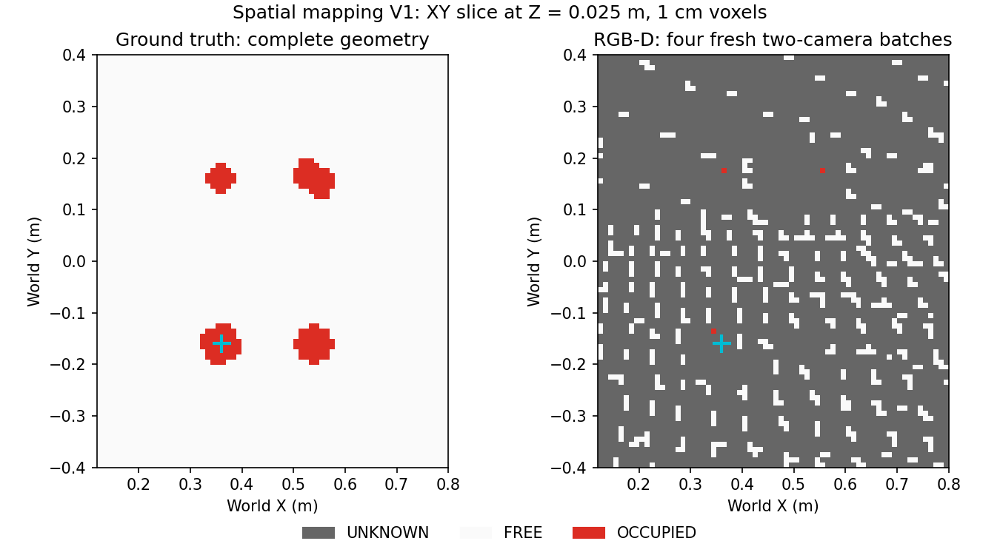
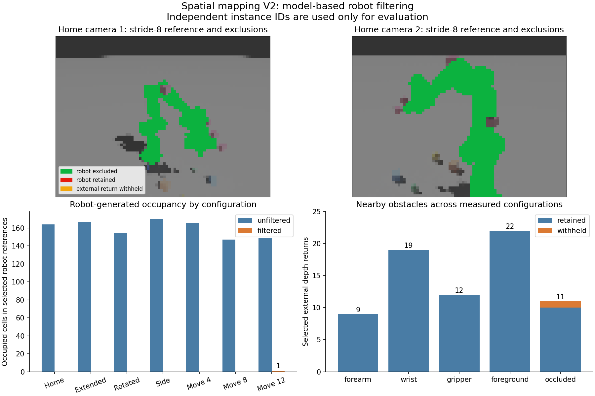
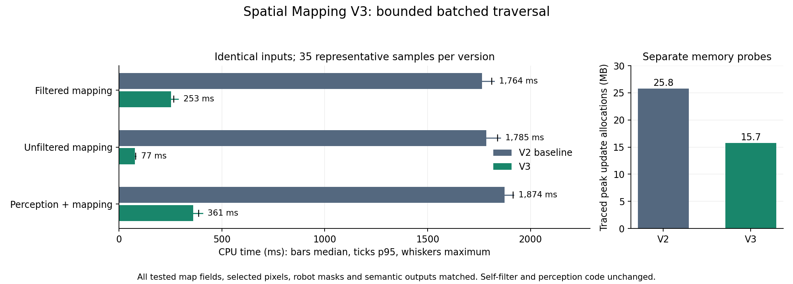
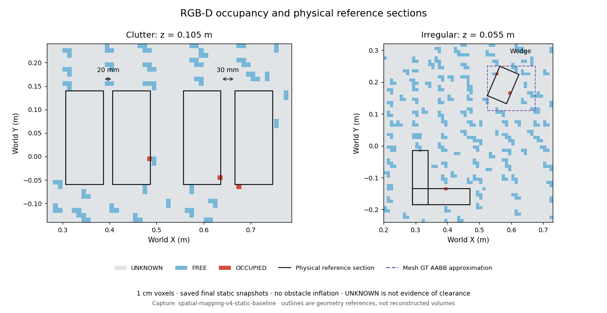
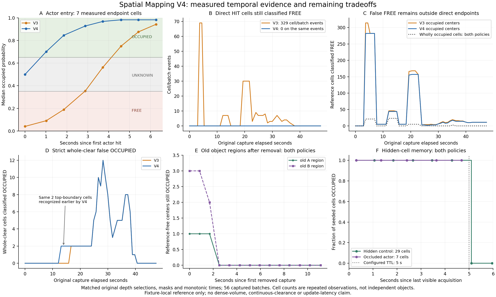
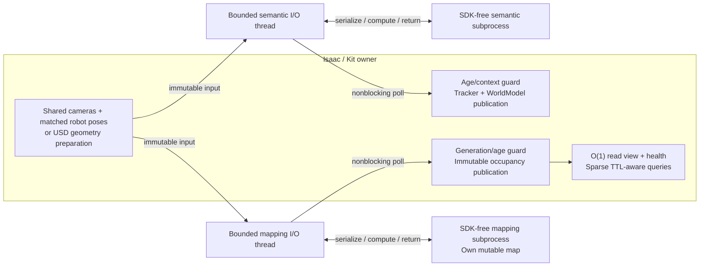

# Spatial mapping

Spatial mapping stores volumetric environment evidence independently of semantic
objects. `world/spatial_mapping` contains the NumPy grid, occupancy evidence and
calibrated depth-ray integration; it imports no Isaac/Omniverse SDK. Isaac stage
geometry, existing camera access and explicit construction belong under
`integrations/isaac/spatial_mapping`. Neither source uses object labels, primitive
fitting, tracked identities or WorldModel to decide occupancy.

Mapping is opt-in. Since V5, normal runtime construction schedules mapping when
`[spatial_mapping] enabled = true`; the default remains disabled. The explicit
standalone API remains available. The earlier sections record its V1–V4 contract
and validation history; see the V5 section for automatic scheduling and camera
ownership. No planner, skill or backend consumes the map.

## Common map contract

`GridSpec` defines world-coordinate bounds in meters, voxel size and maximum
voxel allocation. Bounds are lower-inclusive/upper-exclusive, with XYZ array
indices. A final boundary cell can be shorter than the voxel size. Out-of-bounds
queries return `OUT_OF_BOUNDS` with unknown probability, never `FREE`.

```python
from robot_skill_stack.world.spatial_mapping import GridSpec, OccupancyMap

occupancy = OccupancyMap(GridSpec((.10, -.45, -.05), (.85, .45, .65), .01))
query = occupancy.query((.45, 0., .10))
batch = occupancy.query_many([[.45, 0., .10], [.55, 0., .10]])
snapshot = occupancy.snapshot()
print(query.state.name, query.probability, snapshot.counts(), dict(snapshot.health))
centers = snapshot.voxel_centers()  # Optional export; full-grid allocation.
occupancy.clear()                  # UNKNOWN again; generation/revision advance.
```

The states are `UNKNOWN`, `FREE` and `OCCUPIED`. `observed=False` distinguishes
never-observed space from uncertain evidence near probability 0.5. Expired
evidence becomes UNKNOWN/0.5 with `observed=True`, `expired=True` and its historical
last-observed timestamp retained. Position/index conversions are exposed by
`world_to_indices` and `indices_to_centers`.

Snapshots own immutable arrays and retain one consistent revision, timestamp and
health record. An existing snapshot does not age in place; request another to
see current expiry/freshness. Map queries, snapshots and updates apply expiry;
there is no background aging worker. `revision` counts evidence/expiry/reset
changes; `generation` counts resets. Source health distinguishes waiting, fresh,
no new frame, error and stale. Failures do not refresh the acquisition timestamp
or add evidence; expiry can still change the revision while a source fails.

## Input sources and uncertainty

Ground truth traverses active scene Gprims, including instance proxies and
invisible geometry. Cubes, spheres and cylinders use actual schema dimensions,
axis and complete affine parent/world transforms, including nonuniform scale.
USD `metersPerUnit` converts all geometry to map meters. Conservative cell-volume
overlap preserves curved/rotated volumes instead of filling each primitive's
world AABB. Inverse local interval bounds and boundary touching can mark extra
cells occupied; this is not exact collision geometry.

Unsupported finite Gprims, including meshes/points/curves, use conservative world
AABBs and are counted in source diagnostics. Invalid/unbounded geometry, invalid
units, unloaded nonexcluded payloads, reported scene composition errors or work
budget failures reject the complete update. Fully resolved scene assets are
required. Successful snapshots rebuild occupancy, so moved/removed objects leave
FREE cells. Other map cells are authoritative FREE for this environment layer.
Cameras/lights are not geometry; inactive/undefined/abstract prims are skipped.
Guide geometry is skipped unless an enabled CollisionAPI makes it physical.
`/Franka` is excluded by default and can be changed explicitly; its omission
does not make the robot's swept volume safe. Composition errors are checked
globally when exposed by USD, including errors outside the mapping bounds.

RGB-D consumes existing calibrated `DepthFrame` snapshots from one or more
cameras, using their original IDs, tokens, acquisition times and transforms.
Pinhole rays use optical +Z forward and meter-valued depth. Valid rays add FREE
evidence before measured surfaces and OCCUPIED evidence at their endpoints;
unobserved space beyond a hit receives no evidence. Another view may observe it.
Invalid pixels and measurements beyond `max_depth` are ignored, without free
rays. An all-invalid depth image is a source failure.

Per batch, each voxel receives at most one hit/miss update, with occupied evidence
winning conflicts. Default log-odds increments are +0.85/-0.4, bounded to ±4;
FREE requires probability ≤0.35 and OCCUPIED ≥0.65. Consequently one miss can
remain uncertain. Since V4, a positive endpoint vote that would still classify
its cell FREE resets that cell to observed UNKNOWN/0.5. A directly contradicted
free claim is withheld immediately; this does not fill unobserved interiors.
Repeated valid free observations can clear previous occupied
evidence; unrefreshed cells expire toward UNKNOWN after five seconds by default.
Source freshness defaults to one second and is independent of cell expiry.

Every configured camera must be present and valid. Missing/frozen/regressed,
skewed or stale frames do not publish fresh evidence; there is no partial-camera
fallback. Repeated buffers produce no new map timestamp. If camera IDs are not
configured, the first complete batch establishes the required set.
The default clock checks frame age again after ray processing; over-budget or
aged-out work is discarded atomically. Explicit `now=` supports deterministic
offline callers. Clearing a map preserves the mapper's consumed-token history;
reconstruct the source after a renderer clock reset.

`exclusion_masks={camera_id: boolean_depth_image}` skips each true pixel's entire
ray. A masked robot hit therefore clears neither the robot nor space behind it.
V1 accepts caller-supplied masks; V2 adds the optional automatic robot filter
described below. With automatic filtering disabled, callers must provide reliable
robot masks or robot returns can enter the environmental map. Ground-truth robot
exclusion does not automatically mask depth images.

## Configuration and explicit use

Add this section to a local complete setup copy; semantic `[world].provider` and
its workspace remain independent:

```toml
[spatial_mapping]
enabled = true
source = "rgbd"                    # Or "ground_truth".
bounds_min = [0.10, -0.45, -0.05]
bounds_max = [0.85, 0.45, 0.65]
voxel_size = 0.01
max_voxels = 2000000
camera_prim_paths = ["/World/PerceptionCamera", "/World/PerceptionCameraSide"]
stride = 8
max_rays = 1024
max_voxel_visits = 500000
max_depth = 5.0
max_skew = 0.025
max_frame_age = 1.0
stale_after = 1.0
evidence_ttl = 5.0
excluded_prim_paths = ["/Franka"]   # Ground truth only.
max_candidate_voxels = 8000000     # Ground-truth candidate work across all prims.
automatic_robot_filter = false    # V2, RGB-D only; explicit opt-in.
robot_depth_tolerance = 0.005     # Meters, optical-depth comparison.
robot_pose_tolerance = 0.01       # Seconds, pose/render timestamp matching.
# update_hz = 5.0                  # Optional limit on explicit update calls.
```

This example enables RGB-D with explicit camera paths; the default source is
ground truth and camera paths default to empty. Omitted `enabled` is false.
The other values shown are defaults. Bounds/voxel budgets are validated
without allocating a map. RGB-D camera paths identify expected input frames;
they do not construct cameras. One camera is valid for mapping. Depth sampling
and ray/voxel-visit budgets bound work independently of the semantic 2 mm
point-cloud settings. More cameras/geometry and finer grids cost time/memory;
equal throughput is not promised. `update_hz` limits caller-driven attempts,
without scheduling them. GT ignores RGB-D settings; RGB-D ignores GT exclusions.

```python
from robot_skill_stack.integrations.isaac.config import load_scene_config
from robot_skill_stack.integrations.isaac.spatial_mapping.factory import create_spatial_mapping

config = load_scene_config("outputs/my_setup.toml")
session = create_spatial_mapping(
    config.spatial_mapping,
    robot_prim_path=config.robot.prim_path,  # Required for automatic RGB-D filtering.
)  # None when disabled.
if session is not None:
    try:
        session.update(frames)     # RGB-D: already-acquired DepthFrames.
        print(session.map.query((.45, 0., .10)))
    finally:
        session.close()
```

For ground truth, pass `stage=stage` at construction or use the current Isaac
stage, then call `session.update()` without frames. This never calls the semantic
ground-truth provider.

To reuse exact multi-view captures, install `SharedFrames(existing_provider.rig)`
before the owner acquires a new sample; pass that tap as `frame_source` and call
mapping `update()` after the owner's observation. The tap stores those same
DepthFrame objects and timestamps, without capturing again. `own_frame_source=True`
lets session cleanup restore the owner's capture method; the tap never closes
the owner's cameras. For an already initialized single V1 camera,
`CameraSnapshots({camera_path: existing_camera})` borrows its buffers/calibration;
it initializes no cameras and closes only its reader. Close taps/readers before
replacing their acquisition owner. Caller-supplied frames need no adapter.

## V1 validation history and limits

```bash
./run_isaac_python.sh -m unittest \
  tests.unit.test_spatial_mapping_occupancy \
  tests.unit.test_spatial_mapping_rgbd \
  tests.unit.test_spatial_mapping_ground_truth \
  tests.unit.test_spatial_mapping_config_factory
./run_isaac_python.sh scripts/run_all_regressions.py --unit-only \
  --artifacts-dir outputs/spatial-mapping-unit-final
./run_isaac_python.sh scripts/run_all_regressions.py --group spatial_mapping \
  --artifacts-dir outputs/spatial-mapping-native
./run_isaac_python.sh scripts/run_all_regressions.py --group multiview \
  --artifacts-dir outputs/spatial-mapping-perception
./run_isaac_python.sh scripts/run_all_regressions.py --group isaac \
  --artifacts-dir outputs/spatial-mapping-v1
./run_isaac_python.sh scripts/run_all_regressions.py --group regression \
  --artifacts-dir outputs/spatial-mapping-regression
```

The V1 final offline run passed all 528 discovered tests (72 new mapping tests),
eight standalone checks and the architecture/syntax checks. Both mapping native
scenarios passed, as did the six existing multi-view and two V1 scenarios. The
legacy regression group initially passed five of six: its benchmark retained one
stale perceived pose across twelve teleports and exceeded its 15 mm error limit.
The unchanged `main` benchmark and a feature-branch retry both passed, with maximum
position error 2.01 mm and all four Pick/Place trials successful. No source or test
threshold changed for the retry. The intermittent failure's cause remains
unisolated; the initial FAIL is retained alongside successful comparisons.
Thus all sixteen native scenarios have passing results, with that retry caveat.
The durable
[validation summary](assets/spatial_mapping/validation.json) records inspected
scenario results and workstation timings. The GT test uses an isolated USD stage,
exports its fixture/occupancy and checks transformed primitives, invisible and
unsupported geometry, instance proxies, move/remove, units and failed updates.
The RGB-D test uses the existing acquisition path and compares representative
GT/free/surface/occluded queries, not complete grid equality. Inspect result JSON
as well as exit status. Use the established launcher/NumPy environment; do not
use `--no-ros-env`.

The failed scenario was repeated with:

```bash
./run_isaac_python.sh tests/regression/test_benchmark.py \
  --result outputs/spatial-mapping-benchmark-retry/result.json \
  --artifacts-dir outputs/spatial-mapping-benchmark-retry/artifacts
```

The RGB-D test is also the standalone demonstration:

```bash
./run_isaac_python.sh tests/spatial_mapping/test_rgbd.py \
  --result outputs/spatial-mapping-demo/result.json \
  --artifacts-dir outputs/spatial-mapping-demo
```

It saves calibrated capture diagnostics, representative queries, NPZ state and
probability grids, and `ground_truth_xy.ppm`/`rgbd_xy.ppm` slices through z=0.025 m
(unknown gray, free white, occupied red). NPZ arrays use XYZ axes and include
bounds/resolution; array-only exports are diagnostics, while consumers should
prefer query/snapshot methods. Reinitialization borrows the same camera resources.



The cyan cross marks the queried cube interior: occupied in GT, unobserved in RGB-D.

Measured results on the workstation, with 1 cm voxels:

| Source/scenario | Dimensions | FREE | OCCUPIED | UNKNOWN | Update time |
| --- | --- | ---: | ---: | ---: | ---: |
| GT isolated fixture, final scene | 120×120×70 | 1,002,644 | 5,356 | 0 | 5.9–24.9 ms |
| GT existing demo scene | 68×80×32 | 162,504 | 11,576 | 0 | 5.7 ms |
| RGB-D existing demo, four fresh batches | 68×80×32 | 24,007 | 356 | 149,717 | 373.7–406.8 ms |

The demo uses both existing 640×480 cameras, stride 8, 1,024 total sampled rays,
two-second frame/freshness limits and a 30-second evidence TTL. Times exclude
rendering and semantic processing; source health was fresh at the captured
snapshots. GT and RGB-D agreed on representative visible occupied/free cells;
the cube interior was GT OCCUPIED and RGB-D never-observed UNKNOWN. Frozen and
duplicate camera data retained the prior timestamp and failed freshness checks;
resume restored acquisition. These are bounded functional checks, not claims of
complete obstacle coverage or collision-safe robot motion.

V1 is a bounded dense grid with sampled rays, finite evidence memory and explicit
updates. Thin geometry between sampled rays, calibration/depth noise, occlusion
and unmodeled robot returns limit RGB-D completeness. GT approximations can
overoccupy. Unknown space is not certified free. V2 adds model-derived robot
masks; uncertainty-aware ray evidence and sparse storage remain future work.
This stage supplies occupancy evidence; it implements no collision checking,
avoidance or motion planning.

## V2 automatic robot filtering

Set `automatic_robot_filter = true` for RGB-D mapping and pass
`robot_prim_path=config.robot.prim_path` to `create_spatial_mapping`. There is no
automatic-filter fallback to `/Franka`; the configured robot can live elsewhere.
The default remains off, and GT mapping continues to use its independent
`excluded_prim_paths`. The two positive finite tolerances above are the only new
tuning settings. `robot_pose_tolerance` is a time tolerance, not robot inflation.

The Isaac adapter reads the robot's authored visual meshes, associates them with
their kinematic rigid bodies and caches the local triangle geometry and fixed
mesh-to-body transforms. This requires static visual meshes and static transforms
relative to each rigid body; the standard Franka's arm and finger bodies can
still move through their current PhysX poses. Skinning, deforming meshes and
animated mesh-to-body transforms are not supported. The generic
`world/spatial_mapping/robot_filter.py` builds reusable bounding-volume
hierarchies (BVHs) and intersects calibrated camera rays with the actual
triangles. Bounding boxes accelerate traversal; they do not define the final
mask. There is no silhouette dilation, broad occupied robot envelope, new camera,
extra render pipeline or production segmentation annotation.

The mapper first validates caller masks and fairly selects at most `max_rays`
from valid stride-grid candidates across cameras. The filter predicts the
nearest positive robot surface only for those selected pixels, in optical-depth
coordinates. A measured return
more than `robot_depth_tolerance` in front of it is retained as possible external
geometry. Returns consistent with the robot, and ambiguous returns behind that
expected occluding surface, are withheld. Rays without a robot intersection are
retained. Automatic exclusions are dropped without backfilling other rays.
The automatic boolean masks have the full depth-image shape; unqueried pixels
remain false and are not classified as robot. These are mapping masks rather
than dense robot segmentation images. Factory construction keeps both strides
equal. Diagnostics distinguish allocated, retained and automatically excluded
selected rays, so a robot-dominated view cannot silently consume extra work.

Automatic and caller-supplied `exclusion_masks` are combined with OR without
changing either input. All configured cameras still participate in one complete
batch. Every automatic mask must have the corresponding camera ID, boolean dtype
and depth-image shape. The existing mapper skips each excluded ray completely:
filtering contributes neither occupied robot voxels nor free evidence in front
of or behind that return. Another unmasked camera can still observe the region.
Nothing turns UNKNOWN into OCCUPIED.

### Robot poses and frame time

`DepthFrame.acquired_at` is the local monotonic time when existing camera buffers
were read. Its `token[1]` identifies simulation time for the rendered exposure.
Those clocks serve different purposes: sampling the robot at mapping-processing
time can pair old depth with a newer arm pose. Native investigation found
roughly 33–67 ms of render lag, and USD transforms read in a post-physics callback
could still be one physics step old. These observations motivated pose history;
they are not a fixed lag correction.

Only the enabled Isaac filter owns a post-physics subscription and a bounded
256-sample history of raw PhysX rigid-body poses. For the inspected Panda, the callback
copies 11 body poses; it does no camera reads or mesh intersections. Camera-specific
geometry uses the nearest history sample to each frame's original render
timestamp, subject to `robot_pose_tolerance`. This is a bounded time approximation,
not an exact pose or motion-error guarantee. It does not substitute the latest USD
pose. Cached mesh data are reused as the arm and fingers move. The adapter
borrows the global physics view and owns its subscription and body-view handle.
Backward simulation time clears pose history. Callback errors are reported by
the next mask request; they are not silently ignored. The geometry cache does
not monitor runtime USD mesh, visibility, topology, mesh-to-body transform or
stage edits. Callers must close and manually reinitialize the filter after such
changes, once the model is static again. These edits do not automatically fail
the next update or refresh the cached model.

Construct the mapping session before acquiring the frames to be mapped so its
pose history can collect matching samples. Missing or out-of-tolerance pose
history, invalid poses and detected model-construction failures are explicit
errors, with no unfiltered fallback. This does not imply detection of later
changes to cached geometry. The
RGB-D mapper validates complete camera tokens, age and calibration before
requesting automatic masks. Attempted tokens are consumed before filtering, so
repairing a failed filter cannot relabel the same buffers as fresh evidence.
The normal completion-age check includes filter processing time; explicit
`now=` retains its deterministic offline semantics.

### Explicit use and lifecycle

Existing `SharedFrames` and `CameraSnapshots` adapters continue to borrow camera
resources. Install the mapping session while the simulator is initialized, then
feed new observations through the existing acquisition owner:

```python
from robot_skill_stack.integrations.isaac.spatial_mapping import SharedFrames

tap = SharedFrames(existing_provider.rig)
session = create_spatial_mapping(
    config.spatial_mapping,
    stage=stage,
    frame_source=tap,
    own_frame_source=True,
    robot_prim_path=config.robot.prim_path,
)
try:
    # After the owner acquires a fresh batch and matching pose history exists:
    existing_provider.observe()
    updated = session.update()  # Automatic masks; no manual robot masks needed.
    print(updated, session.robot_filter.diagnostics)
finally:
    session.close()             # Removes the filter subscription and restores the tap.
```

This example requires enabled RGB-D mapping with automatic filtering enabled.
It illustrates explicit calls; bootstrap, semantic perception, the controller,
skills and planner do not start or consume mapping. Any supported camera count
uses those same calibrated snapshots. The filter creates no replacement cameras.

Closing a session is idempotent. It attempts source, filter/history and owned
frame-adapter cleanup even if an earlier close fails, preserving cleanup errors.
Borrowed cameras, the robot, stage and global physics view remain owned by their
existing components. Constructor failures clean resources whose ownership was
acquired; the filter also owns cleanup of its partial initialization.

Enabling filtering does not delete prior unfiltered occupancy. Start a fresh map
with `session.map.clear()` when comparing modes, or allow existing evidence to
clear through later valid free rays or its ordinary TTL. The implementation does
not erase robot-shaped volumes, which could also remove external obstacles.

### V2 verification and remaining limits

SDK-free geometry tests cover calibrated half-pixel projection, actual triangle
intersections, optical depth, foreground/self/behind distinctions, open/closed
finger gaps, multiple views and moving snapshots. Integration tests cover the
opt-in configuration, arbitrary robot path, mask composition, failed/repeated
buffers, processing age and resource ownership:

```bash
./run_isaac_python.sh -m unittest \
  tests.unit.test_spatial_mapping_robot_filter \
  tests.unit.test_spatial_mapping_robot_adapter \
  tests.unit.test_spatial_mapping_self_filter_integration
./run_isaac_python.sh tests/spatial_mapping/test_robot_self_filter.py \
  --result outputs/spatial-mapping-v2/result.json \
  --artifacts-dir outputs/spatial-mapping-v2
```

The final V2 run on 22 October 2026 passed all 573 offline tests, eight standalone
checks and architecture/syntax checks. All 17 native scenarios passed: three
mapping, six multi-camera perception, two V1 perception/manipulation and six
legacy manipulation regressions. The mapping suite includes the unchanged
GT/RGB-D scenarios. The self-filter fixture used seven
configurations, both existing 640×480 cameras and independent instance-ID
annotations on those same render products. Production does not use those labels.
The full [evaluation](assets/spatial_mapping_v2/evaluation.json) records per-pose
reference denominators, state counts, calibration timing and test artifacts.
The [verification record](assets/spatial_mapping_v2/verification.json) includes
all suite results and confirms that all 19 frozen perception/configuration files
are unchanged.

| Configuration | Selected robot returns excluded/observed | Robot-reference OCCUPIED before → after | Selected external returns withheld/observed |
| --- | ---: | ---: | ---: |
| Home, closed | 164/164 | 164 → 0 | 0/12 |
| Extended, open | 167/167 | 167 → 0 | 0/7 |
| Rotated, closed | 154/154 | 154 → 0 | 0/11 |
| Side extended, open | 170/170 | 170 → 0 | 0/11 |
| Moving, sample 4 | 166/166 | 166 → 0 | 0/10 |
| Moving, sample 8 | 160/160 | 147 → 0 | 0/12 |
| Moving, sample 12 | 164/165 | 149 → 1 | 1/10 |

These are exact mapping-selected rays and per-configuration reference cells,
summed across configurations, not unique global voxels. All 62 selected clear
forearm/wrist/gripper/foreground returns were retained. One of 11 selected
occlusion-edge returns was withheld. A separate dense stride-8 validation found
8,253/8,255 robot returns excluded, zero exclusions among the 424 clear adjacent
and foreground returns, and four withheld among 97 occlusion-edge returns.
Dense validation is evaluated separately and does not backfill production rays.

At Home, the 115×120×114 grid (1,573,200 voxels, 1 cm) changed as follows:

| Mode | FREE | OCCUPIED | UNKNOWN |
| --- | ---: | ---: | ---: |
| Unfiltered | 141,940 | 505 | 1,430,755 |
| Filtered | 124,573 | 341 | 1,448,286 |

The filter creates no occupied model envelope. The additional UNKNOWN cells
reflect withheld whole rays, including their formerly cleared prefixes.
Over historical robot-reference cells that GT classifies environment-FREE,
occupied counts fell from 409 to one. This set includes current robot volume;
it is not a measurement of exclusively vacated-space ghosts. Existing unfiltered
ghosts still require valid free evidence, expiration or a deliberate map reset.

No FREE classifications occurred at the 35 GT-occupied probe-center checks.
There were two FREE classifications at selected robot surface-reference cells;
the dense gripper reference also contained one FREE cell in both modes. These
surface-cell checks expose voxel-boundary/sampling uncertainty and are not
complete continuous-volume ground truth. One robot return remained unmasked
while moving, and occlusion-edge external returns can be withheld. These residual
errors remain visible in the report; neither robot exclusion nor FREE is a
geometric collision certificate.

The probe behind the arm had a robot-labeled foreground occluder in the first
camera in every tested pose, and could be seen from the second camera. Its
interior remained UNKNOWN rather than falsely cleared. Delayed-frame masks were
unchanged after advancing the arm to another configuration. Frozen/repeated
sources did not refresh map timestamps; resume, reinitialization and cleanup
passed. Pose-history matches had zero measured simulation-time skew in this run,
within the configured 10 ms limit.



Median model lookup/filtering was **227 ms** (207–238 ms) for 1,024 selected rays.
One-time geometry/BVH initialization was 507 ms. The 11-body post-physics history
capture averaged 0.130 ms, with a 0.202 ms maximum over 240 callbacks. The larger
full-arm grid took 2.165 s unfiltered and 2.135 s filtered at the median: dropped
robot rays offset the extra filtering work. These mapping times should not be
compared directly with V1's smaller tabletop ROI. They exclude rendering and the
separate dense validation pass. The comparison uses five-second acquisition and
freshness limits because it runs both maps sequentially on the same original
snapshot; timestamps are never rewritten. An initial run alongside CPU-heavy
units correctly expired, so final native timing runs were isolated.

Reproduce the final verification in sequence, with each native run isolated:

```bash
./run_isaac_python.sh scripts/run_all_regressions.py --unit-only \
  --artifacts-dir outputs/spatial-mapping-v2-unit-final
./run_isaac_python.sh scripts/run_all_regressions.py --group spatial_mapping \
  --artifacts-dir outputs/spatial-mapping-v2-final
./run_isaac_python.sh scripts/run_all_regressions.py --group multiview \
  --artifacts-dir outputs/spatial-mapping-v2-perception
./run_isaac_python.sh scripts/run_all_regressions.py --group isaac \
  --artifacts-dir outputs/spatial-mapping-v2-v1
./run_isaac_python.sh scripts/run_all_regressions.py --group regression \
  --artifacts-dir outputs/spatial-mapping-v2-regression
```

V2 is ready for broader spatial-mapping validation on additional layouts, speeds,
thin obstacles and close-contact gaps. The results support practical robot
exclusion with clear foreground preservation, while the remaining edge errors
need continued evaluation. Runtime integration and motion planning remain
separate tasks.

This is model-based evidence filtering for collision-avoidance support, not a
certified safety mechanism. Geometry/calibration error, render/pose mismatch and
stride sampling can leave robot returns or withhold nearby external returns.
Camera calibration is trusted as supplied: native validation uses fixed world
cameras, and because existing acquisition reads K/T with the buffers rather than
recovering historical extrinsics, moving cameras require caller-supplied frames
calibrated at exposure.
An obstacle within the depth tolerance can be ambiguous; withholding it does not
mean the space is free. Missing views and occlusion still limit map coverage, and
old evidence can persist until cleared or expired. Practical readiness depends
on the native obstacle-preservation and latency results; it does not establish
collision-safe motion or authorize runtime/planning integration.

## V3 CPU performance

V3 continues from `d260377` without changing mapping bounds, resolution,
sampling, camera configuration, ray budgets, probability settings or the V2
robot-depth rules. The unchanged seven-configuration native fixture first
reproduced 2,133 ms median filtered updates, 2,190 ms unfiltered and 223 ms
filter computation. Its 15 fresh updates are a reproduction check; the
controlled before/after benchmark uses additional warm-up and repeated identical
recorded observations. The original
[profile](assets/spatial_mapping_v3/baseline_profile.json) retains this distinction.

A focused SDK-free profile of the original Home observation found scalar voxel
traversal consumed about 92% of `RgbdMapper.update`: 147,009 visits generated
over 3.4 million function calls. Occupancy integration took about 29 ms, expiration
8 ms and a separately measured full immutable snapshot 17 ms. These measurements
support optimizing traversal rather than replacing the dense grid.

`RgbdMapper` now advances finite rays in bounded batches of at most 256. It
retains slab clipping, half-open grid bounds, `nextafter` entry selection,
positive-length cells, simultaneous crossings and the original endpoint rules.
Traversal emits flat integer voxel IDs; NumPy deduplicates them per view and
across views, with occupied endpoints winning over free evidence. Every visit
still counts before deduplication. Exceeding the configured global budget
rejects the complete update without integrating partial evidence. The visit
buffer is bounded by the remaining budget plus one, not the grid volume times
the ray count.

The occupancy engine, dense-grid representation, immutable snapshots and query
API remain unchanged. Repeated flat-index validation inside integration is now
a small cost and does not justify another internal update API. New differential
tests retain a frozen V2 scalar reference and compare complete map states,
probabilities, observation/expiration arrays, timestamps and diagnostics,
including boundary, budget and multi-camera cases. Two existing clock-delay
tests inject their delay at the new traversal entry point; their freshness and
original-timestamp assertions are preserved.

The accurate mesh filter and Isaac pose-history adapter are unchanged. Its
separate seven-configuration profile attributed about 48% of cumulative time to
BVH box tests and 22% to triangle cross products; repeated norm calculations
accounted for only 4%. A research-only norm/leaf-array cache preserved all masks
but changed median lookup from 178.48 to 175.28 ms, just 1.8%. This was too small
to justify another cached layout, so the prototype was discarded. Neither
triangle geometry nor tolerances were weakened for performance.

The reproducible benchmark captures the exact V2 fixture from baseline Git
objects into an isolated package namespace, including original depth/RGB,
calibration, tokens, acquisition timestamps and exposure-matched mesh poses.
Capture I/O is excluded from performance claims. CPU replay builds each version's
mesh/BVH once, uses the same complete fifteen-update sequence and map resets,
and alternates baseline/current pass order. It times updates separately from
snapshots, queries, equality comparisons and disk writes. Explicit replay time
is the original observation timeline; replay is not evidence of live freshness.
The original capture manifest is retained, with a documented correction to its
reset annotation before the moving sequence.

Benchmark-only line attribution and cProfile runs provide phase evidence;
their instrumented times are excluded from headline medians. Scalar traversal
includes per-visit set insertion, whereas batched traversal and array dedup have
separate costs. Expiration nested inside integration is reported as overlapping
work rather than added twice. No profiling hooks run in normal mapping.

Reproduce the performance comparison on the Isaac workstation, with no other
CPU-heavy work or simulator running:

```bash
./run_isaac_python.sh scripts/benchmark_spatial_mapping_performance.py \
  --capture-only --baseline-ref d260377 \
  --artifacts-dir outputs/spatial-mapping-v3-capture \
  --result outputs/spatial-mapping-v3-capture/result.json
./run_isaac_python.sh scripts/benchmark_spatial_mapping_performance.py \
  --replay outputs/spatial-mapping-v3-capture --warmup 2 --repeats 5 \
  --semantic --profile --memory \
  --artifacts-dir outputs/spatial-mapping-v3-performance \
  --result outputs/spatial-mapping-v3-performance/result.json
./run_isaac_python.sh scripts/check_spatial_mapping_live_freshness.py \
  --artifacts-dir outputs/spatial-mapping-v3-live-final \
  --result outputs/spatial-mapping-v3-live-final/result.json
```

The baseline commit must exist in the local Git history. Capture/replay validates
input file hashes and records source and script hashes; benchmark PASS requires
those sources to stay unchanged during execution. Raw captures, profiler files
and verbose logs stay under ignored `outputs/`. The separate live check uses
real production clocks and the original acquisition timestamps, with
`max_frame_age=stale_after=1` for its independent filtered maps. Only its nested
`live_default_freshness` measurements are timing evidence: the original fixture's
unfiltered timers include the injected freshness check.

### Controlled mapping results

On the Ryzen 7 7800X3D workstation, two warm-up passes preceded five measured
passes with alternating baseline/current order. Each pass processed all fifteen
captured batches, retaining mapper rotation/token history and the native map
resets. The table uses the last static batch and each moving configuration:
35 representative updates per mode/version across seven configurations.

| Same-input CPU update | Baseline median / p95 / max, ms | V3 median / p95 / max, ms | Median reduction |
| --- | ---: | ---: | ---: |
| Full-arm, robot filtering enabled | 1,763.9 / 1,812.2 / 1,822.5 | 252.8 / 266.7 / 287.8 | 1,511.1 ms, 85.7% |
| Full-arm, filtering disabled | 1,785.5 / 1,839.9 / 1,853.4 | 77.4 / 81.3 / 82.2 | 1,708.1 ms, 95.7% |
| Filter with recorded-pose assembly | 182.1 / 201.5 / 206.0 | 182.9 / 197.5 / 220.0 | Unchanged implementation |

Every measured batch, including predecessors omitted from the timing summary,
matched the baseline's complete state, probability, observation/expiration and
last-observed arrays, map metadata and fixed spatial queries. Production-selected
pixels and robot masks also matched the original capture exactly. There were no
runtime errors or output mismatches. This preserves V2's residual errors as well
as its successful exclusions; it does not improve or certify geometric accuracy.

The separate native real-clock check passed fifteen fresh filtered updates:
median/p95/max 300.9/311.2/313.0 ms, with a maximum original-observation age of
335.6 ms at completion. Paired camera acquisition took 5.6/7.6/8.2 ms. The unchanged
full-arm ground-truth mapper took 11.2/17.3/20.4 ms across eight native reference
updates. These native measurements include stage/camera access and differ from
SDK-free replay; they are not interchangeable timing distributions.

The required uninstrumented native self-filter fixture also passed. Its fifteen
fresh filtered updates changed from the reproduced baseline's
2,132.7/2,189.7/2,207.3 ms median/p95/max to 303.6/314.8/321.8 ms, an 85.8% median
reduction. Unfiltered updates took 90.2/95.9/96.5 ms. All native selected-reference
quality counts matched the V2 reproduction: 1,145/1,146 robot returns excluded,
robot-reference occupied cells 1,117 → one, all 62 clear nearby-obstacle returns
retained and one of eleven occlusion-edge returns withheld. The same two robot
surface-reference FREE cells remained; no FREE appeared at the 35 GT-occupied
probe-center checks. The measured speedup preserves the documented residual
errors and accuracy limits.

No default timing limits were increased. The measured isolated full-arm workload
now fits the original one-second acquisition/freshness defaults. The map keeps
the oldest contributing acquisition timestamp, so processing and earlier
consumers still consume the same freshness budget. Slow or delayed inputs remain
explicit failures; the deterministic replay clock is never substituted in live
mapping. TTL and repeated/frozen-frame behavior are unchanged.

### Semantic perception and scheduling scope

The semantic pipeline is unchanged. Its existing diagnostics split acquisition,
projection/cropping/per-view voxelization, fusion, segmentation/refinement,
fitting/finalization, observability and tracking/publication. The combined
benchmark processes each original camera batch through semantic perception and
then a filtered map, directly measuring both baseline and V3 schedules. It
compares semantic class, persistent ID, geometry, confidence, grasp readiness,
metadata and original timestamps across schedules and repeats. Timing on these
full-arm views is distinct from the broader frozen tabletop research protocol.

Existing `SharedFrames` can reuse the same acquired batch without another camera
read. Sharing the semantic cloud would change mapping evidence: semantic
projection uses stride 2, workspace/support cropping and voxel centroids, whereas
mapping uses the selected stride-8 depth rays and needs their entire free-space
segments. Calibration arithmetic is small relative to fitting and self-filter
intersection work. No new shared preprocessing framework is justified here.

Both APIs remain synchronous. Calling a roughly 300 ms native map update inside
a simulation/control stepping loop would delay that loop for its processing
duration, even though the pose-history callback itself remains small. Combining
consumers adds their sequential latency and consumes more observation age.
The replay benchmark does not demonstrate asynchronous execution or controller
deadlines. Runtime scheduling and planner/controller integration remain future
work; no worker threads, control callbacks or motion behavior were changed.

The measured semantic-only median/p95/max was 103.0/105.8/109.1 ms. Fitting took
86.9 ms at the median, compared with projection 4.1 ms, fusion 0.5 ms,
segmentation 5.0 ms, observability 6.3 ms and tracking/publication 0.1 ms. No small
projection/copy optimization would materially change this fitting-dominated
workload, so all frozen perception code and its limits were retained. All 35
representative samples contained four confirmed objects; class/identity,
geometry, confidence and grasp-readiness signatures were identical across the
semantic-only and both combined schedules.

| Sequential same-input workload | Median / p95 / max, ms |
| --- | ---: |
| Perception plus baseline filtered mapping | 1,873.7 / 1,916.3 / 1,917.6 |
| Perception plus V3 filtered mapping | 360.8 / 387.0 / 406.5 |

The measured combined median reduction is 1,512.9 ms (80.7%); this is a directly
timed sequence, not a sum of separate medians. Original observation and map
timestamps were preserved. Its roughly 0.4 s tail is a CPU replay result, not a
live deadline guarantee across other layouts, speeds or fitting workloads.

### Phase and memory evidence

Separate line-attributed Home profiling explains the gain. These instrumented
single-update values are not substitutes for the warm latency distributions:

| Filtered Home phase | Baseline ms | V3 ms |
| --- | ---: | ---: |
| Recorded-frame validation | 0.66 | 0.61 |
| Candidate/selected rays | 0.21 | 0.20 |
| Robot geometry/masks, with tracing overhead | 256.0 | 270.6 |
| World-coordinate projection | 0.27 | 0.24 |
| Traversal; scalar also includes per-visit insertion | 2,192.1 | 52.4 |
| Remaining accumulation/deduplication | 64.9 | 9.9 |
| Probabilistic integration, including nested expiry | 8.18 | 8.29 |
| Expiry across session/integration, overlapping the above | 0.84 | 0.94 |

Snapshot/query work was timed separately without the line profiler. Full
immutable snapshots had median/p95/max 6.22/17.58/18.22 ms before and
6.00/6.63/12.53 ms after; 1,000-position queries took 0.251/0.262/0.269 ms and
0.236/0.284/0.319 ms. Those implementations were not changed, and their timing
variation is not claimed as an optimization. Physical camera acquisition and
native stage access are reported separately above.

Separate memory workers measured traced peak update allocations of
25,791,774 → 15,732,616 bytes, a 39.0% reduction. Resident memory after the update
was 264.2 → 237.2 MB. These processes deliberately retained all fifteen captured
batches (101.4 MB of frame buffers), cached geometry and a map; they are not
production application RSS measurements. Process high-water RSS was already
398.2 MB before each probe and stayed there, so no process-peak reduction is
claimed. Tracemalloc was excluded from timing runs. The dense map still occupies
the same storage; the reduction comes from traversal/accumulation temporaries.



The compact [evaluation](assets/spatial_mapping_v3/evaluation.json) records full
distributions, configuration scopes, 30 baseline/current full-array/query
comparisons, 150 exact captured-mask/selection checks and 300 recorded consistency
checks, of which 240 compare later repetitions with their first measured result.
The remaining 60 establish those initial signatures. Semantic equivalence and
timestamp checks are recorded separately. Detailed replay inputs, samples and
profiles remain local artifacts rather than committed bulk data.

### Completed V3 validation

On 22 October 2026, all 582 discovered offline tests (nine new), eight standalone
checks and architecture/syntax checks passed. All 17 native scenarios passed:
three spatial mapping, six multi-camera perception, two V1 perception/manipulation
and six legacy manipulation regressions. All 19 frozen perception/configuration
hashes remained unchanged. The [verification record](assets/spatial_mapping_v3/verification.json)
contains exact commands, artifact paths, result hashes and protected-source
checks. Reproduce the final groups sequentially:

```bash
./run_isaac_python.sh scripts/run_all_regressions.py --unit-only \
  --artifacts-dir outputs/spatial-mapping-v3-unit-final
for mapping_group in spatial_mapping multiview isaac regression; do
  ./run_isaac_python.sh scripts/run_all_regressions.py --group "$mapping_group" \
    --artifacts-dir "outputs/spatial-mapping-v3-final-$mapping_group" || break
done
```

V3 meets the 500 ms full-arm stretch target on this tested configuration with
equivalent occupancy quality. Accurate robot intersection is now the largest
mapping cost; semantic fitting dominates the other consumer. Larger ray budgets,
regions, complex scenes and longer observation queues still need measurement.
The validated subsystem remains independent and explicitly updated; runtime
integration, motion planning and controller scheduling have not begun.

## V4: practical reliability validation

V4 starts from the published V3 checkpoint `b9afb8e`. The unchanged baseline
passed all 582 offline tests and the three existing native mapping scenarios
before new fixtures or production changes. New geometry is authored only into
temporary USD session layers; saved scenes, perception data and launchers are
unchanged. Mapping still uses the two calibrated 640×480 cameras, the full-arm
1,573,200-cell ROI, 1 cm voxels, stride 8, a 1,024-ray global budget and the V3
batched traversal. The new reliability fixtures use the normal one-second frame
age/freshness limits and five-second evidence TTL.

### What the measurements mean

The native fixtures use independent instance-ID annotations for evaluation.
Neither annotations nor geometry references enter RGB-D mapping. Analytic
boxes, spheres, cylinders and a closed convex wedge supply exact solid
membership at voxel centers. An L shape is a union of boxes. Visual and physical
reference geometry coincide for these fixtures; the wedge's convex collision
hull coincides with its visual solid. The mapper's unsupported-mesh world AABB
is reported separately as an approximate reference, never as exact occupied
volume.

False FREE divides FREE states at physically occupied centers by all evaluated
occupied centers. False OCCUPIED divides OCCUPIED states at physically free
centers by all evaluated free centers. UNKNOWN coverage includes both
unobserved and uncertain cells. Observed agreement reports both all active
observed cells and the subset having a classified state. No single accuracy
percentage combines these quantities.

Center labels differ from whole-cell labels at thin surfaces and voxel
boundaries. A conservative whole-cell occupied stratum requires every cell
corner to lie in the same convex reference solid; a whole-cell clear stratum
requires conservative overlap tests to reject every reference solid. Other
cells remain boundary/possible-overlap strata. These are evaluation partitions,
not obstacle inflation. Free-space evaluation is local, above the ground contact
band, with explicitly counted omissions where exposure-matched robot bounds
prevent a complete physical reference. Robot bounds are evaluation exclusions,
not assertions that their interiors contain robot geometry.

Surface metrics count measured endpoint events and unique in-bounds endpoint
voxels separately. Selected, retained, dense and out-of-bounds returns have
different denominators. A visible feature missed by the fixed ray sample is not
silently counted as detected. Predefined clear-gap samples test geometric
usability only; they do not generate paths or certify continuous clearance.

Dynamic references match PhysX pose history to each camera's render token.
Cells whose physical labels disagree between camera exposures form a separate
motion-boundary stratum. The capture records exact accepted HIT/MISS indices,
original acquisition timestamps and actual integration times. SDK-free replay
compares V3 and current policies on these identical observations; checkpoint
states, probabilities, observation history and expiry must reproduce the native
V3 capture exactly. Replay does not establish live freshness or native latency.
Large sensor captures and full-map checkpoints stay under ignored `outputs/`.

### Static scenes and clear-space usability

Eight native episodes cover mixed primitives and a large unclassified box,
rotated/irregular geometry, a 6 mm upright obstacle, a 12 mm object, a clipped
workspace-boundary obstacle, clutter, two/one/zero-camera visibility and probes
10 mm beyond forearm/wrist/gripper visual support planes. Foreground and
behind-robot probes supplement those close obstacles. No semantic provider is
constructed. The [static evaluation](assets/spatial_mapping_v4/static_evaluation.json)
contains per-object visibility, masks, denominators and observed agreement.

The final snapshot of each episode gives these aggregate voxel/episode counts;
the same physical voxel may occur in multiple independent episodes:

| Reference stratum | False FREE | False OCCUPIED |
| --- | ---: | ---: |
| Exact occupied centers | 50 / 30,742 | — |
| Exact free centers | — | 152 / 66,104 |
| Conservative whole-cell occupied | 0 / 26,725 | — |
| Conservative whole-cell clear | — | 0 / 55,057 |

All 50 center false-FREE cells are partial/boundary cells. All 152 center
false-OCCUPIED cells fall in the conservative possible-overlap stratum; actual
overlap is not established by that test. None of these findings
justifies changing the validated ray traversal or inflating geometry. All 349
retained, in-bounds external surface events were OCCUPIED; 44 out-of-bounds
events are separate. No selected external event was lost to automatic masking
in these static fixtures. These surface results do not establish volumetric
reconstruction: UNKNOWN coverage ranges from 85.9% to 95.1% of the local domains.

The fully hidden target has 1,100/1,100 UNKNOWN centers. The 12 mm object has
44/55 raw image pixels in the two cameras but zero selected returns and all four
positive voxel centers UNKNOWN. The fixed sparse ray budget can therefore miss
small visible obstacles. A 6 mm obstacle also illustrates the distinction
between surface hits and mixed object/air voxels at 1 cm resolution.

The predefined 20 mm and 30 mm clear corridors each contain 289 conservatively
whole-cell-clear sampled voxels and zero OCCUPIED cells. All 289 cells in the
20 mm corridor remain UNKNOWN; the 30 mm corridor has 286 UNKNOWN and three
FREE cells. The wider sampled sets contain one/two OCCUPIED cells respectively,
all in the possible-wall-overlap stratum. No OCCUPIED cell appears in the
conservatively whole-cell-clear sampled subsets; these tests do not establish
usable continuous clearance. V3 and V4 states, probabilities, observation
history and expiry arrays are identical on all 32 recorded static updates.



### Correction for a directly contradicted FREE claim

The unchanged V3 dynamic fixture exposed a significant delay: after ten clear
updates, all seven retained surface cells of the entering cube stayed FREE for
three direct-hit batches, became UNKNOWN on the fourth/fifth and OCCUPIED on
the sixth. A saturated prior has log odds −4; three +0.85 votes still classify
it FREE. This differs from unobserved object interiors, which receive no hit.

V4 changes only `OccupancyMap.integrate`: if a positive vote would still classify
the cell FREE under the configured threshold, set its log odds to zero. The
first contradictory hit then produces observed UNKNOWN; the second consistent
hit produces OCCUPIED under the defaults. Already-uncertain hit updates retain
their evidence. Miss handling, saturation, occupied-wins conflicts, TTL,
timestamps, robot filtering and ray traversal are unchanged. A single erroneous
hit that triggers this reset withholds a free claim rather than declaring
occupancy. From that zero-log-odds reset state, two default miss votes restore
FREE. Seven focused regressions cover these rules, including the
exact configured probability boundary.

On the identical 56-batch native evidence timeline, directly hit cells left
FREE fall from 329 to zero **unique cell/batch events**. The entering cube's
seven surface cells change from FREE/FREE/FREE/UNKNOWN/UNKNOWN/OCCUPIED to
UNKNOWN/OCCUPIED from the first two hits. This does not claim that all 329
events are distinct obstacles or physical voxel-center false negatives.

The faster response also recognizes existing boundary occupancy earlier. Two
strictly whole-cell-clear cells above the cube appear OCCUPIED four updates
earlier; V3 eventually occupies the same cells. Their lower faces are only
2.384 nm above the exposure-matched physical top, and depth endpoints overshoot
that top by approximately 13–80 nm. Their voxel centers are 5 mm above it.
This is a grid-boundary/float-precision alias, not a new spatial inflation
policy. Strict error counts retain these cells. No snapping tolerance or new
geometry policy is introduced to improve the reported score.

The [temporal evaluation](assets/spatial_mapping_v4/temporal_evaluation.json)
keeps the tradeoff explicit. Across the 56 recorded updates, center false-FREE
cell/batch events decrease from 2,644 to 2,514, while center false-OCCUPIED events
increase from 5,193 to 5,496 (at most 35 extra in one update). Whole-cell-clear
false-OCCUPIED events rise from 127 to 135 solely because the two top-boundary
cells appear four updates earlier. These are repeated cell/batch counts, not
unique erroneous physical volumes or independent accuracy samples.

### Motion, occlusion and remaining limits

The dynamic cuboid uses actual PhysX velocities while the fixture changes the
robot's joint configuration. Its physical references match camera exposures,
rather than the latest pose. The static behind-robot probe has zero pixels in
one camera and 1,095 in the other; all three selected returns from the second
camera remain OCCUPIED. The forearm/wrist/gripper probes retain two selected
returns each and the foreground probe retains three, without mask loss.

All seven previously observed actor surface cells remain OCCUPIED throughout
the four hidden updates. Their original timestamps do not advance; the last
hidden snapshot is 4.686 seconds after the last visible acquisition, below the
five-second TTL. All 29 seeded control surface cells eventually expire to
UNKNOWN while other observations keep the map globally fresh. The SDK-free
tests also exercise a two-second occlusion at a 0.5-second update period.

After workspace removal, old-A/old-B physical-center probe regions have
1/3, 1/3, 1/2 and then 0/0 occupied ghost cells over the first four updates in
both policies. They finish with zero ghost occupancy. A single contradictory
miss remains insufficient to clear strong occupancy.

**Unhit prior FREE interiors remain a limitation.** The dynamic whole-cell
false-FREE count is unchanged at 220 cell/batch events over 171,450 evaluated
whole-cell occupied events. In particular, 23 whole-cell occupied centers can
retain old FREE evidence after entry because new surface hits hide them. Their
history expires at the configured TTL; no object-volume filling is performed.
A fresh global map timestamp therefore does not prove current clearance of
every cell. Sparse sampling, occlusion, voxel boundary aliasing and cell age
must remain visible to a future consumer.

An initial validation attempt also exposed a distinct SDK lifecycle limitation:
deactivating a USD rigid body invalidated shared PhysX pose views, including
the robot filter's view. Mapping rejected the update as nonfresh; it did not
publish cleared space. The complete successful fixture tests an active body's
exit from the mapped workspace, **not recovery from arbitrary body deletion**.
Rigid-body topology changes require source/SDK view reinitialization. The failed
capture is retained in the verification evidence. No controller, launcher or
automatic reinitialization behavior was changed.

During simultaneous robot/object movement, automatic filtering withholds
2,303/2,305 selected robot-labelled returns and retains all 47 selected actor
returns. At the final snapshot, the 1,961 unique historical selected robot-return
cells have zero OCCUPIED states in both policies (1,804 UNKNOWN, 157 FREE).
This is an environment-layer endpoint check, not proof of a wholly vacated
robot volume; complete final robot geometry was not exported globally. The
unchanged V2 native self-filter regressions also pass.



### Performance and completed validation

The full-arm workload retains V3-level processing cost. Native update times in
milliseconds are:

| Run | Median | p95 | Maximum |
| --- | ---: | ---: | ---: |
| V3, 56 instrumented V4 fixture updates | 297.96 | 312.61 | 326.31 |
| V4, same fixture/settings with recording | 297.71 | 314.24 | 323.43 |
| V4, recording/scoring disabled, approximately 2 Hz | 298.86 | 310.52 | 328.82 |

The first two are independent native runs with the same phases/configuration,
not an identical-input speedup benchmark. Update timers exclude acquisition,
oracle scoring and artifact writes. The separate timing run publishes 56 fresh
updates with median acquisition interval 0.500071 seconds, p95 0.500088 seconds
and maximum 0.500102 seconds. Maximum observation age at completion is 336.55 ms
under the normal one-second limit. It uses original source times and production
wall-clock checks, with no explicit `now=` or timestamp rewriting.

This is a serial standalone loop that steps physics between mapping calls;
it does not establish combined semantic/control/runtime schedulability. The
[performance record](assets/spatial_mapping_v4/performance.json) retains settings,
result hashes and timing scopes. The recorded reliability timeline includes
scoring/I/O overhead and must not be presented as a 2 Hz acquisition benchmark.

All 615 discovered unit tests passed, preserving the 582-test baseline and adding
33 focused tests. Architecture/syntax checks and eight standalone checks passed.
The five established groups ran sequentially without competing intensive jobs:
five spatial mapping, six multi-camera perception, two Isaac
perception/manipulation and six legacy regressions, for 19 native scenario files.
All original 17 remain present and passed. No existing assertions were weakened.
All 19 frozen perception/configuration hashes remain unchanged.

The compact [evaluation](assets/spatial_mapping_v4/evaluation.json) and
[verification record](assets/spatial_mapping_v4/verification.json) contain exact
artifact paths, commands, source/result hashes and scope checks. Large captures
and failed exploratory runs remain in ignored `outputs/`.

V4 is ready to inform the next runtime-integration design as an independent
occupancy-evidence provider. It is not sufficient by itself to certify collision
clearance: a future consumer must retain UNKNOWN, source health, individual cell
age and the distinction between surface evidence and solid volume. Small/thin
features, old FREE evidence under occlusion and SDK topology changes remain
material limitations. No runtime integration or motion planning is implemented;
`main` remains unchanged.

### Reproduction

Run native jobs sequentially through the existing workstation wrapper. The
standard mapping group discovers the new static and temporal scenarios:

```bash
./run_isaac_python.sh tests/spatial_mapping/test_reliability.py \
  --result outputs/spatial-mapping-v4-static/result.json \
  --artifacts-dir outputs/spatial-mapping-v4-static
./run_isaac_python.sh tests/spatial_mapping/test_temporal_reliability.py \
  --result outputs/spatial-mapping-v4-temporal/result.json \
  --artifacts-dir outputs/spatial-mapping-v4-temporal
```

An identical-input policy comparison requires a complete **pre-fix V3** temporal
capture, not a newly recorded post-fix capture:

```bash
./run_isaac_python.sh scripts/evaluate_spatial_mapping_reliability.py \
  --capture outputs/spatial-mapping-v4-temporal-baseline-v2 \
  --output outputs/spatial-mapping-v4-policy-comparison.json
```


## V5: automatic runtime scheduling

Normal runtime construction now separates SDK acquisition, worker computation
and owner-thread publication. Multi-camera and V1 RGB-D semantic processing no
longer runs inside `WorldModelUpdater._on_physics`. Their synchronous `observe`
interfaces remain available for standalone diagnostics. Lightweight semantic
ground-truth updates retain the existing updater path. This scheduling change
does not change occupancy evidence, primitive fitting, robot control or skills.

The Kit update subscription reads camera buffers and calibration, and prepares
immutable robot mesh instances from the existing exposure-matched PhysX history.
`IsaacRobotSelfFilter.prepare(frames)` performs this preparation without ray/mesh
intersections. It never substitutes current poses for missing exposure poses.
Ground-truth mapping likewise collects immutable USD primitive/bounds payloads
on Kit; the unchanged conservative rasterizer runs independently of the SDK.

The runtime uses a separate SDK-free subprocess for each processor, with a
parent I/O thread owning serialization and pipe waits. Semantic fitting and cloud
processing run in the semantic process; robot filtering, depth-ray integration,
occupancy mutation and full snapshot copying run in the mapping process.



Each subprocess starts through a private Python module, without forking Kit or
reimporting a native SimulationApp launcher. It rejects simulator SDK imports.
The parent only submits/polls bounded work; it does not serialize full maps or
wait for subprocess computation on Kit. A broken transport requires clean
runtime reinitialization rather than silently replacing an established map with
an empty one.

The measured thread prototype was retained as a failed alternative. Although
it reduced controller stalls, concurrent computation produced zero fresh map
publications and semantic throughput below 1 Hz in each 20-second phase. The
initial process combined run passed all contracts and eight ordinary motions,
with approximately 5 Hz semantic and 2 Hz mapping publication in both stationary
and moving-object phases. Its controller-apply interval p99 was 29.28/35.59 ms,
compared with 333.48/325.75 ms in the synchronous combined baseline. These are
short-run workstation measurements; they do not establish a universal frame-rate
guarantee. Final timing and skill/lifecycle/regression evidence is summarized below. The
raw thread and initial process records remain in ignored
`outputs/spatial-mapping-v5-thread-combined` and
`outputs/spatial-mapping-v5-process-combined`.

Each worker has one running computation and at most one replaceable pending
input. Superseded pending observations are dropped, rather than creating an old-frame backlog.
No SDK object, camera method, controller or live WorldModel is used by a worker.
The owner associates semantic results and mutates WorldModel after checking
source age, runtime generation and current held/hint context revision.

### Configuration, rates and shared cameras

The existing mapping section activates automatic scheduling; no additional
runtime feature flag is required:

```toml
[spatial_mapping]
enabled = true
source = "rgbd"                       # Or independent USD "ground_truth".
update_hz = 2.0
camera_prim_paths = ["/World/PerceptionCamera", "/World/PerceptionCameraSide"]
automatic_robot_filter = true
```

The other mapping settings above retain their defaults and meanings. The
runtime uses 2 Hz when mapping `update_hz` is omitted. RGB-D semantic runtime
observations use `[world].update_hz`, or 5 Hz when omitted. Lightweight semantic
ground truth retains the existing updater cadence. Standalone
`MappingSession.update` still limits explicit attempts without installing a
scheduler.

Mapping and semantic sources remain independent. RGB-D mapping accepts one or
more configured camera paths, even when semantic observations use ground truth.
An empty mapping path list reuses the configured semantic RGB-D camera paths;
with semantic ground truth, RGB-D mapping requires explicit paths. The runtime
borrows matching semantic cameras and creates only missing mapping cameras.
Only the owner closes those additional cameras/render products. A complete
per-consumer camera batch remains mandatory; no partial-camera fallback is
introduced. A failed extra mapping camera does not block an unrelated semantic
camera subset.

The shared frame pool copies a new camera exposure once and retains its original
ID, render token, calibration and monotonic acquisition time for both consumers.
For overlapping RGB-D camera sets, a due mapping acquisition waits until the
next semantic acquisition, adding at most one semantic period of phase delay.
Both consumers then receive the same overlapping buffers in that Kit tick. At
5 Hz semantics and 2 Hz mapping, intervals can alternate approximately 0.4/0.6
seconds while preserving the average mapping cadence. Disjoint camera sets or
semantic ground truth keep independent deadlines. The scheduler does not burst
through missed deadlines, and actual throughput remains limited by processing
cost, source freshness and workstation load.

### Published views, health and lifecycle

Runtime consumers need neither camera access nor worker coordination:

```python
snapshot = bundle.spatial_mapping.snapshot()  # O(1), fixed read-time view.
query = snapshot.query((.45, 0., .10))         # Ages only the requested cell.
health = bundle.spatial_mapping.health
```

The worker owns the mutable map. A completed immutable snapshot is published
atomically; owner-thread polling does not scan or copy the grid. A view fixes
its read time and retains the published source timestamp, revision and runtime
generation. Old views never change in place. Each sparse query applies TTL to
its requested cells: expired evidence becomes UNKNOWN/0.5 while preserving
`observed=True` and the original `last_observed`. Request a new view to advance
the read time. Source freshness and individual voxel expiry remain distinct.
Dense `states`, `probabilities`, `expired`, `counts()` and `voxel_centers()` are
explicit full-grid operations and may allocate; they are not part of recurring
runtime publication or sparse reads. Read-time expiry does not fabricate an
integration revision or a new observation timestamp.

Service health separates source failures, worker failures, no new frame and
stale source evidence, with independent worker running/pending/replacement/drop
counters. A fresh publication requires a newly accepted integration within its
original source-age limits; delayed or unsuccessful completions retain the
prior publication and do not increment the publication count. `health.last`
records input/source timestamps, worker and queue durations, completion time,
filter cost and source age at publication. For a subprocess, `worker_seconds`
is the parent I/O round trip, including serialization, child execution and return.
`compute_seconds` measures generic algorithm work and immutable snapshot creation;
`transport_seconds` is the nonnegative remainder, including transport and other
execution overhead. These are distinct from queue delay and source age. An
ordinary unchanged camera tick does not cancel valid work already in progress. A later source failure installs
an immediate barrier so earlier in-flight success cannot clear that failure.

The owner also checks the robot filter's read-only `source_error` before mapping
publication on every Kit update, independently of the 2 Hz acquisition deadline.
It reads cached model/pose-capture error text without SDK calls or array work.
A newly known error invalidates pending/completed publication once, marks the
source nonfresh, and withholds mapping admission/publication while that error
persists. Thus an older running job cannot publish in the interval before the
next scheduled `prepare` discovers a model or pose-history failure. The known
Stop/Play transition uses the owner rebind path below before ordinary source
checks resume; it does not turn an invalid old view into fresh evidence.

Stop/Play and detected simulation-clock resets invalidate pending and completed
work, hide prior map publications, clear cached camera exposures and invalidate
robot pose history. The next generation reconstructs the map and mapper token
state in the worker. Old camera buffers cannot become fresh by being relabelled.
Isaac 5.1 invalidates its simulation view on Stop. After Play, the Kit owner
waits for the new initialized manager view, then
`IsaacRobotSelfFilter.rebind_after_play()` creates a view for the original exact
rigid-body paths and validates its paths/count before swapping it. Meshes and
BVHs remain cached. A Pause/Play with the same valid manager view requires no
rebind. The method does not record a current pose as a substitute for an older
exposure; subsequent post-physics callbacks must populate fresh history. No
physics callback rebinds or rebuilds views.

Camera restart resets the existing SDK sensor's acquisition timer through its
public `post_reset()` method. It creates no camera/render product and changes no
calibration. Cached pre-restart tokens remain blocked until actual new frames
arrive. This handles the SDK timer retaining a pre-Stop simulation time instead
of relabelling old buffers as fresh. A renderer can also deliver an in-flight
pre-Stop exposure after Play whose token differs from the previously cached
buffer. The pool rejects render simulation timestamps ahead of the current
simulation clock plus the allowed skew before admitting the token. It retains
the last rejected future token in a bounded per-camera quarantine, including
across pool resets. If that exposure remains frozen, clock catch-up cannot make
it admissible or give it a new acquisition timestamp. A different exposure must
still pass ordinary admission checks. Only one quarantined token per camera is
stored; there is no growing rejection history. The rejected token does not
become the prior accepted token against which the next genuine exposure is
checked for regression. Native restart validation and focused quarantine tests
retain original timestamps.

Missing histories and invalid models fail closed. A scoped USD notice listener
invalidates cached robot geometry on subtree resync, mesh geometry/topology,
visibility/purpose, static mesh-to-body placement and explicit scale ops;
ordinary rigid-body pose updates remain allowed. Such model/topology changes, or
an active-stage change, require clean runtime reinitialization. Scale embedded
in a rigid body's general transform op is not inspected; arbitrary robot model
edits require clean reinitialization. Close revokes
only owned subscriptions, invalidates publication and returns without joining
a running computation. Owned SDK resources are closed on the owner thread.
Late worker output cannot publish after reset or close. Native lifecycle
validation covers source/worker recovery, Stop/Play with a fresh generation,
nonwaiting close during computation, rejected late output and clean reinit.

The occupancy map remains observational. There is no trajectory consumer,
collision-aware planning, RMPflow obstacle update or automatic motion response.
V4's unknown space, voxel aliasing, hidden old FREE interiors and source/model
limitations remain relevant to any future consumer.

### Validated source combinations

Native source validation passes for semantic ground truth with GT mapping,
semantic ground truth with one independently configured RGB-D camera, and
semantic cameras A/B with mapping cameras A/C. The last case verifies that A
uses the exact same immutable frame in both consumers, B remains borrowed from
semantics, only missing C is additionally owned, and all render products are
unique. Injected C failure leaves semantic A/B fresh while mapping A/C becomes
nonfresh, then mapping recovers when C returns. Resource closure and unchanged
source selection are checked in every case. The raw source-validation record
is retained in `outputs/spatial-mapping-v5-runtime-sources/result.json`.

### V5 measurements and verification

The unchanged V4 checkpoint was measured first, before production edits, with
ordinary asynchronous hover/side/return/Home commands. Semantic-only processing
occupied the existing physics callback for about 160 ms, dominated by fitting.
Mapping was absent from V4 bootstrap: its synchronous comparison is an explicit
diagnostic integration, about 320 ms including about 240 ms filtering. The
combined pauses reached the controller, rather than merely a research
`world.step(render=True)` loop. Every baseline motion succeeded, but combined
four-command wall time rose to 6.163/5.343 seconds from 2.298/2.041 control-only.

The matched four-mode results below report **movement-only controller-apply
interval p99**, stationary/moving phases in milliseconds. Source rates use the
entire 20-second phase. The scene, render resources and command tolerances are
identical across each sweep.

| Mode | Synchronous V4 diagnostic p99, ms | Process runtime p99, ms | Runtime semantic / mapping rate |
| --- | --- | --- | --- |
| Control only | 21.890 / 18.911 | 16.985 / 19.762 | disabled / disabled |
| Semantic only | 177.875 / 179.825 | 19.738 / 19.542 | approximately 5 Hz / disabled |
| Mapping only | 335.263 / 327.765 | 22.903 / 23.404 | disabled / approximately 2 Hz |
| Combined | 333.482 / 325.750 | 28.929 / 30.001 | approximately 5 Hz / 2 Hz |

Combined p99 dropped 91.3%/90.8%; worst controller-apply intervals were
34.264/34.267 ms and there were no controller waits over 100 ms. All 32 motions
in the runtime sweep succeeded. Combined motion time was 2.380/2.174 seconds;
final position errors remained at most 24.617 mm under the unchanged 25 mm
diagnostic tolerance, and orientation error at most 0.02671 rad. These are goal
and joint-command errors, not a claim of time-parameterized trajectory tracking
or improved endpoint accuracy. The production backend and skill tolerances are
unchanged.

The sweep published 100 semantic batches and 40 maps per phase, with zero
replaced, discarded or rejected jobs and zero source/worker failures. Maximum
original publication ages were 202.1/212.3 ms for semantics and 491.4/493.4 ms
for mapping. The owner acquisition/publication callback p99 was 8.43/8.29 ms.
Mean pure child computation was 148.4/151.4 ms for semantic geometry and
320.3/322.6 ms for mapping, including full immutable map construction. Parent
I/O envelopes were 156.0/159.0 ms and 402.7/409.0 ms respectively. Their paired
differences include serialization/deserialization, process communication and
scheduling; they are not pipe-only timing. Original source age, queue delay,
computation, transport envelope and publication latency remain separate metrics.

A final error-path change quarantines the last future-rejected exposure per
camera even if the restarted clock catches up. The complete four-mode sweep
precedes that narrow guard; only `shared_frames.py` differs in its captured
runtime paths. A separate
combined confirmation on the final source passes the same declared gates:
p99 31.729/31.239 ms, maximum intervals 35.202/34.616 ms, approximately 5/2 Hz,
no controller waits over 100 ms, and maximum map publication age below 480 ms.
Its 100/101 semantic publications reflect normal phase-boundary completion
spillover. No queued result receives a new acquisition timestamp. A subsequent
compatibility correction restores JSON-compatible diagnostics for standalone
synchronous ground-truth mapping; it does not affect this RGB-D workload.

The ordinary physical-cube acceptance also executes Pick, held Home, Place and
released Home while both services run. It verifies actual lift, held identity,
release and reacquisition of the same `multiview_1`. The retained full acceptance
measured about 92.2 mm actual lift and 21.174 mm placement error under existing
skill verification; it does not claim improved placement accuracy. Frozen input,
injected camera/worker failures and recovery, Stop/Play, close during deliberately
blocked computation, late-output rejection and clean reinitialization are tested.
Two real restart failures led to the view-rebind and exposure-generation guards;
the failed attempts remain in the compact record. In the complete regression
run and post-correction mapping rerun, closure returned in 24.4/33.3 ms while
the deliberately blocked computation remained unfinished.

Compact evidence:

- [Acceptance protocol](assets/spatial_mapping_v5/acceptance_protocol.json): limits declared before the final sweep, derived from the validated control baseline.
- [Baseline and failed threads](assets/spatial_mapping_v5/scheduling_baseline.json): exact source/artifact hashes and the rejected strategy.
- [Four-mode evaluation and final confirmation](assets/spatial_mapping_v5/evaluation.json): P50/P95/P99/worst physics, Kit, control and callback distributions, rates, drops, ages, tracking and gate outcomes.
- [Runtime lifecycle and source validation](assets/spatial_mapping_v5/runtime_validation.json): physical manipulation, retained failures, recovery and camera ownership.
- [Scope audit](assets/spatial_mapping_v5/scope_audit.json): unchanged algorithms, occupancy thresholds, backend, launchers, scenes and configuration; intentional provider/preparation wrapper extraction.
- [Final regression verification](assets/spatial_mapping_v5/verification.json): individual suite outcomes, retained export failures and passing post-correction reruns.

The final offline run passes 694 discovered unit tests, all eight standalone
modules and architecture/syntax checks. All 21 unique native scenarios pass:
14 manipulation/multi-view cases in the complete suite, plus all seven mapping
cases in the post-correction rerun. The initial complete suite reported two
ground-truth diagnostics JSON export failures. Their compatibility correction
preserves immutable worker input, and the unchanged native assertions pass on
rerun. The verification record retains both failures and their resolution.
